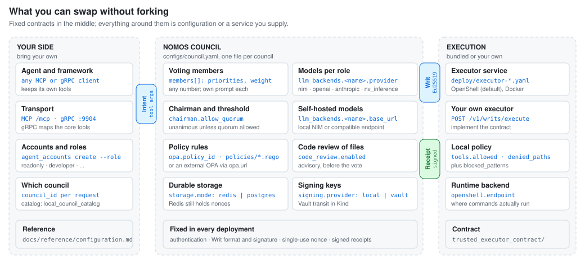
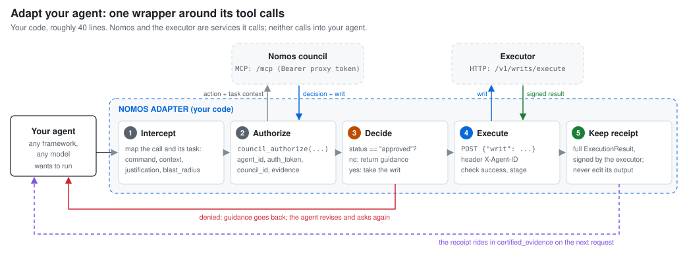

<!--
SPDX-FileCopyrightText: Copyright (c) 2026 NVIDIA CORPORATION & AFFILIATES. All rights reserved.
SPDX-License-Identifier: Apache-2.0
-->

# Nomos

**Oversight for AI agent actions.** Before your agent runs a risky command,
Nomos checks it: deterministic policy first, then a council of LLM reviewers.
Only an approved action receives a signed, single-use **Writ of Execution**. The
executor that holds your tools' credentials runs exactly what the Writ says and
signs a receipt of what happened.

Keep your agent, its framework and its model. Nomos sits between the agent and
the tools it should not use unchecked.

**[Get started](docs/getting-started.md)** ·
**[Integrate your agent](docs/integrate-your-agent.md)** ·
**[How it works](docs/architecture.md)** ·
**[All documentation](docs/index.md)**

<picture>
  <source media="(prefers-color-scheme: dark)" srcset="docs/assets/diagrams/request-lifecycle-dark.svg">
  
</picture>

## Why Nomos

Autonomy is what makes agents useful. It is also what lets them delete the wrong
files, crash a server, leak credentials or push a destructive change to
production. Nomos lets agents keep their autonomy while the dangerous actions are
caught before they execute.

- **It stops bad actions before they run.** OPA rules cover what you can write
  down: blocked paths, required justification, absolute executable paths. The
  council covers what you can't: a command that doesn't match its stated purpose,
  an understated blast radius, adversarial framing.
- **It runs exactly what was approved.** The Writ signs the command, working
  directory, packaged files and target agent. The executor verifies it, enforces
  its own local policy as a second layer, and accepts each Writ once.
- **It leaves evidence.** Executor results are signed, rejections included. An agent can attach
  those receipts to later requests, so reviewers judge the observed output rather
  than the agent's account of it. Decisions are recorded in a hash-linked ledger.

Typical uses: routing IDE agents' shell commands (Cursor, Windsurf, Copilot)
through review, gating CI/CD deployments, migrations and infrastructure changes,
letting autonomous agents request privileged operations with proof of
authorization, and testing how LLM reviewers handle jailbreaks and obfuscated
commands.

Nomos protects the actions routed through it. Your integration decides which
actions go through the adapter, and your deployment decides what the executor
can reach.

## How a request flows

1. **Decide (steps 1–7).** The agent calls `council_authorize` with the exact
   command and why it needs it. Nomos checks identity, any attached receipts,
   permissions and OPA policy; the chairman assesses risk and sets the approval
   threshold; the voting members decide. A denial comes back with guidance the
   agent can act on.
2. **Hand off.** On approval the response carries the signed Writ. Nomos never
   runs anything itself: the agent takes the Writ to an executor.
3. **Execute (steps 8–12).** The executor checks the signature, expiry and target
   agent, claims the Writ's nonce, applies its local rules, runs the command and
   signs the result.

The [architecture guide](docs/architecture.md#how-a-request-flows) walks through
each step and what a failure returns.

## What you can swap

Nomos is a set of contracts with replaceable parts around them. Each part below
changes through configuration or a service you supply, not a fork.

<picture>
  <source media="(prefers-color-scheme: dark)" srcset="docs/assets/diagrams/modularity-dark.svg">
  
</picture>

| Part | Shipped default | Change it with |
|---|---|---|
| Your agent | Any MCP or gRPC client | [Integrate your own agent](docs/integrate-your-agent.md) |
| Voting members | Command integrity, environment isolation, blast containment | `members[]` in `configs/council.yaml`: add, remove, reprioritize, reweight |
| Models | One NVIDIA API Catalog model for every role | `llm_backends` per role (`nim`, `openai`, `anthropic`, `nv_inference`); [self-hosted models](docs/self-hosted-models.md) |
| Chairman and threshold | Chairman on, unanimous approval | `chairman.enabled`, `chairman.allow_quorum` |
| Policy | OPA `strict-shell` profile, fails closed | `opa.policy_id`, `policies/*.rego`, or an external OPA at `opa.url` |
| Councils | One council, `council-prod` | `configs/local_council_catalog.yaml` and `council_id` per request |
| Executor | OpenShell adapter on port `9907` | `deploy/executor-*.yaml` profiles, or [your own service](docs/integrate-your-agent.md#other-integration-shapes) |
| Storage and signing | Compose: Redis and local keys. Kind: PostgreSQL and Vault transit | `storage.mode`, `signing.provider` |

Details: [configuration reference](docs/reference/configuration.md).

## Integrate your own agent

Wrap your agent's tool dispatcher in a small adapter. Nothing in your agent's
framework has to change.

<picture>
  <source media="(prefers-color-scheme: dark)" srcset="docs/assets/diagrams/agent-adapter-dark.svg">
  
</picture>

The core of the adapter, given an open MCP session to the council:

```python
async def run_through_nomos(session, action):
    reply = await session.call_tool("council_authorize", arguments={
        **action, "agent_id": AGENT_ID, "auth_token": AUTH_TOKEN, "council_id": "council-prod",
    })
    decision = json.loads(reply.content[0].text)
    if decision["status"] != "approved":
        return decision  # guidance goes back to the agent; a revision is a new request
    async with httpx.AsyncClient(timeout=240) as http:
        result = await http.post(f"{EXECUTOR_URL}/v1/writs/execute",
                                 headers={"X-Agent-ID": AGENT_ID},
                                 json={"writ": decision["writ"]})
    return result.json()  # check success and verification_stage; keep it as a receipt

# action = {"command": "/usr/bin/echo hello", "working_directory": "/workspace",
#           "description": "...", "target_resource": "/workspace",
#           "justification": "...", "blast_radius": "Prints a string; changes nothing"}
```

The [integration guide](docs/integrate-your-agent.md) has the complete adapter,
the values to get from your operator, denial handling, IDE agents, application
tools and custom executors.

## Try it locally

Linux with Docker, plus Kind, kubectl and Helm for the default target, and an
[NVIDIA API key](https://build.nvidia.com/):

```bash
git clone https://github.com/NVIDIA/Nomos.git && cd Nomos

NVIDIA_API_KEY=nvapi-... ./scripts/deploy_stack.sh                        # Kind (default)
NVIDIA_API_KEY=nvapi-... DEPLOY_TARGET=compose ./scripts/deploy_stack.sh   # or Docker Compose

curl -s http://127.0.0.1:9901/healthz    # monitor and council
curl -s http://127.0.0.1:9907/v1/health  # executor
```

The script generates local secrets, creates the first agent account and prints
the service URLs. [Getting started](docs/getting-started.md) continues from here
to a first approved request. The hosted API Catalog models are for evaluation;
for steady latency, run a [self-hosted model](docs/self-hosted-models.md).

## Documentation

| Step | Read | When |
|---|---|---|
| 1 | [Architecture](docs/architecture.md) | You want the request path, the Writ and the components |
| 2 | [Getting started](docs/getting-started.md) | You want a running stack and a first request |
| 3 | [Integrate your own agent](docs/integrate-your-agent.md) | You have an agent to put behind Nomos |
| 4 | [Configuration](docs/reference/configuration.md) · [Self-hosted models](docs/self-hosted-models.md) | You want to change members, models, policy or executors |
| 5 | [Deployment setup](docs/deployment-setup.md) · [Validation](docs/council-mcp-validation.md) | You operate a deployment |
| — | [MCP tools and executor API](docs/reference/mcp-api.md) · [Development](docs/development.md) | Reference and repository internals |

The [documentation index](docs/index.md) lists everything, including the
browser-based interactive explainers.

## Contributing, security and license

This project is not currently accepting contributions; see
[MAINTAINERS.md](MAINTAINERS.md) for the maintenance and release process. Report
vulnerabilities as described in [SECURITY.md](SECURITY.md).

Apache License 2.0; see [LICENSE](LICENSE). This project downloads and installs
additional third-party open source software. Review their license terms before
use; see [LICENSE-THIRD-PARTY](LICENSE-THIRD-PARTY).

Nomos is built for integration with NVIDIA NeMo Agent Toolkit and speaks MCP for
broad agent compatibility. Its kernel follows John Lakos's levelized design.
