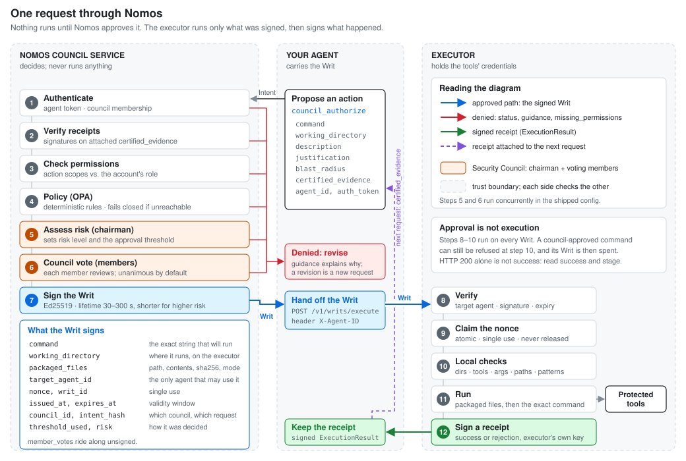

<!--
SPDX-FileCopyrightText: Copyright (c) 2026 NVIDIA CORPORATION & AFFILIATES. All rights reserved.
SPDX-License-Identifier: Apache-2.0
-->

# Architecture

How Nomos decides whether an agent's action may run, how the decision is
carried to the place where the action runs, and what each component is
responsible for. For a hands-on run, see [Getting started](getting-started.md).

## The Problem

As "build an agent" becomes cheap and near-instant, the differentiator stops being task competence and becomes **enterprise-grade control**: who is allowed to act, under what constraints, with what proof.

Without a governing layer, multi-agent systems trend toward:
- **Opaque decisions** — No audit trail of what happened or why
- **Overbroad privileges** — Agents with god-mode access
- **Overeager actions** — An agent does more than its task needs, and nothing compares the action with the task
- **Irreproducible incidents** — "It just broke" with no way to replay
- **"Trust me bro" postmortems** — No cryptographic proof of actions

---

## How a request flows

<picture>
  <source media="(prefers-color-scheme: dark)" srcset="assets/diagrams/request-lifecycle-dark.svg">
  
</picture>

Nomos never runs anything itself. It returns a decision, and on approval a
signed **Writ of Execution**. The agent carries that Writ to an **executor**,
which holds the credentials for the protected tools and refuses anything without
a valid Writ.

| Step | Where | What happens | A failure means |
|---|---|---|---|
| 1 | Nomos | **Authenticate.** The agent token is checked and the agent must be a member of the requested council. | `status: "error"` |
| 2 | Nomos | **Verify receipts.** Each signed `ExecutionResult` attached in `certified_evidence` must verify against a registered, enabled executor key and match the agent and council. | `status: "error"`, before any review |
| 3 | Nomos | **Check permissions.** The action is mapped to permission scopes (`shell:read`, `file:write`, ...) and compared with the account's role. | `denied`, with `missing_permissions` |
| 4 | Nomos | **Policy.** Deterministic OPA rules reject actions outside the admissible set. The shipped config fails closed if OPA is unreachable. | `denied`, with the rule's reason |
| 5 | Nomos | **Assess risk.** The chairman assigns a risk level and sets the approval threshold. | `denied` |
| 6 | Nomos | **Council vote.** Each voting member reviews the request against its own criteria; packaged files also get an advisory code review. Unanimity is the default. | `denied`, with each member's `guidance` |
| 7 | Nomos | **Sign the Writ.** The issuer signs the exact command, working directory, packaged files, target agent, nonce and expiry. Higher risk means a shorter lifetime. | — |
| 8 | Executor | **Verify.** The caller must be the Writ's target agent; the signature and validity window must check out. | Rejected, with `verification_stage` |
| 9 | Executor | **Claim the nonce.** An atomic set-if-absent write makes each Writ single-use. A claimed nonce is never released. | Rejected as a replay |
| 10 | Executor | **Local checks.** Allowed directories and tools, denied arguments and paths, blocked patterns. | Rejected; the Writ is spent |
| 11 | Executor | **Run.** Packaged files are written and the exact signed command runs. | Non-zero `exit_code` |
| 12 | Executor | **Sign a receipt.** Success or rejection, the result is signed with the executor's own key. | — |

Steps 5 and 6 run concurrently in the shipped config
(`parallel_member_evaluation: true`); the votes only count against the
chairman's threshold, so the risk assessment still decides what the vote must
reach. The browser [Workflow walkthrough](interactive/workflow.html) animates
the same path.

### Components

| Component | Role | Notes |
|---|---|---|
| **Monitor** | Public `/mcp` reverse proxy (Bearer token), dashboard and metrics | Port `9901` on both local targets |
| **Council** | MCP server: authentication, OPA call, chairman, members, Writ signing | Internal only; reached through the monitor or the Kind gateway |
| **OPA** | Deterministic policy prefilter | `policies/`, profile set in `configs/council.yaml` |
| **Executor** | Verifies Writs, enforces local policy, runs commands, signs receipts | `executor-openshell` by default (`9907`); any service implementing the [executor contract](reference/mcp-api.md#trusted-executor-api) can replace it |
| **Durable store** | Accounts, Writ and intent history, trusted executor keys | Redis on Compose; PostgreSQL in Kind service mode |
| **Redis** | Nonce claims and rate counters | Required in both modes |
| **Signing** | Council and executor keys | Local key files on Compose; Vault transit in Kind service mode |

## Kernel Levelization

The kernel itself follows **Lakos-style levelization** — each level depends only on levels below it:

```
Level 4  SecurityCouncil          — orchestrates the full workflow
Level 3  SandboxExecutor          — runs actions with token enforcement
Level 2  CapabilityService        — mints/validates scoped tokens
         QuorumManager            — multi-party weighted voting
Level 1  LedgerChain              — hash-chained append-only audit log
         PolicyEngine             — explicit policy rules
Level 0  Clock, Crypto, Types     — pure utilities, no external deps
```

---

## Writ of Execution

The **Writ of Execution** is the core authorization primitive. It is a cryptographically signed, nonce-protected, time-bounded token that authorizes exactly one command execution.

### Anatomy

```json
{
  "writ_id":              "019a2b7c-...",
  "intent_hash":          "sha256 of the canonical Intent",
  "command":              "/usr/local/bin/python3 -c 'open(\"/workspace/test.txt\", \"x\").write(\"hello\\\\n\")'",
  "working_directory":    "/workspace",
  "target_agent_id":      "agent-developer",
  "packaged_files":       [{"path": "...", "content_base64": "...", "sha256": "...", "mode": "0600", "description": "..."}],
  "issued_at":            1739226000.0,
  "expires_at":           1739226300.0,
  "max_executions":       1,
  "nonce":                "32 random bytes, hex",
  "council_id":           "council-prod",
  "threshold_used":       "unanimous",
  "chairman_risk_level":  "low",
  "ledger_entry_hash":    "",
  "member_votes":         [{"member_id": "m1", "decision": "approve"}],
  "signature":            "Ed25519 signature over the canonical JSON"
}
```

The signature covers every field except `member_votes` and `signature`
(`WritOfExecution.canonical_bytes`). Vote summaries ride along for display; a
Writ proves the issuer approved, not how each member voted.

### Security Properties

| Property | Mechanism |
|----------|-----------|
| **Authenticity** | Ed25519 signature — only the council's private key can produce a valid writ |
| **Integrity** | Changing any signed field (everything except `member_votes`) invalidates the signature |
| **Non-replayability** | Nonce is atomically claimed in Redis (`SET NX`); second use is rejected |
| **Time-bounding** | `expires_at` enforced by executor; TTL scales with risk (low=300s, critical=30s) |
| **Scope-limiting** | The exact command, `working_directory`, packaged files and `target_agent_id` are signed; the executor runs nothing else |

### Verification Pipeline

The trusted executor contract performs agent binding before handing the writ to
the example enforcer. Together, the adapter and enforcer run these checks before
executing the command. Failure at any step aborts immediately:

1. **Deserialize** — decode base64, parse JSON into `WritOfExecution`
2. **Agent binding** — verify `X-Agent-ID` matches the writ's `target_agent_id`
3. **Signature** — verify Ed25519 signature against council's public key
4. **Temporal** — check `issued_at <= now <= expires_at`
5. **Nonce** — atomically claim nonce in Redis (prevents replay)
6. **Directory** — verify `working_directory` is in the allowed list
7. **Blocked patterns** — reject catastrophic commands (fork bombs, sudo, pipe-to-shell, etc.)
8. **Tool whitelist** — every command segment must use an allowed tool
9. **Denied tool args** — per-tool argument restrictions (e.g., `git push --force`)
10. **Denied paths** — command must not reference forbidden paths (e.g., `/etc/shadow`)
11. **Command** — reject empty commands
12. **Packaged files** — materialize signed attachments only if hashes and paths validate

Steps 1–5 are **contract/cryptographic/nonce** checks. Steps 6–12 are **local policy and materialization** checks (executor-level). A command can be council-approved yet still blocked by local policy — defense in depth.

---

## Kernel Internals

### Permission Scopes

The `categorize_intent` function classifies shell commands and structured tool
operations into 8 permission scopes:

| Scope | Example Commands |
|-------|-----------------|
| `SHELL_READ` | `ls`, `cat`, `ps`, `grep`, `date`, `echo` |
| `SHELL_WRITE` | `mkdir`, `cp`, `mv`, `chmod`, `chown` |
| `FILE_WRITE` | `>`, `>>`, `touch`, `tee` |
| `FILE_DELETE` | `rm`, `rmdir` |
| `INFRA_DEPLOY` | `kubectl apply`, `terraform apply`, `docker run`, `helm install` |
| `INFRA_DESTROY` | `kubectl delete`, `terraform destroy` |
| `FILE_READ` | `cat`, `head`, `tail`, `grep`, `find` |
| `TOOL_WRITE` | Structured application tool calls such as Slack, Jira, or Outlook writes |

### Authentication

Agent accounts are stored in Redis with SHA-256 hashed tokens:

```bash
# Create named accounts. Run from the repository root; the script needs the
# project environment, so prefix with `uv run` if you are not already inside it.
./scripts/agent_accounts.sh create alice-agent --role developer
./scripts/agent_accounts.sh rotate-token alice-agent
./scripts/agent_accounts.sh disable alice-agent

# Optional local demo fixtures, for development machines with Python installed
python3 scripts/seed_accounts.py
```

### Redis Key Schema

All keys are prefixed with `nomos:` to avoid collisions:

| Key Pattern | Type | Purpose |
|-------------|------|---------|
| `nomos:accounts:{agent_id}` | Hash | Token hash, display name, enabled flag |
| `nomos:accounts:{agent_id}:perms` | Set | Permission scope strings |
| `nomos:nonces:{hex}` | String | Writ ID (SET NX + EX for atomic claim + TTL) |
| `nomos:writs:{writ_id}` | Hash | Full writ metadata |
| `nomos:writs:{writ_id}:outcome` | Hash | Execution result (exit code, stdout hash, etc.) |
| `nomos:intents:{intent_id}` | Hash | Intent request + decision + timestamps |
| `nomos:ratelimit:{category}:{identifier}` | String | Rate limiting counters (INCR + EXPIRE over the window) |

---
