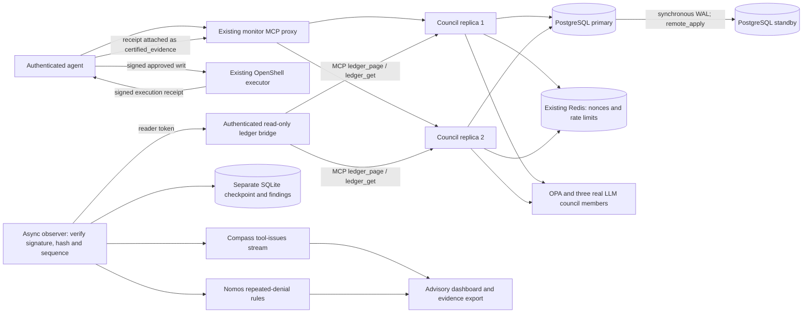

# Live council integration

The October 8 validation connects the assurance observer to the existing
`nomos-relay-it` deployment and `council-relay-test`. This is separate from the
synthetic Kind demonstration. The live assurance dashboard is on
`http://127.0.0.1:9911`; it uses the existing Nomos monitor login. The existing
monitor remains on port 9901 and the existing agent dashboard on port 8765.

## Data path



PostgreSQL stores the canonical signed ledger, accounts, permissions, council
memberships, writs, execution outcomes, intents, trusted executors and workflow
status. Nomos already supplied this implementation: `PostgresLedgerStorage`
serializes appends under the chain-row lock and commits the row and head together.
This integration enables that existing implementation in the previously
Redis/file-configured relay deployment. It does not introduce another ledger.

The primary and standby use separate Docker volumes. The primary acknowledges
successful commits after standby replay (`synchronous_commit=remote_apply`).
Both council replicas write through the primary. This is a single-primary
PostgreSQL deployment with multiple council writers; it is not multi-primary
PostgreSQL or an automatic failover system. All containers run on one local
Docker host, so the demonstration does not tolerate loss of that host.

The observer has no PostgreSQL credentials, agent token, management token, or
signing key. Its bridge exposes only two bounded, authenticated read routes and
calls the real stateless MCP interface. The installed NAT frontend has tool
discovery under `/debug/tools/list`, but no `/debug/tools/call/<tool>` route.
The bridge supplies that narrow HTTP contract for the observer and existing
monitor, using MCP internally. A monitor reader token is optional for older
deployments and mandatory for this configured bridge.

## What Compass sees

Only the pinned Compass `tool-issues` stream runs. The observer retains council
review records as GUARDRAIL spans and projects TOOL spans from
`intent.metadata.certified_evidence` inside the signed review payload. Nomos
checks the original executor receipt, trusted executor registration, agent and
council binding, and result hashes before recording these summaries.

The observer verifies the council ledger signature. The original executor
signature is not embedded in those summaries, so it relies on the council's
verification assertion. Raw agent-written evidence and unsigned ledger metadata
cannot create certified observations. Repeated writ IDs are deduplicated;
conflicting summaries within the analysis window are suppressed. Evidence links
include the ledger sequence/hash and the exact payload path of the receipt.

Receipts lack run and independent-case correlation. Each receipt is therefore
an individual TOOL observation. The observer does not infer retries, separate
cases, or eligible recurring cards from them. Known explicit execution failures
are still actionable advisory evidence. New receipt findings have stable IDs
across the rolling analysis window. Conflict comparison covers the most recent
2,000 ledger entries; older stored findings remain append-only and are not
automatically retracted.

The Nomos repeated-denial detector is separate from Compass. Eval Author runs
when exporting an audit bundle; it validates the handoff format and does not
measure detector accuracy. Findings request human review and do not ban agents,
change permissions, or prove malicious intent.

## Migration and preservation

The legacy runtime was drained, pending approvals were confirmed empty, and
durable Redis state plus raw JSONL rows were exported. Redis nonce/replay state
remains in its original running Redis service. No keys or credentials rotated.

The final snapshot contained 39 signed ledger entries, one account, four
permissions, one council membership, 31 writs, 31 execution outcomes, 35 intents,
one recent-intent queue and one registered executor. The importer checked every
ledger signature/hash/link, account HMAC, identity index, executor fingerprint,
and queue relationship before opening its destination transaction. It refuses
a nonempty target, locks all destination tables, and imports atomically.

Post-import reads through Nomos's PostgreSQL classes exactly matched the source
ledger rows and all durable records. The recent-30 intent ordering was also
preserved. SQL ordering timestamps for imported intents are migration metadata;
the original intent JSON and signed ledger timestamps are unchanged. Queries
above 30 may expose older retained intents, as supported by the PostgreSQL
backend. In-flight in-memory workflows are not migrated; migration requires
them to be drained.

The original JSONL volume, Redis data, signer volumes, private snapshot and
configuration backups are retained. Once new PostgreSQL entries exist, reverting
only the configuration to the old file ledger would discard visibility of those
entries. Do not do that. Recover the canonical PostgreSQL history, or perform a
deliberate reverse migration while all writers are stopped.

## Reproduce and operate

`deploy/assurance/live-compose.yaml` supplies the PostgreSQL primary/standby,
ledger reader and observer. Its environment is held in ignored
`.assurance-live/live.env` with mode 0600. Public trust anchors are in
`.assurance-live/trusted-keys.json`. Keep secret files out of source control.

From this worktree:

```sh
docker compose --env-file .assurance-live/live.env \
  -f deploy/assurance/live-compose.yaml up -d
```

Fresh PostgreSQL volumes bootstrap replication asynchronously. Wait for the
standby to stream, then enable synchronous replication before council writes:

```sh
docker exec nomos-assurance-live-assurance-postgres-1 psql -U nomos -d nomos \
  -c "ALTER SYSTEM SET synchronous_standby_names = 'FIRST 1 (assurance_standby)';"
docker exec nomos-assurance-live-assurance-postgres-1 psql -U nomos -d nomos \
  -c "ALTER SYSTEM SET synchronous_commit = 'remote_apply';"
docker exec nomos-assurance-live-assurance-postgres-1 psql -U nomos -d nomos \
  -c 'SELECT pg_reload_conf();'
```

These settings persist on the existing primary volume. With one required
standby, loss of the standby can block commits. A client timeout is an ambiguous
write outcome: inspect the canonical ledger before retrying an operation.
The replication slot has a 1 GiB WAL retention ceiling; an excessively delayed
standby can require an explicit rebuild from a new base backup.

The existing relay's private `.local/compose.yaml` now selects PostgreSQL and
two council replicas, and points its monitor at the authenticated ledger reader.
Its `.local/secrets.env` holds the added DSN and reader token. Existing provider
credentials and the original relay launch environment remain necessary.
The monitor's small transport patch is copied into `.local/overrides/ledger_api.py`.
Start the companion PostgreSQL services before the council on a fresh start.

Legacy export/import are one-shot maintenance operations, not normal startup:

```sh
python -m scripts.assurance_snapshot_legacy --output /protected/snapshot.json
python -m scripts.assurance_import_legacy --snapshot /protected/snapshot.json \
  --trusted-keys /protected/trusted-keys.json --dry-run
```

Run them in the appropriate council environment with all source writers stopped.
Apply Nomos schema migrations to an empty database before actual import. The
importer reads its DSN and integrity key from environment variables and rejects
repeat imports; never point its target at an existing populated council.

`scripts/assurance_live_council_tests.py --help` describes the repeatable live
test. It makes real council requests and retains the resulting ledger records.
It only executes pinned, verified writs for `/usr/bin/true` and `/usr/bin/false`,
checks the signed executor receipts, and submits the failed receipt for council
review. It never retries an ambiguous mutating call or bypasses a denial.

The earlier Kind fixture deployment remains separate at port 9910 when its
port-forward is running. Use port 9911 for the live council integration.

## Observed validation results

- Sequences 39–41: three actual OPA denials; the observer emitted one
  `repeated_unchanged_denial` finding.
- Sequences 42–43: the live three-member council approved `/usr/bin/true` and
  `/usr/bin/false`. The existing executor ran them and produced verified signed
  receipts with exit codes 0 and 1 respectively.
- Sequence 44: the council verified the failed execution receipt in a new
  review. Compass emitted `explicit_tool_failure` with a pointer to that
  receipt summary. Both findings are real recorded observations from controlled
  tests, not evidence of malicious intent.
- Sequences 45–46: concurrent harmless denied requests reached different
  council replicas and appended to the same canonical chain. SQL writer IDs
  matched the two containers. These SQL IDs are operational diagnostics, not
  signed agent attribution.
- PostgreSQL primary and standby matched at head 46. The observer independently
  verified all 47 records. Restarting the primary and observer retained the
  checkpoint and both finding IDs. An approved workflow written on replica 1
  was readable on replica 2.
- Current Nomos OPA short-circuit denials have ledger audit records but no
  `council_workflows` row: later `check_status` can return `Intent not found` for
  those denied intent IDs. Their signed ledger records remain the evidence.
- Fresh-volume PostgreSQL/standby bootstrap passed in an isolated temporary
  network; those test containers and volumes were removed afterward.
- 143 assurance tests, nine dashboard model tests and the pre-commit checks
  passed. PostgreSQL-specific concurrency/storage/workflow checks also passed
  against a disposable database. Desktop and 390-pixel dashboard checks passed
  without JavaScript errors; audit export returned a valid Eval Author bundle.
- Final full suite: 1,377 passed, 112 skipped, 106 failed; coverage 81.42% exceeds
  the 79% floor. All failures are in the existing deploy-script tests, caused
  by the pre-existing shell syntax error in `scripts/deploy_stack.sh` at line
  1757. That script is byte-identical to the main checkout and was not edited.

PostgreSQL operational references:
[streaming and synchronous replication](https://www.postgresql.org/docs/16/warm-standby.html),
[standby bootstrap with pg_basebackup](https://www.postgresql.org/docs/16/app-pgbasebackup.html).
