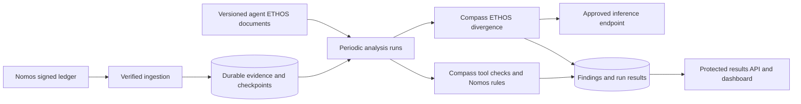

<!-- SPDX-FileCopyrightText: Copyright (c) 2026 NVIDIA CORPORATION & AFFILIATES. All rights reserved. -->
<!-- SPDX-License-Identifier: Apache-2.0 -->

# Nomos asynchronous assurance implementation plan

Build on the asynchronous assurance PoC to periodically review verified Nomos
ledger evidence for tool problems and divergence from an agent's stated purpose.
Publish evidence-backed advisory results through a protected API for human review.

Implement the feature on `feat/async-assurance`, validate it locally, and prepare
one Nomos PR with reviewable milestone commits. ETHOS analysis may use a
configurable, approved LLM endpoint. Compass runs as code in
the assurance service; this design does not require a Compass deployment.
Compose and Helm integration are part of the implementation. Shared deployment
rollout and enforcement are separate follow-up work.

The assurance service is **disabled by default** and requires explicit opt-in
configuration. When disabled, it starts no observer worker, polls no ledger,
performs no analysis, and exposes no assurance API or dashboard. Existing Nomos
authorization behavior remains unchanged.

Enabling assurance requires an explicit enable setting, authenticated ledger
access, trusted signing keys, durable state, and protected API credentials.
ETHOS inference is separately disabled by default and requires its own explicit
enable setting, agent-to-ETHOS mappings, and approved inference configuration.
Enabling assurance alone runs deterministic checks without model calls. Validate
required configuration before starting an enabled service or stream.

## Existing foundation

The PoC already provides signed-ledger ingestion, durable SQLite checkpoints,
deterministic Compass tool analysis, Nomos denial and verification rules, an
authenticated dashboard and API, and Eval Author audit exports. Its polling
interval is configurable; the default is two seconds. Analysis currently
recomputes the latest 2,000 verified entries and exposes the latest 1,000 findings.

Two distinctions shape the extension:

- **Compass detects ETHOS divergence.** The pinned Compass revision already
  includes `EthosDivergenceEvidenceStream`, which takes an ETHOS document and
  uses `nooa.UnifiedLLM` to examine traces. This adds inference dependencies and
  model calls beyond the PoC's deterministic tool checks.
- **Eval Author is separate from Compass.** Its offline authoring tools help
  developers describe purpose, scope, constraints, and success criteria. The
  PoC's existing exported `ETHOS.md` is a generic draft evaluation brief; it is
  not a configured purpose contract for each monitored agent.

The existing ledger projection contains review decisions and selected execution
summaries. It does not establish complete task or conversation histories. This
limits which purpose claims the observer can evaluate.

## ETHOS authoring and lifecycle

Ship a shared Nomos baseline, a role-document template, and one clearly labeled
example. Use the PoC export brief as source material to improve into explicit,
testable requirements, rather than the monitored contract for every agent.
Documents are static, version-controlled, and owner-reviewed. Several agents may
share one document; map existing authenticated agent IDs directly to documents.
This introduces no new authorization role or permission category.

The outside agent's owner authors and reviews its purpose contract, optionally
using Eval Author offline. The deployment operator mounts approved files
read-only and configures the identity mapping when enabling ETHOS checks.
Unknown agents report not-configured; tool checks continue. Never assign an
example to production agents automatically. Start with standalone documents;
common baseline expectations can be copied into a reviewed role contract without
runtime inheritance or automatic rule merging.

Activate changes through explicit configuration rollout. Hold an immutable
snapshot per run, retain historical versions, and evaluate each event against
its applicable version. The service neither writes ETHOS documents nor learns
new obligations from observed behavior. Review findings to inform later human
edits. Audit export includes the actual configured documents and their hashes
from stored run snapshots, replacing the PoC's hardcoded generic brief.

## Eval Author dependency boundary

Developers may install Eval Author's ETHOS authoring skills in their coding
assistant environment to create and maintain `ethos.md` and prepare evaluation
cases. Authoring and document validation happen offline from the deployed
monitor. Supply the reviewed, versioned document to the service as configuration;
Compass consumes it directly. The periodic monitoring loop does not invoke
Eval Author or require its authoring skills.

The PoC also uses Eval Author for a separate export feature: its build script
fetches a pinned source checkout, and the Dockerfile copies the audit tooling
into `/opt/eval-author`. The export handler invokes that validator when an audit
bundle is requested. This is audit-format validation, not ETHOS authoring or
behavior analysis.

Retain that tooling as a dependency of the audit-export feature only. Keep its
installation and imports separate from monitoring requirements, so the service
can ingest evidence and run tool and ETHOS checks without Eval Author installed.
If export is retained in a deployment, include the pinned validator; otherwise
disable export explicitly without affecting monitoring. Never install the ETHOS
authoring skills as a requirement of the deployed service.

## Proposed data flow

Retain one observer process and SQLite for the local pilot. Separate stream
execution logically so an ETHOS timeout cannot prevent tool checks from
publishing results. Keep assurance outside the council's authorization path.

## Compass integration boundary

Repository review on October 16, 2026 used Compass commit
`518ad41d583e259205fb89623cb035ae3904f3f8`. Keep this review snapshot distinct
from the PoC dependency pin. Compass is a research preview with changing APIs;
choose and record the supported revision before implementation and cover that
revision with integration contract tests.

Call the selected Python analysis components directly. The full Compass CLI
requires inference credentials even for a tool-only selection, enables all five
signals by default, and can invoke additional model-based insight compilation.
Those defaults do not meet the service's deterministic-only mode. Explicitly
allowlist tool issues and optional ETHOS divergence. Sentiment, grader-failure,
and anomaly signals remain outside the initial scope, with no embedding models,
external trace platforms, or codebase mounts required.

Distinguish individual tool findings, recurrence cards, ETHOS candidate problems,
and compiled insights. The initial integration retains tool findings and exposes
ETHOS candidates for human review; it does not run Compass's full insight
compiler or code-based validation/confidence review. The compiler requires at
least two supporting traces per insight and adds model calls; tool cards default
to three independent logical cases. Neither threshold should hide a supported
individual observation. Do not present candidates as compiled insights or invent
Compass severity/confidence ratings that the selected stages do not produce.

Use Nomos's durable store as the source of run results rather than scraping CLI
YAML output. A successful CLI exit may include skipped signals, and an empty CLI
result can leave an older output file untouched. The adapter must persist an
explicit outcome for every enabled stream, including successful-empty results.

Inference must support the pinned NOOA/LiteLLM path, including tool calling and
structured output. Test the configured gateway/model rather than assuming any
OpenAI-compatible endpoint is sufficient. Set the endpoint and credentials
explicitly instead of accepting unrelated provider environment fallbacks.
Compass does not automatically redact its inputs: ETHOS content and selected
trace content reach the configured model, so minimization belongs in the Nomos
adapter and its documented evidence-handling configuration.

Keep upstream content telemetry disabled. Current Compass can export full-content
traces to LangSmith when dedicated telemetry credentials are present; do not
enable exporters through inherited environment settings. Operational health
metrics must not export prompts, trace payloads, ETHOS text, or credentials.

## Milestone 1 Define the evidence and purpose contracts

Establish the inputs before adding the detector.

- Map authenticated agent identities to operator-managed ETHOS documents. A
  document may serve several agents when they share a role; resolve the mapping
  explicitly rather than deriving it from arbitrary ledger metadata.
- Record the document ID, content hash, version, and effective interval. Review
  historical events against the applicable version. An explicit reanalysis
  against a newer document must be labeled as such.
- Start with one pilot agent and an owner-reviewed purpose document containing
  observable obligations, boundaries, and success criteria. Use Eval Author's
  authoring format and validator offline where compatible with the chosen source
  pin; deploy the resulting document rather than the authoring tools.
- Inventory which signed fields support each obligation: agent and council,
  task/run/call identity, requested action and target, review outcome, execution
  outcome, and ordering. Preserve the distinction between a request, an approval,
  and an observed execution.
- Expand the PoC projection to reuse context already present in signed review
  payloads: intent description, justification, target and environment, supplied
  task context, relevant policy/council review details, and available execution
  outcomes. Preserve source pointers and distinguish agent assertions from
  council judgments and council-validated execution summaries. Council review
  text is not a human conversation or an independent performance grade. Identify
  remaining gaps before proposing new instrumentation.
- Validate projection against the selected canonical `Trace` and `TraceSnapshot`
  contracts. Preserve nested span order, stable trace/span/call IDs, genuine
  result references and counts, recorded errors, and visible user/assistant
  messages when captured. Preserve absent input/output separately from explicit
  null; do not synthesize a result ID or successful outcome to fill missing data.
- Capture the active tool catalog and argument schemas when available. Preserve
  provenance context only when its completeness is established. Report which
  tool rules have enough evidence to run, using the upstream coverage helper or
  a tested adapter equivalent. Finding-type counts alone do not measure coverage
  across Compass's nineteen tool rules. Unknown correlation must not become
  independent cases merely because Compass defaults case IDs to trace IDs.
- Define a versioned extension for missing context. Prefer signed ledger payloads
  for correlation and task context; if conversation evidence lives elsewhere,
  require a digest-bound reference and an authenticated retrieval contract.
  Preserve its origin and trust level rather than treating it as executor proof.
- Prioritize execution correlation for tool checks. Join requests, approvals,
  and execution evidence through recorded intent, writ, token, or call IDs, scoped
  to the applicable council, chain, and agent. Where a link is unavailable, retain
  an explicitly uncorrelated observation instead of joining by timestamp or
  command similarity. A receipt cited in several reviews remains one execution;
  it does not establish retries or independent runs. Keep repeated-denial
  detection as a separate Nomos rule, not a failed tool execution.
- Report incomplete context as limited or insufficient evidence. An out-of-scope
  user request that the agent correctly refuses is a negative control, not a
  violation. Do not infer malicious intent from a finding.
  The ETHOS stream checks document availability but does not enforce Nomos's
  evidence-completeness requirements; apply that eligibility gate in the adapter.

Define ETHOS eligibility per requirement. Requirements about requested targets
or environments can use request evidence when the requirement governs requests.
Requirements about performed actions need execution evidence; requirements about
user instructions, consent, or responses need the relevant conversation context.
Do not require a complete conversation for obligations supported by other
evidence. Evaluate eligible requirements and report insufficient evidence for
the affected requirements only. Record which requirements were evaluated and
which were excluded, tied to the original ETHOS version and requirement IDs.

**Acceptance:** a small evidence matrix maps each pilot obligation to available
fields, missing fields, and positive and negative examples. Every projected
observation has a ledger sequence/hash reference and explicit attribution.
Projection checks cover nested spans, missing versus null values, duplicate and
missing results, partial conversations, and catalogs with missing schemas.
The evidence matrix identifies each requirement's evaluation scope and minimum
inputs, and demonstrates that an unavailable execution outcome or conversation
does not suppress unrelated eligible checks.

## Milestone 2 Make periodic analysis durable

Extend `assurance/monitor.py` and its store rather than adding another scheduler
service for the pilot.

- Separate ledger polling from analysis cadence. Proposed pilot defaults are
  frequent bounded ingestion and an analysis run every five minutes, configurable
  independently. Analyze only changed evidence unless an explicit reanalysis is
  requested.
- Persist each run's input snapshot, verified sequence range and checkpoint,
  agent scope, ETHOS version, detector versions, model configuration, and status.
  Retain per-stream progress and outcomes such as complete, failed, skipped, and
  insufficient evidence.
- Maintain durable pending work and bounded retries per stream. ETHOS failures
  must not silently advance its progress or block successful tool publication.
  Bound the backlog; when capacity is exhausted, pause intake and expose degraded
  health instead of dropping unprocessed evidence.
  Isolate stream exceptions and cancellation explicitly; do not inherit an
  upstream aggregate execution path that fails or cancels the whole run when
  one signal raises. Bound total stream time as well as individual model requests.
- Group related events using recorded run/task IDs scoped to chain and agent.
  Use explicit overlap or retained run state for patterns crossing batch
  boundaries. Mark incomplete or oversized runs and context truncation visibly.
- Cache analysis by evidence digest, ETHOS digest, detector version, and model
  configuration. A restart must resume pending work without creating duplicate
  findings or repeating already completed model requests unnecessarily.
- Preserve finding history and record supersession when reanalysis changes a
  conclusion. Do not promise deterministic model output or deduplicate solely
  by generated prose.

**Acceptance:** restart, duplicate-page, batch-boundary, and inference-outage
scenarios preserve evidence and per-stream progress. No skipped range is reported
as successfully analyzed.

## Milestone 3 Add the Compass ETHOS stream

Add a small stream adapter layer around the existing tool checks, Nomos rules,
and `EthosDivergenceEvidenceStream`.

- First test the existing Compass pin
  `11fefa0a6a2c20fa1eeda56447869b3a4fba88f8`. Add and lock the dependencies needed
  by its ETHOS path, including NOOA and its inference integration. Verify the
  Docker image can import and execute that path. Treat any upstream upgrade as
  an explicit compatibility change; current upstream uses `compass_signals`
  where the PoC uses `evidence_streams`.
  The reviewed current revision also replaces the separate
  `packages/trace-ingest` workspace package with `src/trace_ingest` inside the
  `insight-agent` distribution. If upgrading, update image copy/build paths,
  dependency resolution, class/result mappings, and test imports together.
  Prefer a reproducible wheel built from the selected revision, or document and
  test the pinned source-copy boundary. Preserve applicable licenses and notices.
  Compass requires Python 3.12 or 3.13 at the reviewed revision; keep this runtime
  constraint isolated from Nomos core and verify disabled assurance needs no
  Compass or inference imports.
- Separate optional Eval Author export dependencies from monitoring packaging.
  Monitoring must start and execute both Compass paths without Eval Author
  installed. Include its pinned audit validator only when export is enabled.
- Resolve one immutable ETHOS snapshot per analysis scope. Never combine agents
  governed by different documents into an undifferentiated purpose check.
  Supply the requirement-level eligibility and evidence scope to the ETHOS
  adapter. Validate candidate attribution against the requirements actually
  evaluated; unsupported obligations remain coverage gaps, not violations.
- Configure an approved endpoint, model, credential reference, request timeout,
  concurrency, and token/cost budget. Credentials stay outside findings and run
  manifests. Require explicit opt-in for ETHOS inference independently of the
  service enable setting. Disabling ETHOS inference leaves deterministic checks
  available without requiring inference credentials.
  Verify tool-calling and structured-output support against the approved model.
  Keep embeddings, full insight compilation, code-aware review, and upstream
  content telemetry outside this configuration.
- Send only the evidence required for the scoped obligations, preserving relevant
  task and conversation context. Record redaction and missing context. Treat
  trace text as evidence, not authority to change the review instructions or
  invoke Nomos actions.
- Validate returned trace references against the supplied snapshot and map them
  back to ledger evidence. Publish a purpose-divergence candidate only with a
  supported explanation and a reference to the applicable ETHOS requirement.
  The pinned upstream result supplies prose and trace IDs, so requirement
  attribution needs an explicit adapter contract and validation.
- Keep individual observations distinct from recurring patterns. Count actual
  independent runs when established by recorded IDs; repeated references to the
  same receipt are not independent occurrences.

**Acceptance:** controlled evidence produces a reviewable ETHOS candidate for a
purpose violation even when its tool call succeeds; a compliant case stays clear.
Missing documents, bad citations, model failures, and unavailable context have
explicit outcomes. Tool checks continue to work with ETHOS disabled or failed.
Verify both streams without Eval Author installed and verify export validation
separately in a deployment that enables the export feature.
Check the exact registered signals, import paths, canonical-model round trip,
and result/artifact mappings at the selected pin. Verify no model or telemetry
traffic in deterministic-only mode, and no unrelated signal execution when ETHOS
is enabled. Exercise incompatible model responses and stream timeout isolation.

## Milestone 4 Publish protected results

Extend the existing API and dashboard without requiring a push receiver.
"Publish" means persist a result and make it available to authenticated readers.

| Endpoint | Proposed behavior |
| --- | --- |
| `GET /api/status` | Ingestion health, evidence checkpoint, backlog, and independent stream progress and freshness |
| `GET /api/runs` | Paginated run summaries with agent, time, stream, and status filters |
| `GET /api/runs/{id}` | Input range, versions, coverage limits, stream outcomes, and finding references |
| `GET /api/findings` | Paginated findings filtered by agent, stream, run, time, and review disposition |
| `GET /api/findings/{id}` | Explanation, applicable requirement, evidence references, and finding history |

Use a versioned result schema. Each finding identifies its stream, detector,
agent, analysis run, evidence range, supporting references, and advisory status.
ETHOS findings also identify the document/hash, requirement, and inference
configuration. Keep integrity incidents separate from behavioral findings.

Make each stream's successful result publication atomic. A complete API response
must distinguish an empty successful analysis from a skipped or failed stream.
Introduce pagination while retaining compatibility for the existing dashboard.

Keep authentication mandatory for results. For the loopback-only pilot, existing
Basic authentication can protect browser access; add a separate read credential
for API clients. A later shared deployment needs TLS and the chosen Nomos identity
and authorization integration. Never expose sensitive context or raw secrets
through ordinary findings responses.

**Acceptance:** unauthenticated reads fail; authenticated clients can enumerate
results beyond the old 1,000-item cap and distinguish fresh, stale, partial,
failed, and successful-empty results. The dashboard shows stream and coverage
status alongside each finding.
Show individual observations separately from recurrence-qualified groups and
ETHOS candidates. Expose rule eligibility and missing inputs alongside counts;
unsupported checks must not appear as checks that passed. Generate evidence
links from trusted ledger references, never from model-provided URLs.

## Milestone 5 Integrate Compose and Helm deployments

Make assurance available through the standard deployment configuration. After
supplying settings and credentials, operators should be able to enable it without
editing deployment templates.

### Compose

- Add an opt-in `assurance` profile to the supported Compose deployment entry
  points, starting the observer and its authenticated ledger bridge. Ordinary
  startup must not start these services or require assurance-specific secrets.
- Provide configuration for the image, council/source identity, polling and
  analysis intervals, trusted public keys, persistent observer state, and API
  credentials. Mount ETHOS documents read-only and provide a separate explicit
  ETHOS enable setting with inference configuration.
- Reuse the deployment's council network and existing ledger backend. Keep the
  bridge internal and bind the local dashboard/API to loopback by default.
  Assurance must not require the PoC's companion PostgreSQL replication stack.
- Document the Compose file combination, profile invocation, image build, and
  credential/document mounts for deterministic-only and ETHOS-enabled operation.
  Validate required opt-in settings when the services are enabled, without
  breaking ordinary Compose configuration when they are disabled.

### Helm

- Add `assurance.enabled: false` to the main Nomos chart and gate all
  assurance-specific workloads and resources on that value.
- Add `assurance.ethos.enabled: false` independently of service enablement.
  Expose image settings, council/source configuration, intervals, resources,
  persistence, trusted keys, and ETHOS document mappings through chart values.
- Support existing Secret references for ledger/API credentials and inference
  credentials, and ConfigMap or appropriate volume references for trust anchors
  and ETHOS documents. Do not embed credentials in checked-in example values.
- Template the observer, ledger bridge, internal Services, and required storage
  and configuration. Use one observer replica with a strategy that prevents
  simultaneous SQLite writers, and preserve its state across restarts.
- Update NetworkPolicies to allow the ledger and configured inference paths.
  Account for DNS and the deployment's approved inference gateway or egress
  mechanism; a provider URL alone is not a Kubernetes NetworkPolicy rule.
  Keep assurance external exposure disabled by default; document port forwarding
  for local access and authenticated TLS routing when external access is enabled.
- Provide example values for deterministic-only and ETHOS-enabled operation.
  Reject inconsistent enable settings and missing required configuration with
  actionable validation errors.

**Acceptance:** default Compose startup and default Helm rendering create no
assurance workloads or endpoints and require no assurance credentials. Verify
both deterministic-only and ETHOS-enabled configurations using Compose config
validation, Helm lint/template checks, and local startup smoke tests. Test
authentication, connectivity, persistence across restart, and missing-config
errors in each deployment path. A documented profile or values change is
sufficient to enable the service once its inputs are supplied.

## Milestone 6 Evaluate the local pilot

Create a labeled replay set before tuning the checks. Include tool failures,
bounded recovery, repeated denials, purpose violations with successful tools,
legitimate exceptions, corrected requests, unrelated interleaved agents, copied
history, missing context, and ETHOS version changes.

Include these Nomos-specific cases with explicit expected results:

| Case | Expected result |
| --- | --- |
| A denied request is corrected and subsequently approved | No repeated-unchanged-denial finding for the correction; approval alone is not execution evidence |
| A tool fails and the agent recovers within its documented retry limit | Preserve supported failure observations without claiming an unproductive retry pattern or ETHOS violation solely because a failure occurred |
| Several reviews reference the same certified execution receipt | One execution observation; no inferred retry or independent-case recurrence |
| A tool executes successfully under valid Nomos authorization but violates the agent's ETHOS | A supported ETHOS candidate even though the tool outcome is successful |
| Request evidence supports one ETHOS requirement while another requires an unavailable outcome or conversation | Evaluate the supported requirement and report insufficient evidence only for the unsupported requirement |

Exercise both a genuine repeated-denial pattern in the Nomos rules and a genuine
failed-call retry pattern in Compass, keeping their evidence and counts distinct.

Use deterministic adapters or recorded responses to verify orchestration and
contracts. Run a separate opt-in evaluation against the approved real model to
measure the quality of purpose findings. Have a human adjudicate expected labels
and disagreements. Record precision, recall, abstentions, evidence-reference
validity, duplicate rate, latency, and inference usage separately for each stream;
agree pilot quality and cost targets before tuning on the evaluation set.

Exercise a real local council-to-observer path, including controlled requests
that span several ledger events, and retrieve its results through the protected
API. Keep synthetic and real evidence visibly labeled. Retain the existing
signature, corruption, restart, authentication, and export checks.

**Acceptance:** one documented local command sequence builds and starts the
service, loads the pilot ETHOS configuration, runs scenarios, and retrieves
results. The evaluation report records measured outcomes and unresolved coverage
gaps. Eval Author schema validation remains distinct from measured quality.

Verify the enablement combinations: default configuration starts no assurance
service or endpoints; assurance enabled with ETHOS disabled runs deterministic
checks without model calls; explicitly enabling both runs both analysis paths.
Missing required opt-in configuration produces an actionable startup error.
Document both enable settings and their required configuration.

## Delivery order and scope

Deliver the evidence contracts first, then durable runs, ETHOS integration,
protected result publication, Compose and Helm integration, and the measured
pilot. Suitable review units are
one local commit series per milestone, with tests appropriate to its behavior.
Keep all work local until pushing is requested.

The pilot does not add automatic bans, permission changes, multiple observer
replicas, a new ledger, or database migration/replication work. Reuse the existing
ledger backend and integrate assurance into standard Compose and Helm deployment
configuration. Cross-chain analysis, production retention,
multi-instance coordination, and shared-service identity integration can follow
after the pilot establishes useful evidence and acceptable finding quality.

Before implementation, settle the pilot agent and ETHOS owner, inference
endpoint/model and evidence handling rules, and whether existing signed records
can support the selected purpose obligations. If richer context is needed, the
minimal instrumentation extension is a dependency of those obligations.

## References

- [Service setup and behavior](README.md), [deployment configuration](DEPLOYMENT.md),
  and [evaluation procedure](EVALUATION.md).
- [Pinned Compass ETHOS stream](https://github.com/NVIDIA-NeMo/nemo-compass/blob/11fefa0a6a2c20fa1eeda56447869b3a4fba88f8/src/insight_agent/evidence_streams/ethos_divergence/ethos_divergence_detector.py).
- [Pinned Compass result contract](https://github.com/NVIDIA-NeMo/nemo-compass/blob/11fefa0a6a2c20fa1eeda56447869b3a4fba88f8/src/insight_agent/evidence_streams/evidence_streams.py).
- [Compass architecture](https://github.com/NVIDIA-NeMo/nemo-compass/blob/main/docs/architecture.md).
- [Reviewed Compass signal configuration](https://github.com/NVIDIA-NeMo/nemo-compass/blob/518ad41d583e259205fb89623cb035ae3904f3f8/docs/compass-signals.md).
- [Reviewed Compass package layout and dependencies](https://github.com/NVIDIA-NeMo/nemo-compass/blob/518ad41d583e259205fb89623cb035ae3904f3f8/pyproject.toml).
- [Reviewed canonical trace contract](https://github.com/NVIDIA-NeMo/nemo-compass/blob/518ad41d583e259205fb89623cb035ae3904f3f8/src/trace_ingest/models.py).
- [Reviewed tool-rule coverage helper](https://github.com/NVIDIA-NeMo/nemo-compass/blob/518ad41d583e259205fb89623cb035ae3904f3f8/src/insight_agent/compass_signals/tool_issues/coverage.py).
- [Reviewed model access and data handling](https://github.com/NVIDIA-NeMo/nemo-compass/blob/518ad41d583e259205fb89623cb035ae3904f3f8/docs/model-access.md).
- [Reviewed result semantics](https://github.com/NVIDIA-NeMo/nemo-compass/blob/518ad41d583e259205fb89623cb035ae3904f3f8/docs/results.md).
- [Reviewed telemetry implementation](https://github.com/NVIDIA-NeMo/nemo-compass/blob/518ad41d583e259205fb89623cb035ae3904f3f8/src/insight_agent/telemetry.py).
- [Eval Author ETHOS authoring tools](https://github.com/NVIDIA-NeMo/eval-author/tree/main/team-skills/ethos).

The pinned references define the initial implementation target. References to
upstream `main` describe current capabilities and must be pinned before adopting
their authoring format or code.
