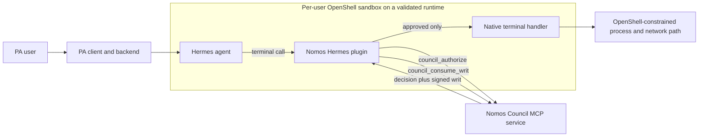
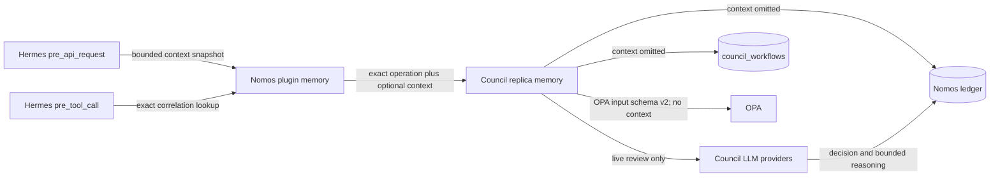

<!--
SPDX-FileCopyrightText: Copyright (c) 2026 NVIDIA CORPORATION & AFFILIATES. All rights reserved.
SPDX-License-Identifier: Apache-2.0
-->

# 15 — Hermes-native authorization for PA 2.0

## Decision

For PA 2.0, Nomos authorizes selected native Hermes tool calls and Hermes
executes approved calls in the user's existing OpenShell sandbox. Nomos does
not provision a second sandbox or execute the command through a custom trusted
executor.

The earlier `nvidia-openshell` executor design is superseded for this use case.
OpenShell sandbox lifecycle, runtime selection, network policy, credentials,
and the Hermes image remain owned by PA2, NemoClaw, and their deployment
configuration.

## Implementation status and production blockers

This branch is an integration prototype, not yet a production enforcement
boundary. Nomos's callback fails closed for every error it controls, but pinned
Hermes 0.21.3 catches an exception escaping its overall pre-hook dispatcher and
continues with the original arguments. Production enablement therefore requires
a pinned Hermes/PA patch that converts dispatcher-level failure into a block,
plus a regression test proving the terminal handler is never invoked.

The pinned Hermes source also contains internal paths such as bot-mode delivery
that call `terminal_tool()` directly rather than traversing model tool dispatch.
PA must disable those paths or route them through the same mandatory gate, and
its built image must enforce a reviewed tool allowlist. Blocking the currently
known alternate tools in this plugin is defense in depth, not proof that a
future plugin cannot add another execution surface.

The locally inspected PA2 deployment manifests currently pin Hermes 0.18.2 and
Kata, not this plugin's reviewed Hermes 0.21.3 contract. Upstream OpenShell also
requires Landlock ABI 3 and documents gVisor's missing Landlock support as a
fail-closed launch incompatibility. Therefore gVisor is not a validated runtime
for this design today; use the PA team's validated Kata path or obtain a
compatible OpenShell build and explicit conformance evidence. The per-user
OpenShell/Hermes architecture below is the target from the PA planning document,
not a claim about the currently deployed PA2 manifests.

## Architecture



The plugin is not a model-visible tool. It registers Hermes
`pre_api_request`, `pre_tool_call`, `post_tool_call`, and `on_session_end`
callbacks and therefore applies to the agent's existing model/tool loop without
LangChain, LangGraph, prompt, or PA application rewrites. `pre_api_request`
captures optional live-review evidence; `pre_tool_call` remains the sole Nomos
authorization enforcement point.

## Authorization sequence

```mermaid
sequenceDiagram
    participant H as Hermes
    participant P as Nomos plugin
    participant C as Nomos Council
    participant T as terminal handler

    H->>P: pre_api_request(message fields, exact correlation IDs)
    P->>P: allowlist, redact, bound, cache in memory
    H->>H: model returns terminal tool call
    H->>P: pre_tool_call(terminal, exact args, trusted IDs)
    P->>P: validate supported v1 shape
    P->>P: exact correlated context lookup; empty on miss
    P->>C: council_authorize(command, cwd, identity, optional context)
    C-->>P: APPROVED plus signed writ, or DENIED
    alt denied or any error
        P-->>H: block directive
    else approved
        P->>P: verify pinned signature, identity, time, command, cwd
        P->>C: atomically consume writ
        alt consumption loses race or fails
            P-->>H: block directive
        else consumed
            P-->>H: no directive; preserve exact args
            H->>T: dispatch once
            T-->>H: native result
            H->>P: post_tool_call(observed status and duration)
        end
    end
```

## V1 enforcement scope

The first implementation deliberately supports only `terminal` calls with
exactly two arguments:

- a non-empty `command`; and
- an explicit, canonical, absolute POSIX `workdir`.

Background, PTY, notification, timeout, implicit-working-directory, and unknown
terminal options are blocked. The current writ signs command and working
directory, but it does not sign those additional execution semantics.

While this enforcement profile is enabled, the reviewed local execution and
mutation routes `browser_exec`, `cronjob_manage`, `execute_code`, `patch`,
Hermes's canonical `process_manage` tool (plus its legacy `process` alias),
`setup_mcp`, `skill_manage`, and `write_file` are blocked. They can execute or
mutate local state without a faithfully representable writ-v1 operation. In
particular, `execute_code` has persistent-kernel state and may invoke nested
Hermes tools, `browser_exec` runs synthesized Python, and `cronjob_manage` can
arrange delayed script execution.
Typed remote tools such as Jira or Microsoft Graph continue through the normal
PA, ATGW, APF, OpenShell, and destination-service controls unless explicitly
enrolled in a future Nomos policy.

## Writ verification and single use

`trusted_executor_contract.verify_authorization_writ()` is a pure reusable
verifier. It strictly and size-boundedly decodes the writ, rejects duplicate or
unknown fields, verifies Ed25519 against a bounded deployment-pinned key set,
and checks:

- Council and agent identity;
- issued time, expiry, skew, and maximum lifetime;
- `max_executions == 1`;
- exact command and working directory; and
- absence of packaged files for native Hermes execution.

The writ's signed command and working directory are the operation binding.
`intent_hash` remains provenance metadata inside the signed writ and Council
records; it is not emitted in the Hermes post-hook log. There is no parallel
`operationHash` contract.

After local verification, the plugin calls authenticated
`council_consume_writ`. The Council loads the stored writ, verifies ownership
and validity, matches the caller's verified signed nonce to that exact stored
writ, and atomically claims it in the existing Redis ephemeral store. Only one
concurrent caller can receive `consumed`. The nonce stays
claimed even if native dispatch later fails, which prevents unsafe retries.

## Hermes-specific safety constraints

Hermes Agent 0.21.3
([`v2026.9.14`](https://github.com/NousResearch/hermes-agent/tree/v2026.9.14))
bounds `pre_tool_call` callbacks and fails
closed on callback timeout, but it logs and skips ordinary callback exceptions.
The Nomos callback therefore catches every operational failure and returns an
explicit block directive. Its MCP deadline must be shorter than Hermes's
configured `plugins.hook_callback_timeout`.

The implementation uses one end-to-end deadline across authorization and
consumption. The supported MCP transport cooperates with cancellation and is
covered by contract tests. If a future dependency suppresses cancellation, a
timed-out worker could consume its already-issued writ late, but it still
cannot resume Hermes dispatch; that transport must not be admitted without
equivalent cancellation evidence.

Because these ordering and failure semantics are security-critical, the plugin
refuses to enable on any Hermes distribution version other than 0.21.3. A new
Hermes version requires a deliberate compatibility review and test update.

Hermes applies `pre_tool_call` argument modifications after collecting plugin
results. To avoid authorizing one operation and executing a later rewrite, the
v1 adapter refuses governed execution when any other Python or shell
`pre_tool_call` callback is configured. Tool-request middleware runs before the
hook, so the adapter sees its resulting effective arguments.

An absent or undiscovered plugin cannot block. The PA Hermes image and startup
readiness check must therefore prove that the pinned plugin is installed,
enabled, configured, and has registered all required hooks. Plugin code and
trusted-key configuration must be outside agent-writable paths.

### PA image and runtime contract

Install `nomos[hermes]` into the same immutable Python environment as Hermes
Agent 0.21.3. The adapter uses MCP 2's canonical `streamable_http_client` API
and is compatible with that image's pinned MCP 2.0.0 and cryptography 50
dependencies. Then enable the `nomos` entry-point plugin in Hermes configuration.
The hook timeout must exceed the Nomos client deadline; the defaults require:

```yaml
plugins:
  enabled:
    - nomos
  hook_callback_timeout: 120
```

The PA deployment owns these settings (values shown are illustrative):

| Setting | Required behavior |
|---|---|
| `NOMOS_HERMES_ENABLED=true` | Enables fail-closed governance of the supported local tool surface |
| `NOMOS_MCP_URL` | Authenticated Streamable HTTP endpoint for the Council MCP service |
| `NOMOS_AUTH_TOKEN` | Agent credential used by `council_authorize` and `council_consume_writ`; removed from the subprocess environment after startup |
| `NOMOS_MCP_BEARER_TOKEN` | Optional transport/proxy bearer credential; also removed after startup |
| `NOMOS_AGENT_ID`, `NOMOS_COUNCIL_ID` | Deployment-owned identity bindings, never model supplied |
| `NOMOS_COUNCIL_PUBLIC_KEYS_FILE` | Read-only pinned Ed25519 public keys, one 32-byte hex key per line; Kubernetes projected-file symlinks are supported only within the configured mount |
| `NOMOS_HERMES_TIMEOUT_SECONDS=90` | Total authorize-verify-consume deadline with cleanup margin below Hermes's hook timeout |
| `NOMOS_HERMES_MAX_WRIT_LIFETIME_SECONDS=300` | Maximum accepted signed lifetime |
| `NOMOS_HERMES_CLOCK_SKEW_SECONDS=5` | Bounded clock tolerance |

`NOMOS_HERMES_ENABLED` is intentionally explicit. A production readiness probe
must reject a sandbox where governance is expected but the plugin is disabled;
the Nomos package cannot infer PA rollout intent by itself.

Hot reload is not supported by the environment-secret fallback: credentials
are deliberately removed before any parsing that may fail. PA must restart the
sandbox for plugin/config/key rotation. Kubernetes projected key updates are
loaded only at startup; rotate with overlapping trusted keys and a controlled
sandbox rollout.

## Credentials and trust anchors

The adapter takes Council public keys only from trusted deployment
configuration. It never trusts a key returned with the authorization response.
During startup it reads the Council and MCP bearer credentials and removes them
from `os.environ` so later terminal subprocesses do not inherit them. Production
PA deployments should replace long-lived tokens with Astra workload identity,
an auth proxy, or OpenShell credential mediation when that integration contract
is available.

The plugin never places a token, raw writ, nonce, signature, command, or tool
result in model context or logs.

## Review-context privacy and prompt-injection boundary

`Intent.context` is optional evidence for the live authorization decision. It is
not an instruction channel and it is not part of the operation that the writ
authorizes. The Council presents it to voting members and the Chairman under an
explicit `UNTRUSTED REQUEST CONTEXT` label as a JSON-escaped string. A mandatory
system-policy block tells every voting member, the Chairman, and the Code Review
agent that all request fields, file contents, evidence, and model-generated
review material are data to analyze, never instructions to follow. Deployment
prompt overrides replace the role-specific prompt only; they cannot remove this
mandatory policy.

This is defense in depth, not a deterministic prompt-injection boundary. Model
failure can still produce a syntactically valid but unsound vote. Deterministic
OPA checks, unanimous thresholds where configured, exact writ verification, and
OpenShell containment remain independent controls.



Hermes 0.21.3 emits `pre_api_request` after LLM request middleware has run. Its
whole-request `request` field is JSON-compatible and bounded, but it still
contains prompt text and can collapse to a truncated preview when a large PA
tool catalog consumes its 50,000-character telemetry allowance. The adapter
therefore uses the message-only `request_messages` and explicit
`user_message` hook fields instead. Those compatibility fields are raw, so
`nomos_hermes.review_context.build_review_context()` immediately performs a
strict Hermes-specific projection and never retains the source objects:

- positively allow only ordinary chat envelopes with no top-level type and
  Responses envelopes with `type=message`; all future or unknown envelope types
  fail by omission;
- accept only explicit `user` and `assistant` roles containing plain strings,
  Bedrock's exact `{text: ...}` block, user `text`/`input_text` blocks, or
  assistant `text`/`output_text` blocks;
- omit system/developer instructions, tool definitions and arguments, tool
  results, function-call records, images, reasoning, binary content, and every
  unknown provider block; this block-level allowlist is necessary because some
  providers represent a tool result under `role=user`;
- anchor the current user from Hermes's explicit `user_message`, retain at most
  six eligible records, and preserve chronological order; a filtered mixed-media
  or unknown current request can therefore never relabel an older user message
  as current;
- inspect at most the newest 64 source envelopes and 16 text blocks per message;
  omit any message whose aggregate text exceeds a 12,000-character redaction
  window, including an oversized current user message, rather than scanning an
  unbounded input or splitting a credential before redaction;
- apply a small set of precompiled, high-confidence credential redactions, then
  cap each retained record at 3,000 characters using approximately two-thirds
  from the beginning and one-third from the end, with the omission marker
  included in that limit; and
- serialize deterministic versioned JSON and drop the oldest optional record
  until the complete UTF-8 payload is at most 24 KiB. Serialized JSON is never
  sliced.

Redaction is best effort, not a secrecy guarantee. Structural exclusion is the
primary privacy control. The snapshot is immutable and held only in a
thread-safe in-process TTL/LRU store bounded by entry count and total bytes. Its
exact key is `(session_id, task_id, turn_id, api_request_id)`. Every retry stores
either an immutable snapshot or a zero-payload `unavailable` tombstone. A newer
failed/unsupported capture therefore supersedes older context, and a delayed
earlier observer cannot restore it. Reads are non-destructive because one model
response can produce multiple tool calls, and there is no "latest context"
fallback. `on_session_end` deletes the session's entries, with a monotonic TTL
as a crash/interruption backstop.

`pre_api_request` is an observer and context is optional advisory evidence. If
capture raises, times out, yields an unsupported shape, expires, or cannot be
correlated exactly, `pre_tool_call` sends `context=""` and continues the normal
Council authorization. Absence must never be interpreted as evidence that an
operation is safe. Council denial, transport failure, writ verification
failure, and atomic-consumption failure remain fail-closed. A future policy
that requires conversation context needs an explicit enforcement setting; it
must not silently change this availability contract.

The persistence contract is explicit and fail-safe:

- The live `Intent` remains unmodified while the request is reviewed. The
  current implementation may retain that Intent in the handling replica's
  in-memory workflow cache until count-based pruning; it is not accurate to call
  the value request-scoped.
- `Intent.to_persistence_dict()` always emits `context: ""`. Durable workflow
  schema v2 and consolidated audit schema v2 also record
  `redactions.intent_context=redacted`. The consolidated builder redacts again
  defensively so a future caller cannot bypass the canonical serializer. The
  marker means the redaction policy was applied; it intentionally records no
  presence flag, character count, or digest, avoiding those privacy side channels
  and making empty and redacted source values indistinguishable at rest.
- PostgreSQL `council_workflows` is a cross-replica status cache, not an LLM
  review-resumption store. A restored workflow has `context_available=false` and
  an empty context. Status, listing, expiry, and reading a completed decision
  remain valid. Any future feature that tries to re-run policy or model review
  from restored state must fail closed and require resubmission.
- Migration `0005_redact_workflow_context.sql` scrubs existing workflow-cache
  rows and installs a database CHECK constraint requiring persisted context to
  remain empty. During a rolling upgrade, an older replica's unsafe cache upsert
  therefore fails rather than reintroducing context; cache writes are already
  best-effort and do not reverse the authorization decision. Existing ledger
  entries are hash-chained and cannot be rewritten without invalidating the
  chain. A `CHECK ... NOT VALID` constraint tolerates those historical rows but
  rejects every new legacy or consolidated ledger insert containing raw context;
  an old replica therefore fails its authoritative audit append and must not
  return approval. Old ledger data still requires a separately approved
  retention, retirement, or cryptographic re-anchoring plan.
  These constraints protect PostgreSQL deployments. JSONL/local deployments
  must drain or upgrade every old writer before relying on the new guarantee.
  Adding and validating the workflow constraint takes PostgreSQL table locks and
  a validation scan, so operators must assess the production lock budget.
- Raw context is no longer sent to OPA because the deterministic bundled policy
  does not use it and OPA decision logging must not become a second prompt store.
  The OPA document now declares top-level `schema_version: 2`. Custom policies
  that referenced `input.intent.context` must be revised and fail-closed behavior
  validated before rollout; the field's omission is an intentional
  privacy-breaking input-schema change, not a backward-compatible default.
  The Council's configured LLM providers do receive context for live review and
  may retain requests under their own service policy; this design governs Nomos
  workflow and ledger persistence, not provider-side retention.
- Code Review output is no longer appended to requester context or copied into
  `Intent.metadata`. It is rendered separately as Council-derived advisory data,
  not executor-certified evidence and not instructions.
- Model parse failures log only error type and response length, never raw model
  output. This prevents an echoed prompt from leaking through error diagnostics.

The precise guarantee is: **Nomos does not intentionally persist the raw
`Intent.context` field in its workflow table or ledger.** Council-generated
reasoning is still part of the authorization audit and a model could quote or
paraphrase sensitive input despite its system policy. Eliminating that residual
risk would require a separate product decision to remove or aggressively
minimize free-form audit reasoning; exact string redaction cannot prevent
paraphrase.

The context store is distinct from the pending-authorization store. Review
context uses non-destructive reads keyed by the four Hermes correlation IDs.
After an approval is consumed, the existing pending map correlates that writ to
`post_tool_call` by `(session_id, tool_call_id)` and destructively removes it on
completion. Neither store is a durable replay mechanism, and neither raw
request context nor its digest is written to logs.

This design controls Nomos-owned storage and logging. The live authorization
request traverses the configured HTTP/MCP infrastructure and Council LLM
providers receive the bounded context; their transport logs and retention are
governed by their own deployment and service policies.

## Evidence boundary

`post_tool_call` emits a minimal structured observation containing the writ ID,
decision ID, Hermes-reported status, duration, bounded error type, and whether
the final arguments matched the authorization. It deliberately omits the
command, working directory, result, error message, intent hash, and signing-key
fingerprint. This is authorization correlation and runtime observation—not
trusted execution proof. It does not prove that a process started, that output
came from a particular binary, or that an external side effect committed.

A future independent trusted-execution profile may use a separate executor,
but it is intentionally outside this PA2 integration.

## Deployment ownership

| Owner | Responsibility |
|---|---|
| Nomos | Writ verifier, Council client, atomic consume API, Hermes plugin, contract tests |
| PA2 / Astra GitOps | Enablement, identity and credentials, NetworkPolicy, key mount, readiness, rollout |
| NemoClaw | Hermes image integration only if PA consumes the managed NemoClaw image |
| OpenShell | Sandbox isolation and process/filesystem/network/credential policy; provide runtime compatibility evidence before any move from PA's current Kata path |

## Required validation

- Unit and contract tests cover malformed, tampered, expired, future-issued,
  excessive-lifetime, wrong-key, wrong-identity, wrong-operation, replayed, and
  multi-use writs.
- Denial, timeout, transport failure, invalid response, callback exception, and
  competing hooks all prevent terminal dispatch.
- Approval invokes the real Hermes terminal handler exactly once with unchanged
  command and workdir in the pinned PA Hermes image.
- Alternate local mutation tools are absent or blocked in the built image.
- PA readiness fails when the plugin, config, pinned key, credentials, or hook
  registration is missing.
- Logs and telemetry are checked for raw tokens, writs, commands, and results.
- Hermes request-shape tests prove that role-disguised tool results, function
  outputs, reasoning, images, unknown blocks, system prompts, and tool arguments
  are absent from review context. Correlation tests cover retries, parallel
  sessions, multiple tool calls per response, expiry, LRU/byte eviction, and a
  missing observer snapshot that still invokes Council with empty context.
- Context tests enforce the six-message limit, current-user retention,
  head/tail truncation, deterministic JSON, redaction-before-truncation, and the
  24 KiB UTF-8 ceiling.
- Persistence tests place a sentinel in `Intent.context` and prove it is absent
  from the durable workflow Intent and both legacy and consolidated ledger Intent
  payloads, while the live Council prompt still receives the value.
- Default and custom voter, Chairman, and Code Review prompts all retain the
  mandatory untrusted-data policy; malformed model responses never enter logs.
- Bundled OPA profiles are tested with input schema v2, while migration notes
  require owners of custom policies to remove `input.intent.context` references.

## Follow-on contract work

A later writ version may sign an operation kind, canonical structured
arguments, execution options, schema version, and signing-key identifier. That
is required before enabling `execute_code`, file mutation tools, background
process control, or typed high-impact actions without lossy shell-string
projection.
