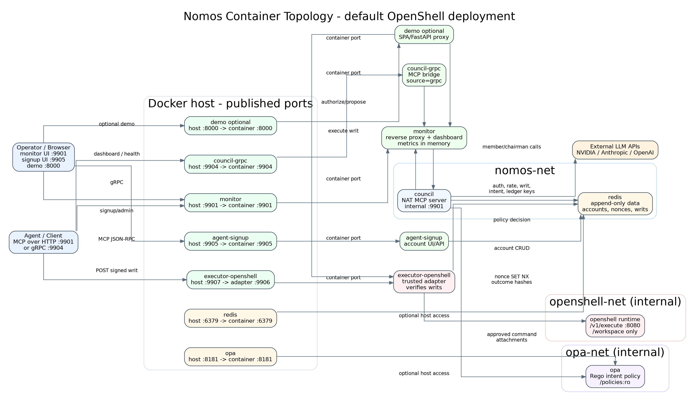
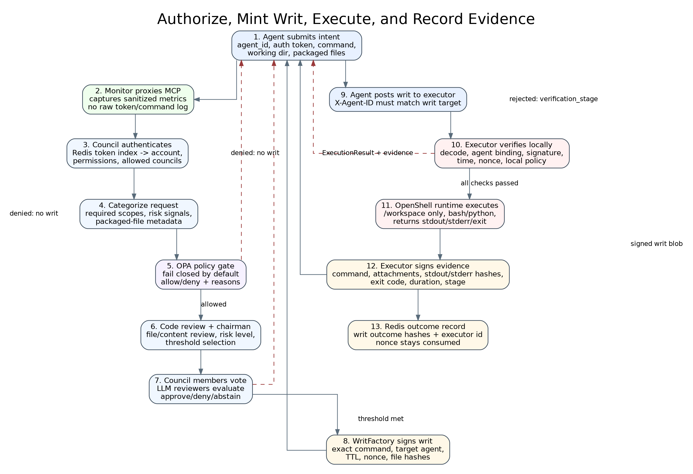
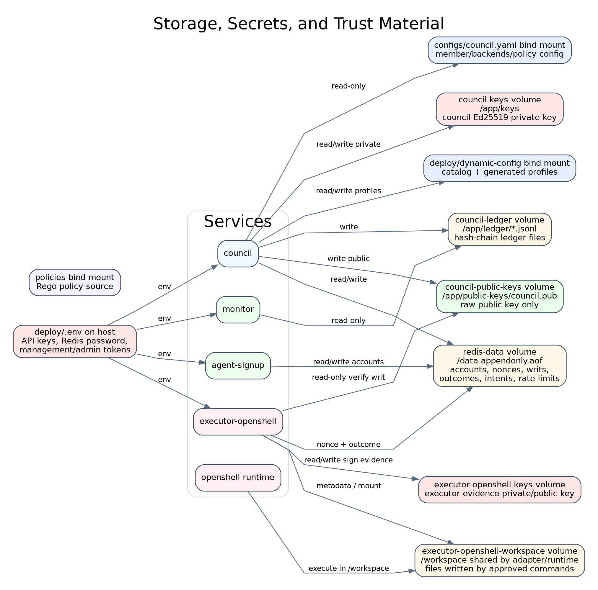
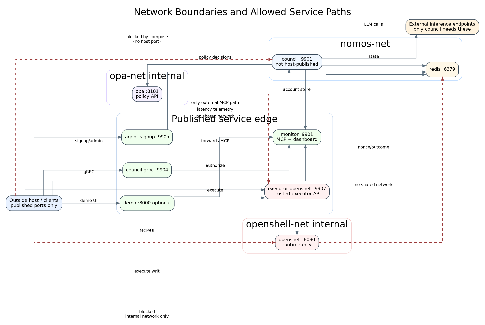

\newpage

# Executive Summary

Nomos is a containerized authorization and execution system. Agents do not run
privileged commands directly. They petition a council service over MCP or gRPC.
The council authenticates the agent, applies deterministic policy, asks LLM
council members to review the intent, and, when approved, returns a signed Writ
of Execution. The agent then presents that writ to a trusted executor. The
executor verifies the writ independently, consumes the nonce, enforces its own
local policy, runs the exact approved command, and returns signed evidence of
the result.

The default local deployment is Docker Compose based. The core always-on
services are Redis, OPA, the council, the monitor proxy, the gRPC proxy, and
agent signup. The Helm deployment keeps that service model but now hardens
bundled Redis: the chart renders Redis as a StatefulSet by default and can
enable a bundled Sentinel topology with three Redis pods, three Sentinel pods,
per-pod PVCs, disruption budgets, restricted NetworkPolicy ingress, and
Sentinel-aware clients in council, signup, and executor paths. Docker Compose
can run the same Redis/Sentinel client behavior through
`deploy/docker-compose.redis-sentinel.yml`, which adds three Redis containers
and three Sentinel containers while preserving the standalone Compose file as a
compatibility path.

The default trusted executor profile is `executor-openshell`, which publishes
the trusted executor API on host port `9907` while keeping its internal adapter
listener on `9906`. The adapter delegates execution to an internal OpenShell
runtime on `openshell-net`; that runtime has no host port and is scoped to the
executor workspace.

This report is based on these source-of-truth files:

| Source | Role |
|---|---|
| `deploy/docker-compose.yml` | Container services, networks, volumes, profiles, and ports |
| `deploy/docker-compose.redis-sentinel.yml` | Optional Compose Redis/Sentinel topology and client wiring |
| `deploy/kubernetes/nomos/templates/redis.yaml` | Bundled Redis StatefulSet, Sentinel, PVC, PDB, and probe manifests |
| `deploy/kubernetes/nomos/templates/networkpolicy.yaml` | Kubernetes network isolation for Redis and Sentinel |
| `nomos_runtime/redis_client.py` | Shared standalone/Sentinel Redis client factory |
| `deploy/executor-openshell.yaml` | Default OpenShell trusted executor policy |
| `nomos/store/SCHEMA.md` | Redis keys and stored state |
| `docs/proposals/06_ha_nonce_store.md` | Redis availability proposal and implementation scope |
| `docs/concepts/architecture.md` | Council and writ workflow overview |
| `docs/guides/deployment.md` | Deployment behavior and operator controls |
| `docs/executors/trusted-executor-contract.md` | Executor HTTP contract and evidence model |
| `monitor/server/proxy.py` and `monitor/server/metrics.py` | Monitor proxy and sanitized metric behavior |
| `executors/openshell/*` | OpenShell adapter and runtime behavior |

\newpage

# Architecture Diagrams

## Container Topology

{width=100%}

> **Discussion: what this shows.** External agents and operators only reach
> published ports. The council itself is internal to Docker and receives MCP
> traffic through the monitor. The OpenShell runtime is even narrower: it is
> reachable only from the trusted executor adapter over `openshell-net`.

\newpage

## Authorization and Execution Sequence

{width=100%}

> **Discussion: what passes between services.** The command and any packaged
> files enter through an MCP tool call. The council returns only a signed writ
> when approval succeeds. Execution is a second, separate call to the trusted
> executor. The executor returns stdout, stderr, exit code, duration, and an
> executor-signed evidence object binding the returned result to the writ and
> exact command.

\newpage

## Storage, Keys, and Trust Material

{width=100%}

> **Discussion: what data is stored where.** Redis is the main operational
> database. Docker volumes hold long-lived cryptographic keys, ledger files, and
> executor workspaces. Bind mounts provide configuration and policy source. The
> council private key is not mounted into executor containers; executors receive
> only the council public key and keep their own evidence-signing keys.

\newpage

## Network Boundaries

{width=100%}

> **Discussion: what is isolated.** `nomos-net` carries normal application
> traffic. `opa-net` is the policy side network shared only by council and OPA.
> `openshell-net` is the execution runtime network shared only by
> `executor-openshell` and `openshell`. The runtime cannot resolve or connect to
> Redis or the council through Compose networking because it is not attached to
> `nomos-net`.

\newpage

# Service Inventory

## Core Services

| Service | Default port | Networks | Persistent data | Talks to | Purpose |
|---|---:|---|---|---|---|
| `redis` | host `6379`, container `6379` | `nomos-net` | `redis-data:/data` | council, signup, executors | Operational state: accounts, nonces, writs, outcomes, intents, rate limits |
| `opa` | host `8181`, container `8181` | `opa-net` | `policies:/policies:ro` | council | Deterministic Rego policy gate before LLM approval |
| `council` | internal `9901` | `nomos-net`, `opa-net` | `council-keys`, `council-public-keys`, `council-ledger`, dynamic config bind mount | Redis, OPA, monitor, LLM APIs | Authenticates agents, evaluates intents, mints signed writs |
| `monitor` | host `9901` | `nomos-net` | reads `council-ledger:ro`; in-memory metrics | council | External MCP proxy, dashboard, metrics, ledger browser |
| `council-grpc` | host `9904` | `nomos-net` | none | monitor | gRPC facade that forwards to MCP through monitor |
| `agent-signup` | host `9905` | `nomos-net` | Redis account records | Redis, monitor URL in generated credentials | Public signup and Basic-auth admin account management |
| `demo` | host `8000`, optional | `nomos-net` | in-memory session/demo state | monitor, executor | Interactive demo UI and proxy |

## Kubernetes Redis Topology

The Helm chart has two bundled Redis modes. Both keep Redis inside the Nomos
release for now; neither unbundles Redis into an external managed service.

| Mode | Kubernetes shape | Client behavior | Operational intent |
|---|---|---|---|
| `sentinel` | three Redis StatefulSet pods with per-pod PVCs, three Sentinel pods, Redis/Sentinel services, Redis and Sentinel PDBs | consumers set `*_REDIS_MODE=sentinel`, discover the current master through `nomos-redis-sentinel:26379`, and connect with bounded timeouts | default bundled topology and pod-level failover without changing key schema or nonce semantics |
| `standalone` | one Redis StatefulSet pod, one PVC, headless service, probes, hardened container context, optional Redis NetworkPolicy | consumers use the normal Redis service on `:6379` | explicit compatibility override for constrained local or smoke-test environments |

In Sentinel mode, the master name is `nomos-master`. Redis pods announce their
stable StatefulSet DNS names, and restarted pods ask Sentinel for the current
master before deciding whether to join as a replica. This avoids assuming that
`redis-0` remains primary after a failover.

NetworkPolicy, when enabled, allows Redis ingress only from council,
executor-openshell, agent-signup, Redis peers, and Sentinel. Sentinel ingress is
allowed from council, executor-openshell, agent-signup, and Sentinel peers.

This is a meaningful hardening step, but it is not full infrastructure HA by
itself. A single-node Kind cluster or a production cluster without anti-affinity
and separate failure domains can still lose all Redis pods together. True
infrastructure HA depends on the Kubernetes cluster, storage class, and
scheduling policy.

## Compose Redis Sentinel Topology

Compose keeps the single Redis service in `deploy/docker-compose.yml` as the
compatibility path. The optional `deploy/docker-compose.redis-sentinel.yml`
override adds:

- `redis`, `redis-1`, and `redis-2` containers with separate named volumes.
- `redis-sentinel-1`, `redis-sentinel-2`, and `redis-sentinel-3`.
- Sentinel client environment variables for council, agent-signup,
  executor-default, and executor-openshell.
- Startup logic that asks Sentinel for the current master before a restarted
  Redis container decides whether to join as a replica.

This mirrors the key client and failover behavior of the Helm Sentinel path. It
does not mirror Kubernetes-only controls such as StatefulSet ownership,
PodDisruptionBudgets, NetworkPolicy, storage class behavior, or node spreading.

## Executor Services

| Service | Profile | Default port | Networks | Persistent data | Purpose |
|---|---|---:|---|---|---|
| `executor-openshell` | `executor-openshell` | host `9907` -> container `9906` | `nomos-net`, `openshell-net` | `executor-openshell-keys`, shared workspace, council public key | Default trusted executor adapter. Verifies writs, consumes nonces, enforces executor policy, signs evidence |
| `openshell` | `executor-openshell` | internal `8080` | `openshell-net` only | shared `executor-openshell-workspace` | Local OpenShell-compatible command runtime scoped to `/workspace` |
| `executor-default` | `executor-default` | host `9902` -> container `9902` | `nomos-net` | own keys and workspace | Legacy restrictive Docker/local-subprocess executor |
| `executor-dev` | `executor-dev` | host `9903`, host network | host network | own keys/workspace plus host repo and kube mounts | Development profile with broader tools and host access |

> **Discussion: default executor posture.** The default is the OpenShell
> executor pair, not the legacy Docker executor. The trusted adapter is the only
> service that accepts the signed writ HTTP contract from outside. The runtime
> has no published host port and does not join the application network.

# Runtime Networks

## `nomos-net`

`nomos-net` is the main Compose application network. Redis, council, monitor,
council-grpc, agent-signup, demo, and trusted executor adapters live here. In
Kubernetes, the equivalent traffic moves through ClusterIP services and can be
restricted with NetworkPolicy. This is where stateful application traffic
moves:

- monitor -> council MCP requests
- council-grpc -> monitor forwarded MCP requests
- demo -> monitor authorization requests
- demo -> executor execution requests
- council -> Redis account/writ/rate/intent state
- executor -> Redis nonce and outcome state
- signup -> Redis account administration

In Helm Sentinel mode, council, executor, and signup first ask Sentinel for the
current Redis master, then issue Redis commands to that master. The data model
does not change.

## `opa-net`

`opa-net` is marked internal in Compose. Council and OPA share it so the council
can call OPA without giving executor containers a network path to the policy
API. The OPA service may still have a host-published port for operational use,
depending on `OPA_BIND_ADDR` and host firewall settings.

## `openshell-net`

`openshell-net` is marked internal and is shared only by `executor-openshell`
and `openshell`. The adapter posts an already-approved command, working
directory, timeout, packaged files, and metadata to `http://openshell:8080/v1/execute`.
The runtime cannot reach Redis, OPA, monitor, or the council through Compose
service names because it is not connected to those networks.

# Primary Request Flows

## Account Creation and Authentication

Agent accounts are created by `scripts/agent_accounts.sh`, `scripts/seed_accounts.py`,
the `agent-signup` UI/API, or the signup admin backend. All paths write Redis
account records. A token is shown once to the operator or agent, while Redis
stores the token hash and reverse token index.

The council authorization flow receives `agent_id` and token material through
MCP tool arguments. It resolves the token hash through Redis, loads account
permissions and allowed councils, checks account integrity when configured, and
fails closed if auth is required but Redis/auth data is unavailable.

> **Data passed:** `agent_id`, auth token, requested council id, command,
> description, justification, working directory, packaged file metadata and
> content where provided.
>
> **Data stored:** Redis account hash, permission set, council membership set,
> token reverse index, optional account integrity signature.

## MCP Authorization Through Monitor

The default external path is:

```text
Agent -> monitor:9901/mcp -> council:9901/mcp
```

The monitor is a streaming reverse proxy. It forwards the original JSON-RPC body
to the council and streams the response back. It records sanitized metrics:
agent id labels, command hash, command executable, counts of packaged files,
evidence items, and environment keys. It deliberately avoids storing raw auth
tokens, raw command text, file contents, environment values, or writ material in
the dashboard metrics.

The council then runs:

1. Auth and permission lookup.
2. Intent categorization into permission scopes.
3. OPA evaluation when enabled.
4. Code review of packaged file contents when attached.
5. Chairman risk/threshold assessment.
6. LLM council member votes.
7. Writ minting and signing if approved.

> **Data passed to OPA:** normalized intent facts, command metadata, agent and
> permission context, required scopes, packaged-file metadata, and policy id.
>
> **Data passed to LLM backends:** prompt context for chairman and member
> review. This can include command, description, justification, risk context,
> and code review material needed for the decision.
>
> **Data stored:** Redis intent record, writ record when approved, ledger entry
> data, monitor in-memory metrics, monitor-readable ledger JSONL files.

## gRPC Path

The gRPC proxy publishes host port `9904` and forwards through the monitor:

```text
Agent -> council-grpc:9904 -> monitor:9901/mcp -> council:9901/mcp
```

This keeps gRPC traffic visible in the same monitor dashboard. The proxy tags
outbound MCP requests with `X-Council-Source: grpc`, so monitor metrics can
separate direct MCP traffic from gRPC traffic.

## Demo Path

The optional demo service publishes port `8000`. It proxies browser actions to
the live system:

```text
Browser -> demo:8000 -> monitor:9901/mcp
Browser -> demo:8000 -> executor-openshell:9906
```

Inside Compose, demo uses `http://monitor:9901/mcp` for authorization and
`http://executor-openshell:9906` for execution. Outside Compose, local tools and
docs use `http://localhost:9907` for the executor because `9907` is the host
port mapped to the adapter's internal `9906`.

## Trusted Execution Path

After approval, the agent receives a signed writ blob and calls:

```text
Agent -> executor-openshell:9907/v1/writs/execute
```

The executor requires `X-Agent-ID` to match the writ target. It then verifies:

1. Writ can be decoded and parsed.
2. Agent binding matches the caller.
3. Council Ed25519 signature verifies against `/app/public-keys/council.pub`.
4. `issued_at <= now <= expires_at`.
5. Nonce can be claimed atomically in Redis with `SET NX EX`.
6. Working directory is allowed.
7. Blocked patterns, tool whitelist, denied arguments, and denied paths pass.
8. Packaged file hashes/materialization rules pass.

Only after those checks does the adapter call OpenShell:

```text
executor-openshell -> openshell:8080/v1/execute
```

The runtime receives the command, working directory, timeout, packaged files,
and metadata. It executes in `/workspace`, returns stdout, stderr, exit code,
duration, and whether the command used a shell. The adapter records outcome
hashes in Redis and signs an evidence payload with its executor-owned key.

> **Data passed to OpenShell:** exact approved command, working directory,
> timeout, packaged files, and metadata containing writ id, intent hash,
> target agent id, and council id.
>
> **Data returned to the agent:** `ExecutionResult` with success, exit code,
> stdout, stderr, duration, verification stage, executed command metadata, and
> signed executor evidence.
>
> **Data stored:** Redis nonce claim, Redis outcome hash record, files written
> under the executor workspace volume, executor evidence key in its key volume.

# Stored Data

## Redis Operational Schema

Redis uses a configurable key prefix, default `nomos:`. Compose runs Redis with
append-only persistence enabled in the `redis-data` Docker volume. Helm
standalone mode uses one Redis StatefulSet pod and one PVC. Helm Sentinel mode
uses three Redis StatefulSet pods with per-pod PVCs and three Sentinel pods for
master discovery and failover.

| Key pattern | Type | Stored value | Producer/consumer |
|---|---|---|---|
| `nomos:accounts:{agent_id}` | Hash | `token_hash`, display name, timestamps, enabled flag, optional role, integrity field | signup/admin/scripts write; council reads |
| `nomos:accounts:{agent_id}:perms` | Set | Permission strings such as `shell:read`, `shell:write`, `file:write` | signup/admin/scripts write; council reads |
| `nomos:accounts:{agent_id}:councils` | Set | Council ids or `*` | signup/admin/scripts write; council reads |
| `nomos:token_index:{token_hash}` | String | `agent_id` | auth lookup |
| `nomos:councils:{council_id}:agents` | Set | Agent ids allowed for council | account management and auth |
| `nomos:nonces:{nonce_hex}` | String with TTL | `writ_id`; claimed by `SET NX EX` | executor writes; council/status can read |
| `nomos:writs:{writ_id}` | JSON/string | Writ metadata and lifecycle state | council writes; status tools read |
| `nomos:writs:{writ_id}:outcome` | Hash | `exit_code`, `stdout_hash`, `stderr_hash`, `executed_at`, `executor_id` | executor writes; status/audit reads |
| `nomos:intents:{intent_id}` | JSON/string | Intent request, decision, timestamps | council writes; status tools read |
| `nomos:ledger:{council_id}:entries` | Sorted set | timestamp -> ledger entry hash | council writes; audit/status reads |
| `nomos:ratelimit:{category}:{identifier}` | String with TTL | window counter | council/auth paths |

Redis contains security-sensitive operational data. It includes auth token
hashes, account metadata, writ metadata, intent records, and outcome hashes.
It should be treated as a privileged service even though tokens are not stored
in plaintext.

Sentinel does not change the operational schema. It only changes how clients
discover the writable Redis primary. If Redis is unavailable, read-only during
failover, or the nonce claim result is ambiguous, Nomos continues to fail
closed instead of authorizing execution on best effort state.

## Docker Volumes

| Volume | Mounted at | Readers/writers | Contents |
|---|---|---|---|
| `redis-data` | Redis `/data` | Redis | Compose and Helm standalone append-only Redis persistence |
| `redis-data-nomos-redis-{0,1,2}` | Redis `/data` | Redis StatefulSet pods | Helm Sentinel per-pod Redis PVCs |
| `council-keys` | council `/app/keys` | council read/write | Council Ed25519 private key material |
| `council-public-keys` | council `/app/public-keys`; executor `/app/public-keys:ro` | council writes, executors read | Raw council public key used to verify writs |
| `council-ledger` | council `/app/ledger`; monitor `/app/ledger:ro` | council writes, monitor reads | Hash-chain ledger JSONL files |
| `executor-openshell-keys` | executor `/app/executor-keys` | executor read/write | Executor evidence-signing key pair |
| `executor-openshell-workspace` | executor/runtime `/workspace` | runtime writes, adapter can mount | Workspace files created/read by approved commands |
| `executor-default-keys` | legacy executor `/app/executor-keys` | legacy executor | Evidence keys for legacy executor |
| `executor-default-workspace` | legacy executor `/workspace` | legacy executor | Legacy execution workspace |
| `executor-dev-keys` | dev executor `/app/executor-keys` | dev executor | Dev evidence keys |
| `executor-dev-workspace` | dev executor `/workspace` | dev executor | Dev workspace |

## Bind Mounts and Host Files

| Path | Mounted into | Contents and risk |
|---|---|---|
| `configs/council.yaml` | council `/app/configs/council.yaml:ro` | Static council defaults, backends, member config |
| `deploy/dynamic-config` | council `/app/dynamic-config` | Dynamic catalog and council profiles; writable by council management tools |
| `policies` | OPA `/policies:ro` | Rego policy source |
| `deploy/executor-openshell.yaml` | executor `/app/config/executor.yaml:ro` | Executor policy and OpenShell endpoint config |
| `deploy/.env` | consumed by Compose and deploy scripts | Redis password, API keys, dashboard/admin credentials, management token |
| `${DEV_REPO_PATH}` | dev executor only | Host project mount for the dev executor profile |
| `${HOME}/.kube` | dev executor only | Host Kubernetes config for the dev profile |

## In-Memory State

Monitor metrics are primarily in-memory rolling-window counters and recent
request summaries. The demo service keeps lightweight session/demo state in the
process. These do not survive container restarts unless separately exported.

# Data Passed Between Services

| Path | Protocol | Main payload | Sensitive fields | Stored by receiver |
|---|---|---|---|---|
| Agent -> monitor | HTTP MCP JSON-RPC | tool name and arguments | auth token, command, file contents, environment values | monitor stores sanitized metrics only |
| monitor -> council | HTTP MCP JSON-RPC | original request body | same as above | council may store intent/writ/ledger data |
| council -> Redis | Redis protocol | account lookup, writ/intent writes, rate counters | token hashes, account metadata, outcome metadata | Redis persists |
| council -> OPA | HTTP JSON | normalized policy input | command metadata, agent/permission context | OPA is stateless by default |
| council -> LLM APIs | HTTPS | reviewer prompts and context | command, justification, code review context | outside Nomos boundary |
| council -> monitor | HTTP JSON | stage/actor latency telemetry | sanitized timing metadata | monitor stores in memory |
| council-grpc -> monitor | HTTP MCP JSON-RPC | translated gRPC request | same as MCP request | monitor metrics source=`grpc` |
| signup -> Redis | Redis protocol | account CRUD | token hash, role, permissions, councils | Redis persists |
| demo -> monitor | HTTP MCP JSON-RPC | demo authorization requests | demo account token and command | monitor/council paths as above |
| demo -> executor | HTTP executor contract | signed writ, request id, `X-Agent-ID` | writ blob | executor verifies; Redis gets nonce/outcome |
| Agent -> executor | HTTP executor contract | signed writ and `X-Agent-ID` | writ blob | executor verifies; Redis gets nonce/outcome |
| executor -> Redis | Redis protocol | nonce claim and outcome hashes | writ id, hashes, executor id | Redis persists |
| executor -> OpenShell | HTTP JSON | command, cwd, timeout, packaged files, metadata | exact approved command and files | runtime writes only workspace files |
| OpenShell -> executor | HTTP JSON | stdout, stderr, exit code, duration | command output may be sensitive | executor returns to caller and stores hashes |
| executor -> Agent | HTTP JSON | `ExecutionResult` and signed evidence | stdout/stderr, evidence payload | caller decides storage |

In Helm Sentinel mode, council, signup, and executor also talk to Sentinel over
Redis Sentinel protocol to discover the current primary. Sentinel stores
topology state, not Nomos account/writ data. Redis remains the operational data
store.

# Trust Boundaries

## Council Boundary

The council owns authorization. It has access to Redis account state, dynamic
council configuration, LLM API keys, OPA, and the council private key. The
council private key signs writs and is stored only in `council-keys`.

Important properties:

- The council is not host-published directly; monitor is the normal external
  MCP entry point.
- It exports the public key into `council-public-keys`.
- It does not execute shell commands for agents.
- It may send decision context to configured external LLM providers.

## Executor Boundary

The executor owns execution. It never receives the council private key. It
trusts only the council public key and its own local policy. A council approval
alone is insufficient; the executor still verifies the writ, consumes the
nonce, checks local restrictions, and rejects on any verification failure.

Important properties:

- Default host entry point is `http://<host>:9907/v1/writs/execute`.
- Internal adapter listener is `9906`.
- The adapter talks to Redis and OpenShell.
- The runtime is isolated from Redis/council networks.
- Evidence is signed by an executor-owned key, not by the council key.

## Policy Boundary

OPA is deterministic policy before LLM review. It is configured fail-closed by
default through council settings. OPA sees normalized intent facts and returns
allow/deny decisions plus reasons. This gives the system a non-LLM gate for
known-bad command patterns, path rules, packaged file metadata, and permission
shape.

## Observability Boundary

Monitor observes traffic shape and decision outcomes without becoming a raw
secret log. Its metrics path uses hashes and counts rather than raw command
text, tokens, file content, or writ blobs. It reads ledger files from
`council-ledger:ro` and keeps dashboard metrics in memory.

# What Happens on Failure

| Failure point | Result |
|---|---|
| Missing/invalid auth token | Council denies; no writ minted |
| Redis unavailable for auth when auth is required | Council fails closed |
| Redis primary pod fails in Helm Sentinel mode | Sentinel promotes a replica; clients rediscover the master; in-flight ambiguous operations fail closed |
| OPA denies or errors with fail-closed enabled | Council denies; no writ minted |
| LLM council denies or quorum is not met | Council returns denial; no writ minted |
| Writ expired before executor receives it | Executor returns `verification_stage=temporal`; no execution |
| Nonce already claimed | Executor returns `verification_stage=nonce`; no execution |
| Executor policy rejects command/path/tool | Executor rejects after consuming nonce; agent must request a new writ |
| OpenShell runtime error or timeout | Executor returns execution/timeout result and signed evidence |

# Deployment and Operations Notes

`scripts/deploy_stack.sh` is the normal one-command deployment path. It creates
or updates `deploy/.env`, starts the core stack, selects `executor-openshell` by
default, removes inactive stale profile services, preflights host port
conflicts, waits for health checks, and bootstraps an initial agent account.

Important default URLs:

| Component | URL |
|---|---|
| Monitor MCP and dashboard | `http://<host>:9901` |
| gRPC proxy | `<host>:9904` |
| Agent signup | `http://<host>:9905` |
| Demo UI, optional | `http://<host>:8000` |
| Default trusted executor | `http://<host>:9907` |
| Internal OpenShell runtime | `http://openshell:8080` from adapter only |

Host ports can be overridden with environment variables such as
`MONITOR_PORT`, `COUNCIL_GRPC_PORT`, `AGENT_SIGNUP_PORT`,
`EXECUTOR_OPENSHELL_PORT`, `EXECUTOR_DEFAULT_PORT`, `REDIS_PORT`, and
`OPA_PORT`. Bind addresses can be narrowed with the corresponding `*_BIND_ADDR`
variables where Compose defines them.

For Helm, Redis topology is controlled by `redis.topology.mode`:

- `sentinel` is the default and renders the bundled three-pod Redis/Sentinel
  topology and passes Sentinel settings to council, executor-openshell, and
  agent-signup.
- `standalone` is an explicit override that renders one bundled Redis
  StatefulSet pod.

The shared Redis client configuration supports bounded connect and command
timeouts. In Sentinel mode the clients use `nomos-master` as the Sentinel
service name and `nomos-redis-sentinel:26379` as the in-cluster Sentinel
endpoint unless chart values override the release name or port.

For Compose, Sentinel mode is selected either by adding
`-f deploy/docker-compose.redis-sentinel.yml` to the Docker Compose command or
by running `scripts/deploy_stack.sh`; Sentinel is the default Compose topology.
The Compose Sentinel endpoint list is
`redis-sentinel-1:26379,redis-sentinel-2:26379,redis-sentinel-3:26379`. The
Docker account helper uses the same default and supports
`COMPOSE_REDIS_TOPOLOGY=standalone` only for local single-Redis runs that
explicitly do not need failover.

# Mental Model

The system has three main responsibilities and keeps them separated:

1. **Authorize:** monitor and council decide whether an agent may run a command.
2. **Execute:** the trusted executor verifies a signed writ and runs only the
   approved command in the selected sandbox/runtime.
3. **Record:** Redis and ledger files preserve operational state, nonce use,
   writ metadata, decisions, and execution outcome hashes.

The strongest invariant is that approval and execution are separate trust
domains. A compromised or buggy agent cannot execute without a valid signed
writ, and a valid signed writ still cannot execute unless the trusted executor
accepts it under local policy and can atomically consume the nonce.
