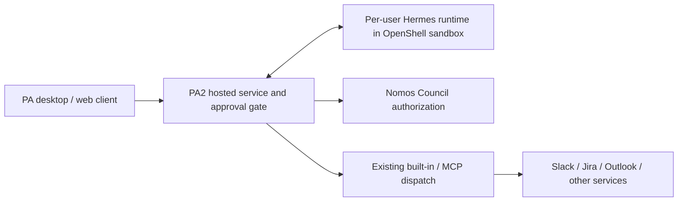
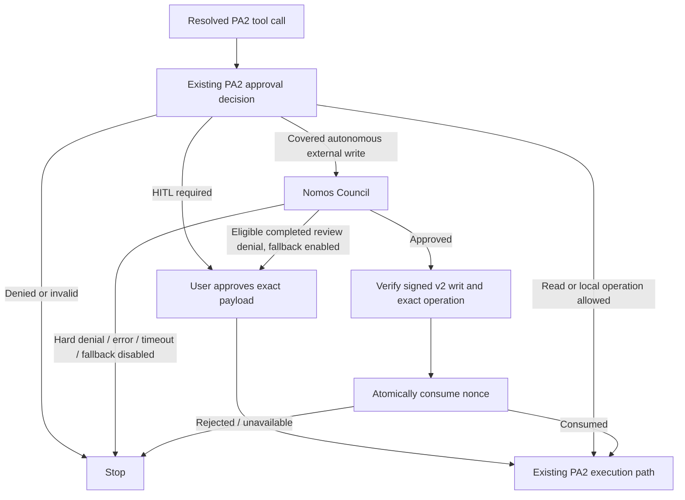
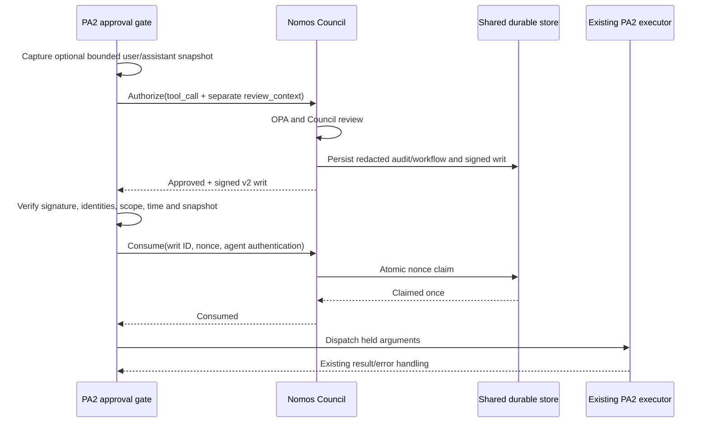
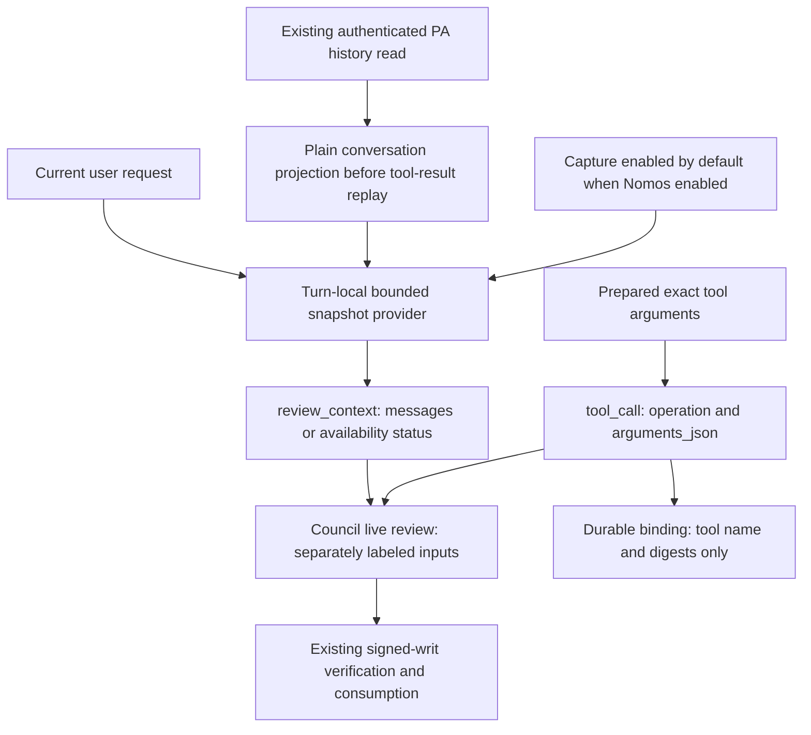
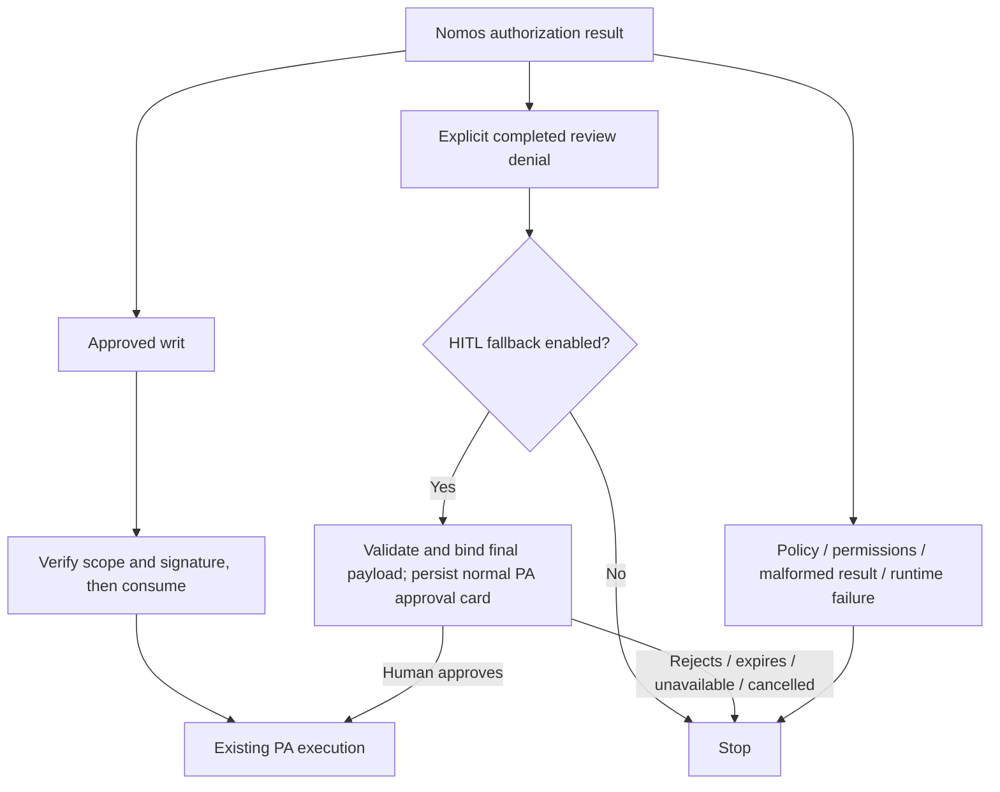

# PA2 autonomous external-write authorization

Status: proposed implementation, 30 September 2026. This proposal supersedes the
Hermes terminal-gate integration in draft PR #108. It describes the coordinated
Nomos and PA2 changes, with PA retaining tool execution.

## Purpose and scope

PA2 already decides which operations need human approval. Nomos adds Council
review to covered external writes that PA2 would otherwise execute without a
human. For example, PA2 can permit an internal Slack message automatically;
with this integration enabled, that message's resolved recipient and exact
arguments must receive a valid, single-use Council authorization before dispatch.

The integration uses PA2's existing approval decision and reviewed tool-effect
inventory. It does not add a new classifier, shell-command parser, sandbox,
credential broker, or trusted executor. Local shell/file operations continue
through their existing PA2 approval and runtime controls. A shell command with
external effects is not detected by this integration; sandbox egress controls
and credential isolation remain necessary.

## PA architecture and evidence

PA 1.x's desktop architecture runs agent orchestration in Electron and calls
remote inference and MCP services. That is background from the PA team's
architecture discussion, not a claim that all current PA deployments use it.
PA2 supports hosted orchestration and external agent runtimes. The
[PA NemoClaw on Astra architecture document](https://docs.google.com/document/d/1QSFgN-77mHJQHnYL47P2B5I5F5ImIMRpr_iS1uyFhhE/edit)
specifies **per-user sandboxes** in milestones 3/4 and **Per-User Hermes Sandbox**
in build-time requirement 25. We treat centrally managed shared gateway topology
as roadmap/deployment-specific, not an MVP prerequisite.

The implementation boundary is the PA2 shared approval gate. A Hermes or
OpenClaw runtime participates when its tool call reaches that gate; native calls
that bypass PA2 are outside coverage. No new Hermes **pre_tool_call** or OpenClaw
**before_tool_call** plugin is installed by this proposal.

## Decision flow

PA2's `requiresNomosAuthorization` selects no-HITL decisions with rule
`internal-comms`, or `reviewed-mcp-auto` whose existing `resolveToolEffect`
returns `write`. It excludes `mode-write`, `other-builtin`, reads, and human
approval paths. An existing exact human-approval replay is accepted earlier by
the gate and does not call Nomos. Reviewed MCP waivers can apply in any PA mode;
coverage is therefore not limited to the Fully Autonomous toggle.

## PA2 integration architecture and implementation

**Implementation status and boundary.** The Nomos service changes are proposed
in draft PR #109. The PA2 companion implementation is submitted as
[draft MR !1706](https://gitlab-master.nvidia.com/jarvis-chatbot/personal-assistant/pa2/-/merge_requests/1706),
tracked by [AIPRDQLTY-2206](https://nvidia.atlassian.net/browse/AIPRDQLTY-2206).
Neither submission establishes deployment or production readiness. This
section describes that implementation, not an already-enabled PA production
feature. The integration is an optional dependency of PA2's shared approval
gate, rather than a replacement agent harness or a new execution service.

**Component responsibilities.** Paths below are relative to the PA2 repository.

| File / entry point | Responsibility |
|---|---|
| `src/core/autonomous-write-authorizer.ts` | Defines the implementation-independent `AutonomousWriteAuthorizer` and `AutonomousWriteAuthorizationInput` contracts. No Council transport or cryptography dependencies. |
| `src/core/nomos-authorization.ts` / `NomosAuthorizationService.authorizeAndConsume` | Captures optional advisory context, canonicalizes exact arguments, requests Council review, verifies the signed writ, and consumes it once. Does not dispatch tools. |
| `src/core/nomos-review-context.ts` | Projects a bounded, sanitized, immutable user/assistant snapshot from plain conversation text. No model hooks, extra history reads, or global latest-context cache. |
| `src/core/nomos-authorization.ts` / `createNomosAuthorizerFromEnv` | Validates enabled configuration and creates the concrete client and transport. Disabled configuration leaves the dependency absent. |
| `src/api/index.ts` | Composition root: supplies the factory result when constructing the default hosted `CoreConfig`. |
| `src/core/app.ts` | Accepts `CoreConfig.nomosAuthorizer`, passes it to execution gates, and closes implementation-owned resources during shutdown. |
| `src/core/approval-gate.ts` / `createApprovalGate` | Uses the existing PA approval decision to select covered calls, freezes the dispatch input by cloning it, and waits for authorization before releasing it. |
| `src/core/query-dispatcher-chain.ts` / `wrapWithHitlApproval` | Honors the gate's block or modified-arguments result and invokes the existing inner dispatcher only when permitted. |
| `src/core/tool-dispatcher.ts` | Continues normal execution and server-owned context handling, including stripping governance-shaped arguments at the dispatch boundary. |

**Startup and dependency injection.** The hosted API constructs one authorizer
for its application configuration and shares it with the gates. `app.ts` and
`approval-gate.ts` depend on the standalone interface through type-only imports;
they do not construct a gRPC client or import the concrete service to implement
policy routing. A test double or another authorizer can implement the same
interface without taking a dependency on Nomos's transport implementation.
Callers supplying their own `CoreConfig` must explicitly inject the authorizer;
the default API factory does not automatically alter custom configurations.

The interface takes `toolName`, `args`, authenticated `ownerId`, an optional
`AbortSignal`, and an optional trusted `getReviewContext` provider. The authorizer's
`captureReviewContext` setting lets the host skip preparing context when disabled.
Its `authorizeAndConsume` method returns `Promise<void>`:
resolution means authorization and consumption have completed and the caller
may dispatch the reviewed input; rejection means stop. It does not return a writ
to the model or execute the operation itself. The optional `close()` method
releases owned resources. An alternative implementation must preserve those
semantics, not merely return after requesting a review.

**Execution-path coverage.** `app.ts` injects the dependency into five execution
gate construction sites: the default durable dispatcher, Sticky trigger
execution, iframe invocation, orchestration, and request-local chat. This keeps
the decision in the existing shared gate instead of adding separate checks to
individual MCP connectors. The hosted human-approval preparation path does not
consume a writ: preparing an approval is not dispatching an autonomous action.
Coverage still requires a call to traverse these gates; it is not a global
interceptor for every process or native tool inside an OpenShell sandbox.

**Order of checks and release to execution.** Existing PA checks remain ahead of
Nomos, including authenticated server context, recipient resolution, and the
approval decision. Exact human-approved replay follows the existing approval
path without a second Council review. For a no-HITL decision, the gate calls
`requiresNomosAuthorization` using PA's existing rule and tool-effect metadata.
If selected and enabled, it derives the owner from trusted server context
(`hostedStorageUserId`, then `userId`, then `credentialSubject`); a missing owner
blocks the operation. Model arguments cannot supply this identity.

The gate removes model-controlled governance fields and uses `structuredClone`
to hold a separate argument snapshot while the remote review is pending. After
`authorizeAndConsume` succeeds, the gate returns `action: 'modify'` with that
snapshot as `modifiedArgs`. `wrapWithHitlApproval` forwards those arguments to
`inner.dispatch`, rather than using the original caller-owned object. This
handoff is essential: hashing a snapshot would not protect dispatch if the
wrapper later executed a different, mutated object. The concrete authorizer
also checks argument equality and cancellation around consumption.

**Council transport and trust.** The concrete service calls
`/nomos.council.v1.CouncilProxy/Authorize`, verifies the returned signed v2 writ
locally, and invokes `council_consume_writ` through
`/nomos.council.v1.CouncilProxy/CallTool`. These are two remote steps inside one
PA method, not a new remote method named `authorizeAndConsume`. A single
configured deadline covers both steps; caller cancellation cancels outstanding
gRPC work. TLS and pinned Council verification keys serve different purposes:
TLS authenticates/protects the connection, while the pinned key verifies the
authorization payload. Transport and registered-agent credentials stay in the
trusted PA service configuration, not tool arguments or model-visible output.

PA's existing connector and credential routing execute the approved call. The
integration neither copies user OAuth credentials into a new sandbox nor asks
Nomos to discover or control the user's Hermes sandbox. This avoids coupling
Council authorization to agent-sandbox lifecycle or gateway provisioning.

**Errors, observability, and test seams.** Invalid enabled configuration fails
startup. Runtime verification/transport/consumption failure produces a blocking
gate result with a safe error; it does not fall through to dispatch. An explicitly
eligible completed review denial can instead enter PA's existing human-approval
path, as described below; it never grants automatic execution.
Success logging records tool name, writ identifier, and elapsed authorization
time. Failure logging uses a safe category rather than raw request material.
Existing PA post-tool handling remains responsible for execution observations.
The PA-side authorization and optional context-capture spans are described below.
Council LLM usage is not newly accounted for by this PA client.

Gate tests can inject an interface implementation to test routing independently
of gRPC. Concrete-service tests exercise transport outcomes and signed-writ
checks; a Python-generated fixture checks the Python/TypeScript signature
contract. Dispatcher-wrapper tests verify that the reviewed snapshot, not a
later mutation of the original arguments, reaches execution. These checks do
not substitute for staging tests with a real Council and connector.

## Exact authorization and execution binding

1. PA2 resolves recipients and applies existing approval policy.
2. The gate strips model-controlled governance arguments with the same helper
   used by the dispatcher and clones the argument object. It holds this snapshot
   during review and returns it through the existing `modify` hook result.
3. `NomosAuthorizationService` serializes JSON with sorted object keys, preserves
   array order, rejects cycles/non-JSON values, and caps the UTF-8 payload at
   32,000 bytes. SHA-256 binds those exact bytes.
4. PA2 calls the authenticated Council gRPC `Authorize` method with a structured
   `tool_call` and separate optional `review_context`. Exact arguments and
   conversation messages remain distinct live-review data; the signed operation
   still binds tool name, argument digest, and an opaque owner subject.
5. Council review mints a v2 writ. The signature covers the decoded
   `payload_base64` bytes directly. The TypeScript verifier never reserializes
   the payload before checking Ed25519; this avoids Python/JavaScript numeric
   formatting differences. A shared Python-generated fixture pins the contract.
6. PA2 verifies a deployment-pinned public key, schema/version, Council and
   service-agent identities, tool name, argument hash, owner subject, validity
   interval, and `max_executions=1`. It rejects malformed/duplicate JSON fields.
7. PA2 calls `council_consume_writ`. Nomos authenticates the registered agent,
   matches writ owner/Council/nonce, and claims the nonce atomically in shared
   durable storage. Only an unambiguous successful claim permits dispatch.
8. PA2 checks cancellation and argument equality again, then releases the held
   snapshot to its existing tool executor. Credentials stay in PA2's established
   server-owned credential routing.

The service `agent_id` is the registered Nomos client, not a model-supplied agent
name. The opaque subject hashes the authenticated PA owner identifier. It does
not attest to the downstream provider account: PA may select another credential
principal through its existing server-owned routing. Endpoint, account selection,
connector transformations, and provider effects remain inside PA's trust boundary.
The writ authorizes the PA dispatch input, not OS execution or provider completion.

## Failure and concurrency semantics

With the feature disabled, the existing gate behaves as before. When enabled,
missing configuration fails startup. Missing/invalid writ, transport failure,
expiry, cancellation, payload mutation, failed consumption, and hard policy or
permission denial block execution. Only an explicitly eligible completed Council
review denial may request human approval when configured. There is no unchecked
execution or automatic retry. Human-approval policy continues independently.

The client uses one deadline across authorize and consume and forwards caller
cancellation to gRPC. A timeout after consumption is ambiguous: the client blocks
and does not reuse the writ. A crash after consumption but before dispatch can
lose the operation. Single-use consumption prevents replay of a writ across PA
replicas; it does not provide exactly-once external effects or prevent a new
authorization from approving the same operation again. Provider idempotency
remains the executor's responsibility.

Existing post-tool telemetry continues. The Nomos client logs successful writ
consumption and duration without arguments, prompt context, nonce, token, or
raw writ. Those records prove an authorization gate ran; post-tool success is
an observation, not trusted execution attestation. A future trusted executor
would need enforcement and signed evidence at the actual execution boundary.

## PA-side tracing implementation

`NomosAuthorizationService.authorizeAndConsume()` reuses PA2's
`startChildSpan()` and `withActiveSpan()` helpers from
`src/core/observability/datadog-tracer.ts`. No new tracing SDK, exporter, or
configuration is introduced, and the authorizer interface is unchanged.

| Span | Placement | Meaning |
|---|---|---|
| `nomos.authorize_and_consume` | Around the complete public authorization method, including preparation, verification, and release checks. | Total authorization overhead before dispatch is permitted. |
| `nomos.capture_review_context` | Before the Council RPC, around the enabled lazy snapshot provider and validation. | Snapshot acquisition/projection, sanitization, bounding, and serialization validation; not model inference or a database fetch. Omitted when capture is disabled. |
| `nomos.authorize` | Around the Council authorize RPC and decision parsing. | Review round-trip and response validation, not just network latency. |
| `nomos.consume_writ` | Around the consumption RPC and response validation, after verified approval. | Time to confirm the single-use claim. Absent when review or verification blocks the call. |

In the traced chat path, the existing `pa.tool.call` span encloses the approval
gate, so the new outer span inherits it. Both RPC spans explicitly reference
the authorization parent. For other entry points, parentage depends on the
active request/job context; with no active parent the authorization span is a
root. This change does not add missing turn/job instrumentation to other paths.
Local signature verification does not create another span.

**Safe outcomes and correlation.** New tags contain tool and Council names
(bounded to 128 characters), stage, outcome, and the verified writ ID when its
length is at most 128 characters. Oversized writ IDs are omitted rather than
truncated to an ambiguous correlation value. Stages identify preparation,
review, verification, consumption, and release checks. Outcomes distinguish
approval/consumption, expected denial, invalid writ, failed consumption,
cancellation, timeout, generic transport failure, and other errors. Denial and
cancellation do not mark these spans as infrastructure errors; malformed or
unknown decisions do. A child review approval is not overall authorization:
verification and consumption can still fail afterward.

Only safe local categories are derived from gRPC status codes; remote error
messages are not recorded. No arguments, prompts, owner identifiers, argument
or intent hashes, nonce, credentials, raw writ, or Council reasoning are added
to these spans. Existing PA tool-result telemetry remains unchanged and has its
own payload handling. Writ IDs are trace correlation fields, not metric labels.

**Failure isolation and concurrency.** Trace state lives inside each invocation,
not on the shared authorizer instance. A small private wrapper isolates failures
in span creation, context activation, tagging, status updates, and finish. It
memoizes the operation promise before running work, so even activation failure
after callback invocation cannot repeat an RPC. Authorization rejection remains
a rejection, and every created span receives a finish attempt in a finally
block. Tracing disabled or unavailable must not change the security decision.

**Scope of visibility.** These spans use PA's existing Datadog tracer and show
PA-observed round-trip latency. PA's optional OTel summary sink is a separate
path and is not extended here. No connected Council-side trace propagation or
Council reviewer/inference spans are added, and no new token/cost accounting
is introduced. Those require separate work across the service boundary. Traces
are operational observations, not durable audit guarantees or proof of exact
external execution.

Validation covers span parentage and completion, concurrent calls, disabled and
failing instrumentation, negative authorization paths, and payload exclusion.
A staging trace with real Council and connector calls remains an operational
rollout check, not something established by unit tests.

## Optional conversation capture and separate review inputs

**What changes.** Earlier in this branch, exact tool arguments occupied the
generic `Intent.context` field and no conversation history was sent. The new
tool-call path keeps the request's existing `tool_call.operation` and
`tool_call.arguments_json`, and adds a separate typed `review_context`. Nomos
attaches both to a private, live-only review-material object on the Intent;
it does not concatenate them into a generic context string. Legacy shell
authorization continues using its existing context contract.

| Input | Content and purpose | Authority and retention |
|---|---|---|
| `tool_call.operation` | Tool name, exact argument digest, and owner subject. | Existing signed execution binding; persists as structured authorization facts. |
| `tool_call.arguments_json` | Exact canonical argument JSON the caller will dispatch. | Live Council review only; digest verification remains unchanged. |
| `review_context` | Versioned availability status, bounded user/assistant messages, and truncation flag. | Untrusted advisory material; neither execution input nor evidence of human approval. Never placed in durable intent fields. |

**PA-native source and coverage.** The chat-turn integration obtains a parallel
plain-text projection from the same authenticated history read PA already makes.
It must happen before model-history assembly: PA's replay builder appends
approval summaries, completed-tool outputs, and large-result handles inside
some user/assistant messages. Filtering that enriched history by role would
therefore be insufficient. No additional history lookup is introduced. The
current user request is included separately; model-injected memory, system
instructions, tool payloads/results, and hidden reasoning are not sources.

The provider belongs to one request-local approval gate, not the shared service
instance or a global session map. It freezes selected source strings and memoizes
an immutable sanitized result. Multiple covered tool calls in that turn can
reuse the snapshot. This is recent conversation history plus the current user
request, not a hook capturing every intermediate assistant message generated
inside a remote Hermes runtime. Paths without a trusted conversation source,
including other execution gates, report unavailable; they never borrow another
turn's context or fetch a latest-context fallback.
If the plain historical source is unavailable but the current user request is
present, the snapshot can still be available with that request alone. The
capture span excludes the existing history database read and the small initial
plain-field copy; it measures lazy snapshot processing and validation.

**Projection budget.** Inspect at most 64 recent candidate messages and retain
at most six eligible user/assistant text messages, including the current user
message. Skip an individual candidate exceeding 32,768 characters rather than
scanning unbounded input or redacting an already-cut fragment. Sanitize eligible
whole candidates before selecting the beginning/end excerpts. Each retained
message is at most 2,000 characters including the omission marker; the entire
serialized context is at most 24,000 UTF-8 bytes. Older messages are dropped if
necessary to satisfy the wire budget. Mark omission/truncation explicitly.
Redaction is best-effort, not a guarantee that prose contains no sensitive data:
an assistant can repeat source data, and novel secret formats may evade masking.

**Availability and configuration.** `PA_NOMOS_CAPTURE_REVIEW_CONTEXT` defaults
to true and is subordinate to the existing default-disabled
`PA_NOMOS_ENABLED`. False skips context preparation and provider invocation
entirely and sends status `disabled`. A missing source sends `unavailable`;
failed or malformed capture sends `error`. Only `available` can carry messages.
These statuses are explicit in Council review. Missing context alone does not
block authorization or bypass Council; the ordinary decision and fail-closed
verification/consumption path still apply.

**Capture observability.** `nomos.capture_review_context` is a child of
`nomos.authorize_and_consume` because capture is lazy at authorization time,
not in a pre-model hook. It records only status, included-message count,
serialized byte count, and truncation flag alongside existing bounded tool and
Council identifiers. No message text or capture exception is logged. Capture
errors do not mark successful authorization as failed. Disabled capture creates
no capture span. The elapsed time reflects that invocation; subsequent calls
can retrieve an already memoized snapshot.

## Context privacy and Council prompt handling

Council rendering has separate **PROPOSED TOOL OPERATION** and **UNTRUSTED
CONVERSATION CONTEXT** sections. The exact tool input must be evaluated as data,
and the conversation is advisory: neither section supplies instructions to the
reviewer or proves human approval. The existing fixed PA-routing justification
does not carry conversation text. Private review material survives in-process
review copies but is excluded from model serialization, persistence, OPA, and
workflow hydration. Structured operation hashing/signing is unaffected.

The retained privacy work changes three storage/policy boundaries:

| Boundary | New behavior | Reason |
|---|---|---|
| Ledger | New intent submissions and consolidated review records serialize an empty legacy context; private tool-review material is excluded entirely. Structured authorization facts remain. | Avoid copying raw arguments or conversation into the immutable audit trail. |
| Workflow cache | Durable schema v2 redacts legacy context, omits private tool-review material, and records that context is unavailable on hydration. | Status reads and cross-replica coordination do not require raw user data. |
| OPA | The input projection omits context and identifies the new input contract. | Current bundled policy does not use prompt context; reduce disclosure to policy services and their logs. |

Migration `0005_redact_workflow_context.sql` first installs constraints that
reject new unredacted records, then scrubs historical workflow-cache context and
marks it unavailable. It validates the workflow constraint after scrubbing. The
ledger constraint is deliberately `NOT VALID` for old rows: historical
hash-chained ledger entries are not rewritten. Existing ledger copies, backups,
provider logs, and any external tracing need their own retention controls.

This is a raw-field minimization guarantee, not a guarantee that no sensitive
text can ever persist. Council reasoning or other caller-supplied text fields
can quote or paraphrase arguments; those outputs may still be audited. Review
deployment logging and LLM-provider retention separately. The in-process live
review necessarily holds context until its normal object lifetime ends.

Workflow hydration is a status/read path, not a mechanism for rerunning review
without context. Approval is minted only during a fresh authorize call. Privacy
settings fail closed when authoritative audit persistence fails.

## Human approval after an eligible Council review denial

**Purpose and default.** `PA_NOMOS_HITL_ON_REVIEW_DENIAL` defaults true when the
Nomos integration is enabled. Nomos still approves or refuses autonomous
execution. For an eligible review denial, PA asks the human to approve the
specific operation using its existing durable approval flow. This is a separate
human authorization, not a claim that Nomos approved or a retry of the denied
operation. This is deployment-owned configuration, not a model/tool argument.
Set false when deployment policy requires every Council denial to
remain terminal. Nomos itself remains disabled by default.

**Explicit eligibility, not error-text matching.** Nomos adds a server-generated
`denial_category` to its authorization response. `review_denied` is the only
fallback-eligible value. Permission denial, policy denial, unavailable review,
unknown categories, and older servers that omit the field remain hard stops.
The eligible category is emitted only for a completed tool-call review whose
required member evaluations completed successfully. Inference timeouts, parse
failures, and evaluation exceptions can produce defensive deny votes in Nomos;
those are not human-override prompts. Server-owned evaluation-completion metadata
is carried through initial/debate votes and cannot be supplied by model JSON.
These completion markers are private, process-local server state, excluded from
the response and persisted records. Nomos validates them before deriving
`denial_category`; PA validates the resulting category over the trusted Council
transport, not a separate completion flag. This classification is not a signed
execution authorization: only PA's subsequent bound human approval permits
dispatch on the fallback path.
Chairman preauthorization, RBAC, OPA, and deterministic policy failures are not
eligible even if they share the public status `denied`.

**PA client contract.** The authorizer raises a dedicated
`AutonomousWriteReviewDeniedError` only for an explicit eligible denial from the
expected Council with a valid bounded decision ID. Conflicting writ or permission
fields, missing/unknown categories, cancellation, and mutated held arguments
cannot produce that signal. The exception contains only safe correlation IDs
and a fixed message, not Council reasoning or conversation text. The standalone
authorizer contract owns this type; the gate does not import the concrete Nomos
client or inspect error strings to decide whether to escalate.

**Existing approval machinery is reused.** The gate catches only the typed
review denial when fallback is enabled and the call has not been cancelled. It
then runs the same payload validation, argument materialization, recipient
revalidation, connector preflight, approval binding, duplicate detection, and
durable enqueue path used for ordinary HITL. It never returns `continue` merely
because fallback is enabled. The approval display says **Nomos declined
autonomous execution; human approval is required**, with bounded decision and
Council IDs for correlation. The notice is attached before approval preparation
and binding. Raw Council explanations and review context are not copied into
approval metadata.
The specialized email card explicitly renders the same fixed denial notice;
generic, Slack, and Teams cards display the additional summary field through
their existing presentation paths.

If materialization changes the proposed input, the human approves the final
displayed and bound payload. The same original denied payload must not silently
execute in parallel. Human-approved replay uses PA's existing exact-payload proof
and does not petition Nomos again or create a denial/approval loop. No Nomos writ
is issued or consumed on the denied branch; authority comes from PA's human
approval mechanism. Approval cards retain the normal PA payload persistence and
access-control policy, separate from Nomos's live-context privacy boundary.

**Failure and audit semantics.** Missing approval infrastructure, validation or
binding failure, persistence failure, expired approval, human rejection, and
cancellation remain stops. Cancellation is checked after asynchronous preparation
and lease checks before enqueue. Existing pending/approved-action deduplication
is retained; this change does not introduce a new global exactly-once guarantee.
Authorization spans remain `denied`, with a bounded category, not `approved`.
PA logs the transition to human review and emits its ordinary approval event;
no new tracing SDK or duplicated execution telemetry is added.

Validation covers default-on/disabled configuration, classified versus unknown
denials, actual evaluation failures, cancellation/mutation, notice binding,
missing gateway, failed persistence, deduplication and normal human replay.
Staging validation should additionally exercise the card UI, approval resolver,
and real connector outcome. Deploy the matching Council response contract before
enabling fallback; older responses safely stay blocked.

## Deployment and rollout

Deploy the Nomos contract before enabling PA2. Provision a registered service
agent with the dedicated `tool:write` scope; shell privileges are not required.
Existing developer/operator presets are not broadened. Pin Council
public keys independently of the authorization response. Key rotation can
overlap up to eight trusted raw Ed25519 public keys.

Nomos gRPC now exposes `council_consume_writ` through its existing generic
`CallTool` method. The proxy enforces the configured transport bearer token in
addition to agent authentication on authorization/consume. Helm exposes an
explicit ingress peer list (default deny) and optional existing TLS secret.
Use TLS with hostname validation, or an authenticated encrypted service mesh.
NetworkPolicy requires an enforcing CNI and is not a replacement for encryption.

PA2 environment settings:

| Setting | Purpose |
|---|---|
| `PA_NOMOS_ENABLED` | Opt-in switch; default disabled. |
| `PA_NOMOS_CAPTURE_REVIEW_CONTEXT` | Default true when Nomos is enabled; false skips conversation capture without disabling authorization or exact-argument review. |
| `PA_NOMOS_HITL_ON_REVIEW_DENIAL` | Default true when Nomos is enabled; only explicitly eligible review denials may request existing PA human approval. False makes them terminal. |
| `PA_NOMOS_GRPC_TARGET` | Council gRPC host:port. |
| `PA_NOMOS_GRPC_BEARER_TOKEN` | Transport credential matching the proxy token. |
| `PA_NOMOS_AGENT_ID`, `PA_NOMOS_AGENT_AUTH_TOKEN` | Registered service-agent identity and credential. |
| `PA_NOMOS_COUNCIL_ID` | Expected Council identity. |
| `PA_NOMOS_COUNCIL_PUBLIC_KEYS` | Comma-separated pinned 32-byte public keys in hex. |
| `PA_NOMOS_TIMEOUT_MS` | Combined review/consume deadline, default 60 seconds. |
| `PA_NOMOS_TLS_CA_FILE` | Optional private CA bundle; otherwise system roots. |
| `PA_NOMOS_ALLOW_PLAINTEXT=true` | Explicit local or protected-mesh exception. |

Configure `councilGrpc.tls.secretName` with a `kubernetes.io/tls` secret for
direct TLS. Set `councilGrpc.networkPolicy.ingressFrom` to the PA namespace AND
pod selectors in the same peer entry, so the selectors intersect. Do not use
separate entries when intersection is intended. Rotate tokens through Secrets.
The proxy-to-monitor internal hop retains its existing deployment security model;
use mesh encryption for that hop if required by the deployment threat model.

Roll out the privacy migration during a coordinated Council deployment. Old
replicas attempting unredacted inserts will fail the new constraints. Verify
custom OPA policies against the new input projection before rollout. Deploy PA2
disabled, configure trust/auth/TLS, then enable for a controlled environment and
exercise both positive and negative paths before broad rollout.

## Validation and remaining operational checks

Tests cover the signed operation and shared cross-language fixture, argument
canonicalization, signature/scope/time rejection, consumption ownership and
replay behavior, PA gate routing, cancellation/mutation, and privacy projection.
The review must also confirm the forwarded snapshot is the reviewed one through
the actual PA dispatcher wrapper. Render Helm with TLS and restricted peers.

A real staging Council/PA2 rollout and real connector write are not implied by
unit tests. Before production, validate the registered agent permissions,
Council latency/deadline, TLS trust, NetworkPolicy reachability, audit behavior,
and authorized/denied execution in that environment. Do not advertise provider
execution verification until a trusted execution boundary is implemented.
