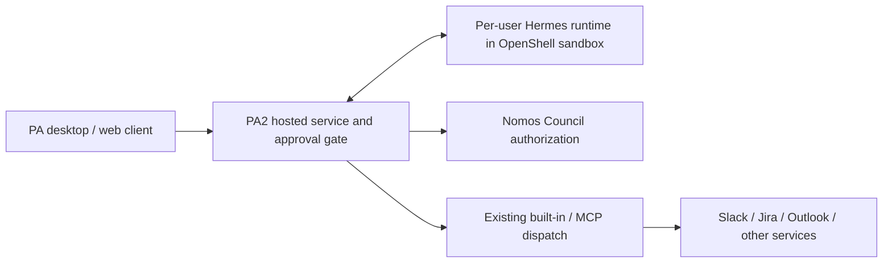
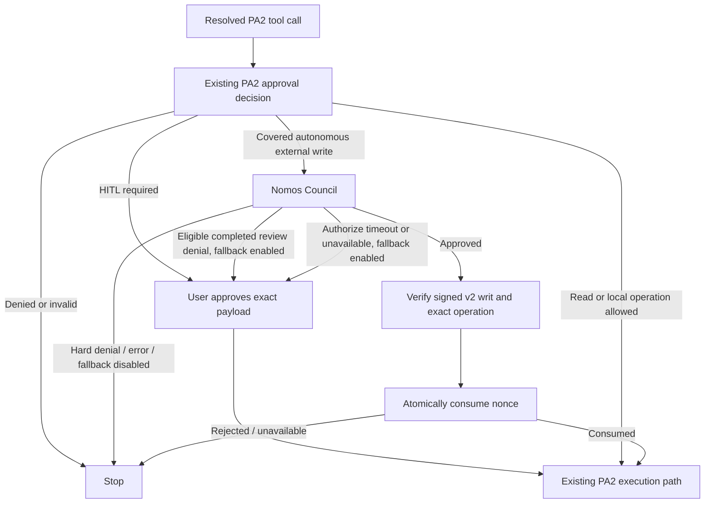
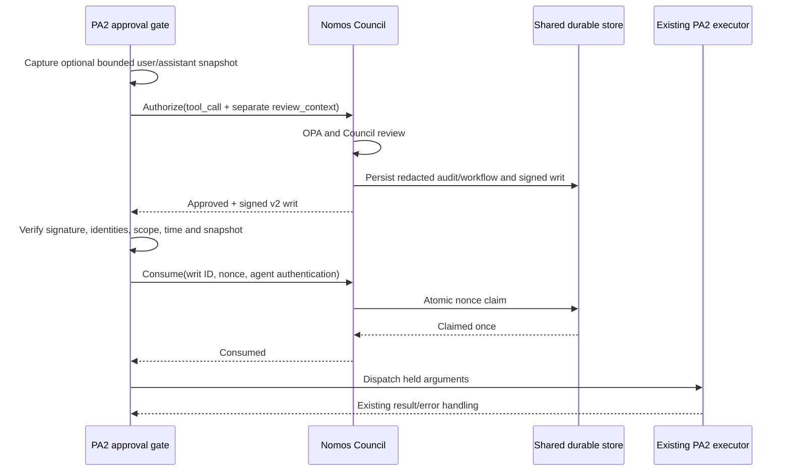
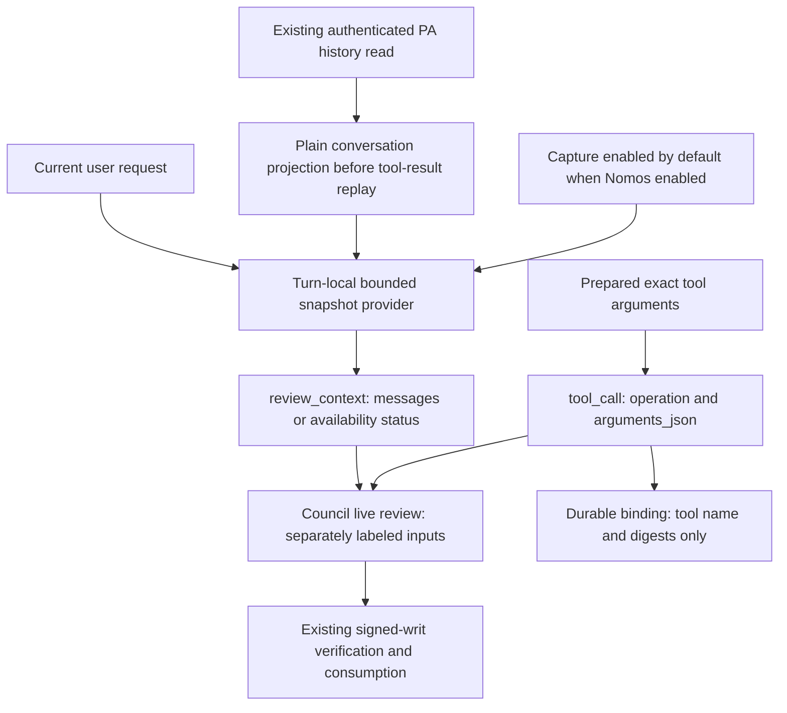
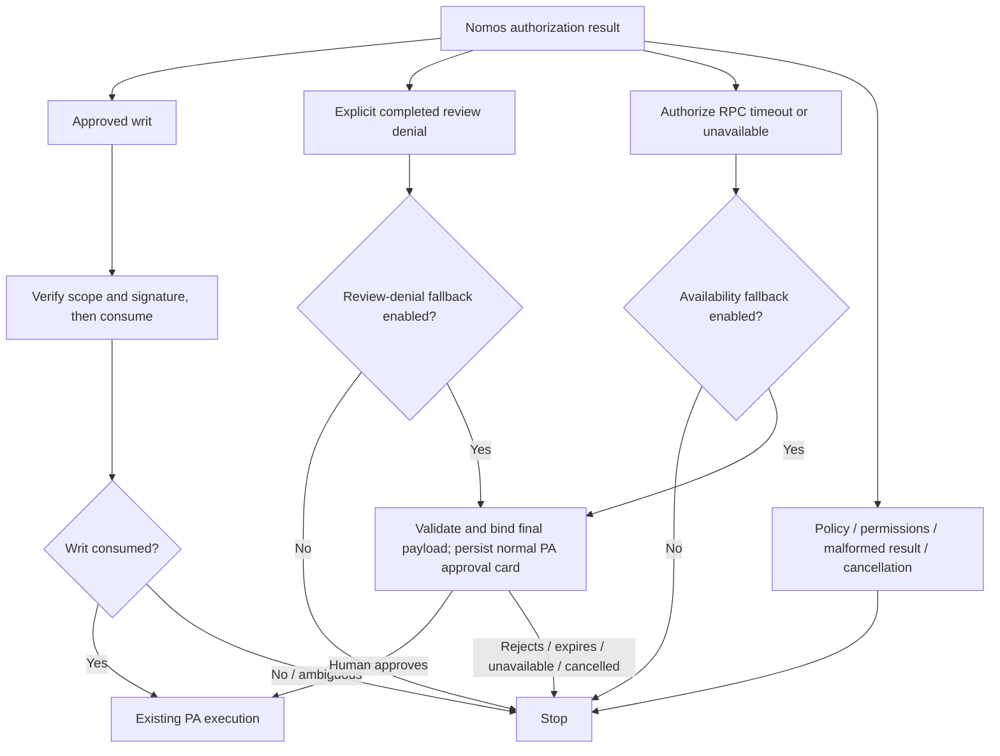

# PA2 autonomous external-write authorization

Status: submitted for review; updated 1 October 2026. This proposal supersedes the
Hermes terminal-gate integration in [Nomos PR #108](https://github.com/NVIDIA/Nomos/pull/108)
(closed). The current Nomos and PA2 submissions are open drafts, with PA retaining
tool execution. Deployment and staging validation remain outstanding.

## Purpose and scope

PA2 already decides which operations need human approval. Nomos adds Council
review to selected external writes that PA2 would otherwise execute without a
human: internal communications and MCP calls classified as writes by PA's
existing reviewed tool-effect inventory. These are the document's "covered
autonomous writes"; the integration does not intercept every external write.
For example, PA2 can permit an internal Slack message automatically;
with this integration enabled, that message's resolved recipient and exact
arguments need either a valid, single-use Council authorization or, following
an eligible review denial, approval through the configured human fallback.

**At a glance:**

- PA2 retains tool execution and its existing credential routing.
- Ordinary human-in-the-loop (HITL) approval bypasses Nomos.
- When enabled, Nomos reviews only the selected writes that PA would otherwise
  allow without human approval. Reads and other unselected operations keep
  their existing PA controls.
- An eligible Council review denial can request human approval when fallback
  is enabled. A timeout or unavailable response from the initial authorization
  RPC can also request human approval when its separate fallback is enabled.
  Hard policy/permission denials, malformed responses, cancellations, and all
  writ-consumption failures remain blocked.

The integration uses PA2's existing approval decision and reviewed tool-effect
inventory. It does not add a new classifier, shell-command parser, sandbox,
credential broker, or trusted executor. Local shell/file operations continue
through their existing PA2 approval and runtime controls. A shell command with
external effects is not detected by this integration; sandbox egress controls
and credential isolation remain necessary.

## PA architecture and evidence

PA 1.x's desktop architecture runs agent orchestration in Electron and calls
remote inference and MCP services. That is background from the PA team's
architecture discussion, not a claim that all current PA deployments use it.
PA2 supports hosted orchestration and external agent runtimes. The
[PA NemoClaw on Astra architecture document](https://docs.google.com/document/d/1QSFgN-77mHJQHnYL47P2B5I5F5ImIMRpr_iS1uyFhhE/edit)
specifies **per-user sandboxes** in milestones 3/4 and **Per-User Hermes Sandbox**
in build-time requirement 25. We treat centrally managed shared gateway topology
as roadmap/deployment-specific, not an MVP prerequisite.

The implementation boundary is the PA2 shared approval gate. A Hermes or
OpenClaw runtime participates when its tool call reaches that gate; native calls
that bypass PA2 are outside coverage. No new Hermes **pre_tool_call** or OpenClaw
**before_tool_call** plugin is installed by this proposal.

## Decision flow

PA2's `requiresAutonomousWriteAuthorization` selects no-HITL decisions with rule
`internal-comms`, or `reviewed-mcp-auto` whose existing `resolveToolEffect`
returns `write`. It excludes `mode-write`, `other-builtin`, reads, and human
approval paths. An existing exact human-approval replay is accepted earlier by
the gate and does not call Nomos. Reviewed MCP waivers can apply in any PA mode;
coverage is therefore not limited to the Fully Autonomous toggle.

## PA2 integration architecture and implementation

### Implementation status and boundary

The Nomos service changes are published
in [draft PR #109](https://github.com/NVIDIA/Nomos/pull/109). The PA2 companion implementation has been pushed and submitted as
[draft MR !1706](https://gitlab-master.nvidia.com/jarvis-chatbot/personal-assistant/pa2/-/merge_requests/1706),
tracked by [AIPRDQLTY-2206](https://nvidia.atlassian.net/browse/AIPRDQLTY-2206).
Both remain under review; neither submission establishes deployment or production
readiness. The Jira ticket remains open after merge for staging validation. This
section describes that implementation, not an already-enabled PA production
feature. The integration is an optional dependency of PA2's shared approval
gate, rather than a replacement agent harness or a new execution service.

**Component responsibilities.** Paths below are relative to the PA2 repository.

**Table 1. PA2 integration components and responsibilities**

| File / entry point | Responsibility | Change in this MR |
|---|---|---|
| `src/core/autonomous-write-authorizer.ts` | Defines the provider-independent `AutonomousWriteAuthorizer` contract, its input, PA-owned fallback policy, and the typed denial/unavailability signals that can enter human review. Successful completion permits dispatch of the reviewed arguments; the authorizer does not execute tools. | New |
| `src/core/nomos-authorization.ts` / `NomosAuthorizationService` | Implements `AutonomousWriteAuthorizer`. Its `authorizeAndConsume()` method obtains optional conversation context, requests Council review, verifies the returned writ against the exact operation, and asks Nomos to consume it before permitting dispatch. | New |
| `src/core/autonomous-write-review-context.ts` | Builds a bounded, best-effort sanitized snapshot of recent user/assistant messages for authorization review, separate from the exact tool arguments. | New |
| `src/core/nomos-authorization.ts` / `createNomosAuthorizerFromEnv` | Reads and validates PA's Nomos environment settings. Creates `NomosAuthorizationService` when enabled; returns `undefined` when disabled. | New |
| `src/api/index.ts` | Constructs the default `CoreConfig`, creates the concrete Nomos implementation, reads PA's provider-independent fallback policy, and passes both to `PersonalAssistantApp`. Callers supplying a custom configuration inject their own authorizer and may override the fallback policy. | Modified |
| `src/core/app.ts` | Wires the configured authorizer into PA's execution approval gates, supplies optional turn-local conversation context, and closes the authorizer during application shutdown. | Modified |
| `src/core/approval-gate.ts` / `createApprovalGate` | Applies existing PA approval policy and invokes the configured authorizer only for selected autonomous writes. Holds an isolated argument snapshot, permits or blocks dispatch, and routes only typed eligible denials or pre-decision unavailability through PA's existing human-approval flow when the corresponding fallback is enabled. | Modified |
| `src/core/query-dispatcher-chain.ts` / `wrapWithHitlApproval` | Applies the gate's result: prevents dispatch for blocked or queued calls, returns a queued-for-approval response when appropriate, or forwards the permitted arguments to the existing dispatcher. | Existing—unchanged |
| `src/core/tool-dispatcher.ts` | Routes tool calls to PA's existing handlers or MCP servers, carrying the existing authenticated user/credential context. Does not request Council review itself. | Existing—unchanged |

### Startup and configuration

`src/api/index.ts` constructs the default
`CoreConfig` object, sets `autonomousWriteAuthorizer` using
`createNomosAuthorizerFromEnv()`, reads `autonomousWriteAuthorizationPolicy`,
and passes the object to `new PersonalAssistantApp(coreConfig)`. The
`PersonalAssistantApp` class in `src/core/app.ts` stores that configuration and
passes `this.config.autonomousWriteAuthorizer` and the fallback policy to its
execution approval gates. `app.ts` and
`approval-gate.ts` depend on the standalone authorizer contract;
they do not construct a gRPC client or import the concrete service to implement
policy routing. A test double or another authorizer can implement the same
interface without taking a dependency on Nomos's transport implementation.
Callers supplying their own `CoreConfig` must explicitly inject the authorizer;
the default API factory does not automatically alter custom configurations.
They may omit `autonomousWriteAuthorizationPolicy` to use the gate's default-true
behavior for both typed fallback signals, or override either setting explicitly.

### What the approval gate passes to the authorizer

The approval gate calls `authorizeAndConsume()` on its configured authorizer:
`config.autonomousWriteAuthorizer.authorizeAndConsume(...)`.

The `AutonomousWriteAuthorizer` interface defines the method's contract; it does
not contain the executable implementation. When Nomos is enabled through PA's
default configuration, a `NomosAuthorizationService` instance provides that
implementation. Custom configurations and tests can supply another object that
implements the same interface.

The gate passes an `AutonomousWriteAuthorizationInput` object:

- `toolName` and `args`: the selected tool and the held argument snapshot.
- `ownerId`: the owner identity supplied by PA's authenticated server context.
- `signal`: an optional `AbortSignal` for cancellation.
- `getReviewContext`: an optional trusted callback providing conversation context.

The configured authorizer's `captureReviewContext` property, declared by the
`AutonomousWriteAuthorizer` interface, lets
`PersonalAssistantApp` skip preparing conversation context when disabled.

### What the authorizer returns

`authorizeAndConsume()` returns `Promise<void>`, not a tool result or a writ for
the model. The approval gate waits for one of four outcomes:

- **Success:** authorization and single-use consumption are complete. The gate
  permits dispatch of the reviewed arguments through PA's existing dispatcher.
- **Eligible review denial:** the method throws `AutonomousWriteReviewDeniedError`.
  The gate may request human approval when fallback is enabled; it does not execute.
- **Authorizer unavailable before a decision:** the method throws
  `AutonomousWriteAuthorizerUnavailableError`. The gate may request human
  approval when that separate fallback is enabled.
- **Other rejection:** the gate blocks the operation. Hard policy or permission
  denials, malformed responses, cancellations, mutation, and any failure during
  writ verification or consumption do not become human-override prompts.

The authorizer never executes tools. Alternative implementations must preserve
this contract, not return successfully after merely requesting a review. The
optional `close()` method on the configured authorizer releases owned resources;
the `AutonomousWriteAuthorizer` interface declares that lifecycle method.

### Where PA invokes the approval gate

`PersonalAssistantApp` passes `CoreConfig.autonomousWriteAuthorizer` and
`CoreConfig.autonomousWriteAuthorizationPolicy` into five execution
gate construction sites: the default durable dispatcher, Sticky trigger
execution, iframe invocation, orchestration, and request-local chat. This keeps
the decision in the existing shared gate instead of adding separate checks to
individual MCP connectors. The hosted human-approval preparation path does not
consume a writ: preparing an approval is not dispatching an autonomous action.
Coverage still requires a call to traverse these gates; it is not a global
interceptor for every process or native tool inside an OpenShell sandbox.

### From authorization to tool execution

Existing PA checks remain ahead of
Nomos, including authenticated server context, recipient resolution, and the
approval decision. Exact human-approved replay follows the existing approval
path without a second Council review. For a no-HITL decision, the gate calls
`requiresAutonomousWriteAuthorization` using PA's existing rule and tool-effect metadata.
If selected and enabled, it derives the owner from trusted server context
(`hostedStorageUserId`, then `userId`, then `credentialSubject`); a missing owner
blocks the operation. Model arguments cannot supply this identity.

The PA approval gate (`createApprovalGate`) removes model-controlled governance fields and uses `structuredClone`
to hold a separate argument snapshot while the remote review is pending. After
`authorizeAndConsume` succeeds, the gate returns `action: 'modify'` with that
snapshot as `modifiedArgs`. `wrapWithHitlApproval` forwards those arguments to
`inner.dispatch`, rather than using the original caller-owned object. This forwarding
is existing wrapper behavior, reused without modifying `query-dispatcher-chain.ts`. This
handoff is essential: hashing a snapshot would not protect dispatch if the
wrapper later executed a different, mutated object. `NomosAuthorizationService`
also checks argument equality and cancellation around consumption.

### Council requests and trust checks

PA's `NomosAuthorizationService` calls
`/nomos.council.v1.CouncilProxy/Authorize`, verifies the returned signed v2 writ
locally, and invokes `council_consume_writ` through
`/nomos.council.v1.CouncilProxy/CallTool`. These are two remote steps inside one
PA method, not a new remote method named `authorizeAndConsume`. A single
configured deadline covers both steps; caller cancellation cancels outstanding
gRPC work. TLS and pinned Council verification keys serve different purposes:
TLS authenticates/protects the connection, while the pinned key verifies the
authorization payload. Transport and registered-agent credentials stay in the
trusted PA service configuration, not tool arguments or model-visible output.

PA's existing connector and credential routing execute the approved call. The
integration neither copies user OAuth credentials into a new sandbox nor asks
Nomos to discover or control the user's Hermes sandbox. This avoids coupling
Council authorization to agent-sandbox lifecycle or gateway provisioning.

### Errors and observability

Invalid enabled configuration fails
startup. Runtime verification/transport/consumption failure produces a blocking
gate result with a safe error; it does not fall through to dispatch. An explicitly
eligible completed review denial can instead enter PA's existing human-approval
path, as described below; it never grants automatic execution.
Success logging records tool name, writ identifier, and elapsed authorization
time. Failure logging uses a safe category rather than raw request material.
Existing PA post-tool handling remains responsible for execution observations.
The PA-side authorization and optional context-capture spans are described below.
Council LLM usage is not newly accounted for by this PA client.

Implementation-level validation details are retained in Appendix A. Staging
tests with a real Council and connector remain necessary.

## Exact authorization and execution binding

1. PA2 resolves recipients and applies existing approval policy.
2. The gate strips model-controlled governance arguments with the same helper
   used by the dispatcher and clones the argument object. It holds this snapshot
   during review and returns it through the existing `modify` hook result.
3. `NomosAuthorizationService` encodes the held arguments deterministically and
   hashes them with SHA-256, binding authorization to the exact dispatch input.
   Serialization limits and cross-language checks are detailed in Appendix A.
4. PA2 calls the authenticated Council gRPC `Authorize` method with a structured
   `tool_call` and separate optional `review_context`. Exact arguments and
   conversation messages remain distinct live-review data; the signed operation
   still binds tool name, argument digest, and an opaque owner subject.
5. An approved Council review mints a signed v2 writ for that operation. PA
   verifies the original signed bytes rather than reconstructing the payload.
6. PA2 verifies a deployment-pinned public key, schema/version, Council and
   service-agent identities, tool name, argument hash, owner subject, validity
   interval, and `max_executions=1`. It rejects malformed/duplicate JSON fields.
7. PA2 calls `council_consume_writ`. Nomos authenticates the registered agent,
   matches writ owner/Council/nonce, and claims the nonce atomically in shared
   durable storage. Only an unambiguous successful claim permits dispatch.
8. PA2 checks cancellation and argument equality again, then releases the held
   snapshot to its existing tool executor. Credentials stay in PA2's established
   server-owned credential routing.

The service `agent_id` is the registered Nomos client, not a model-supplied agent
name. The opaque subject hashes the authenticated PA owner identifier. It does
not attest to the downstream provider account: PA may select another credential
principal through its existing server-owned routing. Endpoint, account selection,
connector transformations, and provider effects remain inside PA's trust boundary.
The writ authorizes the PA dispatch input, not OS execution or provider completion.

## Failure and concurrency semantics

With the feature disabled, the existing gate behaves as before. When enabled,
missing configuration fails startup. Missing/invalid writ, transport failure,
expiry, cancellation, payload mutation, failed consumption, and hard policy or
permission denial block execution. Only an explicitly eligible completed Council
review denial may request human approval when configured. There is no unchecked
execution or automatic retry. Human-approval policy continues independently.

PA's `NomosAuthorizationService` uses one deadline across authorize and consume and forwards caller
cancellation to gRPC. A timeout after consumption is ambiguous: the client blocks
and does not reuse the writ. A crash after consumption but before dispatch can
lose the operation. Single-use consumption prevents replay of a writ across PA
replicas; it does not provide exactly-once external effects or prevent a new
authorization from approving the same operation again. Provider idempotency
remains the executor's responsibility.

Existing post-tool telemetry continues. The Nomos client logs successful writ
consumption and duration without arguments, prompt context, nonce, token, or
raw writ. Those records prove an authorization gate ran; post-tool success is
an observation, not trusted execution attestation. A future trusted executor
would need enforcement and signed evidence at the actual execution boundary.

## PA-side tracing implementation

`NomosAuthorizationService.authorizeAndConsume()` reuses PA2's
`startChildSpan()` and `withActiveSpan()` helpers from
`src/core/observability/datadog-tracer.ts`. No new tracing SDK, exporter, or
configuration is introduced, and the authorizer interface is unchanged.

**Table 2. PA-side authorization and context-capture spans**

| Span | Placement | Meaning |
|---|---|---|
| `nomos.authorize_and_consume` | Around the complete public authorization method, including preparation, verification, and release checks. | Total authorization overhead before dispatch is permitted. |
| `nomos.capture_review_context` | Before the Council RPC, around the enabled lazy snapshot provider and validation. | Snapshot acquisition/projection, sanitization, bounding, and serialization validation; not model inference or a database fetch. Omitted when capture is disabled. |
| `nomos.authorize` | Around the Council authorize RPC and decision parsing. | Review round-trip and response validation, not just network latency. |
| `nomos.consume_writ` | Around the consumption RPC and response validation, after verified approval. | Time to confirm the single-use claim. Absent when review or verification blocks the call. |

In the traced chat path, the existing `pa.tool.call` span encloses the approval
gate, so the new outer span inherits it. Both RPC spans explicitly reference
the authorization parent. For other entry points, parentage depends on the
active request/job context; with no active parent the authorization span is a
root. This change does not add missing turn/job instrumentation to other paths.
Local signature verification does not create another span.

### Safe outcomes and correlation

New tags contain tool and Council names
(bounded to 128 characters), stage, outcome, and the verified writ ID when its
length is at most 128 characters. Oversized writ IDs are omitted rather than
truncated to an ambiguous correlation value. Stages identify preparation,
review, verification, consumption, and release checks. Outcomes distinguish
approval/consumption, expected denial, invalid writ, failed consumption,
cancellation, timeout, generic transport failure, and other errors. Denial and
cancellation do not mark these spans as infrastructure errors; malformed or
unknown decisions do. A child review approval is not overall authorization:
verification and consumption can still fail afterward.

Only safe local categories are derived from gRPC status codes; remote error
messages are not recorded. No arguments, prompts, owner identifiers, argument
or intent hashes, nonce, credentials, raw writ, or Council reasoning are added
to these spans. Existing PA tool-result telemetry remains unchanged and has its
own payload handling. Writ IDs are trace correlation fields, not metric labels.

Tracing failures must neither change authorization decisions nor repeat an RPC.
Appendix A describes the failure-isolation implementation.

### What tracing does and does not show

These spans use PA's existing Datadog tracer and show
PA-observed round-trip latency. PA's optional OTel summary sink is a separate
path and is not extended here. No connected Council-side trace propagation or
Council reviewer/inference spans are added, and no new token/cost accounting
is introduced. Those require separate work across the service boundary. Traces
are operational observations, not durable audit guarantees or proof of exact
external execution.

A staging trace with real Council and connector calls remains an operational
rollout check, not something established by unit tests.

## Optional conversation capture and separate review inputs

### Separate tool input and conversation context

Earlier in this branch, exact tool arguments occupied the
generic `Intent.context` field and no conversation history was sent. The new
tool-call path keeps the request's existing `tool_call.operation` and
`tool_call.arguments_json`, and adds a separate typed `review_context`. Nomos
attaches both to a private, live-only review-material object on the Intent;
it does not concatenate them into a generic context string. Legacy shell
authorization continues using its existing context contract.

**Table 3. Separate operation and conversation review inputs**

| Input | Content and purpose | Authority and retention |
|---|---|---|
| `tool_call.operation` | Tool name, exact argument digest, and owner subject. | Existing signed execution binding; persists as structured authorization facts. |
| `tool_call.arguments_json` | Exact canonical argument JSON the caller will dispatch. | Live Council review only; digest verification remains unchanged. |
| `review_context` | Versioned availability status, bounded user/assistant messages, and truncation flag. | Untrusted advisory material; neither execution input nor evidence of human approval. Never placed in durable intent fields. |

### Where conversation context comes from

The chat-turn integration obtains a parallel
plain-text projection from the same authenticated history read PA already makes.
It must happen before model-history assembly: PA's replay builder appends
approval summaries, completed-tool outputs, and large-result handles inside
some user/assistant messages. Filtering that enriched history by role would
therefore be insufficient. No additional history lookup is introduced. The
current user request is included separately; model-injected memory, system
instructions, tool payloads/results, and hidden reasoning are not sources.

The `getReviewContext` callback belongs to one request-local approval gate, not
the shared `NomosAuthorizationService` instance or a global session map. The
context-capture code freezes selected source strings and memoizes
an immutable sanitized result. Multiple covered tool calls in that turn can
reuse the snapshot. This is recent conversation history plus the current user
request, not a hook capturing every intermediate assistant message generated
inside a remote Hermes runtime. Paths without a trusted conversation source,
including other execution gates, report unavailable; they never borrow another
turn's context or fetch a latest-context fallback.
If the plain historical source is unavailable but the current user request is
present, the snapshot can still be available with that request alone. The
capture span excludes the existing history database read and the small initial
plain-field copy; it measures lazy snapshot processing and validation.

### Conversation size limits

Inspect at most 64 recent candidate messages and retain
at most six eligible user/assistant text messages, including the current user
message. Skip an individual candidate exceeding 32,768 characters rather than
scanning unbounded input or redacting an already-cut fragment. Sanitize eligible
whole candidates before selecting the beginning/end excerpts. Each retained
message is at most 2,000 characters including the omission marker; the entire
serialized context is at most 24,000 UTF-8 bytes. Older messages are dropped if
necessary to satisfy the wire budget. Mark omission/truncation explicitly.
Redaction is best-effort, not a guarantee that prose contains no sensitive data:
an assistant can repeat source data, and novel secret formats may evade masking.

### Missing context and configuration

`PA_NOMOS_CAPTURE_REVIEW_CONTEXT` defaults
to true and is subordinate to the existing default-disabled
`PA_NOMOS_ENABLED`. False skips context preparation and provider invocation
entirely and sends status `disabled`. A missing source sends `unavailable`;
failed or malformed capture sends `error`. Only `available` can carry messages.
These statuses are explicit in Council review. Missing context alone does not
block authorization or bypass Council; the ordinary decision and fail-closed
verification/consumption path still apply.

### Measuring conversation capture

`nomos.capture_review_context` is a child of
`nomos.authorize_and_consume` because capture is lazy at authorization time,
not in a pre-model hook. It records only status, included-message count,
serialized byte count, and truncation flag alongside existing bounded tool and
Council identifiers. No message text or capture exception is logged. Capture
errors do not mark successful authorization as failed. Disabled capture creates
no capture span. The elapsed time reflects that invocation; subsequent calls
can retrieve an already memoized snapshot.

## Context privacy and Council prompt handling

Council rendering has separate **PROPOSED TOOL OPERATION** and **UNTRUSTED
CONVERSATION CONTEXT** sections. The exact tool input must be evaluated as data,
and the conversation is advisory: neither section supplies instructions to the
reviewer or proves human approval. The existing fixed PA-routing justification
does not carry conversation text. Private review material survives in-process
review copies but is excluded from model serialization, persistence, OPA, and
workflow hydration. Structured operation hashing/signing is unaffected.

The retained privacy work changes three storage/policy boundaries:

**Table 4. Context privacy across storage and policy boundaries**

| Boundary | New behavior | Reason |
|---|---|---|
| Ledger | New intent submissions and consolidated review records serialize an empty legacy context; private tool-review material is excluded entirely. Structured authorization facts remain. | Avoid copying raw arguments or conversation into the immutable audit trail. |
| Workflow cache | Durable schema v2 redacts legacy context, omits private tool-review material, and records that context is unavailable on hydration. | Status reads and cross-replica coordination do not require raw user data. |
| OPA | The input projection omits context and identifies the new input contract. | Current bundled policy does not use prompt context; reduce disclosure to policy services and their logs. |

Migration `0005_redact_workflow_context.sql` first installs constraints that
reject new unredacted records, then scrubs historical workflow-cache context and
marks it unavailable. It validates the workflow constraint after scrubbing. The
ledger constraint is deliberately `NOT VALID` for old rows: historical
hash-chained ledger entries are not rewritten. Existing ledger copies, backups,
provider logs, and any external tracing need their own retention controls.

This is a raw-field minimization guarantee, not a guarantee that no sensitive
text can ever persist. Council reasoning or other caller-supplied text fields
can quote or paraphrase arguments; those outputs may still be audited. Review
deployment logging and LLM-provider retention separately. The in-process live
review necessarily holds context until its normal object lifetime ends.

Workflow hydration is a status/read path, not a mechanism for rerunning review
without context. Approval is minted only during a fresh authorize call. Privacy
settings fail closed when authoritative audit persistence fails.

## Human approval after an eligible denial or pre-decision outage

### When human fallback is enabled

`PA_AUTONOMOUS_WRITE_HITL_ON_REVIEW_DENIAL` defaults true when the Nomos
integration is enabled. Nomos still approves or refuses autonomous
execution. For an eligible review denial, PA asks the human to approve the
specific operation using its existing durable approval flow. This is a separate
human authorization, not a claim that Nomos approved or a retry of the denied
operation. This is deployment-owned configuration, not a model/tool argument.
Set false when deployment policy requires every Council denial to
remain terminal. Nomos itself remains disabled by default.

`PA_AUTONOMOUS_WRITE_HITL_ON_AUTHORIZER_UNAVAILABLE` independently defaults
true. It permits the same human-review pipeline only when the initial Authorize
RPC returns gRPC `DEADLINE_EXCEEDED` or `UNAVAILABLE`, before PA has received a
decision or writ. It does not apply to cancellation, authentication/permission
errors, malformed responses, invalid writs, argument mutation, or any failure
during consumption. A consumption timeout or unavailable response is ambiguous:
the writ might already be consumed, so PA blocks and requires a new operation.
Operators that require Council participation for every autonomous write set
this availability fallback to false. Leaving it enabled can increase approval
volume during an outage or denial-of-service event, but it cannot automatically
execute an action.

### How PA routes an eligible denial to human approval

`AutonomousWriteReviewDeniedError` means: “Nomos declined autonomous execution,
but PA may ask a human to approve.” It is not permission to execute. The class
is defined in `src/core/autonomous-write-authorizer.ts` so the approval gate
can recognize it without importing the concrete Nomos client.

1. **Nomos classifies the denial.** The Council response identifies a completed,
   eligible review denial with `denial_category: review_denied`.
2. **The PA client checks the response.** `NomosAuthorizationService.authorizeAndConsume()`
   checks the expected Council, a valid bounded decision ID, no conflicting writ
   or permission fields, unchanged arguments, and no cancellation. It then throws
   `AutonomousWriteReviewDeniedError`, rejecting the pending promise. Missing or
   unknown categories cannot produce this signal.
3. **The gate chooses whether to ask the human.** `createApprovalGate()` catches
   this specific error type. It proceeds to HITL only when fallback is enabled
   and the request has not been cancelled; otherwise it blocks the operation.
4. **PA prepares and queues approval.** The existing approval machinery validates
   and prepares the final payload, then queues it for human approval. Execution
   remains blocked while approval is pending.
5. **Human-approved replay uses the existing PA path.** PA executes only with its
   existing exact-payload approval proof, without another Nomos review. No Nomos
   writ is issued or consumed on this denied branch.

The exception carries only safe decision/authority IDs and a fixed message, not
Council reasoning or conversation text. The gate checks the error's type with
`instanceof`; it does not infer eligibility from an error message.

`AutonomousWriteAuthorizerUnavailableError` is the corresponding provider-
independent signal for bounded pre-decision unavailability. The Nomos adapter
emits it only around the Authorize RPC. The consume call is deliberately outside
that translation boundary, so an identically coded transport failure after writ
verification remains a hard block rather than becoming human-review eligible.

### Which denials qualify?

Nomos adds a server-generated
`denial_category` to its authorization response. `review_denied` is the only
fallback-eligible value. Permission denial, policy denial, unavailable review,
unknown categories, and older servers that omit the field remain hard stops.
The eligible category is emitted only for a completed tool-call review whose
required member evaluations completed successfully. Inference timeouts, parse
failures, and evaluation exceptions can produce defensive deny votes in Nomos;
those are not human-override prompts. Server-owned evaluation-completion metadata
is carried through initial/debate votes and cannot be supplied by model JSON.
These completion markers are private, process-local server state, excluded from
the response and persisted records. Nomos validates them before deriving
`denial_category`; PA validates the resulting category over the trusted Council
transport, not a separate completion flag. This classification is not a signed
execution authorization: only PA's subsequent bound human approval permits
dispatch on the fallback path.
Chairman preauthorization, RBAC, OPA, and deterministic policy failures are not
eligible even if they share the public status `denied`.

### Preparing the human approval request

The gate catches only the corresponding typed review-denial or pre-decision-
unavailable signal when its fallback is enabled and the call has not been cancelled. It
then runs the same payload validation, argument materialization, recipient
revalidation, connector preflight, approval binding, duplicate detection, and
durable enqueue path used for ordinary HITL. It never returns `continue` merely
because fallback is enabled. The approval display uses a fixed notice identifying
either a declined autonomous review or an unavailable authorizer. A denial carries
bounded decision and authority IDs for correlation; unavailability carries no
provider-controlled diagnostic. The notice is attached before approval preparation
and binding. Raw Council explanations and review context are not copied into approval
metadata. The specialized email card explicitly renders the same fixed notice;
generic, Slack, and Teams cards display the additional summary field through
their existing presentation paths.

If materialization changes the proposed input, the human approves the final
displayed and bound payload. The same original denied payload must not silently
execute in parallel. Human-approved replay uses PA's existing exact-payload proof
and does not petition Nomos again or create a denial/approval loop. No Nomos writ
is issued or consumed on the denied branch; authority comes from PA's human
approval mechanism. Approval cards retain the normal PA payload persistence and
access-control policy, separate from Nomos's live-context privacy boundary.

### Failures and audit records

Missing approval infrastructure, validation or
binding failure, persistence failure, expired approval, human rejection, and
cancellation remain stops. Cancellation is checked after asynchronous preparation
and lease checks before enqueue. Existing pending/approved-action deduplication
is retained; this change does not introduce a new global exactly-once guarantee.
Authorization spans preserve `denied` or `unavailable` as applicable, never
misreporting fallback as Council approval.
PA logs the transition to human review and emits its ordinary approval event;
no new tracing SDK or duplicated execution telemetry is added.

Validation covers both default-on/disabled fallback settings, classified versus
unknown denials, Authorize timeout/unavailability, consume-phase ambiguity,
actual evaluation failures, cancellation/mutation, notice binding, missing
gateway, failed persistence, deduplication and normal human replay.
Staging validation should additionally exercise the card UI, approval resolver,
and real connector outcome. Deploy the matching Council response contract before
enabling fallback; older responses safely stay blocked.

## Deployment and rollout

Complete these prerequisites before enabling Nomos in PA2:

1. **Deploy a compatible Nomos Council.** PA2 depends on the v2 signed
   tool-operation writ and atomic consumption contract in this change. Leave the
   PA feature disabled until that contract is running.
2. **Create a dedicated PA service account.** Give it only the `tool:write`
   permission and membership in the selected Council. It does not need shell or
   file permissions, and enabling this integration must not broaden existing
   developer or operator roles.
3. **Configure both authentication layers.** PA needs one secret to reach the
   Council gRPC proxy and a different secret to authenticate its registered
   service account to the Council.
4. **Pin the Council signing key through a trusted channel.** Do not trust a
   public key returned alongside an authorization response; an attacker could
   otherwise supply both a forged writ and the key that validates it.
5. **Plan signing-key rotation with overlap.** PA can trust up to eight raw
   32-byte Ed25519 public keys at once, allowing old and new keys to coexist
   until all previously issued writs have expired.

Nomos gRPC now exposes `council_consume_writ` through its existing generic
`CallTool` method. The Nomos Council gRPC proxy enforces the configured transport bearer token in
addition to agent authentication on authorization/consume. Helm exposes an
explicit ingress peer list (default deny) and optional existing TLS secret.
Use TLS with hostname validation, or an authenticated encrypted service mesh.
NetworkPolicy requires an enforcing CNI and is not a replacement for encryption.

PA2 environment settings:

**Table 5. PA2 Nomos configuration settings**

| Setting | Purpose |
|---|---|
| `PA_NOMOS_ENABLED` | Opt-in switch; default disabled. |
| `PA_NOMOS_CAPTURE_REVIEW_CONTEXT` | Default true when Nomos is enabled; false skips conversation capture without disabling authorization or exact-argument review. |
| `PA_AUTONOMOUS_WRITE_HITL_ON_REVIEW_DENIAL` | Provider-independent PA routing policy, default true when an authorizer is configured. Only explicitly eligible review denials may request existing PA human approval; false makes them terminal. |
| `PA_AUTONOMOUS_WRITE_HITL_ON_AUTHORIZER_UNAVAILABLE` | Provider-independent PA routing policy, default true when an authorizer is configured. Only an initial Authorize timeout or unavailable result may request existing PA human approval; false makes those failures terminal. |
| `PA_NOMOS_GRPC_TARGET` | Council gRPC host:port. |
| `PA_NOMOS_GRPC_BEARER_TOKEN` | Secret sent as gRPC `authorization` metadata. It must equal the Council gRPC process's `COUNCIL_MCP_PROXY_TOKEN`; bundled Compose and Helm deployments populate that setting from the same secret stored under `MONITOR_MCP_PROXY_TOKEN`. |
| `PA_NOMOS_AGENT_ID` | Stable registered PA service-account identity; it is not a PA user or model-supplied agent name. |
| `PA_NOMOS_AGENT_AUTH_TOKEN` | Raw secret minted for `PA_NOMOS_AGENT_ID` and sent inside Authorize and consume request JSON. Nomos stores only its hash. This is separate from the gRPC bearer token. |
| `PA_NOMOS_COUNCIL_ID` | Expected Council identity. |
| `PA_NOMOS_COUNCIL_PUBLIC_KEYS` | Comma-separated pinned 32-byte public keys in hex. |
| `PA_NOMOS_TIMEOUT_MS` | Combined review/consume deadline, default 60 seconds. |
| `PA_NOMOS_TLS_CA_FILE` | Optional private CA bundle; otherwise system roots. |
| `PA_NOMOS_ALLOW_PLAINTEXT=true` | Explicit local or protected-mesh exception. |

Configure `councilGrpc.tls.secretName` with a `kubernetes.io/tls` secret for
direct TLS. Set `councilGrpc.networkPolicy.ingressFrom` to the PA namespace AND
pod selectors in the same peer entry, so the selectors intersect. Do not use
separate entries when intersection is intended. Rotate tokens through Secrets.
The proxy-to-monitor internal hop retains its existing deployment security model;
use mesh encryption for that hop if required by the deployment threat model.
The PA operator procedure, including least-privilege account provisioning,
secret mapping, coordinated rotation and staging checks, is maintained in the
PA2 repository at `docs/operations/nomos-autonomous-write-authorization.md`.

Roll out the privacy migration during a coordinated Council deployment. Old
replicas attempting unredacted inserts will fail the new constraints. Verify
custom OPA policies against the new input projection before rollout. Deploy PA2
disabled, configure trust/auth/TLS, then enable for a controlled environment and
exercise both positive and negative paths before broad rollout.

## Validation and remaining operational checks

Tests cover the signed operation and shared cross-language fixture, argument
canonicalization, signature/scope/time rejection, consumption ownership and
replay behavior, PA gate routing, cancellation/mutation, and privacy projection.
The review must also confirm the forwarded snapshot is the reviewed one through
the actual PA dispatcher wrapper. Render Helm with TLS and restricted peers.

A real staging Council/PA2 rollout and real connector write are not implied by
unit tests. Before production, validate the registered agent permissions,
Council latency/deadline, TLS trust, NetworkPolicy reachability, audit behavior,
and authorized/denied execution in that environment. Do not advertise provider
execution verification until a trusted execution boundary is implemented.

## Appendix A — Engineering details and validation

### Serialization and signature contract

Argument JSON uses sorted object keys, preserves array order, rejects cycles
and non-JSON values, and is capped at 32,000 UTF-8 bytes. SHA-256 binds those
exact bytes. The Ed25519 signature covers the decoded `payload_base64` bytes
directly; the TypeScript verifier never reserializes the payload before checking
it. This avoids Python/JavaScript numeric-formatting differences. A shared
Python-generated fixture pins the cross-language contract.

### Tracing failure isolation

Trace state lives inside each invocation, not on the shared authorizer instance.
A small private wrapper isolates failures in span creation, context activation,
tagging, status updates, and finish. It memoizes the operation promise before
running work, so even activation failure after callback invocation cannot repeat
an RPC. Authorization rejection remains a rejection, and every created span
receives a finish attempt in a finally block. Tracing disabled or unavailable
must not change the security decision.

### Test seams and coverage

Gate tests inject an interface implementation to test routing independently of
gRPC. Concrete-service tests exercise transport outcomes and signed-writ checks.
Dispatcher-wrapper tests verify that the reviewed snapshot, not a later mutation
of the original arguments, reaches execution. Tracing tests cover span parentage
and completion, concurrent calls, disabled and failing instrumentation, negative
authorization paths, and payload exclusion. These checks do not substitute for
staging tests with a real Council and connector.
