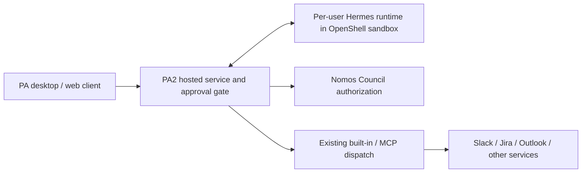
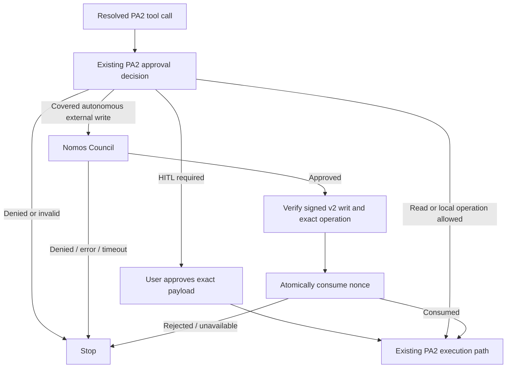
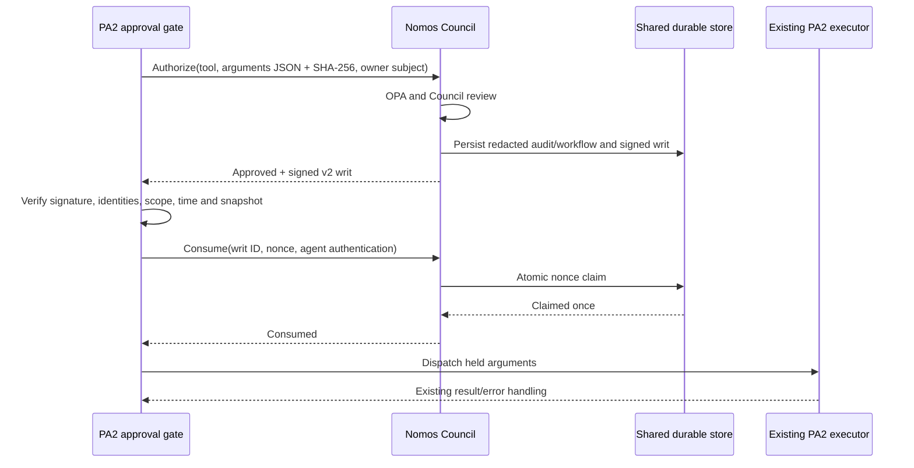

# PA2 autonomous external-write authorization

Status: proposed implementation, 30 September 2026. This proposal supersedes the
Hermes terminal-gate integration in draft PR #108. It describes the coordinated
Nomos and PA2 changes, with PA retaining tool execution.

## Purpose and scope

PA2 already decides which operations need human approval. Nomos adds Council
review to covered external writes that PA2 would otherwise execute without a
human. For example, PA2 can permit an internal Slack message automatically;
with this integration enabled, that message's resolved recipient and exact
arguments must receive a valid, single-use Council authorization before dispatch.

The integration uses PA2's existing approval decision and reviewed tool-effect
inventory. It does not add a new classifier, shell-command parser, sandbox,
credential broker, or trusted executor. Local shell/file operations continue
through their existing PA2 approval and runtime controls. A shell command with
external effects is not detected by this integration; sandbox egress controls
and credential isolation remain necessary.

## PA architecture and evidence

PA 1.x's desktop architecture runs agent orchestration in Electron and calls
remote inference and MCP services. That is background from the PA team's
architecture discussion, not a claim that all current PA deployments use it.
PA2 supports hosted orchestration and external agent runtimes. The
[PA NemoClaw on Astra architecture document](https://docs.google.com/document/d/1QSFgN-77mHJQHnYL47P2B5I5F5ImIMRpr_iS1uyFhhE/edit)
specifies **per-user sandboxes** in milestones 3/4 and **Per-User Hermes Sandbox**
in build-time requirement 25. We treat centrally managed shared gateway topology
as roadmap/deployment-specific, not an MVP prerequisite.

The implementation boundary is the PA2 shared approval gate. A Hermes or
OpenClaw runtime participates when its tool call reaches that gate; native calls
that bypass PA2 are outside coverage. No new Hermes **pre_tool_call** or OpenClaw
**before_tool_call** plugin is installed by this proposal.

## Decision flow

PA2's `requiresNomosAuthorization` selects no-HITL decisions with rule
`internal-comms`, or `reviewed-mcp-auto` whose existing `resolveToolEffect`
returns `write`. It excludes `mode-write`, `other-builtin`, reads, and human
approval paths. An existing exact human-approval replay is accepted earlier by
the gate and does not call Nomos. Reviewed MCP waivers can apply in any PA mode;
coverage is therefore not limited to the Fully Autonomous toggle.

## Exact authorization and execution binding

1. PA2 resolves recipients and applies existing approval policy.
2. The gate strips model-controlled governance arguments with the same helper
   used by the dispatcher and clones the argument object. It holds this snapshot
   during review and returns it through the existing `modify` hook result.
3. `NomosAuthorizationService` serializes JSON with sorted object keys, preserves
   array order, rejects cycles/non-JSON values, and caps the UTF-8 payload at
   32,000 bytes. SHA-256 binds those exact bytes.
4. PA2 calls the authenticated Council gRPC `Authorize` method with a structured
   `tool_call`. Raw arguments are live review material, while the signed
   operation stores only tool name, argument digest, and an opaque owner subject.
5. Council review mints a v2 writ. The signature covers the decoded
   `payload_base64` bytes directly. The TypeScript verifier never reserializes
   the payload before checking Ed25519; this avoids Python/JavaScript numeric
   formatting differences. A shared Python-generated fixture pins the contract.
6. PA2 verifies a deployment-pinned public key, schema/version, Council and
   service-agent identities, tool name, argument hash, owner subject, validity
   interval, and `max_executions=1`. It rejects malformed/duplicate JSON fields.
7. PA2 calls `council_consume_writ`. Nomos authenticates the registered agent,
   matches writ owner/Council/nonce, and claims the nonce atomically in shared
   durable storage. Only an unambiguous successful claim permits dispatch.
8. PA2 checks cancellation and argument equality again, then releases the held
   snapshot to its existing tool executor. Credentials stay in PA2's established
   server-owned credential routing.

The service `agent_id` is the registered Nomos client, not a model-supplied agent
name. The opaque subject hashes the authenticated PA owner identifier. It does
not attest to the downstream provider account: PA may select another credential
principal through its existing server-owned routing. Endpoint, account selection,
connector transformations, and provider effects remain inside PA's trust boundary.
The writ authorizes the PA dispatch input, not OS execution or provider completion.

## Failure and concurrency semantics

With the feature disabled, the existing gate behaves as before. When enabled,
missing configuration fails startup; in-scope denial, missing/invalid writ,
transport failure, expiry, cancellation, payload mutation, or failed consumption
blocks execution. There is no automatic fallback to human approval or unchecked
execution. Human-approval policy continues independently.

The client uses one deadline across authorize and consume and forwards caller
cancellation to gRPC. A timeout after consumption is ambiguous: the client blocks
and does not reuse the writ. A crash after consumption but before dispatch can
lose the operation. Single-use consumption prevents replay of a writ across PA
replicas; it does not provide exactly-once external effects or prevent a new
authorization from approving the same operation again. Provider idempotency
remains the executor's responsibility.

Existing post-tool telemetry continues. The Nomos client logs successful writ
consumption and duration without arguments, prompt context, nonce, token, or
raw writ. Those records prove an authorization gate ran; post-tool success is
an observation, not trusted execution attestation. A future trusted executor
would need enforcement and signed evidence at the actual execution boundary.

## Context privacy and Council prompt handling

Exact tool arguments travel as `arguments_json` and become live `Intent.context`
for review. No conversation-history capture is added in this phase. The client
supplies a fixed explanation of PA's routing decision, not user prompt history.
Council instructions explicitly classify this context as untrusted data, delimit
it, and direct reviewers not to follow instructions embedded within it.

The retained privacy work changes three storage/policy boundaries:

| Boundary | New behavior | Reason |
|---|---|---|
| Ledger | New intent submissions and consolidated review records serialize an empty context; structured authorization facts remain. | Avoid copying raw review context into the immutable audit trail. |
| Workflow cache | Durable schema v2 redacts context and records that it is unavailable on hydration. | Status reads and cross-replica coordination do not require raw user data. |
| OPA | The input projection omits context and identifies the new input contract. | Current bundled policy does not use prompt context; reduce disclosure to policy services and their logs. |

Migration `0005_redact_workflow_context.sql` first installs constraints that
reject new unredacted records, then scrubs historical workflow-cache context and
marks it unavailable. It validates the workflow constraint after scrubbing. The
ledger constraint is deliberately `NOT VALID` for old rows: historical
hash-chained ledger entries are not rewritten. Existing ledger copies, backups,
provider logs, and any external tracing need their own retention controls.

This is a raw-field minimization guarantee, not a guarantee that no sensitive
text can ever persist. Council reasoning or other caller-supplied text fields
can quote or paraphrase arguments; those outputs may still be audited. Review
deployment logging and LLM-provider retention separately. The in-process live
review necessarily holds context until its normal object lifetime ends.

Workflow hydration is a status/read path, not a mechanism for rerunning review
without context. Approval is minted only during a fresh authorize call. Privacy
settings fail closed when authoritative audit persistence fails.

## Deployment and rollout

Deploy the Nomos contract before enabling PA2. Provision a registered service
agent with the dedicated `tool:write` scope; shell privileges are not required.
Existing developer/operator presets are not broadened. Pin Council
public keys independently of the authorization response. Key rotation can
overlap up to eight trusted raw Ed25519 public keys.

Nomos gRPC now exposes `council_consume_writ` through its existing generic
`CallTool` method. The proxy enforces the configured transport bearer token in
addition to agent authentication on authorization/consume. Helm exposes an
explicit ingress peer list (default deny) and optional existing TLS secret.
Use TLS with hostname validation, or an authenticated encrypted service mesh.
NetworkPolicy requires an enforcing CNI and is not a replacement for encryption.

PA2 environment settings:

| Setting | Purpose |
|---|---|
| `PA_NOMOS_ENABLED` | Opt-in switch; default disabled. |
| `PA_NOMOS_GRPC_TARGET` | Council gRPC host:port. |
| `PA_NOMOS_GRPC_BEARER_TOKEN` | Transport credential matching the proxy token. |
| `PA_NOMOS_AGENT_ID`, `PA_NOMOS_AGENT_AUTH_TOKEN` | Registered service-agent identity and credential. |
| `PA_NOMOS_COUNCIL_ID` | Expected Council identity. |
| `PA_NOMOS_COUNCIL_PUBLIC_KEYS` | Comma-separated pinned 32-byte public keys in hex. |
| `PA_NOMOS_TIMEOUT_MS` | Combined review/consume deadline, default 60 seconds. |
| `PA_NOMOS_TLS_CA_FILE` | Optional private CA bundle; otherwise system roots. |
| `PA_NOMOS_ALLOW_PLAINTEXT=true` | Explicit local or protected-mesh exception. |

Configure `councilGrpc.tls.secretName` with a `kubernetes.io/tls` secret for
direct TLS. Set `councilGrpc.networkPolicy.ingressFrom` to the PA namespace AND
pod selectors in the same peer entry, so the selectors intersect. Do not use
separate entries when intersection is intended. Rotate tokens through Secrets.
The proxy-to-monitor internal hop retains its existing deployment security model;
use mesh encryption for that hop if required by the deployment threat model.

Roll out the privacy migration during a coordinated Council deployment. Old
replicas attempting unredacted inserts will fail the new constraints. Verify
custom OPA policies against the new input projection before rollout. Deploy PA2
disabled, configure trust/auth/TLS, then enable for a controlled environment and
exercise both positive and negative paths before broad rollout.

## Validation and remaining operational checks

Tests cover the signed operation and shared cross-language fixture, argument
canonicalization, signature/scope/time rejection, consumption ownership and
replay behavior, PA gate routing, cancellation/mutation, and privacy projection.
The review must also confirm the forwarded snapshot is the reviewed one through
the actual PA dispatcher wrapper. Render Helm with TLS and restricted peers.

A real staging Council/PA2 rollout and real connector write are not implied by
unit tests. Before production, validate the registered agent permissions,
Council latency/deadline, TLS trust, NetworkPolicy reachability, audit behavior,
and authorized/denied execution in that environment. Do not advertise provider
execution verification until a trusted execution boundary is implemented.
