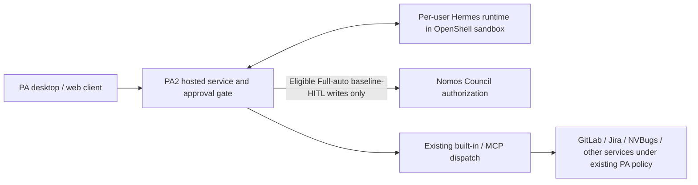
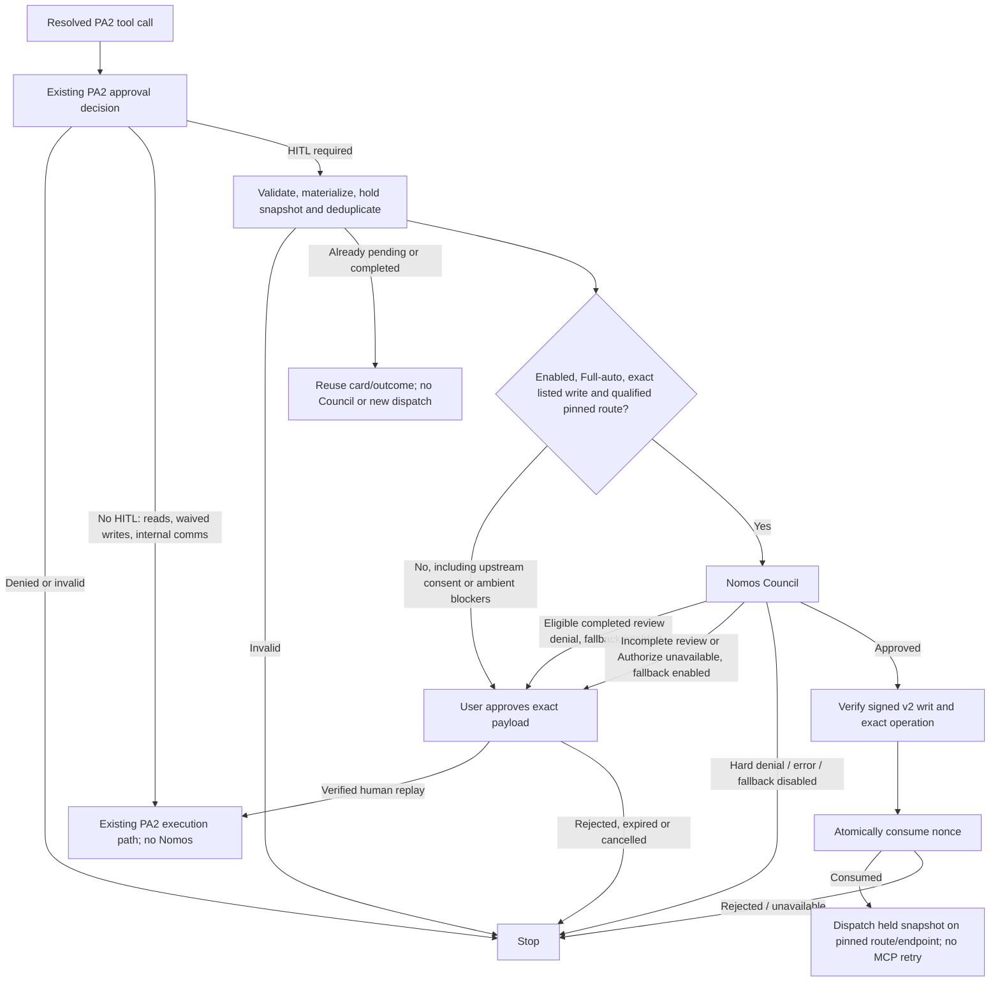
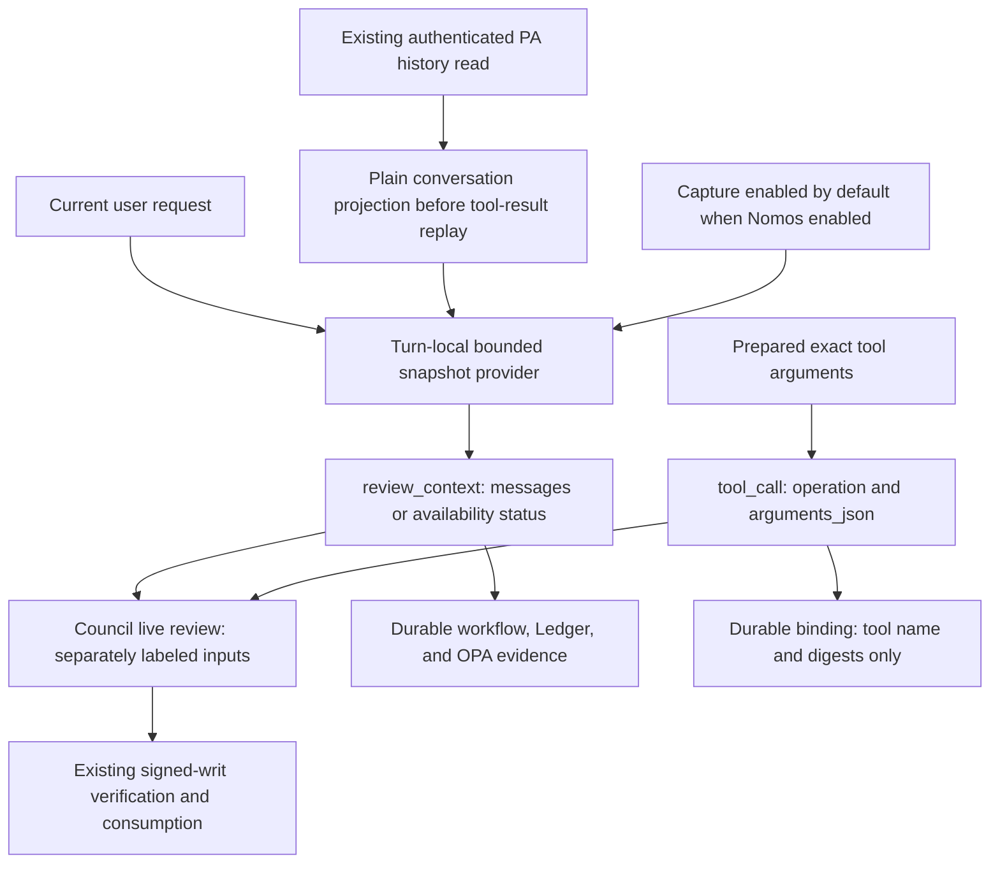
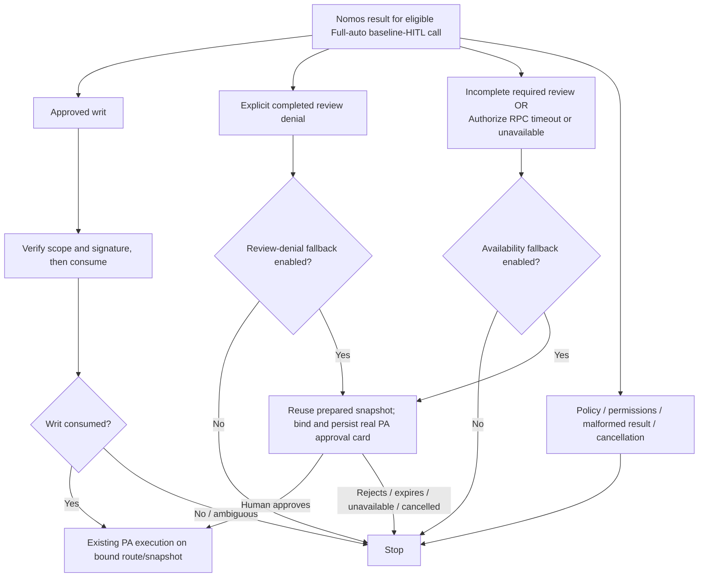
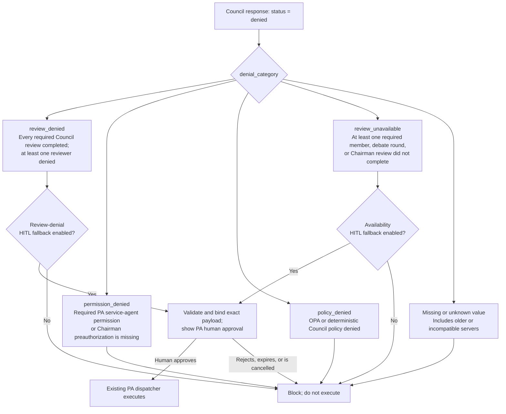

# PA2 autonomous external-write authorization

Status: Proposed, submitted for review; updated 2 October 2026. This proposal
supersedes the
Hermes terminal-gate integration in [Nomos PR #108](https://github.com/NVIDIA/Nomos/pull/108)
(closed). The current Nomos and PA2 submissions are open drafts, with PA retaining
tool execution. Deployment and staging validation remain outstanding.

## Purpose and scope

PA2 already decides which operations need human approval. Nomos substitutes
Council authorization for otherwise-required PA HITL only in Fully Autonomous
(`fully-autonomous`, Full-auto) mode, for an explicitly listed write on its
actual pinned execution route. The baseline approval decision is unchanged.
These are the document's "covered autonomous writes"; the integration does not
intercept every external write. For example, a listed GitLab builtin MR note
normally requires PA human approval. In Full-auto with the integration enabled
and its registered route verified, Council authorization and single-use
consumption may substitute for that approval. Already-waived internal Slack
communications keep their existing behavior and do not call Nomos.

**At a glance:**

- PA2 retains tool execution and its existing credential routing.
- Ordinary human-in-the-loop (HITL) approval bypasses Nomos.
- When enabled, Nomos reviews only Full-auto calls requiring baseline HITL that
  meet the exact inventory, snapshot, provenance, and route qualifications below.
  Reads, already-waived writes, internal communications, and other modes keep
  their existing PA controls without Nomos. Disabled configuration retains HITL
  for all candidates; it never silently grants automatic execution.
- An eligible Council review denial can request human approval when fallback
  is enabled. A timeout or unavailable response from the initial authorization
  RPC can also request human approval when its separate fallback is enabled.
  Hard policy/permission denials, malformed responses, cancellations, and all
  writ-consumption failures remain blocked.

The integration uses PA2's unchanged approval decision plus explicit,
server-owned autonomous flags on its existing tool policy entries. It does not
infer eligibility from write verbs, unknown tools, or application names, or add
a shell-command parser, sandbox,
credential broker, or trusted executor. Local shell/file operations continue
through their existing PA2 approval and runtime controls. A shell command with
external effects is not detected by this integration; sandbox egress controls
and credential isolation remain necessary.

### Exact eligibility inventory

Every candidate must require baseline HITL and use the actual first registered
sink. These entries do not change the builtin/MCP approval tables to waive HITL.

The policy sources are `src/core/builtin-tool-approval-policy.ts` for builtins
and `src/core/maas-mcp-tool-approval-policy.ts` for exact MaaS endpoint/tool pairs.
The same ten builtin tools and four MaaS pairs explicitly declare
`requiresApproval: true` and `allowAutonomousAuthorization: true`; no separate
candidate-list file is needed. The autonomous flag permits Council substitution
only when the Full-auto and per-call checks below pass. Missing or malformed
flags never qualify, even if an unknown tool defaults to requiring approval.
Existing boolean entries and the MaaS boolean-only default export retain the
baseline decisions. The Jira create/clone exemptions and update/log-work/
transition approval requirements are existing PA/MaaS policy choices, not
distinctions introduced by Nomos.

| Application / execution route | Exact candidate tools | Per-call qualification |
|---|---|---|
| GitLab builtin / `gitlab-write` | `gitlab_write--post_mr_note`, `gitlab_write--create_issue`, `gitlab_write--create_mr_review`, `gitlab_write--create_merge_request`, `gitlab_write--create_project`, `gitlab_write--commit_files` | Six explicitly approval-required builtins, on their registered builtin route only. |
| Jira builtin / `jira-write` | `jira_write--add_comment`, `jira_write--create_issue`, `jira_write--update_issue`, `jira_write--transition_issue` | Four explicitly approval-required builtins; implicit ambient scope/attachments/labels/provenance stay on HITL until snapshot-bound. |
| Jira MCP / `external-mcp`, `/maas/jira/mcp` | `jira--jira_update_issue`, `jira--jira_log_work`, `jira--jira_transition_issue` | Exact approval-required entries with the autonomous flag, official registry provenance, authoritative schemas, and pinned endpoint. |
| NVBugs MCP / `external-mcp`, `/maas/nvbugs/mcp` | `nvbugs--nvbugs_update_bug_v2` | Conditional on live authoritative schema availability and review: its approval-required entry has the autonomous flag, but the bundled catalog does not advertise the write. |
| Google Docs / Drive, `/maas/gdrive_v2/mcp` | None | Upstream requires real human confirmation; Council cannot substitute for that consent. |
| ServiceNow, `/maas/servicenow_mcp/mcp` | None | Upstream requires real human confirmation for all five reviewed writes. |

GitLab MCP at `/maas/gitlab/mcp` contains only reviewed reads, with no explicit
`true` entries; its six operational write candidates are builtin routes. MCP
`jira_create_issue` and `jira_clone_issue` are already waived and do not call
Nomos. Builtin `jira_write--create_issue` is a distinct, approval-required tool.
Unknown/default-true MCP entries, unrelated builtins, and local tools do not
qualify. Neither `internal-comms` nor `reviewed-mcp-auto` selects Council review.

### Canonical endpoints and provenance

The MCP branch requires server-owned `maas-registry` or reviewed `builtin`
fallback provenance, the actual `external-mcp` sink, an exact endpoint/tool
approval-required entry with the autonomous flag, and an authoritative schema.
A fallback row is not sufficient evidence of NVBugs write availability: that
tool requires live authoritative
discovery and review. `custom-*`, `local-extra`, absent provenance, unknown
tools, and trusted-looking URLs alone never qualify.

Trusted MaaS endpoints use HTTPS on `maas.prd.astra.nvidia.com` or
`maas.stg.astra.nvidia.com`, default/443 port, no credentials/query/fragment,
and `http`, `sse`, or `streamable-http` transport. Canonical prefixes are
`gitlab`, `jira`, `nvbugs`, `gdrive-mcp-server-v2`, and `servicenow`.
`gdrive`/`google-drive` are routing aliases for Drive v2, while the
`servicenow_mcp` endpoint remote ID projects to `servicenow`. Aliases do not
grant authorization. The legacy `/maas/gdrive/mcp` endpoint is tombstoned and
does not supply an alternate eligible write path. Builtin `gitlab_write` and
`jira_write` identities remain distinct from their MCP counterparts.

### Upstream consent and implicit-effect blockers

Drive's `gdrive_create_folder`, `gdrive_create_workspace_file`,
`gdrive_create_doc`, `gdrive_create_sheet`, `gdrive_upload_file`,
`gdrive_create_comment`, and `gdrive_create_comment_reply`, and ServiceNow's
`create_incident`, `update_comments`, `add_work_note`, `change_state`, and
`change_assignment` require `confirmation_id` and genuine human
`user_confirmed` consent. PA keeps their real preflight/approval/replay flow or
pauses. Council approval cannot forge `user_confirmed=true`, a human decision,
or the human-approved replay proof. The inspected catalog establishes no
alternate machine-authorization route. Future eligibility requires an
upstream-supported contract distinguishing machine authorization from human
consent, not merely a PA gate bypass. Google Docs scope does not automatically
cover Sheets or all Drive writes; `report_user_concern__gdrive_v2` is feedback,
not an eligible operational write, despite its explicit `true` policy entry.

GitLab/Jira builtins have no separate human-confirmation flags in their REST
executors, but still enforce their normal credentials, project/access scope,
and provider restrictions. GitLab commits can create branches and trigger CI;
MR creation does not merge the MR. Jira can apply ambient project/epic scope,
attach request-scoped screenshots, add labels/Slack provenance, and perform
follow-up mutations. Calls using implicit ambient scope/attachments/labels/
provenance remain HITL-only until the effective operation is captured in the
immutable reviewed snapshot and bound through execution. Tool membership alone
does not authorize those unreviewed effects.

## PA architecture and evidence

PA 1.x's desktop architecture runs agent orchestration in Electron and calls
remote inference and MCP services. That is background from the PA team's
architecture discussion, not a claim that all current PA deployments use it.
PA2 supports hosted orchestration and external agent runtimes. The
[PA NemoClaw on Astra architecture document](https://docs.google.com/document/d/1QSFgN-77mHJQHnYL47P2B5I5F5ImIMRpr_iS1uyFhhE/edit)
specifies **per-user sandboxes** in milestones 3/4 and **Per-User Hermes Sandbox**
in build-time requirement 25. We treat centrally managed shared gateway topology
as roadmap/deployment-specific, not an MVP prerequisite.



The implementation boundary is the PA2 shared approval gate. A Hermes or
OpenClaw runtime participates when its tool call reaches that gate; native calls
that bypass PA2 are outside coverage. No new Hermes **pre_tool_call** or OpenClaw
**before_tool_call** plugin is installed by this proposal.

## Decision flow



PA2's `requiresAutonomousWriteAuthorization` selects only baseline-HITL-required
`static-builtin` or `fixed-mcp` calls in Full-auto that satisfy the exact
inventory and actual-route checks. It does not select no-HITL decisions, waived
mutations, or internal communications. An existing exact human-approval replay
is accepted earlier by the gate and does not call Nomos. Disabled configuration,
other modes, and unqualified candidates retain the unchanged baseline HITL path.

## PA2 integration architecture and implementation

### Implementation status and boundary

The Nomos service changes are published
in [draft PR #109](https://github.com/NVIDIA/Nomos/pull/109). The PA2 companion implementation has been pushed and submitted as
[draft MR !1706](https://gitlab-master.nvidia.com/jarvis-chatbot/personal-assistant/pa2/-/merge_requests/1706),
tracked by [AIPRDQLTY-2206](https://nvidia.atlassian.net/browse/AIPRDQLTY-2206).
Both remain under review; neither submission establishes deployment or production
readiness. The Jira ticket remains open after merge for staging validation. This
section describes the revised implementation contract, including the conditional
NVBugs and implicit-effect qualifications above, not an already-enabled PA
production feature. The integration is an optional dependency of PA2's shared approval
gate, rather than a replacement agent harness or a new execution service.

The subsequent policy-metadata consolidation described here is implemented and
validated locally, but not yet committed or pushed. It changes where eligibility
is recorded, not the approved tool scope or runtime safeguards.

**Component responsibilities.** Paths below are relative to the PA2 repository.

**Table 1. PA2 integration components and responsibilities**

| File / entry point | Responsibility | Change in this MR |
|---|---|---|
| `src/core/autonomous-write-authorizer.ts` | Defines the provider-independent `AutonomousWriteAuthorizer` contract, its input, PA-owned fallback policy, and the typed denial/unavailability signals that can enter human review. Successful completion permits dispatch of the reviewed arguments; the authorizer does not execute tools. | New |
| `src/core/nomos-authorization.ts` / `NomosAuthorizationService` | Implements `AutonomousWriteAuthorizer`. Its `authorizeAndConsume()` method obtains optional conversation context, requests Council review, verifies the returned writ against the exact operation, and asks Nomos to consume it before permitting dispatch. | New |
| `src/core/autonomous-write-review-context.ts` | Builds a bounded, best-effort sanitized snapshot of recent user/assistant messages for authorization review, separate from the exact tool arguments. | New |
| `src/core/autonomous-write-dispatch-binding.ts` | Trusted WeakMap-backed in-process receipt binds exact arguments/authenticated context snapshot/route/endpoint/retries, not context object identity. Hooks preserve the first marker; the final base dispatcher claims once and detaches nested arguments before provider/MCP awaits. Neither human consent nor OS-execution attestation. | New |
| `src/core/tool-approval-policy.ts` | Defines shared approval metadata and fail-closed normalization; explicit autonomous flags never waive baseline approval. | New |
| `src/core/builtin-tool-approval-policy.ts` | Keeps existing builtin approval classifications and marks the ten supported builtin tools for autonomous authorization; owns builtin eligibility checks. | Modified |
| `src/core/maas-mcp-tool-approval-policy.ts` | Keeps existing MaaS endpoint/tool approval classifications and marks the four supported pairs; exports raw metadata plus a backward-compatible boolean projection. | Modified |
| `src/core/app.ts` / `src/core/mcp-manager.ts` | Authoritative schema discovery pins the URL on the actual supplying connection with zero retries; consent fields or any reference, including `$recursiveRef`, retain HITL. | Modified |
| `src/core/mcp-tool-approval-policy.ts` | Applies the boolean baseline projection and explicit autonomous flags with endpoint/provenance and schema/consent checks; no separate candidate inventory. | Modified |
| `src/core/nomos-authorization.ts` / `createNomosAuthorizerFromEnv` | Reads and validates PA's Nomos environment settings. Creates `NomosAuthorizationService` when enabled; returns `undefined` when disabled. | New |
| `src/api/index.ts` | Constructs the default `CoreConfig`, creates the concrete Nomos implementation, reads PA's provider-independent fallback policy, and passes both to `PersonalAssistantApp`. Callers supplying a custom configuration inject their own authorizer and may override the fallback policy. | Modified |
| `src/core/app.ts` | Wires the configured authorizer into PA's execution approval gates, supplies optional turn-local conversation context, and closes the authorizer during application shutdown. | Modified |
| `src/core/approval-gate.ts` / `createApprovalGate` | Preserves baseline policy; selects only eligible Full-auto HITL calls; validates/materializes and deduplicates before Council; holds the final snapshot and pins dispatch constraints. Only typed eligible denial/unavailability may enter real HITL when configured. | Modified |
| `src/core/query-dispatcher-chain.ts` / `wrapWithHitlApproval` | Prevents dispatch for blocked/queued calls or forwards the held arguments and trusted route/endpoint/no-retry options to the existing dispatcher. | Modified |
| `src/core/tool-dispatcher.ts` | Resolves/enforces the actual registered sink and carries pinned MCP endpoint/no-retry options alongside existing authenticated credential context. Does not request Council review itself. | Modified |

### Startup and configuration

`src/api/index.ts` constructs the default
`CoreConfig` object, sets `autonomousWriteAuthorizer` using
`createNomosAuthorizerFromEnv()`, reads `autonomousWriteAuthorizationPolicy`,
and passes the object to `new PersonalAssistantApp(coreConfig)`. The
`PersonalAssistantApp` class in `src/core/app.ts` stores that configuration and
passes `this.config.autonomousWriteAuthorizer` and the fallback policy to its
execution approval gates. `app.ts` and
`approval-gate.ts` depend on the standalone authorizer contract;
they do not construct a gRPC client or import the concrete service to implement
policy routing. A test double or another authorizer can implement the same
interface without taking a dependency on Nomos's transport implementation.
Callers supplying their own `CoreConfig` must explicitly inject the authorizer;
the default API factory does not automatically alter custom configurations.
They may omit `autonomousWriteAuthorizationPolicy` to use the gate's default-true
behavior for both typed fallback signals, or override either setting explicitly.

### What the approval gate passes to the authorizer

The approval gate calls `authorizeAndConsume()` on its configured authorizer:
`config.autonomousWriteAuthorizer.authorizeAndConsume(...)`.

The `AutonomousWriteAuthorizer` interface defines the method's contract; it does
not contain the executable implementation. When Nomos is enabled through PA's
default configuration, a `NomosAuthorizationService` instance provides that
implementation. Custom configurations and tests can supply another object that
implements the same interface.

The gate passes an `AutonomousWriteAuthorizationInput` object:

- `toolName` and `args`: the exact eligible tool and final validated/materialized,
  held argument snapshot, after existing pending/approved-action deduplication.
- `ownerId`: the owner identity supplied by PA's authenticated server context.
- `signal`: an optional `AbortSignal` for cancellation.
- `getReviewContext`: an optional trusted callback providing conversation context.

The configured authorizer's `captureReviewContext` property, declared by the
`AutonomousWriteAuthorizer` interface, lets
`PersonalAssistantApp` skip preparing conversation context when disabled.

### What the authorizer returns

`authorizeAndConsume()` returns `Promise<void>`, not a tool result or a writ for
the model. The approval gate waits for one of five outcomes:

- **Success:** authorization and single-use consumption are complete. The gate
  permits dispatch of the reviewed arguments through PA's existing dispatcher.
- **Eligible review denial:** the method throws `AutonomousWriteReviewDeniedError`.
  The gate may request human approval when fallback is enabled; it does not execute.
- **Incomplete required review:** the method throws `AutonomousWriteReviewUnavailableError`
  only for a strictly validated pre-consumption `review_unavailable` result. The
  gate may request human approval when the availability fallback is enabled.
- **Authorizer unavailable before a decision:** the method throws
  `AutonomousWriteAuthorizerUnavailableError`. The gate may request human
  approval when that separate fallback is enabled.
- **Other rejection:** the gate blocks the operation. Hard policy or permission
  denials, malformed responses, cancellations, mutation, and any failure during
  writ verification or consumption do not become human-override prompts.

The authorizer never executes tools. Alternative implementations must preserve
this contract, not return successfully after merely requesting a review. The
optional `close()` method on the configured authorizer releases owned resources;
the `AutonomousWriteAuthorizer` interface declares that lifecycle method.

### Where PA invokes the approval gate

`PersonalAssistantApp` passes `CoreConfig.autonomousWriteAuthorizer` and
`CoreConfig.autonomousWriteAuthorizationPolicy` into five execution
gate construction sites: the default durable dispatcher, Sticky trigger
execution, iframe invocation, orchestration, and request-local chat. This keeps
the decision in the existing shared gate instead of adding separate checks to
individual MCP connectors. The hosted human-approval preparation path does not
consume a writ: preparing an approval is not dispatching an autonomous action.
Coverage still requires a call to traverse these gates; it is not a global
interceptor for every process or native tool inside an OpenShell sandbox.

### From authorization to tool execution

Existing PA checks remain ahead of
Nomos, including authenticated server context, recipient resolution, and the
approval decision. Exact human-approved replay follows the existing approval
path without a second Council review. No-HITL decisions continue without Nomos.
For a baseline-HITL decision, the gate checks Full-auto, exact inventory,
authoritative schema, official MCP provenance where applicable, implicit-effect
qualifications, and the actual registered route. If selected and enabled, it
derives the owner from trusted server context
(`hostedStorageUserId`, then `userId`, then `credentialSubject`); a missing owner
blocks the operation. Model arguments cannot supply this identity.

The PA approval gate (`createApprovalGate`) validates and materializes the payload,
revalidates it, and applies existing pending/approved-action deduplication before
any Council request or writ consumption. It removes model-controlled governance
fields and uses `structuredClone` to hold the final snapshot during review.
After `authorizeAndConsume` succeeds, the gate returns `action: 'modify'` with
that snapshot as `modifiedArgs` and trusted constraints as `modifiedOptions`.
`wrapWithHitlApproval` forwards both to `inner.dispatch`, rather than using the
original caller-owned object or losing the route binding. The dispatcher enforces
the pinned registered sink; MCP also requires the reviewed endpoint and zero
reconnect retries. A changed route/endpoint blocks dispatch, not a new attempt at
another sink. `NomosAuthorizationService` checks argument equality and
cancellation around consumption; the gate also checks cancellation, lease, and
route stability before releasing the snapshot.

### Council requests and trust checks

PA's `NomosAuthorizationService` calls
`/nomos.council.v1.CouncilProxy/Authorize`, verifies the returned signed v2 writ
locally, and invokes `council_consume_writ` through
`/nomos.council.v1.CouncilProxy/CallTool`. These are two remote steps inside one
PA method, not a new remote method named `authorizeAndConsume`. A single
configured deadline covers both steps; caller cancellation cancels outstanding
gRPC work. TLS and pinned Council verification keys serve different purposes:
TLS authenticates/protects the connection, while the pinned key verifies the
authorization payload. Transport and registered-agent credentials stay in the
trusted PA service configuration, not tool arguments or model-visible output.

PA's existing connector and credential routing execute the approved call. The
integration neither copies user OAuth credentials into a new sandbox nor asks
Nomos to discover or control the user's Hermes sandbox. This avoids coupling
Council authorization to agent-sandbox lifecycle or gateway provisioning.

### Errors and observability

Invalid enabled configuration fails
startup. Runtime verification/transport/consumption failure produces a blocking
gate result with a safe error; it does not fall through to dispatch. An explicitly
eligible completed review denial can instead enter PA's existing human-approval
path, as described below; it never grants automatic execution.
Success logging records tool name, writ identifier, and elapsed authorization
time. Failure logging uses a safe category rather than raw request material.
Existing PA post-tool handling remains responsible for execution observations.
The PA-side authorization and optional context-capture spans are described below.
Council LLM usage is not newly accounted for by this PA client.

Implementation-level validation details are retained in Appendix A. Staging
tests with a real Council and connector remain necessary.

## Exact authorization and execution binding

1. PA2 resolves recipients and applies existing approval policy.
2. Only an enabled, Full-auto, baseline-HITL-required, explicitly eligible write
   on a qualified actual route proceeds to Council. PA validates/materializes and
   revalidates the payload, strips model-controlled governance arguments, and
   holds the final snapshot. Existing pending/approved-action deduplication
   precedes review/consumption. Implicit ambient Jira effects remain HITL-only
   until snapshot-bound; upstream human-confirmation tools never qualify.
3. `NomosAuthorizationService` encodes the held arguments deterministically and
   hashes them with SHA-256, binding authorization to the exact dispatch input.
   Serialization limits and cross-language checks are detailed in Appendix A.
4. PA2 calls the authenticated Council gRPC `Authorize` method with a structured
   `tool_call` and separate optional `review_context`. Exact arguments remain
   live-review data, while the already-sanitized conversation snapshot becomes
   durable decision evidence. The signed operation still binds tool name,
   argument digest, and an opaque owner subject.
5. An approved Council review mints a signed v2 writ for that operation. PA
   verifies the original signed bytes rather than reconstructing the payload.
6. PA2 verifies a deployment-pinned public key, schema/version, Council and
   service-agent identities, tool name, argument hash, owner subject, validity
   interval, and `max_executions=1`. It rejects malformed/duplicate JSON fields.
7. PA2 calls `council_consume_writ`. Nomos authenticates the registered agent,
   matches writ owner/Council/nonce, and claims the nonce atomically in shared
   durable storage. Only an unambiguous successful claim permits dispatch.
8. PA2 checks cancellation and argument equality again, then releases the held
   snapshot with trusted route/endpoint constraints to its existing tool executor.
   The actual registered route must still match; MCP pins the reviewed endpoint
   and disables reconnect retries. Credentials stay in PA2's established
   server-owned routing, including its existing project/access restrictions.

```mermaid
sequenceDiagram
  participant PA as PA2 approval gate
  participant C as Nomos Council
  participant S as Shared durable store
  participant E as Existing PA2 executor
  PA->>PA: Unchanged baseline HITL + Full-auto + exact eligible pinned route
  PA->>PA: Validate/materialize, hold final snapshot, deduplicate
  PA->>PA: Capture optional bounded user/assistant snapshot
  PA->>C: Authorize(tool_call + separate review_context)
  C->>C: OPA and Council review
  C->>S: Persist reviewed Intent evidence, workflow, audit, and signed writ
  C-->>PA: Approved + signed v2 writ
  PA->>PA: Verify signature, identities, scope, time and snapshot
  PA->>C: Consume(writ ID, nonce, agent authentication)
  C->>S: Atomic nonce claim
  S-->>C: Claimed once
  C-->>PA: Consumed
  PA->>E: Dispatch held arguments and pinned route/endpoint; no MCP retry
  E-->>PA: Existing result/error handling
```

PA authenticates to Nomos using its registered service account, identified by
`PA_NOMOS_AGENT_ID`; this is not an agent name supplied by the model. Separately,
PA hashes the server-authenticated PA owner ID and includes the resulting value
as the signed operation's `subject`. This binds the writ to that PA owner without
disclosing the raw owner ID to Nomos. The subject identifies the PA owner only;
it does not attest to the downstream provider account. PA may select another
credential principal through its existing server-owned routing. Endpoint,
account selection, connector transformations, and provider effects remain
inside PA's trust boundary. PA enforces route/endpoint constraints separately
from the signed tool-name/argument-digest/subject operation; those constraints
are not a new signed endpoint field or provider-account attestation.
The writ authorizes the PA dispatch input, not OS
execution or provider completion.

### Blast-radius review input

PA2 sends the following fixed text in the Authorize request's `blast_radius` field:

```text
This request proposes an external write. PA2 has not independently assessed its operational blast radius, downstream consequences, or recoverability. The proposed tool operation and exact arguments are provided separately for review. Authorization binds this specific call; it does not establish limited downstream impact.
```

This acknowledges the write without claiming that exact-call authorization bounds
its operational impact. The Council receives the exact operation and arguments
through `tool_call`, with separate optional, untrusted `review_context`. The text
is not a completed impact assessment; insufficient information may still result
in denial. No agent-generated impact claim, additional model call, or per-tool
target mapping is required. Raw arguments and conversation must not be copied
into `blast_radius`; the bounded sanitized snapshot has its own typed Intent
field and is retained as the evidence used during review.

## Failure and concurrency semantics

With the feature disabled, candidate writes retain baseline HITL. Waived writes
and internal communications never call Nomos, regardless of enablement. When enabled,
missing configuration fails startup. Missing/invalid writ, transport failure,
expiry, cancellation, payload mutation, failed consumption, and hard policy or
permission denial block execution. Only the typed completed-review-denial,
incomplete-review, or initial Authorize-unavailability signals may request human
approval under their corresponding fallback settings. There is no unchecked
execution or added authorization retry. Council-covered MCP dispatch disables
reconnect retries; existing builtin compound behavior remains within PA's
reviewed execution contract. Human-approval policy continues independently.

PA's `NomosAuthorizationService` uses one deadline across authorize and consume and forwards caller
cancellation to gRPC. A timeout after consumption is ambiguous: the client blocks
and does not reuse the writ. A crash after consumption but before dispatch can
lose the operation. Single-use consumption prevents replay of a writ across PA
replicas; it does not provide exactly-once external effects or prevent a new
authorization from approving the same operation again. Provider idempotency
remains the executor's responsibility.

Existing post-tool telemetry continues. The Nomos client logs successful writ
consumption and duration without arguments, prompt context, nonce, token, or
raw writ. Those records prove an authorization gate ran; post-tool success is
an observation, not trusted execution attestation. A future trusted executor
would need enforcement and signed evidence at the actual execution boundary.

## PA-side tracing implementation

`NomosAuthorizationService.authorizeAndConsume()` reuses PA2's
`startChildSpan()` and `withActiveSpan()` helpers from
`src/core/observability/datadog-tracer.ts`. No new tracing SDK, exporter, or
configuration is introduced, and the authorizer interface is unchanged.

**Table 2. PA-side authorization and context-capture spans**

| Span | Placement | Meaning |
|---|---|---|
| `nomos.authorize_and_consume` | Around the complete public authorization method, including preparation, verification, and release checks. | Total authorization overhead before dispatch is permitted. |
| `nomos.capture_review_context` | Before the Council RPC, around the enabled lazy snapshot provider and validation. | Snapshot acquisition/projection, sanitization, bounding, and serialization validation; not model inference or a database fetch. Omitted when capture is disabled. |
| `nomos.authorize` | Around the Council authorize RPC and decision parsing. | Review round-trip and response validation, not just network latency. |
| `nomos.consume_writ` | Around the consumption RPC and response validation, after verified approval. | Time to confirm the single-use claim. Absent when review or verification blocks the call. |

In the traced chat path, the existing `pa.tool.call` span encloses the approval
gate, so the new outer span inherits it. Both RPC spans explicitly reference
the authorization parent. For other entry points, parentage depends on the
active request/job context; with no active parent the authorization span is a
root. This change does not add missing turn/job instrumentation to other paths.
Local signature verification does not create another span.

### Safe outcomes and correlation

The Nomos tracing spans introduced by this design carry a small, allowlisted
set of attributes: tool and Council names (each limited to 128 characters),
authorization stage and outcome, and the verified writ ID when it is no longer
than 128 characters. Oversized writ IDs are omitted rather than truncated to an
ambiguous correlation value. Stages identify preparation, review, verification,
consumption, and release checks. Outcomes distinguish approval/consumption,
expected denial, invalid writ, failed consumption, cancellation, timeout,
generic transport failure, and other errors. Denial and cancellation do not
mark these spans as infrastructure errors; malformed or unknown decisions do. A
child review approval is not overall authorization: verification and consumption
can still fail afterward.

Only safe local categories are derived from gRPC status codes; remote error
messages are not recorded. No arguments, prompts, owner identifiers, argument
or intent hashes, nonce, credentials, raw writ, or Council reasoning are added
to these spans. Existing PA tool-result telemetry remains unchanged and has its
own payload handling. Writ IDs are trace correlation fields, not metric labels.

Tracing failures must neither change authorization decisions nor repeat an RPC.
Appendix A describes the failure-isolation implementation.

### What tracing does and does not show

These spans use PA's existing Datadog tracer and show
PA-observed round-trip latency. PA's optional OTel summary sink is a separate
path and is not extended here. No connected Council-side trace propagation or
Council reviewer/inference spans are added, and no new token/cost accounting
is introduced. Those require separate work across the service boundary. Traces
are operational observations, not durable audit guarantees or proof of exact
external execution.

A staging trace with real Council and connector calls remains an operational
rollout check, not something established by unit tests.

## Optional conversation capture and separate review inputs

### Separate tool input and conversation context

Earlier in this branch, exact tool arguments occupied the
generic `Intent.context` field and no conversation history was sent. The new
tool-call path keeps the request's existing `tool_call.operation` and
`tool_call.arguments_json`, and adds a separate typed `review_context`. Nomos
stores `review_context` as a normal typed Intent field so Council, OPA, workflow
state, and the ledger all refer to the same bounded evidence. Exact arguments
remain private live-review material and are represented durably only by their
digest. Legacy shell authorization continues using its existing context contract.

**Table 3. Separate operation and conversation review inputs**

| Input | Content and purpose | Authority and retention |
|---|---|---|
| `tool_call.operation` | Tool name, exact argument digest, and owner subject. | Existing signed execution binding; persists as structured authorization facts. |
| `tool_call.arguments_json` | Exact canonical argument JSON the caller will dispatch. | Live Council review only; digest verification remains unchanged. |
| `review_context` | Versioned availability status, bounded sanitized user/assistant messages, and truncation flag. | Untrusted decision evidence; neither execution input nor proof of human approval. Persisted with the Intent and supplied to OPA. |



### Where conversation context comes from

The chat-turn integration obtains a parallel
plain-text projection from the same authenticated history read PA already makes.
It must happen before model-history assembly: PA's replay builder appends
approval summaries, completed-tool outputs, and large-result handles inside
some user/assistant messages. Filtering that enriched history by role would
therefore be insufficient. No additional history lookup is introduced. The
current user request is included separately; model-injected memory, system
instructions, tool payloads/results, and hidden reasoning are not sources.

The `getReviewContext` callback belongs to one request-local approval gate, not
the shared `NomosAuthorizationService` instance or a global session map. The
context-capture code freezes selected source strings and memoizes
an immutable sanitized result. Multiple covered tool calls in that turn can
reuse the snapshot. This is recent conversation history plus the current user
request, not a hook capturing every intermediate assistant message generated
inside a remote Hermes runtime. Paths without a trusted conversation source,
including other execution gates, report unavailable; they never borrow another
turn's context or fetch a latest-context fallback.
If the plain historical source is unavailable but the current user request is
present, the snapshot can still be available with that request alone. The
capture span excludes the existing history database read and the small initial
plain-field copy; it measures lazy snapshot processing and validation.

### Conversation size limits

Inspect at most 64 recent candidate messages and retain
at most six eligible user/assistant text messages, including the current user
message. Skip an individual candidate exceeding 32,768 characters rather than
scanning unbounded input or redacting an already-cut fragment. Sanitize eligible
whole candidates before selecting the beginning/end excerpts. Each retained
message is at most 2,000 characters including the omission marker; the entire
serialized context is at most 24,000 UTF-8 bytes. Older messages are dropped if
necessary to satisfy the wire budget. Mark omission/truncation explicitly.
Redaction is best-effort, not a guarantee that prose contains no sensitive data:
an assistant can repeat source data, and novel secret formats may evade masking.

### Missing context and configuration

`PA_NOMOS_CAPTURE_REVIEW_CONTEXT` defaults
to true and is subordinate to the existing default-disabled
`PA_NOMOS_ENABLED`. False skips context preparation and provider invocation
entirely and sends status `disabled`. A missing source sends `unavailable`;
failed or malformed capture sends `error`. Only `available` can carry messages.
These statuses are explicit in Council review. Missing context alone does not
block authorization or bypass Council; the ordinary decision and fail-closed
verification/consumption path still apply.

### Measuring conversation capture

`nomos.capture_review_context` is a child of
`nomos.authorize_and_consume` because capture is lazy at authorization time,
not in a pre-model hook. It records only status, included-message count,
serialized byte count, and truncation flag alongside existing bounded tool and
Council identifiers. No message text or capture exception is logged. Capture
errors do not mark successful authorization as failed. Disabled capture creates
no capture span. The elapsed time reflects that invocation; subsequent calls
can retrieve an already memoized snapshot.

## Context sanitization, persistence, and Council prompt handling

Council rendering has separate **PROPOSED TOOL OPERATION** and **UNTRUSTED
CONVERSATION CONTEXT** sections. The exact tool input must be evaluated as data,
and the conversation is advisory: neither section supplies instructions to the
reviewer or proves human approval. The existing fixed PA-routing justification
does not carry conversation text. Private review material survives in-process
review copies but contains only exact tool arguments and is excluded from model
serialization, persistence, OPA, and workflow hydration. The bounded sanitized
`review_context` is a normal Intent field: it is supplied to OPA, rendered for
Council review, hashed with the Intent, and retained in workflow and Ledger
records. This preserves visibility into the evidence behind a decision.

Exact tool arguments remain available only during live Council review. Ledger
and workflow records retain the conversation evidence plus structured
authorization facts: the tool name, SHA-256 digest of the exact arguments, and
hashed PA owner. These fields let PA verify that a signed writ covers the same
proposed call without retaining data from which the exact arguments can be
reconstructed. They do not prove that PA executed the call or that the provider
completed it.

**Table 4. Live review data across storage and policy boundaries**

| Boundary | New behavior | Reason |
|---|---|---|
| Ledger | Intent submissions and consolidated review records retain legacy request context and the bounded structured `review_context`; exact tool arguments remain excluded. | Preserve the evidence Council used so decisions and failures can be analyzed after the fact. |
| Workflow cache | Durable workflow state retains the same Intent context and structured `review_context`; exact tool arguments remain excluded. | A rehydrated workflow exposes the same decision evidence across Council replicas. |
| OPA | Policy input includes legacy request context and structured `review_context`, plus the tool name and argument digest; exact arguments remain excluded. | Policy evaluation receives the same sanitized conversation evidence supplied to Council and stored for audit. |

Nomos deliberately does not apply a second, different redaction pass. PA2/Relay
must sanitize and bound the snapshot before `Authorize`; the exact resulting
`review_context` is then used by OPA and Council and written to the audit trail.
This prevents a mismatch in which Council decides from one payload but operators
later inspect another. Relay execution intercepts can observe the raw model
request, while Relay's sanitized event payloads are delivered only to registered
subscribers, so the integration must deliberately select the sanitized source.

Draft migration `0005_redact_workflow_context.sql` was removed. Forward
migration `0006_restore_workflow_context.sql` drops the redaction constraints
for development databases that applied the earlier draft. It cannot reconstruct
historical context already scrubbed by that draft migration.

Persistence makes retention controls part of the deployment contract. The
Ledger may be immutable, and workflow rows, backups, OPA decision logs, Council
provider logs, and external tracing each need documented access, encryption, and
retention policies. Best-effort sanitization cannot guarantee that prose contains
no sensitive data: an assistant can repeat source data and novel secret formats
may evade masking. Council reasoning can also quote or paraphrase evidence.
Authoritative audit persistence still fails closed.

## Human approval after an eligible denial or review unavailability

### When human fallback is enabled

`PA_AUTONOMOUS_WRITE_HITL_ON_REVIEW_DENIAL` defaults true when the Nomos
integration is enabled. Nomos still approves or refuses autonomous
execution. For an eligible review denial, PA asks the human to approve the
specific operation using its existing durable approval flow. This is a separate
human authorization, not a claim that Nomos approved or a retry of the denied
operation. This is deployment-owned configuration, not a model/tool argument.
Set false when deployment policy requires every Council denial to
remain terminal. Nomos itself remains disabled by default.

`PA_AUTONOMOUS_WRITE_HITL_ON_AUTHORIZER_UNAVAILABLE` independently defaults
true. It permits the same human-review pipeline when the Council returns a
strictly validated `review_unavailable` denial before issuing a writ, or when the
initial Authorize RPC returns gRPC `DEADLINE_EXCEEDED` or `UNAVAILABLE` before PA
receives a decision. It does not apply to cancellation, authentication/permission
errors, malformed responses, invalid writs, argument mutation, or any failure
during consumption. A consumption timeout or unavailable response is ambiguous:
the writ might already be consumed, so PA blocks and requires a new operation.
Operators that require Council participation for every autonomous write set
this availability fallback to false. Leaving it enabled can increase approval
volume during an outage or denial-of-service event, but it cannot automatically
execute an action.



### How PA routes an eligible denial to human approval

`AutonomousWriteReviewDeniedError` means: “Nomos declined autonomous execution,
but PA may ask a human to approve.” It is not permission to execute. The class
is defined in `src/core/autonomous-write-authorizer.ts` so the approval gate
can recognize it without importing the concrete Nomos client.

1. **Nomos classifies the denial.** The Council response identifies a completed,
   eligible review denial with `denial_category: review_denied`.
2. **The PA client checks the response.** `NomosAuthorizationService.authorizeAndConsume()`
   checks the expected Council, a valid bounded decision ID, no conflicting writ
   or permission fields, unchanged arguments, and no cancellation. It then throws
   `AutonomousWriteReviewDeniedError`, rejecting the pending promise. Missing or
   unknown categories cannot produce this signal.
3. **The gate decides whether HITL may be offered.** `createApprovalGate()` catches
   `AutonomousWriteReviewDeniedError`. It may create a human-approval request only
   when `autonomousWriteAuthorizationPolicy.hitlOnReviewDenial` is enabled through
   `PA_AUTONOMOUS_WRITE_HITL_ON_REVIEW_DENIAL` and the request has not been
   cancelled. Otherwise, PA blocks the operation.
4. **PA creates a pending human-approval request.** PA validates and binds the
   final payload, persists the pending request, and displays an approval card that
   states, “Autonomous execution was declined; human approval is required,” and
   shows the exact operation to review. At this point, the human has not approved
   anything and the operation has not executed. The card does not display
   free-form Council reasoning.
5. **The human's decision determines the outcome.** If the human approves the
   exact displayed payload, PA executes it through its existing approved-replay
   path without consulting Nomos again. If the human rejects it, the request
   expires, or it is cancelled, PA does not execute the operation. No Nomos writ
   is issued or consumed on this branch.

The exception carries only safe decision/authority IDs and a fixed message, not
Council reasoning or conversation text. The gate checks the error's type with
`instanceof`; it does not infer eligibility from an error message.

`AutonomousWriteAuthorizerUnavailableError` is the corresponding provider-
independent signal for bounded pre-decision unavailability. The Nomos adapter
emits it only around the Authorize RPC. The consume call is deliberately outside
that translation boundary, so an identically coded transport failure after writ
verification remains a hard block rather than becoming human-review eligible.
A strictly validated Council response received through the configured transport
and classified as `review_unavailable` instead becomes
`AutonomousWriteReviewUnavailableError`, retaining bounded decision and authority
IDs while excluding remote failure diagnostics. Both signals allow fallback to
human approval when `PA_AUTONOMOUS_WRITE_HITL_ON_AUTHORIZER_UNAVAILABLE` is enabled;
when it is disabled, PA blocks the operation. UI metadata and tracing distinguish
incomplete Council review from an authorization RPC timeout or unavailability.

### Which denials qualify?

Nomos assigns one server-generated `denial_category` to a denied authorization
response. PA does not interpret Council prose to decide whether a human may
override the denial; it follows the category shown below.



`review_denied` is the only denial category eligible for the review-denial HITL
fallback. Nomos emits it only when every configured Council member completed a
real evaluation in every required round, any configured Chairman review
completed, and at least one reviewer voted to deny the tool call. PA still asks
the human only when the fallback setting is enabled.

`review_unavailable` means the Council could not establish complete review
provenance. For example, when an incomplete member, debate-round, or Chairman
review causes the overall result to be denied, Nomos marks that denial
`review_unavailable`. If the availability fallback is enabled, PA may offer its
separate human approval; otherwise it blocks. This route never claims that the
Council approved the operation.

This incomplete-review case remains distinct from PA failing to reach the Nomos
Authorize RPC at all. A pre-decision gRPC `DEADLINE_EXCEEDED` or `UNAVAILABLE`
response has no `denial_category`. Both conditions may request human approval when
`PA_AUTONOMOUS_WRITE_HITL_ON_AUTHORIZER_UNAVAILABLE` is enabled; otherwise PA blocks
the operation. This setting is independent of
`PA_AUTONOMOUS_WRITE_HITL_ON_REVIEW_DENIAL`, which governs completed review denials.
PA keeps separate typed signals, notices, and correlation metadata for incomplete
review and transport unavailability. Permission failures, policy
failures, missing or unknown categories, and older servers remain hard stops.

Nomos derives the category from private, process-local completion markers that
model output cannot set. Those markers are not returned or persisted. The
category controls only whether PA may offer its own bound human approval; it is
not execution authorization and never permits automatic dispatch.

### Preparing the human approval request

The gate catches only the corresponding typed review-denial, incomplete-review,
or pre-decision-unavailable signal when its fallback is enabled and the call has
not been cancelled. It
then reuses the already validated/materialized snapshot and runs the normal
recipient revalidation, approval binding, duplicate detection, and durable
enqueue path used for ordinary HITL. Initial validation/materialization and
pending/approved-action deduplication precede Council, not only fallback.
Human-confirmation connector preflight remains on its separate real HITL path;
it is never an autonomous consent bypass. It never returns `continue` merely
because fallback is enabled. The approval display uses a fixed notice identifying
either a declined autonomous review or an unavailable authorizer. A denial carries
bounded decision and authority IDs for correlation; unavailability carries no
provider-controlled diagnostic. The notice is attached before approval preparation
and binding. Raw Council explanations and review context are not copied into approval
metadata. The specialized email card explicitly renders the same fixed notice;
generic, Slack, and Teams cards display the additional summary field through
their existing presentation paths.

If materialization changes the proposed input, the human approves the final
displayed and bound payload. The same original denied payload must not silently
execute in parallel. Human-approved replay uses PA's existing exact-payload proof
and does not petition Nomos again or create a denial/approval loop. No Nomos writ
is issued or consumed on the denied branch; authority comes from PA's human
approval mechanism. Approval cards retain the normal PA payload persistence and
access-control policy, separate from Nomos's live-context privacy boundary.

### Failures and audit records

Missing approval infrastructure, validation or
binding failure, persistence failure, expired approval, human rejection, and
cancellation remain stops. Cancellation is checked after asynchronous preparation
and lease checks before enqueue. Existing pending/approved-action deduplication
is retained; this change does not introduce a new global exactly-once guarantee.
Authorization spans preserve `denied` or `unavailable` as applicable, never
misreporting fallback as Council approval.
PA logs the transition to human review and emits its ordinary approval event;
no new tracing SDK or duplicated execution telemetry is added.

Validation covers both default-on/disabled fallback settings, classified versus
unknown denials, Authorize timeout/unavailability, consume-phase ambiguity,
actual evaluation failures, cancellation/mutation, notice binding, missing
gateway, failed persistence, deduplication and normal human replay.
Staging validation should additionally exercise the card UI, approval resolver,
and real connector outcome. Deploy the matching Council response contract before
enabling fallback; older responses safely stay blocked.

## Deployment and rollout

Complete these prerequisites before enabling Nomos in PA2:

1. **Deploy a compatible Nomos Council.** PA2 depends on the v2 signed
   tool-operation writ and atomic consumption contract in this change. Leave the
   PA feature disabled until that contract is running.
2. **Create a dedicated PA service account.** Give it only the `tool:write`
   permission and membership in the selected Council. It does not need shell or
   file permissions, and enabling this integration must not broaden existing
   developer or operator roles.
3. **Configure both authentication layers.** PA needs one secret to reach the
   Council gRPC proxy and a different secret to authenticate its registered
   service account to the Council.
4. **Pin the Council signing key through a trusted channel.** Do not trust a
   public key returned alongside an authorization response; an attacker could
   otherwise supply both a forged writ and the key that validates it.
5. **Plan signing-key rotation with overlap.** PA can trust up to eight raw
   32-byte Ed25519 public keys at once, allowing old and new keys to coexist
   until all previously issued writs have expired.

Nomos gRPC now exposes `council_consume_writ` through its existing generic
`CallTool` method. The Nomos Council gRPC proxy enforces the configured transport bearer token in
addition to agent authentication on authorization/consume. Helm exposes an
explicit ingress peer list (default deny) and optional existing TLS secret.
Use TLS with hostname validation, or an authenticated encrypted service mesh.
NetworkPolicy requires an enforcing CNI and is not a replacement for encryption.

PA2 environment settings:

**Table 5. PA2 Nomos configuration settings**

| Setting | Purpose |
|---|---|
| `PA_NOMOS_ENABLED` | Opt-in switch; default disabled. Only eligible Full-auto baseline-HITL writes on qualified pinned routes may substitute Council. Disabled retains HITL; waived writes/internal comms do not call Nomos. |
| `PA_NOMOS_CAPTURE_REVIEW_CONTEXT` | Default true when Nomos is enabled; false skips conversation capture without disabling authorization or exact-argument review. |
| `PA_AUTONOMOUS_WRITE_HITL_ON_REVIEW_DENIAL` | Provider-independent PA routing policy, default true when an authorizer is configured. Only explicitly eligible review denials may request existing PA human approval; false makes them terminal. |
| `PA_AUTONOMOUS_WRITE_HITL_ON_AUTHORIZER_UNAVAILABLE` | Provider-independent PA routing policy, default true when an authorizer is configured. A strictly validated `review_unavailable` result or initial Authorize timeout/unavailability may request existing PA human approval; false makes those failures terminal. Consumption ambiguity remains blocked. |
| `PA_NOMOS_GRPC_TARGET` | Council gRPC host:port. |
| `PA_NOMOS_GRPC_BEARER_TOKEN` | Secret sent as gRPC `authorization` metadata. It must equal the Council gRPC process's `COUNCIL_MCP_PROXY_TOKEN`; bundled Compose and Helm deployments populate that setting from the same secret stored under `MONITOR_MCP_PROXY_TOKEN`. |
| `PA_NOMOS_AGENT_ID` | Stable registered PA service-account identity; it is not a PA user or model-supplied agent name. |
| `PA_NOMOS_AGENT_AUTH_TOKEN` | Raw secret minted for `PA_NOMOS_AGENT_ID` and sent inside Authorize and consume request JSON. Nomos stores only its hash. This is separate from the gRPC bearer token. |
| `PA_NOMOS_COUNCIL_ID` | Expected Council identity. |
| `PA_NOMOS_COUNCIL_PUBLIC_KEYS` | Comma-separated pinned 32-byte public keys in hex. |
| `PA_NOMOS_TIMEOUT_MS` | Combined review/consume deadline, default 60 seconds. |
| `PA_NOMOS_TLS_CA_FILE` | Optional private CA bundle; otherwise system roots. |
| `PA_NOMOS_ALLOW_PLAINTEXT=true` | Explicit local or protected-mesh exception. |

Configure `councilGrpc.tls.secretName` with a `kubernetes.io/tls` secret for
direct TLS. Set `councilGrpc.networkPolicy.ingressFrom` to the PA namespace AND
pod selectors in the same peer entry, so the selectors intersect. Do not use
separate entries when intersection is intended. Rotate tokens through Secrets.
The proxy-to-monitor internal hop retains its existing deployment security model;
use mesh encryption for that hop if required by the deployment threat model.
The PA operator procedure, including least-privilege account provisioning,
secret mapping, coordinated rotation and staging checks, is maintained in the
PA2 repository at `docs/operations/nomos-autonomous-write-authorization.md`.

Roll out the privacy migration during a coordinated Council deployment. Old
replicas attempting unredacted inserts will fail the new constraints. Verify
custom OPA policies against the new input projection before rollout. Deploy PA2
disabled, configure trust/auth/TLS, then enable for a controlled environment and
exercise both positive and negative paths before broad rollout.
Verify live authoritative NVBugs write availability separately; its bundled
catalog omission is not resolved by enabling the feature. Keep implicit ambient
Jira effects on HITL until snapshot-bound and keep Google Docs/ServiceNow on
genuine human confirmation until a supported upstream machine-authorization
contract exists. These are eligibility blockers, not Council-outage fallbacks.

## Validation and remaining operational checks

Tests cover the signed operation and shared cross-language fixture, argument
canonicalization, signature/scope/time rejection, consumption ownership and
replay behavior, PA gate routing, cancellation/mutation, and privacy projection.
The review must also confirm the forwarded snapshot is the reviewed one through
the actual PA dispatcher wrapper, with its pinned sink/endpoint and no MCP retry.
Scope validation must cover the six GitLab/four Jira builtin candidates, three
Jira MCP writes, conditional live NVBugs discovery, disabled/non-Full-auto HITL,
waived writes/internal comms bypassing Council, official provenance, unknown or
custom exclusions, and pre-Council validation/materialization/deduplication.
Verify implicit ambient Jira effects remain HITL-only until bound and all twelve
Drive/ServiceNow human-confirmation writes retain their genuine human flow.
Render Helm with TLS and restricted peers.

A real staging Council/PA2 rollout and real connector write are not implied by
unit tests. Before production, validate the registered agent permissions,
Council latency/deadline, TLS trust, NetworkPolicy reachability, audit behavior,
and authorized/denied execution in that environment. Do not advertise provider
execution verification until a trusted execution boundary is implemented.

## Appendix A — Engineering details and validation

### Serialization and signature contract

Argument JSON uses sorted object keys, preserves array order, rejects cycles
and non-JSON values, and is capped at 32,000 UTF-8 bytes. SHA-256 binds those
exact bytes. The Ed25519 signature covers the decoded `payload_base64` bytes
directly; the TypeScript verifier never reserializes the payload before checking
it. This avoids Python/JavaScript numeric-formatting differences. A shared
Python-generated fixture pins the cross-language contract.

### Tracing failure isolation

Trace state lives inside each invocation, not on the shared authorizer instance.
A small private wrapper isolates failures in span creation, context activation,
tagging, status updates, and finish. It memoizes the operation promise before
running work, so even activation failure after callback invocation cannot repeat
an RPC. Authorization rejection remains a rejection, and every created span
receives a finish attempt in a finally block. Tracing disabled or unavailable
must not change the security decision.

### Test seams and coverage

Gate tests inject an interface implementation to test routing independently of
gRPC. Concrete-service tests exercise transport outcomes and signed-writ checks.
Dispatcher-wrapper tests verify that the reviewed snapshot, not a later mutation
of the original arguments, reaches execution. Tracing tests cover span parentage
and completion, concurrent calls, disabled and failing instrumentation, negative
authorization paths, and payload exclusion. These checks do not substitute for
staging tests with a real Council and connector.

Local validation of the policy-metadata consolidation on 2 October 2026 passed
884 targeted tests across 19 suites, the full PA2 `npm run build`, scoped ESLint,
and `git diff --check`. Regression checks pin all 974 MaaS approval decisions,
the builtin approval inventories, and exactly ten builtin/four MaaS autonomous
flags. This does not establish a full PA2 test-suite pass, a remote MR pipeline
pass, or live staging functionality.
