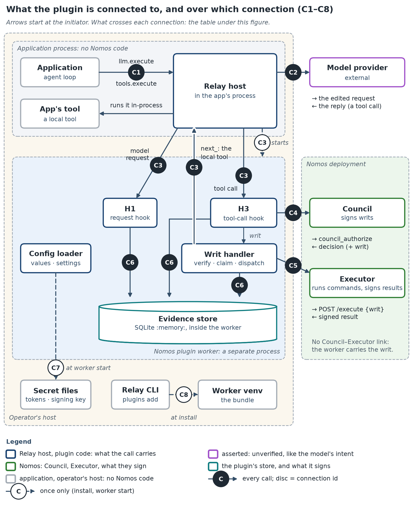
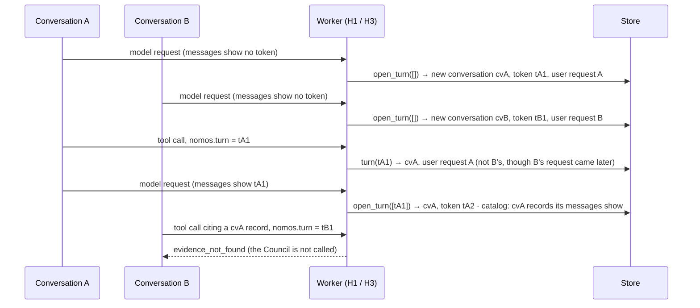

<!--
SPDX-FileCopyrightText: Copyright (c) 2026, NVIDIA CORPORATION & AFFILIATES. All rights reserved.
SPDX-License-Identifier: Apache-2.0
-->

# `nemo_relay_nomos`: physical design

The contract the implementation and the QA suite are both held to. **must**, **never** and **always** mark a
promise, and every promise has a test. Code: [`nemo_relay_nomos/`](nemo_relay_nomos/).

## Requirements

An operator installs this worker plugin in NeMo Relay and adds a `nomos.council` entry to `plugins.toml`.
Every application that routes model calls through `llm.execute` and tool calls through `tools.execute` is
then governed by Nomos, with no application code changes:

1. A configurable set of **guarded** tools: all (`*`), an allow-list, or everything except a deny-list.
2. On each model request, guarded tool schemas gain a required `nomos` intent object. The request also
   carries a **turn token** and, when evidence is kept (requirement 6), a **catalog** of evidence the model may
   cite: tool name and arguments only, never the output.
3. On each guarded tool call, the plugin strips `nomos` and builds a Council intent. Cited evidence goes to
   the Council only as `certified_evidence`: Executor-signed originals, and results and Council decisions the
   plugin certified ([certified plugin records](#certified-council-decisions)). Nothing is asserted `evidence`.
   The plugin then submits the intent.
4. On a **writ**, the default handler validates it, claims it, and dispatches to the tool's configured
   executor. A custom handler can be configured: the fields and interface exist, but no loader yet.
5. On a **denial**, the full Council response is returned from `tools.execute`.
6. With an operator-configured `signing_key`, **every** response is stored as evidence with signer identity,
   timestamp and a signed content hash. Evidence must be signed, and the plugin never generates a key: without
   `signing_key` it keeps **no evidence**. No record or tool list is stored (the turn bookkeeping is), model
   requests offer no catalog and no `evidence` field, and [`tool_definitions`](#observed-tool-definitions) is
   ignored. Evidence lives in the worker's memory and lasts as long as the worker: no storage is
   presumed.
7. Every configuration string can be a literal, an environment reference or a file reference. Encrypted
   values are accepted by the schema and rejected at resolution with a TODO diagnostic.
8. One worker serves **every conversation** in its host process, and Relay does not say which one is calling.
   Conversations must never share evidence, the user request sent to the Council, or session state. Where the
   plugin cannot tell which conversation a call belongs to, it refuses rather than guesses.

**Constraints:** Relay worker SDK `nemo-relay-plugin` 0.11 (`>=0.11.0,<0.12`, `grpc-v1`) · Nomos command-v1 and structured-tool-v2
wire contracts (writ, `ExecutionResult`, `council_authorize`) · guarded calls sequential within a conversation, concurrent across
conversations · POSIX only (`O_NOFOLLOW`) · no disk and no external service (SQLite `:memory:` in the worker).

## Components and levels

A component depends only on strictly lower levels; the graph is acyclic.

| Level | Module | Responsibility | Depends on | Sole adapter to |
|---|---|---|---|---|
| 1 | [`wire`](nemo_relay_nomos/wire.py) | canonical JSON, SHA-256, bounded text | — | — |
| 1 | [`values`](nemo_relay_nomos/values.py) | resolve config value references | — | process env, secret files |
| 1 | [`llm_request`](nemo_relay_nomos/llm_request.py) | inject the intent schema; read tokens and ids from a transcript; append the Nomos message | — | — |
| 2 | [`settings`](nemo_relay_nomos/settings.py) | typed, validated settings and the config JSON Schema | `values` | — |
| 2 | [`tool_call`](nemo_relay_nomos/tool_call.py) | canonical structured request plus the derived operation binding | `wire` | — |
| 2 | [`verify`](nemo_relay_nomos/verify.py) | strict writ and executor-evidence verification against pinned trust | `wire` | — |
| 2 | [`signing`](nemo_relay_nomos/signing.py) | the plugin's Ed25519 identity | `wire` | — |
| 3 | [`nomos_client`](nemo_relay_nomos/nomos_client.py) | `council_authorize` and, opt-in, `council_get_public_key` (MCP), `POST /execute` (HTTP) | `settings`, `wire` | Council, Executor |
| 3 | [`records`](nemo_relay_nomos/records.py) | build records; decide how each is cited | `wire`, `signing`, `verify` | — |
| 4 | [`repository`](nemo_relay_nomos/repository.py) | conversations, turns, journal, records, writ claims | `wire`, `records`, `settings` | SQLite `:memory:` |
| 5 | [`writs`](nemo_relay_nomos/writs.py) | writ handler, claimers, executors | `verify`, `repository`, `nomos_client`, `settings`, `records` | — |
| 6 | [`plugin`](nemo_relay_nomos/plugin.py) | the Relay worker: H1 and H3 | all of the above | Relay worker SDK |
| 7 | [`worker`](nemo_relay_nomos/worker.py) | process entrypoint (`serve_plugin`) | `plugin` | Relay worker SDK |

## Connections and the data that crosses them

Six of the [eight connections](docs/architecture/README.md#the-picture-five-places-eight-connections), each
owned by exactly one module (see Insulation).



| | Owning module | In | Out |
|---|---|---|---|
| **C3** Relay host ⇄ worker | `plugin` (`worker` starts it) | H1: `(model_name, request, annotated)`; H3: `ctx.tool_name`, `ctx.args` (with `nomos`), `ctx.tool_call_id`, and `next_` | H1: the edited request; H3: the model-visible response dict plus annotation `{"nomos": …}` |
| **C4** worker ⇄ Council | `nomos_client.McpCouncil` | an `AuthorizeOutput` dict: `status`, `decision_id`, `council_members`, `chairman`; on approval also `writ` (base64) and `writ_id`; otherwise `error`, `guidance`, `missing_permissions`, `retryable` | `council_authorize(**fields)`, fields below |
| **C5** worker ⇄ Executor | `nomos_client.HttpExecutor` | an `ExecutionResult` with Ed25519 `evidence`, read with a byte bound | `POST /execute {"writ": <base64, unchanged>}`, header `X-Agent-ID` |
| **C6** worker ⇄ its in-memory store | `repository.EvidenceStore` | records, journal rows, claims, turns, conversations | the same |
| **C7** worker ⇄ secret files | `values` | the file's text (≤ 64 KiB, UTF-8) | — |
| **C8** Relay CLI ⇄ bundle | (Relay) | — | — |

**Where each `council_authorize` field comes from.** Observed and asserted fields never mix: the model's intent
cannot change what is authorized.

| Field | Source | Kind |
|---|---|---|
| `agent_id`, `council_id`, `auth_token` | `settings.connection` (configuration; the token via C7) | observed |
| `command`, `working_directory` | `nomos_http` only: configured working directory plus the configured command argument | observed |
| `tool_call` | local tools only: schema version, observed tool name, exact business-argument object and configured opaque subject; Nomos derives the digest | observed except operator-supplied subject |
| `context` | both executors send the bounded user request of the call's own turn; a truncation marker says when H1 shortened it; with [`tool_definitions`](#observed-tool-definitions) on, it first names the certified definitions item's `stdout_sha256` | observed |
| `description`, `justification`, `target_resource`, `blast_radius` | `ctx.args["nomos"]` | asserted |
| `certified_evidence` | cited records, each as `records.citation()` gives it (C6): a certified `executor_result`'s `content`, whole; a `local_result`'s, `council_denial`'s or `council_error`'s `certified_result` | signed by the Executor, or certified by the plugin with `signing_key` |
| `evidence` | always `[]`: nothing is sent as asserted | — |
| `certified_evidence` (last item, only with [`tool_definitions`](#observed-tool-definitions) on) | the tool definitions H1 saw in the call's own turn (`tool_lists`), as an `ExecutionResult` | observed by the plugin, signed with `signing_key`; certified once the operator registers that key as a trusted executor |

Captured data at every step: [How data moves through one call](docs/architecture/README.md#how-data-moves-through-one-call).

## The evidence store

One SQLite `:memory:` database per activation, inside the worker, living exactly as long as it. Relay never
respawns a worker, so a new activation starts empty and older ids read `evidence_not_found`. Records are kept only
with a [`signing_key`](#the-plugins-signing-key). Every table except `writ_claims` and `tool_lists` is per
[conversation](#conversations-sharing-one-worker); a tool list is stored once and charged to each conversation whose
turns keep it.

| Table | Columns | Written by | Read by |
|---|---|---|---|
| `conversations` | `id` (`cv_…`, never shown to the model), `created`, `denials`, `blocked` | `open_turn`, `set_denials`, `finish` | `begin` (blocked), `denials` |
| `turns` | `token` (`nt_…`), `conversation`, `citable` (JSON list of conversation ids), `user_request` (≤ 800 chars), `user_request_truncated`, `created`, `expires`, `tools_sha256` (NULL unless `tool_definitions` is on), `tools_kept`, `superseded` (a later request showed its token) | `open_turn` | `turn` (H3) |
| `tool_lists` | `sha256` (of `tools`), `tools` (the request's canonical `tools` array): one row per distinct list, kept only within `max_citation_bytes` and the storage quota, removed when no live turn keeps it | `open_turn` | `tool_list` (H3), `_check_quota` |
| `records` | `seq` (catalog order), `id` (`ev_…`), `conversation` (NULL for a refusal before the call named a live turn), `kind`, `status` (= `evidence_status`), `created`, `expires` (`created + retention_seconds`), `record` (canonical JSON), `digest` (SHA-256 of `record`), `citation` | `put` (refusals before the journal), `finish` (every other outcome), `mark_citations` | `get` (citations), `catalog` (H1) |
| `calls` | `conversation` and `id` (= `tool_call_id`) together are the key, `request_hash` (SHA-256 of tool + all args), `state`, `outcome` (the returned response), `digest`, `created` | `begin`, `dispatch`, `finish` | `begin` (replay, conflict, blocked) |
| `writ_claims` | `nonce`, `writ_id`, `claimed` | `claim_writ` | `claim_writ` |

**Retention** (the worker may live for weeks; nothing grows without bound):

| Row | Dropped |
|---|---|
| turn | after `retention_seconds`, or oldest first beyond `max_invocations` |
| record | content at expiry; the id tombstone one retention period later |
| completed call | one retention period after it began (so `max_invocations` is per retention window) |
| conversation | when no live turn names it and it has no unfinished call |
| writ claim | never (worker lifetime) |

**Transactions.** A call that reaches the Council writes three, each before the next network call or exposure
(atomic within the worker, not beyond it):

| | Call | State after | Before |
|---|---|---|---|
| T1 | `begin` | `calls.state = authorizing`, quota reserved | C4 |
| T2 | `claim_writ`, then `dispatch` | nonce claimed; `calls.state = dispatching` | C5 (or `next_` for `local`) |
| T3 | `finish` | record inserted; `calls.state = complete` with the outcome; the conversation `blocked` if the outcome is unknown | the response returns over C3 |

A refusal before T1 uses `put` alone; a denial, Council error or later refusal skips T2. Recovery: `begin` below.
Captured rows and crash points: [07 · storage and recovery](docs/architecture/07-storage-and-recovery.md).

## Conversations sharing one worker

**Why.** One worker per activation, one activation per host process: every conversation in the process shares it.
The worker gets no caller identity (tool context is `tool_name`, `args`, `tool_call_id`; `tools.execute` metadata
does not reach it; the scope id is a fresh `invoke-<uuid>` per call), and the plugin does not control how Relay is
used (requirement 8).

**Turn tokens.** H1 puts a random token (`nt_` + 32 hex) in the Nomos message; the schema requires the model to copy
it into `nomos.turn`. A conversation is the set of turns its own transcript links: H1 reads the tokens the messages
show (`transcript_ids`) and opens the new turn there (`open_turn`); H3 resolves the call's token (`turn`) to its
conversation and recorded user request. A token is a bearer value, like an evidence id. The schema text is fixed, so
tools stay byte-identical across turns.



**Isolation promises** (tests in [`tests/test_plugin.py`](tests/test_plugin.py); QA in [`tests/qa/`](tests/qa/)):

| # | Promise | Tests |
|---|---|---|
| 1 | A conversation's catalog **never** lists another conversation's record, even one whose id its messages show. | `test_a_conversation_never_sees_or_cites_another_conversations_evidence`; QA `test_another_conversations_evidence_is_neither_listed_nor_citable`, `test_catalog_lists_only_visible_ids_of_citable_conversations` |
| 2 | A citation of another conversation's record **must** be `evidence_not_found`, indistinguishable from an unknown id, and the Council is **never** called. | the tests of 1; QA `test_get_of_another_conversations_record_with_citable_is_evidence_not_found` |
| 3 | The Council's `context` is **always** the user request of the turn the call names, whatever other conversations sent since. | `test_the_council_gets_the_user_request_of_the_calls_own_turn`; QA `test_the_council_context_is_the_user_request_of_the_calls_own_turn` |
| 4 | Denials, the denial cap and the blocked flag belong to one conversation and **never** stop another. | `test_denials_and_the_denial_cap_are_per_conversation`, `test_an_unknown_outcome_blocks_only_its_own_conversation`; QA `test_denials_count_per_conversation`, `test_an_unknown_outcome_blocks_only_its_own_conversation`, `test_denials_are_per_conversation`, `test_block_holds_for_every_later_call_and_only_in_its_conversation` |
| 5 | The same `tool_call_id` in two conversations is two calls: an outcome is **never** replayed across conversations. | `test_the_same_tool_call_id_in_two_conversations_never_replays_across`; QA `test_the_same_call_id_in_another_conversation_is_a_different_call` |
| 6 | Guarded calls are serialized per conversation; other conversations run concurrently. | `test_conversations_run_concurrently_and_each_is_serialized` |
| 7 | A conversation uses at most `conversation_share_percent` of records, journal entries and storage. | `test_one_conversation_cannot_fill_the_store_for_the_others`; QA `test_a_conversation_may_use_only_its_share_of_the_store` |
| 8 | A call without a live turn **never** reaches the Council: a missing or malformed token is `missing_intent`, an unknown or expired one `unknown_turn`, each with teaching text. | `test_a_missing_or_unknown_turn_is_refused_and_taught`; QA `test_a_missing_turn_is_missing_intent`, `test_an_unknown_turn_is_refused_and_taught_without_the_council`, `test_intent_problems_reports_a_missing_or_malformed_turn` |
| 9 | A request whose messages show a live token continues that conversation; one showing none starts a new one. | `test_a_later_request_continues_its_conversation_from_its_own_transcript`; QA `test_a_later_request_continues_the_conversation_its_transcript_shows`, `test_open_turn_with_a_known_token_continues_that_conversation`, `test_open_turn_without_known_tokens_starts_a_new_conversation` |
| 10 | A request showing several conversations starts a new one with the strictest state and may cite theirs; the conversations found are **never** changed. | `test_a_transcript_naming_two_conversations_starts_a_new_one_with_the_stricter_state`; QA `test_open_turn_over_several_conversations_starts_one_with_the_strictest_state` |
| 11 | The tools schema is identical on every request; only the Nomos message changes. | `test_h1_issues_a_new_turn_for_every_request_with_a_fixed_schema`; QA `test_h1_issues_a_new_turn_on_every_request` |
| 12 | A long-lived worker keeps working: completed calls leave the quota one retention period after they began. | `test_retention_frees_the_journal_so_a_long_lived_worker_keeps_working`; QA `test_completed_calls_leave_the_quota_one_retention_period_after_they_began` |

A captured run of 1–3 on the real worker: [H1, E2](docs/architecture/02-request-path-h1.md#e2--the-turn-token-and-the-conversation--c3-c6). Relay's missing
caller identity: `test_relay_gives_the_tool_hook_no_caller_identity`, [`findings.md`](docs/findings.md).

**Not guaranteed:**

| Case | What happens |
|---|---|
| transcript trimmed of (or expired) all its live tokens | a new conversation: denials reset, a block is left behind |
| forks of one conversation | they share it; each catalog still lists only the ids its own messages show |
| a token or id leaked outside its conversation | usable by whoever is shown it (a leaked token joins that conversation) |
| several agents in one process | all present as the one `connection.agent_id` |

A caller identity on Relay's worker callbacks would replace turn tokens (upstream request).

## The plugin's signing key

Evidence is worth keeping only if signed, and the plugin signs only with an operator-configured `signing_key`
(normally a `{"file": …}` reference). It never generates one: nobody could verify a per-activation key. So the key
decides whether evidence exists at all:

| | `signing_key` set | not set (the default) |
|---|---|---|
| Records | every response is stored, signed (receipt; plugin records also carry the plugin's signature) | **none**: no record is stored |
| `tool_definitions` on | the item is certified with the key; tool lists are kept in memory | ignored (`nomos.config.tool_definitions_disabled` warning): no item, no tool list |
| H1: the `nomos` schema | `NOMOS_FIELD`, with `evidence` | `NOMOS_FIELD_WITHOUT_EVIDENCE`: no `evidence` property |
| H1: the Nomos message | the turn line, then the catalog | the turn line only |
| H3: an intent with `evidence` | citations resolved and sent to the Council | `missing_intent` ("unexpected field 'evidence'"); the Council is not called |
| H3: responses | `evidence_id` and the record's `evidence_status` | no `evidence_id`; `evidence_status` is `locally_verified` for a verified Executor result, `invalid` for one that failed, `unavailable` otherwise |
| Executor results | verified against the pinned keys, then stored as certified | verified the same way before any output is returned; a failure is still withheld (`evidence_invalid`) and blocks the conversation |
| `validate()` | — | a WARNING, `nomos.config.evidence_disabled` |

Unchanged by the key: turns and conversations, the call journal, writ verification and claims, quotas.

Tests: every `test_without_a_signing_key_*` in [`tests/`](tests/) and [`tests/qa/`](tests/qa/) (installed worker
included), plus the `llm_request` tests of `nomos_field(False)`.

## Public interfaces

### `wire`
- `canonical(obj: Any) -> bytes`: sorted keys, `(",", ":")` separators, `allow_nan=False`, UTF-8. It must
  raise `ValueError` on NaN or infinity.
- `sha256_hex(data: str | bytes) -> str`: a string is encoded as UTF-8 first.
- `bounded(text: str, limit: int) -> str`: returns `text` unchanged if `len(text) <= limit`. Otherwise
  returns the first `limit` characters plus `"…[truncated N chars]"`.

### `values`
- `class ConfigReferenceError(ValueError)` with attributes `field: str` and `message: str`.
- `is_reference(value: Any) -> bool`: true only for a dict with exactly one of these key sets:
  `{"value"}`, `{"env"}`, `{"file"}`, `{"encrypted", "key_env"}`, `{"encrypted", "key_file"}`.
- `resolve(value: Any, *, field: str, environ: Mapping[str, str] | None = None) -> Any`:
  - A non-reference is returned unchanged.
  - `{"value": x}` → `x`.
  - `{"env": "NAME"}` → `environ["NAME"]`. A missing or empty variable must raise `ConfigReferenceError` whose
    message names the variable. The message must say that managed Relay workers start with a minimal
    environment.
  - `{"file": "/abs"}` → the file's text with one trailing newline stripped. The path must be absolute and a
    regular file, never a symlink. It must be owned by the current uid with no group or other permission
    bits (`0600` or `0400`) and must be at most 64 KiB. Otherwise raise `ConfigReferenceError`.
  - `{"encrypted": …, "key_env"|"key_file": …}` must always raise `ConfigReferenceError` with a message
    containing `"not supported yet"`.
  - The message of `ConfigReferenceError` must never contain a resolved secret value.
- `resolve_tree(config: Any, *, environ=None, path: str = "") -> Any`: resolves every reference anywhere in
  a JSON tree. `field` is the dotted path, e.g. `connection.auth_token`. It never mutates its input.

### `llm_request`
- `INTENT_FIELDS = ("description", "justification", "target_resource", "blast_radius")`
- `TURN_PATTERN = "^nt_[0-9a-f]{32}$"`
- `NOMOS_FIELD: dict`: the injected JSON Schema object. Its required members are `turn` (a string matching
  `TURN_PATTERN`) and the four intent fields. Optional `evidence` is an array of up to 20 (`MAX_CITATIONS`) unique strings matching
  `^ev_[0-9a-f]{32}$`. `additionalProperties: false`. Its text is fixed, with no per-call data: the token
  itself travels in the Nomos message, so the tools stay byte-identical across turns.
- `NOMOS_FIELD_WITHOUT_EVIDENCE: dict`: `NOMOS_FIELD` without the `evidence` property, for a plugin with no
  signing key. `nomos_field(evidence: bool, citations: int = MAX_CITATIONS) -> dict` returns one or the other;
  a smaller `citations` lowers `evidence.maxItems` (19 with `tool_definitions` on).
- `teach_nomos(tool, *, evidence=True) -> str`: the teaching text; it offers `evidence` only when `evidence`.
- `inject_intent(tools: list[dict], guarded: Callable[[str], bool], field: dict = NOMOS_FIELD) -> tuple[list[dict], list[str]]`:
  - Returns new tools and the names changed. It never mutates its input.
  - Only `{"type":"function","function":{...}}` tools are edited.
  - It is idempotent: a second call changes nothing.
  - It adds `nomos` to `properties` and to the end of `required`.
- `intent_problems(intent: Any, *, evidence: bool = True, citations: int = MAX_CITATIONS) -> list[str]`: empty when
  the intent is complete. More than `citations` ids is a problem. With
  `evidence=False`, an `evidence` key is an unexpected field. `turn` must match
  `TURN_PATTERN`. Every intent field must be a non-blank string of at most 4096 characters.
- `transcript_ids(messages: list) -> tuple[list[str], list[str]]`: the turn tokens and the evidence ids that
  appear anywhere in the messages' JSON text, each in order of first appearance, without duplicates.
- `render_message(turn: str, entries: list[CatalogEntry]) -> str`: the Nomos message.
  - The first line is `TURN_LINE` with the token: it names the token and tells the model to put it in
    `nomos.turn`.
  - When `entries` is non-empty, `CATALOG_HEADER` follows, then one line per entry. Each line holds the
    `evidence_id`, the tool name, the outcome, `certified` or `plugin-signed`, and the compact JSON
    arguments.
  - It never contains tool output.
- `append_message(request: dict, annotated: dict | None, text: str) -> tuple[dict, dict | None]`:
  - With `annotated`, the raw request must be returned unchanged.
  - `annotated.api_specific.api == "anthropic_messages"` → the text is appended to `annotated.instructions`
    (a string; created if absent; joined by a blank line).
  - `"openai_responses"` → a `{"role":"developer","content":text}` message is appended.
  - Otherwise → `{"role":"system","content":text}` is appended.
  - Without `annotated` (raw OpenAI-chat body) → a system message is appended to
    `request["content"]["messages"]`.
  - Never mutates its inputs.

`CatalogEntry` is a dict: `evidence_id`, `tool_name`, `arguments` (dict, bounded), `outcome` (`executed` |
`failed` | `denied` | `error` | `not_executed`), `certified` (bool), `created_at` (float).

### `settings`
- `SCHEMA: dict`: the JSON Schema of the raw config. Every string, number and boolean leaf (and every array item) also accepts a
  value reference. The file `config.schema.json` must equal `json.dumps(SCHEMA, indent=2) + "\n"`.
- `diagnostics(raw: dict, *, environ=None) -> list[Diagnostic]`: schema errors on the raw config, then
  resolution errors, then semantic errors. `Diagnostic` is a `(field: str, message: str)` named tuple. Empty
  means valid.
- `Settings.from_config(raw: dict, *, environ=None) -> Settings`: raises `SettingsError(diagnostics)` when
  `diagnostics` is non-empty.

**Settings fields** (defaults in parentheses):
- `connection: Connection`:
  - `mcp_url` ("http://127.0.0.1:9901/mcp"), `executor_url` ("http://127.0.0.1:9907")
  - `agent_id` (required), `council_id` (required)
  - `auth_token` (""), `proxy_token` ("")
  - `working_directory` ("/workspace"), `timeout_s` (180.0)
- `guard: Guard(include=("run_shell",), exclude=())`. `Guard.matches(name) -> bool` is true when `name`
  matches an include glob (`fnmatchcase`) and no exclude glob. The reserved prefix `nomos_` is never guarded.
- `tools: dict[str, ToolPolicy]`; `ToolPolicy(executor: "nomos_http"|"local", command_argument: str|None)`.
  Default `{"run_shell": ToolPolicy("nomos_http", "command")}`. `Settings.policy(name) -> ToolPolicy`
  returns the configured policy, or `ToolPolicy(default_executor, None)`.
- `default_executor` ("local")
- `tool_call: ToolCallSettings(subject=None)`: an operator-derived opaque subject required by local tools;
  static configuration is suitable only for one subject per activation. Control characters (C0/DEL) and
  Unicode line/paragraph separators are rejected.
- `writ_handler: WritHandlerSettings(kind="default", claim="auto", entrypoint=None, options={})`.
  `kind ∈ {"default","custom"}`; `claim ∈ {"auto","executor","local_ledger","council"}`.
- `max_denials` (3)
- `catalog: CatalogSettings(enabled=True, max_entries=20, max_argument_chars=400)`
- `tool_definitions` ("off"; `"off"|"called"|"all"`): see [Observed tool definitions](#observed-tool-definitions)
- `session: Session(id)`: the `session` object and its `id` are optional; a missing id becomes
  `"activation-" + 12 random hex`
- `signing_key: str | None` (64 hex characters, a raw Ed25519 seed; None means the plugin keeps no evidence; no
  key is ever generated)
- `trust: Trust(policy_version, valid_until, executors: dict[str, list[str]], council_public_key_hex: str | None,
  council_public_key_source: "pinned"|"council" = "pinned")`. With `"council"` the key is None until the first
  guarded call fetches it (H3 step 5)
- `limits: Limits(max_result_bytes=2 MiB, max_storage_bytes=64 MiB, max_records=1000,
  max_invocations=10000, retention_seconds=3600, max_citation_bytes=4 MiB, max_output_chars=65536,
  conversation_share_percent=25)`. Each conversation may use at most `conversation_share_percent` of each of
  `max_records`, `max_invocations` and `max_storage_bytes`, inside the store-wide caps.

**Semantic errors** (diagnostics):
- a `nomos_http` tool without `command_argument`;
- a configured local tool without `tool_call.subject` or with `command_argument`; a guarded tool that can
  fall back to `default_executor="local"` also requires the subject. Glob includes conservatively require
  it unless the same glob (or `*`) is excluded, because the tool map cannot enumerate future matching tools;
- `writ_handler.kind == "custom"`, with the message "custom writ handlers are not implemented yet";
- `writ_handler.claim == "council"`, with a message that the pinned Nomos has no claim API;
- `claim == "executor"` for a `local` tool;
- an expired `trust.valid_until`;
- `council_public_key_source = "pinned"` without `council_public_key_hex`, or `"council"` with it;
- `council_public_key_source = "council"` when `connection.mcp_url` is plain `http://` to a non-loopback host,
  whatever `allow_insecure_http` says (a key fetched in clear can be supplied by anyone on the path);
- `max_storage_bytes` too small for one result within one conversation's share.

### `verify`
- `EvidenceError(ValueError)`
- `check_trust(trust: dict, now=None) -> None`
- `decode_writ(encoded: str) -> dict`
- `decode_tool_call_writ(encoded: str) -> dict`: strict v2 envelope decoding; duplicate and unknown fields fail.
- `verify_writ(writ, trust, *, agent_id, council_id, command, working_directory, writ_id, dispatch=False,
  now=None) -> None`
- `verify_tool_call_writ(...) -> dict`: verifies the signature over the original decoded payload bytes, then
  parses and binds agent, Council, response writ id, exact operation, validity interval and freshness.
- `verify_executor_evidence(result, writ, trust, *, agent_id, council_id, now=None) -> None`

Each raises `EvidenceError` with a stable reason code. They never trust a key that is not in `trust`.

### `signing`
- `class PluginSigner`:
  - `__init__(seed: bytes)` (32 bytes)
  - `identity -> dict`: `{"type":"plugin","id":"nomos.council","public_key_hex","key_fingerprint"}`, where
    the fingerprint is the SHA-256 of the raw public key.
  - `sign(content_sha256: str, *, evidence_id: str, created_at: float, record_sha256: str | None = None) -> dict`:
    returns
    `{"algorithm":"ed25519","signed":{"evidence_id","content_sha256","created_at"},"value": hex}`, signed over
    `canonical(signed)`.
  - `executor_id -> str`: `nomos-relay-plugin:<first 16 hex of the fingerprint>`, the trusted-executor id the
    operator registers the key under.
  - `certify(stdout: str, *, command: str, agent_id: str, council_id: str, request_id: str, success: bool = True,
    error: str | None = None, writ: dict | None = None) -> dict`: a Nomos `ExecutionResult` with `stdout` and an
    `evidence` payload this key signs, field for field Nomos's `ExecutionEvidencePayload` (same canonical bytes),
    `verification_stage: "observed"`. `writ` (a verified v2 writ payload) fills `writ_id`, `intent_hash` and
    `nonce`; without one they are empty. Used for the [observed tool definitions](#observed-tool-definitions) (not
    stored), [local results](#certified-local-results) and [Council decisions](#certified-council-decisions)
    (stored as the record's `certified_result`).
- `verify_plugin_signature(public_key_hex: str, signature: dict) -> bool`: never raises.
- `generate_seed() -> bytes`

### `nomos_client`
- `Council` Protocol: `async authorize(**fields) -> dict`; `async public_key(council_id) -> dict` (Nomos
  `PublicKeyOutput`: `council_id`, `public_key_hex`, `fingerprint`, `key_id`, `error`), used only with
  `council_public_key_source = "council"`. `McpCouncil(connection)` implements both over MCP
  (`council_authorize`, `council_get_public_key`).
- `Executor` Protocol: `async execute(writ: str, agent_id: str) -> dict`. `HttpExecutor(connection,
  max_response_bytes)` implements it.
- These are the only code that performs network I/O to Nomos.

### `records`
- `KINDS = ("executor_result","local_result","council_denial","council_error","execution_unknown","plugin_refusal")`
- `response(status, *, execution="not_executed", evidence="unavailable", **fields) -> dict` — the model-visible result envelope (`contract_version`, `status`, `execution_status`, `evidence_status`, fields).
- `executor_record(*, evidence_id, tool_name, tool_call_id, arguments, result, writ, verified: bool,
  verification_error: str|None, receipt_signer: PluginSigner, policy_version, now) -> dict`
- `plugin_record(*, evidence_id, kind, tool_name, tool_call_id, arguments, content: dict, signer:
  PluginSigner, decision_id=None, writ_id=None, certified_result=None, now) -> dict`: with `certified_result`
  (only for `local_result`, `council_denial` and `council_error`; `ValueError` for another kind) the record is
  certified and carries it; without one it is plugin-signed and not certified. The plugin always passes one for
  those three kinds.
- `executor_signer(result) -> dict`: the Executor's `{type, id, key_fingerprint, public_key_hex}` from its evidence.

**Every record has these keys:**
- `evidence_id`, `kind`, `tool_name`, `tool_call_id`
- `arguments` (without `nomos`), `arguments_sha256`
- `created_at`
- `content`, `content_sha256` = `sha256_hex(canonical(content))`
- `signer`: `{type, id, key_fingerprint, public_key_hex}`
- `signature`
- `receipt`: the plugin signature over `content_sha256`
- `certified: bool`
- `evidence_status`: `locally_verified` | `invalid` | `plugin_signed` | `plugin_certified` (a certified local
  result or Council decision, which also carries `certified_result`: see
  [Certified local results](#certified-local-results) and [Certified Council decisions](#certified-council-decisions))
- `writ_id`, `decision_id`, `policy_version`

**Executor records:**
- `content` is the original `ExecutionResult`.
- `signer.type == "executor"`, with the executor's id and key.
- `signature` is the executor's evidence signature.
- `certified` is true only when `verified`.

**Plugin records:**
- `signer` is the plugin identity.
- `signature` equals `receipt` without its `signer` field (the receipt is `{signer, algorithm, signed, value}`).
- `local_result`, `council_denial` and `council_error` records are certified: `certified` is true,
  `evidence_status` is `plugin_certified`, and the record carries the `certified_result`.
- `plugin_refusal` and `execution_unknown` records are not: `certified` is false, `evidence_status` is
  `plugin_signed`, and they can never be cited.

**Functions:**
- `catalog_entry(record, max_argument_chars) -> CatalogEntry`
- `citation(record) -> dict | None`: what a citation of the record sends as `certified_evidence`:
  - the original `ExecutionResult` for a certified executor record;
  - the `certified_result` for a certified plugin record;
  - otherwise `None`: the record cannot be cited.
- `integrity_ok(record, expected_public_key_hex=None) -> bool`: recomputes `content_sha256` and checks the receipt, and when a key is given, that the receipt is signed by the plugin's own key. Never raises.

### `repository`
- `EvidenceStore(owner: tuple[str,str,str], limits: Limits)`: a new, empty in-memory database. It touches no
  file.
  - `db`: its `sqlite3.Connection` to `:memory:`, the only copy of the data (exposed for inspection and tests).
- `Turn` (frozen dataclass): `token`, `conversation`, `citable: frozenset[str]` (conversations whose evidence
  this turn may cite), `user_request`, `user_request_truncated: bool`, `tools_sha256: str | None` (the request's tool list, with
  `tool_definitions` on), `tools_kept: bool` (whether that list was admitted for this conversation).
- `open_turn(seen_tokens: list[str], user_request: str, tools: list | None = None, *, user_request_truncated: bool = False) -> Turn`: issues a new token.
  With `tools`, it records their digest and admits the list for the conversation (see
  [Observed tool definitions](#observed-tool-definitions)). Its conversation follows
  from the live turns among `seen_tokens`:
  - none → a new conversation;
  - all in one conversation → that conversation; `citable` is that conversation alone;
  - several conversations → a new conversation that starts blocked if any of them is blocked and with the
    highest of their denial counts; `citable` is the new conversation plus all of them. The conversations found
    are never changed.
- `turn(token) -> Turn | None`: None for an unknown or expired token.
- `is_superseded(turn) -> bool`: whether a later model request's messages showed the turn's token (`open_turn`
  marks every token a request shows).
- `tool_list(sha256: str) -> list | None`: a kept tool list by its digest; None when none is kept.
- `denials(conversation) -> int`, `set_denials(conversation, count) -> None`.
- `begin(conversation, call_id: str, request_hash: str) -> dict | None`: reserves capacity.
  - Returns the stored outcome for a repeated id with the same hash in the same conversation. The same id in
    another conversation is a different call.
  - Raises `StoreError` for a conflict (`tool_call_id_conflict`), an unfinished id (`execution_unknown` or
    `authorization_interrupted`), a blocked conversation or one with a dispatching call
    (`session_requires_reconciliation`), or quota (`storage_quota_exceeded`, store-wide or the conversation's
    share).
- `dispatch(conversation, call_id) -> None`
- `finish(conversation, call_id, outcome: dict, record: dict | None = None) -> None`: stores the outcome and the
  record atomically. An outcome with `execution_status == "unknown"` blocks the conversation.
- `put(record: dict, conversation: str | None = None) -> None`: stores a record outside a journaled call (H1
  never does this; H3 does it for refusals).
- `get(evidence_id, citable: frozenset[str] | None = None) -> dict`: raises `StoreError("evidence_not_found" |
  "evidence_expired" | "evidence_integrity_failure")`. With `citable`, a record of any other conversation is
  `evidence_not_found`, indistinguishable from an unknown id.
- `catalog(visible: list[str], citable: frozenset[str], limit: int) -> list[dict]`: only records whose id is in
  `visible` and whose conversation is in `citable`; newest first, unexpired, excluding `plugin_refusal`,
  `execution_unknown` and `evidence_status == "invalid"`.
- `claim_writ(writ_id: str, nonce: str) -> bool`: true the first time for a nonce, false afterwards.
  The claim lasts as long as the store.
- `mark_citations(ids, status)`: never downgrades `accepted`.
- `close() -> None`

### `writs`
- `WritCall` dataclass: `tool_name`, `tool_call_id`, `arguments` (without `nomos`), optional command-v1 `command`,
  `policy`, response `decision_writ_id`, `conversation`, and optional immutable `StructuredToolCall`.
  (the journal the call belongs to), `next_: Callable[[dict], Awaitable[ToolExecutionResult]] | None = None`.
- `HandlerResult` dataclass: `response: dict` (model-visible), `record: dict | None` (None when the plugin has
  no signing key), `annotation: dict | None`.
- `WritHandler` Protocol: `async handle(call: WritCall, encoded_writ: str, writ: dict) -> HandlerResult`.
- `DefaultWritHandler(settings, store, executor: Executor, signer: PluginSigner)`. Its `handle` must:
  1. Command-v1 calls use `verify_writ(..., dispatch=True)`. Tool-call-v2 verifies the original signed payload
     against the held operation and re-canonicalizes callback arguments immediately before dispatch.
  2. Claim the writ. The plugin's own ledger (`store.claim_writ`) **always** records the nonce before dispatch,
     whatever `claim` says; for `nomos_http` the Executor also claims it. The writ must have been issued no more
     than 30 s before the Council was asked (`writ_not_fresh`).
     `local_ledger` uses `store.claim_writ`. A replayed nonce must be refused with status `writ_replayed`,
     and nothing runs.
  3. Dispatch:
     - `nomos_http` → `executor.execute`, then `verify_executor_evidence`. An unverifiable result is
       quarantined: an `invalid` record, `execution_status = "unknown"`, no output to the model.
     - `local` → `next_(arguments)`. The output goes into a `local_result` record.
- `load_writ_handler(settings, **deps) -> WritHandler`: returns `DefaultWritHandler` for `kind="default"`.
  For `kind="custom"` it must raise `NotImplementedError("custom writ handlers are not implemented yet")`.

### `plugin`
`NomosPlugin(council: Council | None = None, executor: Executor | None = None, store: EvidenceStore | None
= None, environ: Mapping | None = None)`. `plugin_id = "nomos.council"`.
- `validate(config) -> list[ConfigDiagnostic]`: errors from `settings.diagnostics`, plus non-blocking WARNING diagnostics from `settings.warnings` (secrets written inline instead of as file references). A valid config has no ERROR diagnostics.
- `register(context, config)`: registers `h1` at priority 10 and `h3` at priority 90. Lower runs first: `h3` must
  run before Relay's caches (tool and LLM caches default to 150, 100 in Relay 0.10) and NeMo Guardrails (100),
  because a cache hit returns before every later execution intercept and would skip the Council. A `nomos_http`
  call never reaches later intercepts (the plugin dispatches it to the Executor itself). A `local` call does: an
  execution intercept that runs after `h3` (priority above 90) sees, and could change, the authorized arguments
  before the tool runs, and a cache after it could answer an authorized call with a stored result. Operators who
  add tool execution intercepts must not let them rewrite guarded tools' arguments.
  It also registers `sanitize_exported_annotation` as a scope-end sanitizer (`export-annotation`): on the tool end
  event that subscribers and exporters receive, the `{"nomos": …}` annotation keeps only the status fields
  (`contract_version`, `status`, `evidence_id`, `quarantine_id`, `writ_id`, `execution_status`, `evidence_status`),
  the Council's `status` and `decision_id`, and `timings_ms`. The submitted command or operation, the votes and the
  conversation id reach only the host, from `tools.execute`.

`h1(model_name, request, annotated) -> LlmRequestInterceptOutcome`:
1. Inject the intent into guarded tools (the annotated tools if annotated is present, else raw
   `content.tools`).
2. Read the turn tokens and evidence ids the messages show (`transcript_ids`), and open a turn with the latest
   user text, at most 800 characters, for intent context. The turn records whether the text was truncated;
   H3 adds a truncation marker when sending it to the Council. With `tool_definitions` on (and a signing key), the
   turn also records the request's tools as the application sent them, before step 1 added `nomos`.
3. Always append the Nomos message (`render_message`). When evidence is kept (a signing key is configured) and
   the catalog is enabled, it lists the citable records among the ids the messages show, so a conversation is
   only ever reminded of its own evidence. Without a key the schema is `NOMOS_FIELD_WITHOUT_EVIDENCE`.

`h3(ctx, next_) -> ToolExecutionInterceptOutcome`. Every outcome carries annotation `{"nomos": {...}}` with
`evidence_id`, statuses and `timings_ms`.
1. An unguarded tool must pass through unchanged (`next_.call(ctx.args)`). No record is stored.
2. Missing, incomplete or extra `nomos` (including a missing or malformed `turn`, and any `evidence` when the
   plugin has no signing key) → `status="missing_intent"` with teaching text. A `plugin_refusal` record is stored
   (with a signing key; without one, nothing is stored anywhere in H3). The Council is never called.
3. A `turn` that is unknown or expired → `status="unknown_turn"`, teaching the model to use the token from the
   latest Nomos message. A `plugin_refusal` record is stored. The Council is never called. Everything below runs
   in the turn's conversation.
4. A second guarded call in a conversation while one is in progress → `session_busy`, not stored. Calls in other
   conversations proceed.
5. The trust snapshot has expired → `trust_policy_expired`. With `trust.council_public_key_source = "council"`
   and no key yet, the Council's key is fetched first (`Council.public_key`); a failure, an `error`, another
   `council_id` or a malformed key → `council_key_unavailable`, and the next call fetches again. Once fetched, the
   key is never fetched again in this activation. Either refusal stores a `plugin_refusal` record; the Council is
   never asked to authorize.
6. A cited id that is unknown, of another conversation, expired, invalid or fails integrity → refused (`status`
   names the reason). So is a record that is not certified (`plugin_refusal`, `execution_unknown`):
   `evidence_not_citable`. A `plugin_refusal` record is stored. The Council is never called.
7. Build the authorization request from the execution path:
   - both paths send the bounded user request of the call's own turn as `context`, with a truncation marker
     when needed; this is observed request text, not model-generated intent or full conversation history;
   - `nomos_http` sends the existing command and working directory;
   - `local` sends one structured `tool_call` object with schema version, tool name, exact argument object and
     configured subject. It omits shell fields, API-version switches, caller digests and embedded JSON strings;
     every argument integer is limited to 640 decimal digits (excluding the sign), including nested values.
     larger values are refused before the Council is called;
   - citations → `certified_evidence` (full originals), each re-checked first: an Executor result against the
     current trust policy, a plugin-certified one against the plugin's own key (`verify_plugin_certified`);
   - `evidence` is always `[]`;
   - with `tool_definitions` on, one more `certified_evidence` item after the citations: the
     [observed tool definitions](#observed-tool-definitions) of the call's own turn; `context` names its digest.
8. Council `status != "approved"` → `status="denied"` (or `"council_error"` for `status == "error"` or an
   exception):
   - the response must contain `council`: the full Council response minus `writ`;
   - a `council_denial` / `council_error` record is stored;
   - nothing runs.
9. Approved → `load_writ_handler(...).handle(...)`; the result is stored and returned.
10. More than `max_denials` consecutive denials in the conversation → `denial_cap` without calling the Council.

All model-visible responses carry `contract_version = "nomos-plugin/v1"`, `status`, `execution_status`,
`evidence_status`, and `evidence_id` (when a record was stored).

## Insulation

| Outside thing | Only touched by |
|---|---|
| Nomos Council and Executor | `nomos_client` |
| SQLite | `repository` |
| environment, secret files | `values` |
| Relay SDK types | `plugin`, `worker` (lower levels use plain dicts) |

## Open questions

Not designed for here: a Nomos evidence type for non-command observations (the plugin certifies them as executor
evidence instead) · a Council claim API · Nomos-signed denials (the plugin certifies the ones it receives) · caller
identity on Relay callbacks (turn tokens stand in) · operator reconciliation.

## Clarifications (from the QA review, 2026-10-12)

- **"Extra `nomos`"** means extra keys inside the `nomos` object. More than 20 cited ids, duplicates, or ids
  that are not `ev_` + 32 hex are all `missing_intent`.
- **`denial_cap`:** after `max_denials` consecutive denials in a conversation, its next guarded call is refused without
  contacting the Council. Any approval resets the count. A Council error does not count as a denial.
- **Journal and storage refusals** use the `StoreError` code as `status`. `execution_status` is `unknown` for
  `execution_unknown`, `session_requires_reconciliation` and `journal_integrity_failure`, and `not_executed`
  otherwise. These responses are not stored, because the store is the thing refusing.
- **A writ that fails validation** is not raised. The handler returns a refusal whose `status` is the
  `EvidenceError` code, and stores a `plugin_refusal` record.
- **`inject_intent` on a tool with no `parameters` or `required`** creates
  `{"type":"object","properties":{}}` and the `required` list.
- **`arguments_sha256` = `sha256_hex(canonical(arguments))`.** Record builders strip `nomos` from
  `arguments`.
- **Catalog `outcome` per kind:**
  - `executor_result` → `executed`, or `failed` (stage `passed`, `execution` or `timeout`), or
    `not_executed` (a pre-execution refusal);
  - `local_result` → `executed` | `failed`;
  - `council_denial` → `denied`;
  - `council_error` → `error`;
  - `execution_unknown` → `unknown`;
  - `plugin_refusal` → `not_executed`.
- **`canonical` uses JSON's default ASCII escaping** (`ensure_ascii=True`), as the Nomos contract does.
- **Invalid inputs:**
  - `PluginSigner` with a seed that is not 32 bytes raises `ValueError`;
  - `plugin_record` with a kind outside `KINDS`, or `executor_result`, raises `ValueError`.
- **`EvidenceStore`:**
  - each instance has its own database; two instances never share records;
  - `get` returns the stored record plus `council_citation_status`, `expires_at` and `parent_digest`.
- **`resolve_tree`:**
  - list elements are addressed as `path[i]`;
  - a non-empty `path=` prefixes every field;
  - `{"value": x}` returns `x` as is, without resolving it again.
- **`diagnostics`** stops at the first failing stage, in the order schema, resolution, semantic.
- **Annotated requests** carry tools in OpenAI function shape under `annotated["tools"]`, and messages under
  `annotated["messages"]`.

## Security hardening (from [the security audit](docs/security-audit.md), 2026-10-12)

| Area | Rule |
|---|---|
| receipts | `signed` also carries `record_sha256`: the canonical record without `receipt`, without a plugin record's `signature` (a receipt copy), without read-back fields; `integrity_ok` recomputes it |
| catalog | names and arguments JSON-escaped (`ensure_ascii=True`); the header declares them model-written data |
| diagnostics | never quote values; `settings.warnings(raw)` reports inline secrets, returned by `validate()` as WARNINGs |
| connection | `http://` to a non-loopback host needs `connection.allow_insecure_http` (default false) |
| H3 inputs | unserializable arguments → `invalid_arguments`; any unexpected exception → `plugin_error`, `execution_status: unknown` |
| approval bookkeeping | citations become `accepted`, and denials reset, only when `HandlerResult.writ_valid` |
| refusal records | a ring of the 200 newest per conversation (turnless refusals share one); not counted in `max_records` |
| output digests | checked on strictly encoded output |
| file references | opened non-blocking; regular files only |
| Council errors | an MCP `isError` result or a non-JSON body becomes a fixed error message |

## Observed tool definitions

`tool_definitions` (top level, default `"off"`) sends the Council the tool definitions the model was offered, so it
can judge a call against what the tool says it does. It needs a `signing_key`; without one it is ignored. H1 records
the request's `tools` array exactly as it arrived (the codec's normalised form when one is active), before the
`nomos` field is added. Identical lists are stored once. H3 appends one **certified** evidence item to the Council
request's `certified_evidence`: a Nomos `ExecutionResult` (`PluginSigner.certify`) whose `stdout` is the observation:

```text
{"type": "nomos.observed_tool_definitions", "version": 1, "agent_id": "…", "council_id": "…",
 "tool_call_id": "…", "tool": "<called tool>", "tools_sha256": "<sha256 of the canonical tools array>",
 "signed_at": 1792000000.0, "tool_count": 3, "called": {<its definition, or null if it was not offered>},
 "tools": [<every definition; "all" only>]}
```

and whose `evidence` is signed with `signing_key`: `executor_id` `nomos-relay-plugin:<first 16 hex of the key
fingerprint>`, `council_id` and `target_agent_id` of the call, `request_id` its tool call id, `command`
`TOOL_DEFINITIONS_COMMAND` (it says no command ran), empty writ fields (`writ_id`, `intent_hash`,
`writ_signature`, `nonce`), and a result of `success: true`, `exit_code: null`, `verification_stage: "observed"`
with the stdout digest.

- **Certified by registration.** Nomos certifies an `ExecutionResult` whose key is a registered, enabled trusted
  executor; it checks the signature, the fingerprint, the council and agent ids, and the output digests, and does
  not look up a writ (`nomos/nat/functions.py`, `_validate_certified_evidence_result`). So the operator registers
  the plugin's key once per Council:
  `scripts/agent_accounts.py trusted-executor register nomos-relay-plugin:<fp16> --public-key-hex <public key>`
  (both values: `PluginSigner(seed).executor_id` and `.public_key_hex`). An unregistered key makes the Council
  refuse the request with an error: a closed gate, and nothing runs.
- **What registration grants.** The Council then accepts as certified anything this key signs. The plugin signs only
  its observation of the tool definitions, the [local results](#certified-local-results) it dispatched and the
  [Council decisions](#certified-council-decisions) it received, but whoever holds the seed could certify anything
  for that Council, so keep it as secret as the agent's `auth_token`.
- **Nothing asserted.** The plugin adds no `evidence` item, so a Council with `allow_uncertified_evidence = false`
  accepts these requests.
- **Binding.** Nomos hashes `context` into the intent but not `certified_evidence`, so `context` begins
  `tool=<name>; tool definitions stdout_sha256=<digest>; `: the writ is bound to the definitions the Council saw.
- `called` sends the called tool's definition and the digest of the whole list; `all` adds every definition.
  Nomos shows the reviewers the first 4000 characters of certified stdout; `called` comes before `tools`, so it
  survives the cut, and the digest covers the whole.
- Tool lists count toward the storage quota: once store-wide, and in the share of each conversation whose turns
  keep them. A turn keeps its list only if it is no larger than `limits.max_citation_bytes` and fits the quota
  (store-wide when the list is new; in the conversation's share unless one of its turns already keeps it, so a
  list another conversation stored is charged again here). A list that is not kept leaves the turn's digest, and
  the item then carries `unavailable` instead of `tool_count`, `called` and `tools`; the call itself goes ahead.
  That also bounds the `all` item.
- `called` is found by name: `function.name`, a flat `name`, or `value.name` of a codec `provider_native` tool.
- **The call's own turn.** The definitions certified are those of the turn the call names, so with the option on
  that turn must be the one the call answers: a turn no later request has shown. A call naming a live turn that a
  later request's messages showed is refused `unknown_turn` after the journal (a repeated call still replays),
  before anything is certified or sent, and is told to use the latest turn. Requests that share a transcript
  without showing each other's tokens (forks, concurrent requests) each keep their own turn. With the option off,
  any live turn of the conversation is accepted.
- Nomos accepts at most 20 `certified_evidence` items, so with the option on the model may cite 19.
- The certificate says the plugin observed this list in the model request. The list is the application's, not the
  model's, but nothing checks it against the tools the application really runs, and a higher-priority intercept may
  have edited it.

## Certified local results

With a `signing_key`, the plugin certifies each guarded **local** tool's result it dispatched, so it is cited as
certified evidence. There is no setting for it: a configuration that still sets `local_results` is a schema error
(an unknown key). (A plugin-signed record, cited as asserted text, would leave a Council that requires certified
executor evidence for state-changing actions nothing certified to go on when an agent's only tools are local.)

- **What is certified.** After the strict v2 writ check (the writ names the exact operation, the held arguments are
  byte-for-byte the authorized ones, and the nonce is claimed) the plugin calls the application's tool and receives
  its return value in the same process. `DefaultWritHandler._certify_local` signs that as a Nomos
  `ExecutionResult` (`PluginSigner.certify`) with the key and executor id of
  [observed tool definitions](#observed-tool-definitions): `writ_id`, `intent_hash` and `nonce` from the verified
  writ (`writ_signature` stays empty: v2 writs sign their payload bytes), `request_id` the tool call id, `command`
  `LOCAL_RESULT_COMMAND` (the tool, the writ and its exact arguments; it says the application ran it, not an
  Executor), `success` whether the tool returned, `error` its error, `exit_code: null`,
  `verification_stage: "observed"`, and `stdout` the observation:

  ```text
  {"type": "nomos.local_tool_result", "version": 1, "tool": "…", "tool_call_id": "…", "writ_id": "…",
   "arguments_sha256": "<the writ's digest>", "status": "executed", "output": <what the tool returned>}
  ```

  (`"status": "failed", "error": "…"` when the tool raised). The record (`kind` `local_result`) carries it as
  `certified_result`, covered by the receipt, with `certified: true` and `evidence_status` `plugin_certified`; the
  model's response says `plugin_certified`, and the catalog lists it as `certified`.
- **Citing it.** A cited certified local result goes to `certified_evidence` whole. Before sending it the plugin
  re-checks the record's receipt and then the item itself against its own key (`verify_plugin_certified`: key,
  fingerprint, signature, executor id, writ id, council and agent ids, result fields and output digests).
- **The Council.** Nomos certifies it like the tool definitions item: once the key is a registered, enabled
  trusted executor; otherwise it refuses the request (a closed gate). So with a `signing_key`, citing any record
  but an Executor result needs the key registered.
- **What it vouches for.** That the plugin, holding a verified writ for exactly these arguments, saw the
  application's tool return this. Against the model that is as strong as an Executor's certificate: the model never
  holds the key and cannot change the arguments, the output or the writ. It is weaker against a compromised host or
  application: the tool is the application's own code, in the plugin's process, and the plugin signs what it
  returns. `nomos_http` tools keep the Executor's certificate.
- Nomos shows the reviewers the first 4000 characters of certified stdout, so a long output is cut there; the
  digest covers all of it. A certified result counts toward `limits.max_citation_bytes` when cited.
- The record holds the output twice, once in `content` and once in the certified copy's `stdout`, where it is
  escaped again (up to twice its size). So with a `signing_key`, `Limits.reserve_bytes`, the space held back
  for each call in flight, covers three result-sized payloads instead of one, and `limits.max_storage_bytes` must
  hold that much in one conversation's share.

## Certified Council decisions

With a `signing_key`, the plugin also certifies each Council answer that ran nothing: a denial, and a Council error
(including the error the plugin writes when the Council is unreachable or its reply is unusable). Nomos does not sign
its decisions, so this is the plugin's certificate that it received this answer for this call. It carries only the
answer's structured parts, never the Council's free text:

- `PluginSigner.certify` with the same key and executor id, and no writ (`writ_id`, `intent_hash` and `nonce` are
  empty: nothing was authorized to run), `request_id` the tool call id, `command` `COUNCIL_DECISION_COMMAND` (no
  command ran; the plugin observed the Council's answer to the call), `success: false` with `error` saying the answer
  (its status) authorized nothing and no command ran, `exit_code: null`, `verification_stage: "observed"`, and
  `stdout`:

  ```text
  {"type": "nomos.council_decision", "version": 1, "tool": "…", "tool_call_id": "…", "decision_id": "…",
   "arguments_sha256": "…", "status": "denied" | "council_error",
   "guidance": ["…"], "missing_permissions": ["…"], "retryable": true | false}
  ```

  `status` is the model's result status; `decision_id`, `guidance`, `missing_permissions` and `retryable` are the
  Council's, bounded as the model's message shows them: at most 5 guidance strings of 1024 characters, at most 20
  permissions of 256 characters, `decision_id` at most 256 characters; `retryable` is a boolean (false when absent).
  Members' and the chairman's reasoning, votes, debate history and the `error` text are **not** carried: the model
  still receives them in its result, but they often quote the agent's own justification, and a certificate must not
  carry the model's claims back to the Council as the Council's. `arguments_sha256` is the record's: of the call's
  arguments without `nomos`. `COUNCIL_DECISION_COMMAND` is in `nemo_relay_nomos.plugin`.
- The record (`council_denial` or `council_error`) carries it as `certified_result`, covered by the receipt, with
  `certified: true` and `evidence_status` `plugin_certified`; the model's result says `plugin_certified`, and the
  catalog lists it as `certified`.
- Cited, it goes to `certified_evidence` whole, after the same re-check as a certified local result
  (`verify_plugin_certified`, with an empty writ id). The Council certifies it once the plugin's key is registered.
- What it vouches for: that the plugin, on this call, received an answer with this status, guidance and missing
  permissions from the Council it asked (or no usable answer). It does not make the decision Nomos-signed: a
  compromised host could certify a decision the Council never made. Guidance is the Council's own text; it is kept
  because it says what would change the answer, and it is the only free text carried.

## Change history

| Version | Change | Removed | Added |
|---|---|---|---|
| Unreleased | **every citation certified** | `local_results` and the `nomos.config.local_results_disabled` warning (local results are always certified with a `signing_key`); asserted citations (`citation()`'s `("asserted", summary)` form, `SUMMARY_CHARS`, `asserted_citations` in the host annotation) | certified `council_denial` / `council_error` records, `COUNCIL_DECISION_COMMAND`, `citation() -> dict \| None`, `verify_plugin_certified(writ_id=)`, the refusal `evidence_not_citable`; `evidence` is always `[]` |
| Unreleased | **certified local results (opt-in)** | | `local_results` (`plugin_signed`/`certified`), `PluginSigner.certify(success=, error=, writ=)`, `plugin_record(certified_result=)`, the record field `certified_result`, `evidence_status` `plugin_certified`, `verify_plugin_certified`, `LOCAL_RESULT_COMMAND`, the `nomos.config.local_results_disabled` warning; a cited certified local result is sent as certified evidence |
| Unreleased | **observed tool definitions (opt-in)** | | `tool_definitions` (`off`/`called`/`all`), the `tool_lists` table (counted in the storage quota), `turns.tools_sha256`, `turns.tools_kept`, `turns.superseded`, `EvidenceStore.is_superseded`, `Turn.tools_sha256`, `Turn.tools_kept`, `EvidenceStore.tool_list`, `open_turn(tools=)`, `PluginSigner.certify`, `PluginSigner.executor_id`, `nomos_field(citations=)`, `intent_problems(citations=)`, `TOOL_DEFINITIONS_COMMAND`, the `nomos.config.tool_definitions_disabled` warning; the item is sent as certified evidence |
| Unreleased | **the Council's key from the Council (opt-in)** | `council_public_key_hex` as a required field | `trust.council_public_key_source` (`pinned`/`council`), `Council.public_key`, `McpCouncil.public_key`, `council_key_unavailable`, the `nomos.config.council_key_fetched` warning |
| 0.5.0 (2026-10-14) | **structured local-tool authorization**: all local tools use one exact structured request instead of a synthetic command string | per-tool authorization switch, fake local command, caller digest and JSON-in-JSON arguments | `tool_call.subject`, `StructuredToolCall`, server-derived digest, immutable argument snapshot and strict raw-byte v2 writ verification; `nomos_http` retains the command contract |
| 0.4.0 (2026-10-12) | **in-memory store**: per-session SQLite file → `:memory:` in the worker; no storage presumed. Schema, queries, transactions, quotas, replay and integrity checks unchanged, within the worker's lifetime | `session.storage_dir` (now a schema error), directory checks, the `flock` lease (`session_already_active`), database and seed files, `owner` / `schema_version` rows | optional `session`/`session.id`; `retention_seconds` default 3600 |
| 0.4.0 (2026-10-13) | **conversation isolation**: before it, the catalog, citations, the Council's user request, denials, blocked, busy, the journal key and quota were shared by every conversation in the process | `metadata` table, `state`/`set_state`, `render_catalog`, `append_catalog` | turn tokens (`nomos.turn`), the Nomos message on every request, `conversations`/`turns` tables, `Turn`, `open_turn`, `turn`, `denials`, `set_denials`, `transcript_ids`, `render_message`, `append_message`, `unknown_turn`, `conversation_share_percent`, retention of calls, tombstones, turns and conversations |
| 0.4.0 (2026-10-13) | **no signing key, no evidence** | `EvidenceStore.signing_seed()`, the per-activation random seed | `NOMOS_FIELD_WITHOUT_EVIDENCE`, `nomos_field`, `teach_nomos`, `inject_intent(field=)`, `intent_problems(evidence=)`, `records.executor_signer`, `HandlerResult.record` may be None, the `nomos.config.evidence_disabled` warning |

Known gaps from these changes are under [Not guaranteed](#conversations-sharing-one-worker) and in
[limits](docs/architecture/10-limits-and-open-items.md).
