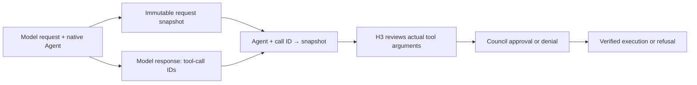
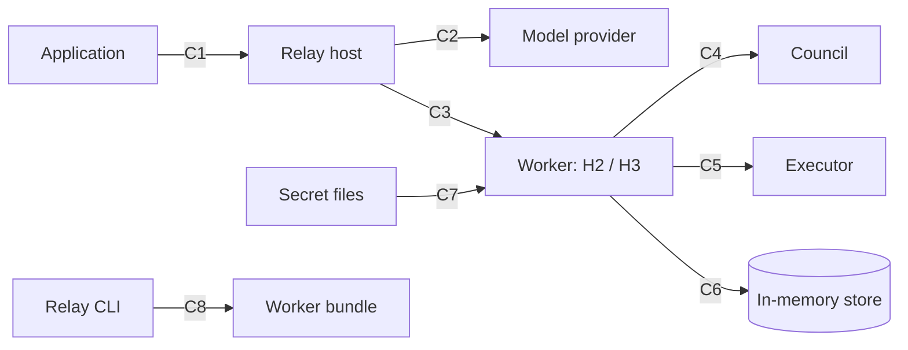

<!--
SPDX-FileCopyrightText: Copyright (c) 2026, NVIDIA CORPORATION & AFFILIATES. All rights reserved.
SPDX-License-Identifier: Apache-2.0
-->

# Nomos plugin for NeMo Relay (`nomos.council`)

`nemo_relay_nomos` is a NeMo Relay **worker plugin** that puts tool calls under a [Nomos](https://github.com/NVIDIA/Nomos)
council. Applications route model and tool execution through Relay and preserve native Agent ownership and
provider tool-call IDs. Install the bundle and configure one `plugins.toml` entry.

**H2: LLM execution interceptor** prepares the required `nomos` intent schema and captures the request. When the model
response completes, it associates the proposed tool-call IDs with that request inside the worker. **H3**, the tool
execution intercept, resolves the originating request, asks Council to review the actual operation, verifies an
approved writ, and dispatches it. Correlation metadata stays out of prompts and tool arguments.

These hook labels are this project's shorthand:
**H2** surrounds model execution, capturing before dispatch and binding IDs after response completion;
**H3** retrieves that snapshot and authorizes tool execution. H2 covers both registered callbacks:
`correlate-request` (non-streaming) and `correlate-stream` (streaming).

**Figure 1. Association is internal; Council still decides whether the tool may run.**



| For each guarded tool, the plugin… | |
|---|---|
| **requires an intent** | the model fills `nomos` (description, justification, target resource, blast radius) |
| **associates each tool call with its request** | native Agent UUID + provider tool-call ID select an immutable request snapshot; the model carries no tracking token |
| **lists citable evidence** | id, tool and arguments of the conversation's earlier calls, never output |
| **asks the Council** | every citation goes as `certified_evidence`: Executor-signed originals, and the local results and Council decisions the plugin certified; nothing goes as asserted `evidence` |
| **acts on the answer** | approval: writ verified against the Council's key (pinned, or fetched once if the operator opts in), claimed, dispatched; denial: the full response is the tool result |
| **stores the evidence** | with a `signing_key`, every result, denial, error and most refusals are signed and stored before the model sees them; without one, no record is (the journal and internal request bookkeeping remain) |

More: [architecture](docs/architecture/README.md) (step by step, real data) · [`DESIGN.md`](DESIGN.md) (the contract the tests hold) ·
[findings](docs/findings.md) (Relay and Nomos behaviour it depends on) · [security audit](docs/security-audit.md) ·
[changelog](CHANGELOG.md).

## How it works

### What the plugin is connected to



What crosses each connection (arrowheads in the figure show who initiates; the first party below initiates):

| | Between | Transport | What crosses it | When |
|---|---|---|---|---|
| **C1** | application → Relay host | in-process calls | `llm.execute(request)`, `tools.execute(name, args, tool_call_id)`; results back. The plugin is not on this link | every model call and tool call |
| **C2** | Relay host → model provider | the application's model call (HTTPS) | the prepared request (guarded tools require `nomos`; an optional trailing message holds the evidence catalog); the reply, possibly a tool call whose arguments carry `nomos`. The plugin never contacts the provider | every model call |
| **C3** | Relay host → plugin worker | Relay's worker protocol (gRPC, `grpc-v1`) | H2: model request and continuation in; schema/catalog preparation and completed-response call-ID binding. H3: tool name, arguments (with `nomos`) and `tool_call_id` in; the result plus a host-only `{"nomos": …}` annotation out. For a `local` tool the worker calls back through Relay (`next_`) with the arguments minus `nomos` | H2 around every model invocation, H3 on every tool call; the worker is started once |
| **C4** | H3 → Council | MCP over streamable HTTP, bearer proxy token | `council_authorize`: identity, the observed command or tool call, the call's turn's user request, the four intent fields, cited evidence, and (opt-in) the tool list the application offered; back: `approved` with a base64 writ and `writ_id`, or `denied` / `error` with reasons and votes. Opt-in, once: `council_get_public_key` | once per guarded call that passes the plugin's own checks |
| **C5** | writ handler → Executor | HTTP `POST /execute`, header `X-Agent-ID` | `{"writ": …}` unchanged; back: an Executor-signed `ExecutionResult`, read with a byte bound | once per approved `nomos_http` call, after the nonce claim; never for `local` tools |
| **C6** | worker ⇄ its store | SQLite `:memory:` inside the worker | turns, conversations, catalog reads, the call journal, records, writ claims, tool lists | every H2; up to three journal transactions per H3 call |
| **C7** | config loader (`values`) → secret files | file read: absolute path, owner-only, no symlinks, ≤ 64 KiB | tokens and the signing key, never logged | once, at worker start |
| **C8** | Relay CLI → bundle and worker venv | `plugins add` / `enable`: digest check, `pip install` | the bundle | once, at install |

The plugin's only network calls are C4 and C5. Neither the Council nor the Executor ever calls the worker, and the
writ travels Council → worker, and on to the Executor only for a `nomos_http` tool.

### Associate a tool call with its model request

H2 captures the request before the provider runs. When the response completes, it binds
its tool-call IDs to that snapshot under the native Agent UUID. H3 later resolves that exact association. Concurrent
requests finishing out of order keep their own context; request association stays inside the worker.

[Before/after examples, sequence diagram, streaming configuration and replay requirements](docs/native-correlation.md).

### What H3 does to a guarded tool call

Before anything may run: the plugin's own checks, the journal row (T1), the citations and the denial cap, then the
Council. Each mark on the H3 line ends the call there.


Once the Council approves: the writ is verified locally, its nonce claimed (T2), then exactly one branch runs.

![Steps 18 to 26, time running down: 18 the writ is verified (the Council's key, this exact call, fresh), a failure refused and journaled at T3 with the denial count not reset; 19 T2 claims the nonce, then marks the row dispatching (C6), an already-claimed nonce is writ_replayed for any tool; then one of two branches: nomos_http, 20 POST /execute (C5) and 21 the Executor-signed ExecutionResult, its signature verified: executed or execution_failed; or execution_unknown (no, oversized or unreadable answer) or evidence_invalid (fails verification): the call may have run and is never retried; local, 20 next_ with the arguments minus nomos through Relay (C3) to the app's tool and 21 its output, executed or execution_failed (the tool raised), plugin-certified when there is a signing_key; 22 the writ was valid, so cited records become accepted and the denial count resets to 0 (C6); 23 T3 completes the row together with the record, and after an unknown outcome blocks the conversation (C6); 24 the tool result goes to Relay (C3) with a note only the host sees (the Council's votes, timings, trace); 25 the application gets the tool result (C1); 26 the model reads it on its next request](docs/figures/h3-dispatch.png)

Every ending reaches the application as an ordinary tool result. The model sees the result (`status`, the output or
the Council's reasons, and `evidence_id` when a record was stored); timings, the conversation id and the Council's votes on an approval go only to
the host, in the `{"nomos": …}` annotation ([what each side receives](docs/architecture/03-governed-tool-call-h3.md)).
A call that may have run (`execution_unknown`, `evidence_invalid`) is never retried: its conversation is blocked
until the worker restarts or its retained native request bindings have expired ([what ends a block](docs/architecture/04-outcomes.md)).

Every ending and what it leaves behind: [every outcome](docs/architecture/04-outcomes.md). Who signs what:
[evidence and citation](docs/architecture/05-evidence-and-citation.md).

### The evidence store


[`repository.py`](nemo_relay_nomos/repository.py): no file, no service; rows expire with
`limits.retention_seconds` (1 hour by default).

| Table | Holds |
|---|---|
| `conversations` | denial count, blocked flag |
| `turns` | internal immutable request snapshots: Agent owner, optional user text and tool-list digest |
| `native_calls` | (Agent UUID, provider call ID) → originating snapshot; ambiguous IDs refuse |
| `tool_lists` | each distinct tool list a live turn names (`tool_definitions` on) |
| `records` | results, denials, errors and refusals, whole (a `local` result over `limits.max_result_bytes` as a string bounded to `limits.max_output_chars`), with content signature and receipt (only with `signing_key`; passthrough, `session_busy`, replays and the store's own refusals store nothing) |
| `calls` | one journal row per (conversation, `tool_call_id`): a repeat is replayed, never re-run |
| `writ_claims` | nonces already used |

Three writes per call, each before the next exposure: journal (before C4) → claim + dispatching (before C5) → record
and outcome together (before the model). Details: [one call's data](docs/architecture/README.md#how-data-moves-through-one-call) ·
[H3 step by step](docs/architecture/03-governed-tool-call-h3.md) · [storage and recovery](docs/architecture/07-storage-and-recovery.md).

## Install and enable

```sh
nemo-relay plugins add --user ./Nomos/integrations/nemo-relay/relay-plugin.toml   # a checkout or release bundle: integrity check + private venv
nemo-relay plugins enable nomos.council
```

Policy override: bundles are integrity-checked, not signed; `startup = "required"` refuses to run tools ungoverned.

```toml
[plugins.policy.overrides."nomos.council"]
attestation = "integrity_only"
startup = "required"
```

## Operator configuration

The `config` table of the plugin's `[[plugins.dynamic]]` entry. A complete example:

```toml
[[plugins.dynamic]]
manifest = "/opt/relay/relay-plugin.toml"

[plugins.dynamic.config.connection]
mcp_url = "https://nomos.example.com/mcp"
executor_url = "https://executor.example.com"
agent_id = "agent-ops"
council_id = "council-prod"
working_directory = "/workspace"
auth_token = { file = "/run/secrets/nomos/auth_token" }
proxy_token = { file = "/run/secrets/nomos/proxy_token" }

[plugins.dynamic.config.guard]
include = ["*"]                 # every tool …
exclude = ["read_*", "search"]  # … except these

[plugins.dynamic.config.tools.run_shell]
executor = "nomos_http"          # the trusted Executor runs it; the app's function never does
command_argument = "command"

# Application-owned local tools automatically use structured authorization.
[plugins.dynamic.config.tools."slack--send_message"]
executor = "local"

[plugins.dynamic.config.tool_call]
# Host/operator-derived, never copied from model arguments. A static subject is
# suitable only when this worker activation serves one subject.
subject = { file = "/run/secrets/nomos/opaque_subject" }

[plugins.dynamic.config]
signing_key = { file = "/run/secrets/nomos/signing_key" }  # optional; without it no evidence is kept

[plugins.dynamic.config.session]
id = "ops-agent-2026-10-12"      # optional label; evidence is held in the worker's memory

[plugins.dynamic.config.trust]
policy_version = "ops-trust-2026-10"
valid_until = 1792022400
council_public_key_hex = "<64 hex: the Council's Ed25519 public key>"
[plugins.dynamic.config.trust.executors]
"openshell:939bbd39d2c6fffa" = ["<64 hex: the Executor's Ed25519 public key>"]
```

**Connection, identity and session:**

| Field | Default | Meaning |
|---|---|---|
| `connection.mcp_url` | `http://127.0.0.1:9901/mcp` | Council MCP endpoint (streamable HTTP) |
| `connection.executor_url` | `http://127.0.0.1:9907` | Trusted Executor base URL |
| `connection.agent_id`, `connection.council_id` | required | The agent's Nomos identity; never taken from the model |
| `connection.auth_token`, `connection.proxy_token` | `""` | Nomos agent token; Monitor proxy bearer token. **Use file references.** |
| `connection.working_directory` | `/workspace` | Directory the Council authorizes |
| `connection.timeout_s` | `180` | Per request to the Council or Executor |
| `connection.allow_insecure_http` | `false` | Required for `http://` to a non-loopback Council or Executor (tokens and evidence would travel in clear) |
| `session.id` | `activation-<random>` | A label for this activation's store. Evidence is held in memory and lasts as long as the worker. |
| `signing_key` | none | The plugin's Ed25519 seed (64 hex), normally a `{"file": …}` reference. Evidence is kept only with one: if omitted, no record or tool list is stored, the model is offered no catalog and no `evidence` field, `tool_definitions` is ignored, and `validate()` warns. The Executor's results are still verified before they are returned. With one, the key also certifies each local result and Council decision it stores, which is how they are cited: **register it with the Council as a trusted executor** (`nomos-relay-plugin:<fp16>`), or the Council refuses calls that cite them. |

**Guarding and execution:**

| Field | Default | Meaning |
|---|---|---|
| `guard.include`, `guard.exclude` | `["run_shell"]`, `[]` | Shell-style patterns. A tool is guarded if it matches an include and no exclude. `nomos_*` is never guarded. |
| `tools.<name>.executor` | `local` | `nomos_http` (the Executor runs it) or `local` (the app's function runs after approval) |
| `tools.<name>.command_argument` | — | For `nomos_http`: the single argument holding the command |
| `tool_call.subject` | — | Required for local tools. An opaque identity supplied by the host/operator, not the model. The static setting is safe only for a single-subject worker activation. |
| `default_executor` | `local` | For guarded tools not listed in `tools` |
| `writ_handler.kind` | `default` | `custom` is reserved, with `entrypoint` and `options` (not implemented) |
| `writ_handler.claim` | `auto` | The plugin's ledger always records each writ's nonce before dispatch; for `nomos_http` the Executor also claims it. `council` is reserved. |
| `max_denials` | `3` | Consecutive denials before the plugin stops asking |
| `catalog.enabled`, `catalog.max_entries`, `catalog.max_argument_chars` | `true`, `20`, `400` | The evidence catalog in model requests |
| `tool_definitions` | `"off"` | Send the Council the tool definitions the model was offered, as one **certified** evidence item signed with `signing_key`: `"called"` (the called tool's definition and a digest of the list) or `"all"` (every definition; the Council shows the first 4000 characters). Register the key with the Council as a trusted executor first (`nomos-relay-plugin:<fp16>`), or the Council refuses the call. Needs `signing_key`. When on, the model may cite 19 ids, not 20. Tool lists count toward `limits.max_storage_bytes`; one over `limits.max_citation_bytes` is not kept and is reported unavailable. See [DESIGN](DESIGN.md#observed-tool-definitions) |

**Trust and limits:**

| Field | Default | Meaning |
|---|---|---|
| `trust.*` | required | Pinned keys and a hard expiry; see below |
| `trust.council_public_key_source` | `pinned` | `council`: fetch the Council's key from `mcp_url` instead of pinning it; see below |
| `limits.*` | see [limits](docs/architecture/07-storage-and-recovery.md#limits) | Result size, memory budget, records, journal, retention (1 hour), citations, output, and each conversation's share of the store (25%) |

**Value references** (errors name the field and source, never the value):

| Form | |
|---|---|
| `{ value = … }` | literal |
| `{ env = "NAME" }` | in-process hosts only: managed workers start with a minimal environment |
| `{ file = "/abs/path" }` | owner-only (0600/0400), regular file, ≤ 64 KiB, one trailing newline removed |
| `{ encrypted = "…", key_env \| key_file = … }` | schema only: **not supported yet** (TODO) |

**Trust.** By default only operator-pinned keys: `council_public_key_hex` verifies writs; `executors` maps each
Executor id to its keys (several allow rotation). After `valid_until` (Unix time) nothing is trusted and nothing runs.
Provision keys yourself, never from a service's reply; restart the worker to rotate (its store starts empty).

For local-only execution, explicitly set `tools` to your local tool policies (or `{}` to use
`default_executor = "local"`) and supply an empty `[plugins.dynamic.config.trust.executors]` table.
Local calls still require Council authorization; they run through the application's callback, without a separate
Executor service. A nonempty executor key map is required if any configured tool or `default_executor` uses
`nomos_http`, including the built-in `run_shell` policy when `tools` is omitted. This does not change the separate
requirement to register the plugin's signing key with the Council when citing plugin-certified evidence.

**Fetching the Council's key instead** (opt-in): set `council_public_key_source = "council"` and leave
`council_public_key_hex` out. On the first guarded call the plugin asks `council_get_public_key` at `mcp_url`, checks the
reply names `council_id` and carries a well-formed key, and trusts that key for the rest of the activation (never
re-fetched, so a later reply cannot swap it). Until it has one, guarded calls are refused (`council_key_unavailable`)
and nothing runs. The trade: whoever controls that endpoint, or its TLS, controls approvals, so it needs `https://` (or
loopback) whatever `allow_insecure_http` says, and `validate()` warns. Executor keys and `valid_until` stay pinned.

```toml
[plugins.dynamic.config.trust]
policy_version = "ops-trust-2026-10"
valid_until = 1792022400
council_public_key_source = "council"   # no council_public_key_hex
[plugins.dynamic.config.trust.executors]
"openshell:939bbd39d2c6fffa" = ["<64 hex: the Executor's Ed25519 public key>"]
```

## What the application sees

Every governed result: `contract_version: "nomos-plugin/v1"`, `status`, `execution_status`, `evidence_status`, and
`evidence_id` when a record was stored; denials add `council` (the full response). The host alone also gets
`{"nomos": {...}}`: decision, votes, the submitted command or structured operation, citations, and timings. All outcomes:
[04 · outcomes](docs/architecture/04-outcomes.md).

## Requirements and limits

- NeMo Relay `>=0.11.0,<0.12` (tested with SDK, CLI and Python/Node bindings 0.11.1); Python 3.11+; Linux or macOS.
- No disk or extra service: evidence lives in the worker's memory and is lost if the worker dies.
- Guarded calls are sequential within a native Agent; different Agents may run at once. The host must preserve
  native Agent ownership and provider call IDs between model and tool execution; missing origins refuse.
- Streaming supports OpenAI chat chunks only. Callback-based codecs require an explicit
  `stream_format = "openai_chat"` declaration. Human-approval replay must preserve the original native ancestry.
- Strict correlation rejects a lone Agent root. Verified hosts may opt in to
  `correlation.allow_single_agent_root = true` as a temporary operator assertion; see the
  [reconstructed-root contract and risks](docs/native-correlation.md#temporary-compatibility-for-a-reconstructed-agent-root).
- `council_context.include_user_request = false` omits user-request text from snapshots and Council context.
- The tested Relay 0.11.1 codec supports editing multiple guarded tool schemas in one request (former R13).
- Structured local tools require the paired Nomos structured-operation API. Existing command tools continue to use
  the v1 command contract unchanged.
- The v2 path verifies the Council signature over the original payload bytes and rechecks the exact operation and
  argument digest before calling the application tool. Verifiers must not reserialize the signed payload.
  `nomos-json-v1` uses Python's numeric JSON encoding (including `1.0` and exact integers up to
  640 decimal digits per integer, excluding the sign),
  not RFC 8785/JCS. The paired clients are Python; other-language clients must reproduce this encoding.
  Its nonce claim is currently worker-local and is lost on
  restart; durable cross-worker consumption is intentionally deferred to Nomos's `council_consume_writ` API.
- A configured static `tool_call.subject` assumes one subject per worker activation. A shared multi-user host needs
  a future authenticated Relay caller-identity channel before enabling structured authorization.
- See [Limits and open items](docs/architecture/10-limits-and-open-items.md).

## Development

| Path | Holds |
|---|---|
| [`nemo_relay_nomos/`](nemo_relay_nomos/) | the package; [`worker.py`](nemo_relay_nomos/worker.py) is the manifest's artifact and entry point |
| [`relay-plugin.toml`](relay-plugin.toml) | the Relay manifest; this directory is the bundle root |
| [`tests/`](tests/) | implementation, security, installed-worker, end-to-end and opt-in live tests; [`tests/qa/`](tests/qa/) is the independent spec suite |
| [`docs/`](docs/) | architecture pages (rendered from [`docs/build/`](docs/build/)), findings, the security audit, an upstream patch |
| [`catalog/nomos-plugin/`](catalog/nomos-plugin/) | the entry for the NeMo-Relay-Plugins catalog (remote variant) |
| [`scripts/`](scripts/) | the test runner, the offline wheelhouse, the repository checks pre-commit runs |
| `../..` (Nomos) | this integration lives in Nomos's `integrations/nemo-relay`; the tests use the enclosing Nomos's own signer and certified-evidence validator |

```sh
make sync        # .venv from uv.lock (Python 3.11+, uv)
make test        # every offline tier, branch coverage of nemo_relay_nomos, fails under the floor in pyproject.toml
make lint        # every pre-commit hook of this integration over its files
make docs        # redraw docs/figures, re-render docs/architecture
make build       # sdist and wheel into dist/
```

`make test` installs the bundle through the real Relay CLI (`nemo-relay-cli-bin==0.11.1` from the test group), offline
from a wheelhouse it builds on first use ([`scripts/wheelhouse.sh`](scripts/wheelhouse.sh)). The end-to-end tier uses the enclosing Nomos
(`NOMOS_TEST_NOMOS_SOURCE` points it elsewhere). `scripts/test.sh -k <expr>` runs a subset without the coverage floor.

The 35 s slow-Council regression is skipped by default, including ordinary CI runs; enable it with
`NOMOS_TEST_SLOW=1 make test`. Commit hooks run lint checks, not this slow test.

`NOMOS_TEST_LIVE_CONFIG=<operator config> make test-live` runs
the live tier against a real Council and Executor. The tiers, and what each one simulates: [testing](docs/architecture/09-testing.md).
How to change things: [`CONTRIBUTING.md`](CONTRIBUTING.md).
