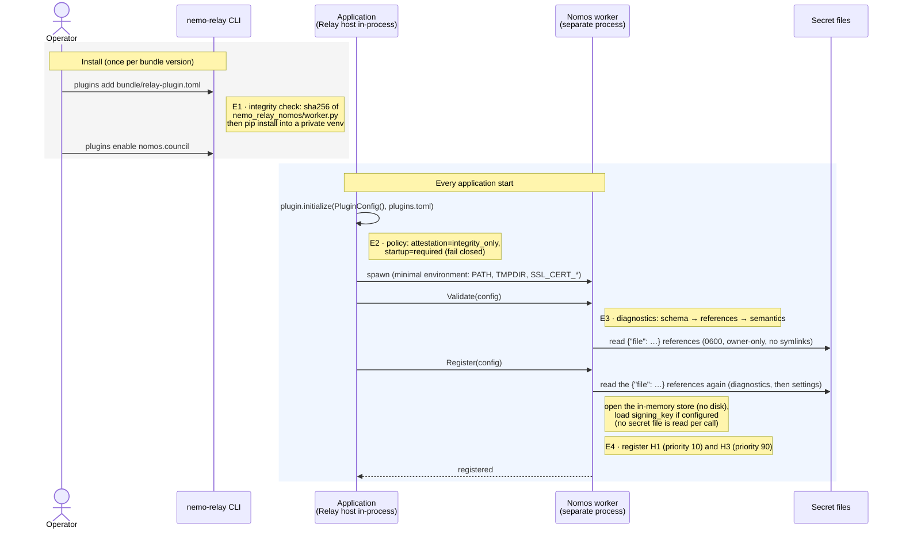
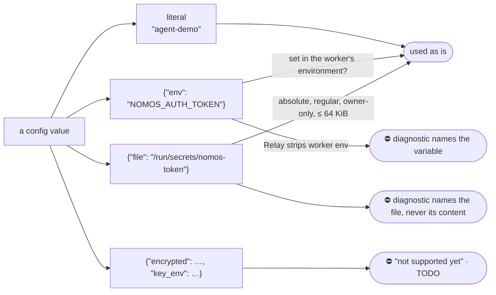

<!-- Generated by docs/build/architecture.py from docs/build/architecture/01-deployment-and-configuration.md; edit the template. -->
<!--
SPDX-FileCopyrightText: Copyright (c) 2026, NVIDIA CORPORATION & AFFILIATES. All rights reserved.
SPDX-License-Identifier: Apache-2.0
-->

# 1. Deployment and configuration

[← Architecture index](README.md)

The operator deploys three things; the application deploys nothing.

| What | Where |
|---|---|
| the plugin **bundle**: `nemo_relay_nomos`, `pyproject.toml`, `uv.lock`, the manifest `relay-plugin.toml` | registered with the Relay CLI (C8) |
| a `nomos.council` entry in **`plugins.toml`**: Council and Executor, agent identity, guarded tools, trusted keys, optional signing key | read at every start (C3) |
| **secret files**, owner-only; `plugins.toml` only points at them | read at worker start only (validate, then register), never per call (C7) |

## Startup, event by event



### E1 · Install · C8

Relay checks one file's digest, the manifest's `source.artifact`:

```toml
# SPDX-FileCopyrightText: Copyright (c) 2026, NVIDIA CORPORATION & AFFILIATES. All rights reserved.
# SPDX-License-Identifier: Apache-2.0

manifest_version = 1

[plugin]
id = "nomos.council"
kind = "worker"

[compat]
relay = ">=0.9.0,<1.0"
worker_protocol = "grpc-v1"

[defaults]
enabled = false

[capabilities]
items = ["plugin_worker", "config_schema"]

[config_schema]
path = "nemo_relay_nomos/config.schema.json"

[source]
manifest_root = "."
artifact = "nemo_relay_nomos/worker.py"

[integrity]
sha256 = "sha256:55a3196f49690b3ba17d8e975043b47d7b0c39a0111c2e06211dd97675618e5d"

[load]
runtime = "python"
entrypoint = "nemo_relay_nomos.worker:main"

```

`plugins add` then pip-installs the bundle into a private venv, resolving dependencies afresh (it ignores
`uv.lock`); the tests install offline from a pinned wheelhouse, [`scripts/wheelhouse.sh`](../../scripts/wheelhouse.sh).

### E2 · Policy

`attestation = "integrity_only"` (bundles are digest-checked, not signed) and `startup = "required"`: if the worker
cannot start, the application does not start. Tools never run ungoverned.

### E3 · Configuration · C3, C7

The `plugins.toml` a test host wrote for one run (secrets are `{"file": …}` references):

```toml
[[plugins.dynamic]]
manifest = "/opt/relay/plugins/nomos-plugin/relay-plugin.toml"

[plugins.dynamic.config]
default_executor = "local"
max_denials = 3

[plugins.dynamic.config.connection]
mcp_url = "http://127.0.0.1:41569/mcp"
executor_url = "http://127.0.0.1:41569"
agent_id = "agent-demo"
council_id = "council-demo"
working_directory = "/workspace"
timeout_s = 180.0

[plugins.dynamic.config.connection.auth_token]
file = "/run/secrets/nomos/auth_token"

[plugins.dynamic.config.guard]
include = [
    "run_shell",
]
exclude = []

[plugins.dynamic.config.tools.run_shell]
executor = "nomos_http"
command_argument = "command"

[plugins.dynamic.config.catalog]
enabled = true

[plugins.dynamic.config.session]
id = "nri-da7432f8f4c6"

[plugins.dynamic.config.signing_key]
file = "/run/secrets/nomos/signing_key"

[plugins.dynamic.config.trust]
policy_version = "nri-offline"
valid_until = 1792004506.025558
council_public_key_hex = "99523d2cd4b3d6b42aa3bd6b8c82cd3d76919db7cf16bf8911ea57dc742aaf59"

[plugins.dynamic.config.trust.executors]
nri-fake-executor = [
    "afc1deb897d2002dac43743bfe0441a471e9fca1cba6b528cba81143e2e6e8be",
]

[plugins.policy.overrides."nomos.council"]
attestation = "integrity_only"
startup = "required"

```

Every leaf can be written four ways, resolved by `values.resolve` when the settings are built:



[`nemo_relay_nomos/values.py` · `_from_file` · lines 76–100](../../nemo_relay_nomos/values.py#L76-L100)

```python
def _from_file(path: Any, field: str) -> str:
    if not isinstance(path, str) or not os.path.isabs(path):
        raise ConfigReferenceError(field, "file reference must be an absolute path")
    try:
        fd = os.open(path, os.O_RDONLY | os.O_NOFOLLOW | os.O_NONBLOCK)  # a FIFO must not block startup
    except OSError as exc:
        raise ConfigReferenceError(field, f"cannot open file reference {path} ({exc.strerror})") from None
    try:
        info = os.fstat(fd)
        if not stat.S_ISREG(info.st_mode):
            raise ConfigReferenceError(field, f"file reference {path} is not a regular file")
        if info.st_uid != os.getuid() or info.st_mode & 0o077:
            raise ConfigReferenceError(
                field, f"file reference {path} must be owned by this user with mode 0600 or 0400"
            )
        raw = os.read(fd, MAX_FILE_BYTES + 1)
    finally:
        os.close(fd)
    if len(raw) > MAX_FILE_BYTES:
        raise ConfigReferenceError(field, f"file reference {path} exceeds {MAX_FILE_BYTES} bytes")
    try:
        text = raw.decode("utf-8")
    except UnicodeDecodeError:
        raise ConfigReferenceError(field, f"file reference {path} is not UTF-8") from None
    return text[:-1] if text.endswith("\n") else text
```

| Relay fact | Consequence |
|---|---|
| managed workers keep only `PATH`, `TMPDIR`, `SSL_CERT_*` | `{"env"}` works in-process, not in a managed worker: use `{"file"}` (pinned by the installed-worker tests) |
| Relay (0.10, 0.11) rejects `writeOnly` under `anyOf` | secrets cannot be masked in Relay's editor; file references keep them out of the TOML |

The schema Relay validates against is `settings.SCHEMA` ([`settings.py`](../../nemo_relay_nomos/settings.py));
a pre-commit hook keeps `config.schema.json` identical. Diagnostics stop at the first failing stage and never quote a
value:

| Stage | Example |
|---|---|
| Schema | `guard.include: 'run_shell' is not of type 'array'` |
| References | `connection.auth_token: environment variable NOMOS_AUTH_TOKEN is not set in this process. Managed Relay workers start with a minimal environment …` |
| Semantics | `writ_handler.kind: custom writ handlers are not implemented yet` · `trust.valid_until: trust snapshot has expired` · `connection.mcp_url: http:// to a non-loopback host …` |
| Warnings | `connection.auth_token: a secret is written inline …` · `signing_key: no signing_key: evidence is disabled …` · `trust.council_public_key_source: the Council's key will be taken from connection.mcp_url …` |

### The trust snapshot

By default the plugin never trusts a key because a service sent it. The operator pins:

| Key | Verifies |
|---|---|
| the Council's Ed25519 public key | writs |
| each trusted Executor's public keys (several allow rotation) | execution evidence |
| `policy_version`, `valid_until` | a label and a hard expiry: after it, nothing is trusted and nothing runs |

Provision it out of band: the Executor keys from the Nomos deployment's executor registry, the Council key from
`council_get_public_key`, and a short `valid_until` (the test bed uses 7 days).

**Opt-in:** `council_public_key_source = "council"` replaces the pinned Council key with one the plugin fetches from
`council_get_public_key` on its first guarded call (C4) and keeps for the activation. It needs an `https://` (or
loopback) `mcp_url`, and `validate()` warns: whoever controls that endpoint controls approvals. Executor keys are always
pinned. Details: [`README.md`](../../README.md#operator-configuration).

### E4 · Registration · C6, C3

`register()` validates again, opens an empty SQLite `:memory:` store, loads `signing_key` if configured (never
generates one: no key, no evidence), and registers the hooks. Relay never respawns the worker; if it dies, guarded calls
fail closed until the host initializes again.

| Hook | Relay API | Priority | Why |
|---|---|---|---|
| `inject-intent` | LLM request intercept | 10 | early: edits the request before other request intercepts |
| `authorize-execution` | tool execution intercept | 90 | before Relay's caches (150) and guardrails (100): a cache hit never skips the Council ([DESIGN](../../DESIGN.md#plugin)) |

[`nemo_relay_nomos/plugin.py` · `NomosPlugin.register` · lines 198–216](../../nemo_relay_nomos/plugin.py#L198-L216)

```python
def register(self, context: Any, plugin_config: dict) -> None:
    problems = diagnostics(plugin_config, environ=self.environ)
    if problems:
        raise ValueError(f"{problems[0].field}: {problems[0].message}")
    s = self.settings = Settings.from_config(plugin_config, environ=self.environ)
    owner = (s.connection.agent_id, s.connection.council_id, s.session.id)
    if self.store is None:
        self.store = EvidenceStore(owner, s.limits)
    elif self.store.owner != owner:
        raise ValueError("injected repository owner does not match the configured session")
    # Evidence must be signed, and the plugin never makes a key up: without a configured key it keeps none.
    self.signer = PluginSigner(bytes.fromhex(s.signing_key)) if s.signing_key else None
    council = self._council or McpCouncil(s.connection)
    self._council = council
    self._executor = self._executor or HttpExecutor(s.connection, s.limits.max_result_bytes)
    self.handler = load_writ_handler(s, store=self.store, executor=self._executor, signer=self.signer)
    context.register_llm_request_intercept("inject-intent", self.h1, priority=REQUEST_PRIORITY)
    context.register_tool_execution_intercept("authorize-execution", self.h3, priority=EXECUTION_PRIORITY)
    context.register_scope_sanitize_end_guardrail("export-annotation", sanitize_exported_annotation)
```

Next: [the model request (H1)](02-request-path-h1.md).
