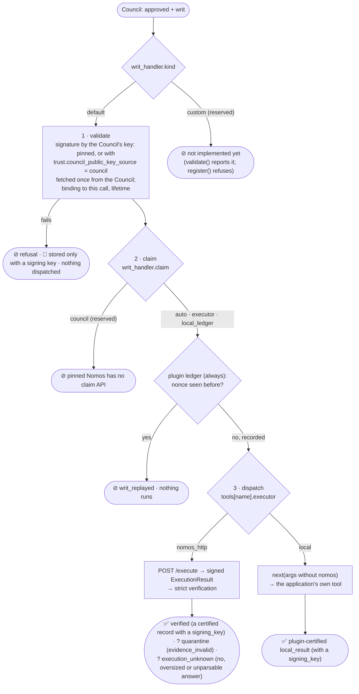

<!-- Generated by docs/build/architecture.py from docs/build/architecture/06-writ-handling-and-executors.md; edit the template. -->
<!--
SPDX-FileCopyrightText: Copyright (c) 2026, NVIDIA CORPORATION & AFFILIATES. All rights reserved.
SPDX-License-Identifier: Apache-2.0
-->

# 6. Writ handling and executors

[← Architecture index](README.md) · previous: [Evidence and citation](05-evidence-and-citation.md)

A **writ** is the Council's signed, single-use permission for one exact operation. A legacy command writ binds a
command, agent, working directory and deadline. A structured tool-call writ binds the tool name, a server-derived
digest of its exact argument object, the host-derived subject, agent and deadline. The **writ handler**
([`writs.py`](../../nemo_relay_nomos/writs.py)) claims it (C6) and dispatches it: to the Executor
(C5) or back through Relay's chain (C3) to the app's function.



## Executors, per tool

| `tools.<name>.executor` | What runs | Evidence |
|---|---|---|
| `nomos_http` | The trusted Executor runs the authorized command; the application's function **never** runs. Needs `command_argument`, the single argument that holds the command. | ✅ certified, signed by the Executor |
| `local` (the default for unlisted guarded tools) | After approval, the plugin calls the next handler in Relay's chain, which is ultimately the application's own tool function, with `nomos` removed. | ✅ `local_result` certified by the plugin's key |

The Council authorizes, and the writ is bound to: the command argument exactly (`nomos_http`), or the structured
tool name, canonical argument digest, canonicalization identifier and subject (`local`). The handler refuses a
command writ for a local tool or a structured writ for `nomos_http`; the two contracts cannot be substituted.

## A `local` tool, end to end (🧪 offline)

`read_file`, guarded with no `tools` entry (`default_executor = "local"`): the Council request and the result:

```json
{
  "tool_call": {
    "schema_version": 1,
    "tool_name": "read_file",
    "arguments": {"path": "notes.txt"},
    "subject": "opaque-host-derived-subject"
  },
  "description": "Read a workspace file",
  "target_resource": "notes.txt",
  "certified_evidence": []
}
```

```json
{
  "content_sha256": "329b7500e31ec2d7eaeef085f6624c30bd810e07fc2686991c3cfea0e920cbd1",
  "contract_version": "nomos-plugin/v1",
  "decision_id": "intent-313ff6b8ea20",
  "evidence_id": "ev_830940edb1a54b0fa433dd3e59bc8acd",
  "evidence_status": "plugin_signed",
  "execution_status": "executed",
  "output": {
    "content": "Deploy window: Friday 18:00 UTC.\n"
  },
  "signer": {
    "id": "nomos.council",
    "key_fingerprint": "e17c187096f8311ad9131fa66732f477a9906ac1b40f8d193137eb2be0580a50",
    "public_key_hex": "ce188e35ec0a66389b5ee60d8163a6cfab9b07a9fadcbd40afc89f1623e97011",
    "type": "plugin"
  },
  "status": "executed",
  "writ_id": "writ-b2602f77e7dd4f2bb09e"
}
```

The app's own output, stored (recorded before local results were always certified: today the record also carries
the plugin's `certified_result` and `certified: true`):

```json
{
  "evidence_id": "ev_830940edb1a54b0fa433dd3e59bc8acd",
  "kind": "local_result",
  "arguments": {
    "path": "notes.txt"
  },
  "content": {
    "output": {
      "content": "Deploy window: Friday 18:00 UTC.\n"
    },
    "status": "executed"
  },
  "signer": {
    "id": "nomos.council",
    "key_fingerprint": "e17c187096f8311ad9131fa66732f477a9906ac1b40f8d193137eb2be0580a50",
    "public_key_hex": "ce188e35ec0a66389b5ee60d8163a6cfab9b07a9fadcbd40afc89f1623e97011",
    "type": "plugin"
  },
  "certified": false,
  "writ_id": "writ-b2602f77e7dd4f2bb09e"
}
```

The `local` executor:

[`nemo_relay_nomos/writs.py` · `DefaultWritHandler._local` · lines 215–265](../../nemo_relay_nomos/writs.py#L215-L265)

```python
async def _local(self, call: WritCall, writ: dict) -> HandlerResult:
    if call.next_ is None:
        raise RuntimeError("a local executor needs the tool continuation")
    annotation = None
    try:
        result = await call.next_(call.arguments)
    except asyncio.CancelledError:
        raise
    except Exception as exc:
        content = {"status": "failed", "error": bounded(f"{type(exc).__name__}: {exc}", 2048)}
    else:
        output = getattr(result, "result", result)
        annotation = getattr(result, "annotation", None)
        try:
            encoded = canonical(output)
        except (TypeError, ValueError):  # not JSON: its repr, bounded the same way
            output = repr(output)
            encoded = canonical(output)
        if len(encoded) > self.s.limits.max_result_bytes:
            output = bounded(encoded.decode("utf-8", "replace"), self.s.limits.max_output_chars)
        content = {"status": "executed", "output": output}
    executed = content["status"] == "executed"
    result_fields = {"output": content["output"]} if executed else {"error": content["error"]}
    if self.signer is None:  # no signing key: the result is returned, never stored
        out = response(
            "executed" if executed else "execution_failed",
            execution="executed" if executed else "failed",
            writ_id=writ["writ_id"],
            **result_fields,
        )
        return HandlerResult(out, None, annotation)
    certified = self._certify_local(call, writ, content)
    record = self._plugin(
        call,
        "local_result",
        content,
        self.store.new_id(),
        writ_id=writ["writ_id"],
        certified_result=certified,
    )
    out = response(
        "executed" if executed else "execution_failed",
        execution="executed" if executed else "failed",
        evidence="plugin_certified",
        evidence_id=record["evidence_id"],
        writ_id=writ["writ_id"],
        signer=record["signer"],
        content_sha256=record["content_sha256"],
        **result_fields,
    )
    return HandlerResult(out, record, annotation)
```

### 🌐 Paired Nomos support required for a `local` tool

The previous plugin rendered a local tool as a fake shell command. The pinned Nomos deployment's OPA policy then
denied that rendering before any member voted:

```text
Not run: the oversight council returned DENIED.
Reason: Denied by OPA policy: Shell commands must invoke executables by absolute path; non-absolute command word(s): read_file
Guidance: Use absolute executable paths for every shell command segment.
```

Pinned by `test_live_guarded_local_tool_gets_a_real_council_decision`. Plugin 0.5 no longer sends that rendering;
it requires the paired Nomos structured-operation change and a new live contract run ([limits](10-limits-and-open-items.md)).

## Claims

Single use, where the writ is consumed:

| Claim | Who | How | Lasts |
|---|---|---|---|
| plugin ledger (always) | the plugin | `INSERT OR IGNORE` into `writ_claims(nonce)` in its in-memory store, before any dispatch | as long as the worker |
| `executor` (nomos_http) | the Nomos Executor, in addition | `SET NX` on the writ's nonce before running; a replay is refused and signed | across restarts (Executor's Redis) |
| `council` | reserved | Nomos `council_consume_writ` exists only on an upstream branch (PA2) | — |

Real ledger rows: [the evidence store](07-storage-and-recovery.md#writ_claims-the-plugins-nonce-ledger).

[`nemo_relay_nomos/writs.py` · `DefaultWritHandler.handle` · lines 69–121](../../nemo_relay_nomos/writs.py#L69-L121)

```python
async def handle(self, call: WritCall, encoded_writ: str, writ: dict) -> HandlerResult:
    conn = self.s.connection
    try:
        if call.policy.executor == "local":
            if call.structured is None or call.command is not None:
                raise EvidenceError("invalid_tool_policy")
            verified = verify_tool_call_writ(
                writ,
                self.s.trust.as_dict(),
                agent_id=conn.agent_id,
                council_id=conn.council_id,
                operation=call.structured.operation,
                writ_id=call.decision_writ_id,
                dispatch=True,
                issued_after=call.requested_at,
            )
            # The continuation receives exactly the bytes whose digest was authorized.
            try:
                held_bytes = canonical_tool_arguments(call.arguments)
            except (TypeError, ValueError, RecursionError) as exc:
                raise EvidenceError("tool_arguments_changed") from exc
            if held_bytes != call.structured.arguments_bytes:
                raise EvidenceError("tool_arguments_changed")
            effective_writ = verified
        elif call.policy.executor == "nomos_http":
            if call.structured is not None or call.command is None:
                raise EvidenceError("invalid_tool_policy")
            verify_writ(
                writ,
                self.s.trust.as_dict(),
                agent_id=conn.agent_id,
                council_id=conn.council_id,
                command=call.command,
                working_directory=conn.working_directory,
                writ_id=call.decision_writ_id,
                dispatch=True,
                issued_after=call.requested_at,
            )
            effective_writ = writ
        else:
            raise EvidenceError("invalid_tool_policy")
    except EvidenceError as exc:
        return self._refusal(call, str(exc), "The council's writ failed local validation; nothing ran.")
    if self.s.claim_for(call.policy) == "council":
        raise NotImplementedError("council writ claims need a Nomos claim API (council_consume_writ)")
    # The plugin's own ledger always records the nonce, whatever else claims it: this plugin never
    # dispatches one writ twice. For nomos_http the Executor also claims it, in its own store.
    if not self.store.claim_writ(effective_writ["writ_id"], effective_writ["nonce"]):
        return self._refusal(call, "writ_replayed", "This writ was already used; nothing ran.")
    self.store.dispatch(call.conversation, call.tool_call_id)
    if call.policy.executor == "nomos_http":
        return await self._nomos_http(call, encoded_writ, writ)
    return await self._local(call, effective_writ)
```

## The custom handler seam (stubbed)

Configuration reserves the fields a custom handler will need:

```json
{
  "writ_handler": {
    "kind": "custom",
    "entrypoint": "my_package.handlers:ApprovalQueueHandler",
    "options": {"queue": "ops-approvals"},
    "claim": "auto"
  }
}
```

Today `validate()` reports `custom writ handlers are not implemented yet` and `register()` refuses. The interface:

[`nemo_relay_nomos/writs.py` · `WritCall` · lines 37–48](../../nemo_relay_nomos/writs.py#L37-L48)

```python
@dataclass(frozen=True)
class WritCall:
    tool_name: str
    tool_call_id: str
    arguments: dict  # without ``nomos``
    command: str | None  # exactly what the v1 Council authorized
    policy: ToolPolicy
    decision_writ_id: str | None  # the writ_id the Council reported alongside the writ
    conversation: str  # the journal this call belongs to
    next_: ToolCall | None = None  # runs the application's tool (local executor)
    requested_at: float | None = None  # when the Council was asked; an older writ is a replayed approval
    structured: StructuredToolCall | None = None  # exact held v2 operation and canonical argument bytes
```

[`nemo_relay_nomos/writs.py` · `WritHandler` · lines 59–60](../../nemo_relay_nomos/writs.py#L59-L60)

```python
class WritHandler(Protocol):
    async def handle(self, call: WritCall, encoded_writ: str, writ: dict) -> HandlerResult: ...
```

`WritCall.next_` runs the app's tool; `HandlerResult` carries the response, the record (None without a signing
key) and an optional annotation.

Next: [the evidence store and recovery](07-storage-and-recovery.md).
