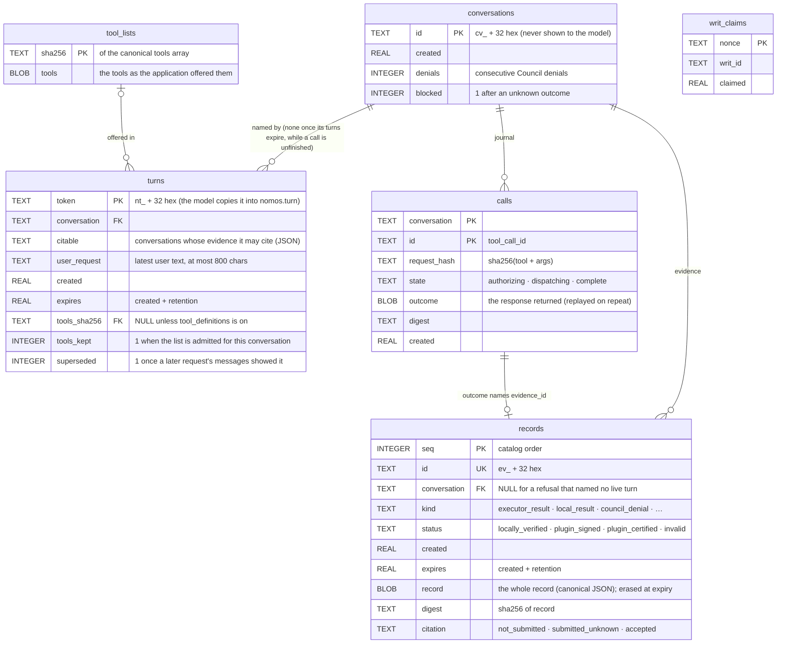

<!-- Generated by docs/build/architecture.py from docs/build/architecture/07-storage-and-recovery.md; edit the template. -->
<!--
SPDX-FileCopyrightText: Copyright (c) 2026, NVIDIA CORPORATION & AFFILIATES. All rights reserved.
SPDX-License-Identifier: Apache-2.0
-->

# 7. The evidence store and recovery

[← Architecture index](README.md) · previous: [Writ handling and executors](06-writ-handling-and-executors.md)

The plugin's memory and audit trail: **one SQLite `:memory:` database in the worker**
([`repository.py`](../../nemo_relay_nomos/repository.py) `EvidenceStore`). No file, no service;
it lives as long as the worker (Relay never respawns one; a new activation starts empty). Everything but the nonce
ledger and the (opt-in) tool lists belongs to one conversation. Every access is **C6**.

## Where it lives, and who touches what

![How long the evidence lasts: the store is SQLite :memory: inside the worker, with no file and no service; the worker starts with an empty store, serves every conversation, and when it exits the whole store is gone; a new activation (only if an operator restarts it, since Relay never respawns a worker) reads old ids as evidence_not_found. Inside it, with R = limits.retention_seconds: a record's content is citable for R, then a tombstone (evidence_expired) until 2R, then the row is gone; a turn lives R, then unknown_turn; a completed call replays its outcome in its own conversation for R, then the same id is a new call; a writ claim is kept for the worker's whole life](../figures/store.png)

Created when the plugin registers; two activations never share records.

[`nemo_relay_nomos/repository.py` · `EvidenceStore.__init__` · lines 52–77](../../nemo_relay_nomos/repository.py#L52-L77)

```python
def __init__(self, owner: tuple[str, str, str], limits: Limits):
    self.owner, self.limits = owner, limits
    self.db: sqlite3.Connection | None = sqlite3.connect(":memory:")
    self.db.row_factory = sqlite3.Row
    self.db.executescript("""
        CREATE TABLE conversations (
            id TEXT PRIMARY KEY, created REAL NOT NULL,
            denials INTEGER NOT NULL DEFAULT 0, blocked INTEGER NOT NULL DEFAULT 0);
        CREATE TABLE turns (
            token TEXT PRIMARY KEY, conversation TEXT NOT NULL, citable TEXT NOT NULL,
            user_request TEXT NOT NULL, user_request_truncated INTEGER NOT NULL,
            created REAL NOT NULL, expires REAL NOT NULL, tools_sha256 TEXT,
            tools_kept INTEGER NOT NULL DEFAULT 0, superseded INTEGER NOT NULL DEFAULT 0);
        CREATE TABLE tool_lists (sha256 TEXT PRIMARY KEY, tools BLOB NOT NULL);
        CREATE TABLE records (
            seq INTEGER PRIMARY KEY AUTOINCREMENT, id TEXT UNIQUE NOT NULL, conversation TEXT,
            kind TEXT NOT NULL, status TEXT NOT NULL,
            created REAL NOT NULL, expires REAL NOT NULL,
            record BLOB NOT NULL, digest TEXT NOT NULL,
            citation TEXT NOT NULL DEFAULT 'not_submitted');
        CREATE TABLE calls (
            conversation TEXT NOT NULL, id TEXT NOT NULL, request_hash TEXT NOT NULL, state TEXT NOT NULL,
            outcome BLOB, digest TEXT, created REAL NOT NULL, PRIMARY KEY (conversation, id));
        CREATE TABLE writ_claims (
            nonce TEXT PRIMARY KEY, writ_id TEXT NOT NULL, claimed REAL NOT NULL);
    """)
```

| Table | Written by | Read by |
|---|---|---|
| `conversations` | H1: `open_turn` (a new conversation); H3: `set_denials`; `finish`: `blocked` | H3: `begin` (blocked), `denials` (denial cap) |
| `turns` | H1: `open_turn`, one per model request | H1: `open_turn` (which conversation the messages show); H3: `turn` (the call's conversation and user request) |
| `tool_lists` | H1: `open_turn`, only with `tool_definitions` on; one row per distinct tool list | H3: `tool_list` (the [observed tool definitions](../../DESIGN.md#observed-tool-definitions) of the call's turn) |
| `records` | H3: refusals and denials (`put`, `finish`); writ handler: results (`finish`); citations update `citation` (`mark_citations`) | H1: the catalog (`catalog`); H3: cited records (`get`) |
| `calls` | H3: `begin` (T1, `authorizing`); writ handler: `dispatch` (T2, `dispatching`); `finish` (T3, `complete` + outcome) | H3: `begin` (replay, conflict, blocked checks) |
| `writ_claims` | writ handler: `claim_writ` (T2), before any dispatch | `claim_writ` (a nonce already present = `writ_replayed`) |

## The tables, with the rows from a real run



The rows after the five 🧪 demonstration calls (times in UTC), dumped after every call by a capture-only worker
entry in the integration test bed, since the worker's memory is unreachable from outside.

### `conversations` and `turns`: who is calling

| id | created | denials | blocked |
|---|---|---|---|
| `cv_40b6cc3fb5be4075af2df…` | `2026-10-13 19:01:52.96Z` | `0` | `0` |

| token | conversation | citable | user_request | created | expires |
|---|---|---|---|---|---|
| `nt_34cca5f15d644e83b00…` | `cv_40b6cc3fb5be4075af2…` | `["cv_40b6cc3fb5be4075a…` | `Check the shell, recor…` | `2026-10-13 19:01:52.96Z` | `2026-10-13 20:01:52.96Z` |
| `nt_0ce4436090f2464bae4…` | `cv_40b6cc3fb5be4075af2…` | `["cv_40b6cc3fb5be4075a…` | `Check the shell, recor…` | `2026-10-13 19:01:53.30Z` | `2026-10-13 20:01:53.30Z` |
| `nt_f78f1b9a7d6141abaa2…` | `cv_40b6cc3fb5be4075af2…` | `["cv_40b6cc3fb5be4075a…` | `Check the shell, recor…` | `2026-10-13 19:01:53.37Z` | `2026-10-13 20:01:53.37Z` |
| `nt_6868b47031a646d6882…` | `cv_40b6cc3fb5be4075af2…` | `["cv_40b6cc3fb5be4075a…` | `Check the shell, recor…` | `2026-10-13 19:01:53.43Z` | `2026-10-13 20:01:53.43Z` |
| `nt_8d1b2be2147744408ed…` | `cv_40b6cc3fb5be4075af2…` | `["cv_40b6cc3fb5be4075a…` | `Check the shell, recor…` | `2026-10-13 19:01:53.52Z` | `2026-10-13 20:01:53.52Z` |

One conversation, five turns: from the second request on, H1 found the earlier tokens in the messages and continued it
([how](02-request-path-h1.md#e2--the-turn-token-and-the-conversation--c3-c6)). `user_request` is the Council's context
for calls in reply to that request; `denials` and `blocked` never cross conversations.

### `records`: one row per response

| seq | id | conversation | kind | status | citation | bytes | created | expires |
|---|---|---|---|---|---|---|---|---|
| `1` | `ev_55b50661a4054d2…` | `cv_40b6cc3fb5be407…` | `executor_result` | `locally_verified` | `accepted` | `3935` | `2026-10-13 19:01:53.29Z` | `2026-10-13 20:01:53.29Z` |
| `2` | `ev_2e1b88d0c5ac494…` | `cv_40b6cc3fb5be407…` | `executor_result` | `locally_verified` | `not_submitted` | `3970` | `2026-10-13 19:01:53.37Z` | `2026-10-13 20:01:53.37Z` |
| `3` | `ev_2e79ef2d80994f6…` | `cv_40b6cc3fb5be407…` | `council_denial` | `plugin_signed` | `accepted` | `2824` | `2026-10-13 19:01:53.43Z` | `2026-10-13 20:01:53.43Z` |
| `4` | `ev_997d4dd1960e4cc…` | `cv_40b6cc3fb5be407…` | `executor_result` | `locally_verified` | `not_submitted` | `4005` | `2026-10-13 19:01:53.51Z` | `2026-10-13 20:01:53.51Z` |
| `5` | `ev_7c466843d71d401…` | `null` | `plugin_refusal` | `plugin_signed` | `not_submitted` | `2407` | `2026-10-13 19:01:53.52Z` | `2026-10-13 20:01:53.52Z` |

| Column | |
|---|---|
| `seq` | catalog order (newest first) |
| `conversation` | the owner; a citation from any other reads `evidence_not_found` (row 5, a missing intent, has none) |
| `record`, `digest` | the whole record as canonical JSON (not shown) and its SHA-256, re-checked on every read ([anatomy](05-evidence-and-citation.md#anatomy-of-a-record)) |
| `expires` | `created` + `retention_seconds` (1 h): content erased, id kept as a tombstone (`evidence_expired`) |
| `citation` | `not_submitted` → `submitted_unknown` (in flight or failed) → `accepted` (valid writ; never downgraded). Rows 1 and 3 were cited and accepted |

Refusals are a ring of the latest 200 per conversation, so they can never exhaust the quota.

[`nemo_relay_nomos/repository.py` · `EvidenceStore.put` · lines 296–310](../../nemo_relay_nomos/repository.py#L296-L310)

```python
def put(self, record: dict, conversation: str | None = None) -> None:
    """Store a record outside the journal. ``conversation`` is None when the call named no live turn."""
    with self.db:
        if record["kind"] == "plugin_refusal":
            # Refusals cost the model nothing to produce; keep only each conversation's most recent ones so
            # a flood of them can never exhaust the record quota and lock governed tools.
            self.db.execute(
                "DELETE FROM records WHERE kind='plugin_refusal' AND conversation IS ? AND seq NOT IN "
                "(SELECT seq FROM records WHERE kind='plugin_refusal' AND conversation IS ? "
                "ORDER BY seq DESC LIMIT ?)",
                (conversation, conversation, MAX_REFUSAL_RECORDS - 1),
            )
        else:
            self._check_quota(conversation, extra_calls=0)
        self._insert(record, conversation)
```

### `calls`: the journal, one row per guarded tool call

| conversation | id | request_hash | state | outcome_bytes | created |
|---|---|---|---|---|---|
| `cv_40b6cc3fb5be4075af2…` | `call_9c3f91f102` | `23c8f73be4c3d66a735fd0…` | `complete` | `602` | `2026-10-13 19:01:52.96Z` |
| `cv_40b6cc3fb5be4075af2…` | `call_d38be4be39` | `6d1c4df3bc99570546aa52…` | `complete` | `611` | `2026-10-13 19:01:53.30Z` |
| `cv_40b6cc3fb5be4075af2…` | `call_4cbf40712d` | `694c7d2ba23333f4a2b8d8…` | `complete` | `954` | `2026-10-13 19:01:53.38Z` |
| `cv_40b6cc3fb5be4075af2…` | `call_de5c55d7ec` | `c9cf35f7a3bfb00cb04f0a…` | `complete` | `642` | `2026-10-13 19:01:53.44Z` |

Keyed by (conversation, `tool_call_id`), so numbered ids (`call_0`) never replay across conversations.
`request_hash` (tool + arguments) detects `tool_call_id_conflict`; `outcome` is the exact response, replayed for a
repeat. Four rows for five calls: the missing-intent call was refused before the journal.

### `writ_claims`: the plugin's nonce ledger

| nonce | writ_id | claimed |
|---|---|---|
| `dcea153e557a4278b07f791be776…` | `writ-50a372d017f244079cc8` | `2026-10-13 19:01:53.28Z` |
| `aa8a4d8bc74748d3893b10cc9777…` | `writ-e7f522cca19245aea48c` | `2026-10-13 19:01:53.36Z` |
| `c2dd9c0c5c15414082e8d54a67bb…` | `writ-a490246939c64436bc65` | `2026-10-13 19:01:53.50Z` |

Three approvals, three claims; every writ is claimed here before dispatch (and by the Executor for `nomos_http`).

[`nemo_relay_nomos/repository.py` · `EvidenceStore.claim_writ` · lines 358–363](../../nemo_relay_nomos/repository.py#L358-L363)

```python
def claim_writ(self, writ_id: str, nonce: str) -> bool:
    with self.db:
        cursor = self.db.execute(
            "INSERT OR IGNORE INTO writ_claims VALUES (?, ?, ?)", (nonce, writ_id, time.time())
        )
    return cursor.rowcount == 1
```

## Reading: the catalog and a citation

The catalog takes the newest valid records among the ids the messages show and the turn's citable conversations;
each passes `get` (expiry, row digest) and the receipt check. A citation reads through the same `get`.

[`nemo_relay_nomos/repository.py` · `EvidenceStore.catalog` · lines 330–349](../../nemo_relay_nomos/repository.py#L330-L349)

```python
def catalog(self, visible: list[str], citable: frozenset[str], limit: int) -> list[dict]:
    """Citable records among ``visible`` (the IDs a request's own messages show), newest first."""
    ids = list(dict.fromkeys(visible))
    if not ids or not citable:
        return []
    kinds, id_marks, conv_marks = (
        ",".join("?" * n) for n in (len(CATALOG_KINDS), len(ids), len(citable))
    )
    rows = self.db.execute(
        f"SELECT id FROM records WHERE expires>? AND status!='invalid' AND kind IN ({kinds}) "
        f"AND id IN ({id_marks}) AND conversation IN ({conv_marks}) ORDER BY seq DESC LIMIT ?",
        (time.time(), *CATALOG_KINDS, *ids, *sorted(citable), limit),
    ).fetchall()
    out = []
    for row in rows:
        try:
            out.append(self.get(row["id"]))
        except StoreError:
            continue  # an expired or corrupt record is simply not offered
    return out
```

[`nemo_relay_nomos/repository.py` · `EvidenceStore.get` · lines 312–328](../../nemo_relay_nomos/repository.py#L312-L328)

```python
def get(self, evidence_id: str, citable: frozenset[str] | None = None) -> dict:
    """A stored record. With ``citable``, a record from any other conversation reads as not found."""
    row = self.db.execute("SELECT * FROM records WHERE id=?", (evidence_id,)).fetchone()
    if row is None or (citable is not None and row["conversation"] not in citable):
        # Another conversation's IDs, like another worker's, are indistinguishable from unknown IDs.
        raise StoreError("evidence_not_found")
    if row["expires"] <= time.time():
        with self.db:
            self._purge(time.time())
        raise StoreError("evidence_expired")
    if sha256_hex(row["record"]) != row["digest"]:
        raise StoreError("evidence_integrity_failure")
    record = json.loads(row["record"])
    record.update(
        council_citation_status=row["citation"], expires_at=row["expires"], parent_digest=row["digest"]
    )
    return record
```

## A record's life

![One evidence record, from build to expiry, only with a signing key: 1 build and seal (plugin-signed or Executor-signed, plus a plugin receipt on all); 2 persist, before the model sees it (at T3, or alone if refused early); 3 offer in the catalog (results, denials and errors only: id, tool and arguments, never output); 4 the model cites the id in a later call's nomos; 5 re-check (receipt re-checked, certified re-verified on the current keys); 6 mark submitted_unknown, then send to the Council; 7 settle (a valid writ marks it accepted; never downgraded); 8 expire (content erased, then the id). Refusals, unknown outcomes and quarantined results are stored but never offered](../figures/record-lifecycle.png)

1–3 inside the producing call, before the model sees anything; 4–7 on later turns
([with data](05-evidence-and-citation.md)); 8 after retention. A refusal before T1 (`invalid_arguments`,
`missing_intent`, `unknown_turn`, tool-policy and trust refusals) is stored by `put` with no journal row. Only
`executor_result`, `local_result`, `council_denial` and `council_error` records that are not quarantined are ever
offered in a catalog. A `plugin_refusal` or `execution_unknown` record is never offered, but its id (which the
tool result showed) can still be cited from a turn that may cite its conversation; a quarantined record cannot.

## The journal: authorizing, dispatching, complete

T1, T2 (two writes: the nonce claim, then `dispatching`) and T3, the network only between them; marking cited
records and counting denials are separate writes of their own. While the worker lives, any failure leaves a state
the next call can act on: a lost answer after dispatch blocks the conversation rather than risk running twice. If the
worker dies, the call fails closed and the next activation starts empty.

![When the call journal is written, time running left to right: T1 (step 13) checks, then writes the row authorizing; the Council is asked (16) and answers (17); a denial or Council error skips T2 from the decision (17), straight to T3; the writ is verified (18), and a refused writ also skips T2; T2 (19) claims the nonce, then moves the row to dispatching; the Executor is called (20) and answers (21), or for a local tool next_ runs through Relay; T3 (23) writes record and row complete at once; then the result is returned (24). Shaded: window 1, after T1 and before T2, and window 2, after T2 and before T3; what a failure in each leaves behind is in the table under the figure](../figures/journal.png)

| A failure in… | What it leaves behind |
|---|---|
| window 1 (after T1, before T2): the Council errs, times out or is unreachable | ✕ `council_error`, journaled at T3 (with a key, a 🔏 record); nothing ran; the denial count is unchanged |
| window 1: the call is cut off before T3 | ⊘ the row stays `authorizing`; the same id again reads `authorization_interrupted`; other calls proceed |
| window 2 (after T2, before T3): no, oversized or unreadable Executor answer | ? `execution_unknown`, journaled at T3; the conversation is blocked; the action may have run, so nothing retries it |
| window 2: the call is cut off before T3 | ? the row stays `dispatching`; the conversation is blocked until an operator restarts the worker, or until its transcript shows no live turn token |

**T1** before C4: `begin` ([shown in H3, E3](03-governed-tool-call-h3.md#e3--the-journal-entry--c6-transaction-t1)).
**T2** before C5: claim, then `dispatching`:

[`nemo_relay_nomos/repository.py` · `EvidenceStore.dispatch` · lines 275–279](../../nemo_relay_nomos/repository.py#L275-L279)

```python
def dispatch(self, conversation: str, call_id: str) -> None:
    with self.db:
        self.db.execute(
            "UPDATE calls SET state='dispatching' WHERE conversation=? AND id=?", (conversation, call_id)
        )
```

**T3** before the model sees anything: record + outcome together (an unknown outcome also sets `blocked`):

[`nemo_relay_nomos/repository.py` · `EvidenceStore.finish` · lines 281–292](../../nemo_relay_nomos/repository.py#L281-L292)

```python
def finish(self, conversation: str, call_id: str, outcome: dict, record: dict | None = None) -> None:
    """Persist the immutable record and the replay outcome together, before exposure."""
    encoded = canonical(outcome)
    with self.db:
        if record is not None:
            self._insert(record, conversation)
        self.db.execute(
            "UPDATE calls SET state='complete', outcome=?, digest=? WHERE conversation=? AND id=?",
            (encoded, sha256_hex(encoded), conversation, call_id),
        )
        if outcome.get("execution_status") == "unknown":
            self.db.execute("UPDATE conversations SET blocked=1 WHERE id=?", (conversation,))
```

| What happens next | Result |
|---|---|
| Same `tool_call_id`, same arguments, journal `complete` | the stored outcome, replayed; nothing is re-sent |
| Same id, different arguments | `tool_call_id_conflict` |
| Same id, journal `authorizing` (an earlier attempt ended before deciding) | `authorization_interrupted` for that id; other calls proceed |
| Same id, journal `dispatching` (the answer was lost after dispatch) | `execution_unknown` for that id |
| Any new call id that reaches T1 in a conversation with a `dispatching` entry, or after an `unknown` outcome or a quarantine in it | `session_requires_reconciliation` (checks before T1 still answer first; other conversations proceed) |
| SQLite failure (for example, out of memory) | `storage_unavailable`, `execution_status: unknown`; no detail is exposed |
| The worker dies | the store is gone; the call fails closed; the next activation starts empty, so old evidence ids read `evidence_not_found` |

| Why | |
|---|---|
| strict | the pinned Nomos cannot report a writ's fate after a lost response, and a new writ could run the action twice; reconciling is an operator action (today: restart the worker); a transcript trimmed of all its live turns escapes the block |
| a dead worker | its evidence is lost and re-created through the Council; a call retried after dying mid-dispatch gets a new writ (the Executor's nonce stops only the same one). Accepted ([limits](10-limits-and-open-items.md)) |

## Retention

A worker may live for weeks; nothing grows without bound:

| Row | Removed |
|---|---|
| a record's content | at its expiry (`created + retention_seconds`); the id stays as a tombstone |
| a record's tombstone | one more retention period later |
| a completed journal entry | one retention period after the call began |
| a turn | at its expiry; also the oldest first beyond `max_invocations` turns |
| a conversation | when no live turn names it and it has no unfinished call |
| a writ claim | never, while the worker lives |

[`nemo_relay_nomos/repository.py` · `EvidenceStore._purge` · lines 384–400](../../nemo_relay_nomos/repository.py#L384-L400)

```python
def _purge(self, now: float) -> None:
    """Retention for a worker that may live for weeks: nothing grows without bound."""
    retention = self.limits.retention_seconds
    # An expired record keeps an ID tombstone for one more retention period, so a caller can tell expiry
    # from an unknown ID; then the row goes.
    self.db.execute(
        "UPDATE records SET record=x'', digest='' WHERE expires<=? AND length(record)>0", (now,)
    )
    self.db.execute("DELETE FROM records WHERE expires<=?", (now - retention,))
    self.db.execute("DELETE FROM calls WHERE state='complete' AND created<=?", (now - retention,))
    self.db.execute("DELETE FROM turns WHERE expires<=?", (now,))
    self._drop_unnamed_tool_lists()
    # A conversation no live turn names can never be reached again, unless a call is still open in it.
    self.db.execute(
        "DELETE FROM conversations WHERE id NOT IN (SELECT conversation FROM turns) "
        "AND id NOT IN (SELECT conversation FROM calls WHERE state!='complete')"
    )
```

## Limits

Store-wide, and per conversation at most `conversation_share_percent` of records, journal entries and storage:

| Limit | Default | Enforced |
|---|---:|---|
| `max_result_bytes` | 2 MiB | Executor response read (streamed, bounded), result size, tool arguments |
| `max_storage_bytes` | 64 MiB | memory: logical bytes of records + journal; capacity for one more result per call in flight is reserved before dispatch |
| `max_records` | 1,000 | live records |
| `max_invocations` | 10,000 | journal entries within one retention period; also the most live turns |
| `retention_seconds` | 1 hour | record content erased at expiry; the id tombstone stays one more period |
| `conversation_share_percent` | 25 | each conversation's share of records, journal entries and storage |
| `max_citation_bytes` | 4 MiB | total size of certified originals in one request |
| `max_output_chars` | 65,536 | stdout / stderr / local output in the model-visible result (the stored record is whole, except a `local` result whose encoding exceeds `max_result_bytes`: it is stored as a string bounded to this) |

Next: [components](08-components.md).
