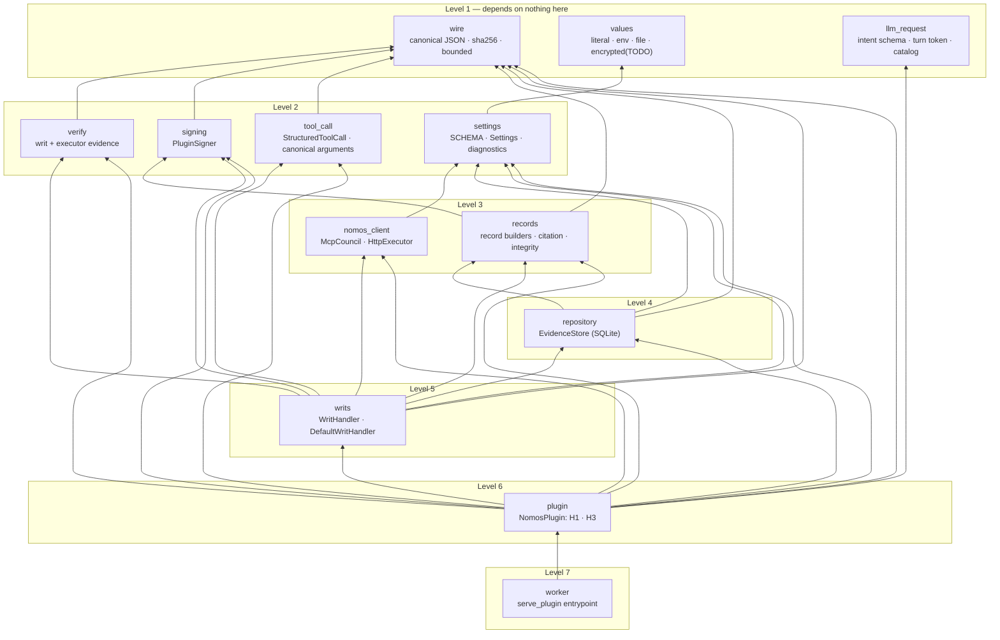

<!-- Generated by docs/build/architecture.py from docs/build/architecture/08-components.md; edit the template. -->
<!--
SPDX-FileCopyrightText: Copyright (c) 2026, NVIDIA CORPORATION & AFFILIATES. All rights reserved.
SPDX-License-Identifier: Apache-2.0
-->

# 8. Components

[← Architecture index](README.md) · previous: [Storage and recovery](07-storage-and-recovery.md)

The package `nemo_relay_nomos` is built as a **levelled physical design**: each module depends only on modules at
a strictly lower level, so the graph has no cycles. Every external surface has exactly one owner. The contract
both the code and the independent spec suite are held to is
[`DESIGN.md`](../../DESIGN.md).



| Module | Owns | Only it touches |
|---|---|---|
| `wire` | canonical bytes (the Nomos contract's), digests | — |
| `values` | resolving `{"env"}`, `{"file"}` references | process environment, operator secret files |
| `llm_request` | the `nomos` schema, `inject_intent`, the turn tokens and evidence ids a transcript shows, the Nomos message and its placement | — |
| `settings` | the configuration schema (source of `config.schema.json`), typed `Settings`, diagnostics | — |
| `verify` | strict checks of writs and executor evidence against pinned trust | — |
| `signing` | the plugin's Ed25519 identity | — |
| `nomos_client` | `council_authorize` over MCP, `POST /execute` over HTTP | **Nomos Council, trusted Executor** |
| `tool_call` | the structured `tool_call` a `local` tool is authorized as: canonical argument bytes and their digest | — |
| `records` | record shapes, the response envelope, citation form, integrity | — |
| `repository` | the in-memory evidence store: conversations, turns, journal, records, claims | **SQLite (`:memory:`)** |
| `writs` | writ handler interface, default handler, claims, executors | — |
| `plugin` | H1 and H3 orchestration | **Relay worker SDK** |
| `worker` | the process entrypoint | **Relay worker SDK** |

## The two hooks

[`nemo_relay_nomos/plugin.py` · `NomosPlugin.register` · lines 198–216](../../nemo_relay_nomos/plugin.py#L198-L216)

```python
def register(self, context: Any, plugin_config: dict) -> None:
    problems = diagnostics(plugin_config, environ=self.environ)
    if problems:
        raise ValueError(f"{problems[0].field}: {problems[0].message}")
    s = self.settings = Settings.from_config(plugin_config, environ=self.environ)
    owner = (s.connection.agent_id, s.connection.council_id, s.session.id)
    if self.store is None:
        self.store = EvidenceStore(owner, s.limits)
    elif self.store.owner != owner:
        raise ValueError("injected repository owner does not match the configured session")
    # Evidence must be signed, and the plugin never makes a key up: without a configured key it keeps none.
    self.signer = PluginSigner(bytes.fromhex(s.signing_key)) if s.signing_key else None
    council = self._council or McpCouncil(s.connection)
    self._council = council
    self._executor = self._executor or HttpExecutor(s.connection, s.limits.max_result_bytes)
    self.handler = load_writ_handler(s, store=self.store, executor=self._executor, signer=self.signer)
    context.register_llm_request_intercept("inject-intent", self.h1, priority=REQUEST_PRIORITY)
    context.register_tool_execution_intercept("authorize-execution", self.h3, priority=EXECUTION_PRIORITY)
    context.register_scope_sanitize_end_guardrail("export-annotation", sanitize_exported_annotation)
```

[`nemo_relay_nomos/plugin.py` · `NomosPlugin.h1` · lines 225–253](../../nemo_relay_nomos/plugin.py#L225-L253)

```python
def h1(self, model_name: str, request: Any, annotated: Any) -> LlmRequestInterceptOutcome:
    guarded = self.settings.guard.matches
    field = nomos_field(self.evidence, self._citations_allowed)
    if annotated is not None:
        annotated = deepcopy(annotated)
        offered = annotated.get("tools") or []
        if offered:
            annotated["tools"], _ = inject_intent(offered, guarded, field)
        messages = annotated.get("messages") or []
    else:
        content = request.get("content") or {}
        offered = content.get("tools") or []
        tools, changed = inject_intent(offered, guarded, field)
        if changed:
            request = {**request, "content": {**content, "tools": tools}}
        messages = content.get("messages") or []
    tokens, visible = transcript_ids(messages)
    user_text = _latest_user_text(messages)
    # The tools as the application offered them, before the nomos field was added.
    recorded = offered if self._tool_definitions_on else None
    turn = self.store.open_turn(
        tokens,
        user_text[:MAX_USER_TEXT],
        recorded,
        user_request_truncated=len(user_text) > MAX_USER_TEXT,
    )
    entries = self._catalog(visible, turn) if self.evidence and self.settings.catalog.enabled else []
    request, annotated = append_message(request, annotated, render_message(turn.token, entries))
    return LlmRequestInterceptOutcome(request, annotated)
```

[`nemo_relay_nomos/plugin.py` · `NomosPlugin.h3` · lines 280–312](../../nemo_relay_nomos/plugin.py#L280-L312)

```python
async def h3(self, ctx: Any, next_: Any) -> ToolExecutionInterceptOutcome:
    if not self.settings.guard.matches(ctx.tool_name):
        inner = await next_.call(ctx.args)
        return ToolExecutionInterceptOutcome(inner.result, annotation=inner.annotation)
    started = time.monotonic()
    trace: dict[str, Any] = {"timings_ms": {}}
    try:
        out, extra = await self._guarded(ctx, next_, trace)
    except StoreError as exc:
        code = str(exc)
        execution = "unknown" if code in _UNKNOWN_STORE_ERRORS else "not_executed"
        out, extra = response(code, execution=execution), None
    except (sqlite3.Error, OSError, RecursionError):
        # Never expose database paths, service bodies, credentials or unverified output.
        out, extra = (
            response(
                "storage_unavailable",
                execution="unknown",
                message="Evidence storage failed. Stop and reconcile this session before running anything else.",
            ),
            None,
        )
    except Exception:  # noqa: BLE001 — an unexpected failure must still close the gate
        out, extra = (
            response(
                "plugin_error",
                execution="unknown",
                message="The governance plugin failed unexpectedly; treat this call as not approved.",
            ),
            None,
        )
    trace["timings_ms"]["total"] = (time.monotonic() - started) * 1000
    return self._out(out, trace=trace, extra=extra)
```

The guarded path, from the intent to the call's conversation:

[`nemo_relay_nomos/plugin.py` · `NomosPlugin._guarded` · lines 314–343](../../nemo_relay_nomos/plugin.py#L314-L343)

```python
async def _guarded(self, ctx: Any, next_: Any, trace: dict) -> tuple[dict, Any]:
    s, store = self.settings, self.store
    args = ctx.args
    try:
        size = len(canonical(args)) if isinstance(args, dict) else -1
    except (TypeError, ValueError, RecursionError):  # NaN, infinity, non-JSON or absurd nesting
        size = -1
    if not 0 <= size <= s.limits.max_result_bytes:
        message = "Tool arguments must be a bounded JSON object (no NaN or infinity)."
        return self._refuse(ctx, {}, "invalid_arguments", message), None
    # Canonical round-tripping creates an immutable-by-convention snapshot
    # that cannot share nested containers with Relay's mutable call object.
    arguments = json.loads(canonical({k: v for k, v in args.items() if k != "nomos"}))
    problems = intent_problems(
        args.get("nomos"), evidence=self.evidence, citations=self._citations_allowed
    )
    if problems:
        message = teach_nomos(ctx.tool_name, evidence=self.evidence) + " Problems: " + "; ".join(problems)
        return self._refuse(ctx, arguments, "missing_intent", message), None
    turn = store.turn(args["nomos"]["turn"])
    if turn is None:  # unknown, expired, or issued by another worker
        return self._refuse(ctx, arguments, "unknown_turn", TEACH_TURN.format(tool=ctx.tool_name)), None
    trace["conversation"] = turn.conversation
    if turn.conversation in self._busy:
        return response("session_busy", message="Serialize tool calls; this call was not run."), None
    self._busy.add(turn.conversation)
    try:
        return await self._in_conversation(ctx, next_, trace, turn, arguments)
    finally:
        self._busy.discard(turn.conversation)
```

Then, within the conversation, from the journal to the writ handler:

[`nemo_relay_nomos/plugin.py` · `NomosPlugin._in_conversation` · lines 345–509](../../nemo_relay_nomos/plugin.py#L345-L509)

```python
async def _in_conversation(
    self, ctx: Any, next_: Any, trace: dict, turn: Turn, arguments: dict
) -> tuple[dict, Any]:
    s, store, args, conversation = self.settings, self.store, ctx.args, turn.conversation
    call_id = ctx.tool_call_id
    if not isinstance(call_id, str) or not 1 <= len(call_id) <= 256:
        return self._refuse(
            ctx,
            arguments,
            "missing_tool_call_id",
            "The harness must supply a tool call id.",
            conversation,
        ), None
    policy = s.policy(ctx.tool_name)
    structured = None
    if policy.executor == "local":
        if not s.tool_call.subject:
            return self._refuse(
                ctx,
                arguments,
                "missing_tool_subject",
                "A host-derived tool_call.subject is required for local tool authorization.",
                conversation,
            ), None
        try:
            structured = StructuredToolCall.build(ctx.tool_name, arguments, s.tool_call.subject)
        except ValueError as exc:
            return self._refuse(
                ctx,
                arguments,
                str(exc),
                (
                    "Structured tool argument integers exceed Nomos's 640-decimal-digit limit."
                    if str(exc) == "tool_integer_too_large"
                    else "Structured tool arguments exceed Nomos's 32,000-byte authorization limit."
                ),
                conversation,
            ), None
        command = None
    else:
        command = arguments.get(policy.command_argument)
        if (
            set(arguments) != {policy.command_argument}
            or not isinstance(command, str)
            or not command.strip()
        ):
            message = f"{ctx.tool_name} takes exactly one argument, {policy.command_argument!r}, a command string."
            return self._refuse(ctx, arguments, "invalid_command_arguments", message, conversation), None
    try:
        check_trust(s.trust.as_dict())
        await self._council_key()
    except EvidenceError as exc:
        return self._refuse(ctx, arguments, str(exc), TRUST_MESSAGES[str(exc)], conversation), None
    s = self.settings  # now holds the Council's key, if it was just fetched

    previous = store.begin(
        conversation, call_id, sha256_hex(canonical({"tool": ctx.tool_name, "args": args}))
    )
    if previous is not None:
        return previous, None  # a repeated call id with identical arguments replays its stored outcome

    ids = list(args["nomos"].get("evidence", []))
    try:
        certified = self._citations(ids, turn)
    except (EvidenceError, StoreError) as exc:
        return self._finish_refusal(
            ctx, arguments, str(exc), "A cited evidence id cannot be used.", conversation
        ), None
    context = f"tool={ctx.tool_name}; "
    if self._tool_definitions_on:
        # The certified definitions are those of the named turn, so it must be the one the call came from:
        # one no later request has shown. An earlier token would certify a list this call was not offered.
        if store.is_superseded(turn):
            message = TEACH_TURN.format(tool=ctx.tool_name)
            return self._finish_refusal(ctx, arguments, "unknown_turn", message, conversation), None
        observed = self._tool_definitions(ctx, turn)
        certified = [*certified, observed]
        # Review metadata: the reviewers see which definitions the item covers. It does not bind the writ to them:
        # Nomos's intent hash covers neither `context` nor certified evidence.
        context += f"tool definitions stdout_sha256={observed['evidence']['payload']['result']['stdout_sha256']}; "
    if store.denials(conversation) >= s.max_denials:
        message = "Too many consecutive council denials in this conversation; nothing was submitted."
        return self._finish_refusal(ctx, arguments, "denial_cap", message, conversation), None

    intent = args["nomos"]
    common_fields = {
        "agent_id": s.connection.agent_id,
        "auth_token": s.connection.auth_token,
        "council_id": s.connection.council_id,
        **{k: intent[k] for k in ("description", "justification", "target_resource", "blast_radius")},
        "evidence": [],  # nothing is asserted: every citation is certified
        "certified_evidence": certified,
        "context": (
            f"{context}latest user request: {turn.user_request}"
            + (" [user request truncated to 800 characters]" if turn.user_request_truncated else "")
        ),
    }
    if structured is None:
        fields = {
            **common_fields,
            "command": command,
            "working_directory": s.connection.working_directory,
        }
    else:
        # Shell fields are deliberately absent: Nomos v2 treats structured
        # authorization as a distinct, exact operation contract.
        fields = {
            **common_fields,
            "tool_call": structured.authorization(),
        }
    store.mark_citations(ids, "submitted_unknown")  # a failure cannot tell us what the council consumed
    requested_at = time.time()
    t0 = time.monotonic()
    try:
        decision = await self._council.authorize(**fields)
        if not isinstance(decision, dict):
            raise ValueError("council response is not an object")
    except Exception as exc:  # noqa: BLE001 — any failure is a closed gate
        decision = {"status": "error", "error": f"council unavailable ({type(exc).__name__})"}
    trace["timings_ms"]["council"] = (time.monotonic() - t0) * 1000
    # Host-only facts about what was asked of the Council, for observability (never secrets).
    trace["submitted"] = {
        **({"operation": structured.operation} if structured is not None else {"command": command}),
        "certified_citations": ids,
    }
    trace["council"] = {
        "status": decision.get("status"),
        "decision_id": decision.get("decision_id"),
        "votes": _votes(decision),
    }

    if decision.get("status") != "approved":
        return self._council_refusal(ctx, arguments, decision, conversation), None
    try:
        writ = (
            decode_tool_call_writ(decision.get("writ"))
            if structured is not None
            else decode_writ(decision.get("writ"))
        )
    except EvidenceError as exc:
        return self._finish_refusal(
            ctx, arguments, str(exc), "The council's writ is unreadable; nothing ran.", conversation
        ), None
    call = WritCall(
        ctx.tool_name,
        call_id,
        arguments,
        command,
        policy,
        decision.get("writ_id"),
        conversation,
        _continuation(next_),
        requested_at,
        structured,
    )
    t0 = time.monotonic()
    result = await self.handler.handle(call, decision["writ"], writ)
    trace["timings_ms"]["execute"] = (time.monotonic() - t0) * 1000
    if result.writ_valid:
        # A valid signed approval: the pinned Council validates every certified item before issuing one.
        store.mark_citations(ids, "accepted")
        store.set_denials(conversation, 0)
    out = {**result.response, "decision_id": decision.get("decision_id")}
    store.finish(conversation, call_id, out, result.record)
    return out, result.annotation
```

Next: [testing](09-testing.md).
