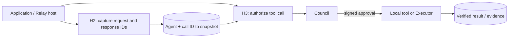
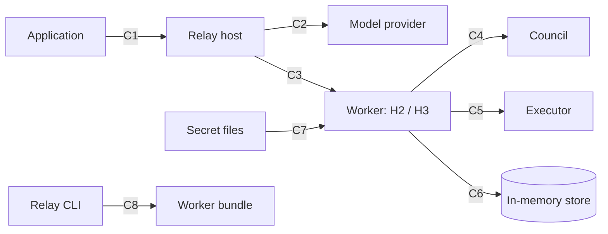

<!-- Generated by docs/build/architecture.py from docs/build/architecture/README.md; edit the template. -->
<!--
SPDX-FileCopyrightText: Copyright (c) 2026, NVIDIA CORPORATION & AFFILIATES. All rights reserved.
SPDX-License-Identifier: Apache-2.0
-->

# Nomos plugin for NeMo Relay: architecture

How the **Nomos plugin** (`nomos.council`) governs an application's tool calls through NeMo Relay alone, step by
step, with real data and the code that handles it.

| Data on these pages | Captured from |
|---|---|
| 🧪 offline | an uninstrumented agent, the real Relay host and the packaged worker, against loopback Nomos speaking the real wire contract |
| 🌐 live | the same calls against a Nomos deployment: an Astra Council (OPA + three LLM members) and an OpenShell Executor |

Recorded by the integration test bed into [`examples/`](examples/) ([provenance](examples/README.md)); rendered from
templates by [`architecture.py`](../build/architecture.py), which fails on data the system did not produce.

## The picture: five places, eight connections

The whole system on one screen: who is in it, what the plugin does at its two moments (H2, H3), who decides and who
runs the tool, and where the evidence lives.

Every step on every page names the connection (**C1–C8**) it crosses:

One governed call, in order, is drawn in three figures: [H2 around model execution](02-request-path-h1.md),
then [H3 before the Council answers, and after it approves](03-governed-tool-call-h3.md). H2 covers model execution; the H3 dispatch figure uses steps 18–26.

The table is the reference for each connection:

| | Between | Transport and message | When | If it fails |
|---|---|---|---|---|
| **C1** | Agent loop ⇄ Relay host | in-process calls: `llm.execute`, `tools.execute` | each model call, each tool call | the application's own handling; the plugin is not on this link |
| **C2** | Relay host ⇄ model provider | the application's model call (HTTPS) | each model call, after H2 prepared it | the application's; H2 calls the host continuation |
| **C3** | Relay host ⇄ plugin worker | Relay's worker protocol (gRPC, `grpc-v1`) to a separate process | H2 around every model invocation; H3 on every tool call | `startup = "required"`: Relay will not start without the worker; any H3 error is a closed gate |
| **C4** | H3 ⇄ Nomos Council | MCP over HTTP, tool `council_authorize`, bearer token | once per guarded call that passes the plugin's own checks (after T1, the citations and the denial cap) | `council_error`; nothing runs |
| **C5** | Writ handler ⇄ Nomos Executor | HTTP `POST /execute {writ}`, header `X-Agent-ID` | once per approved `nomos_http` call, after the claim | no verified answer = `execution_unknown`; the conversation blocks until reconciled |
| **C6** | Plugin ⇄ its in-memory store | SQLite `:memory:` inside the worker; lives as long as the worker | every H2 (a request snapshot, call-ID bindings and optional catalog); per H3 call the journal's T1, T2 (two writes) and T3, plus citation and denial-count writes | `storage_unavailable`, execution unknown; nothing else runs. If the worker dies, the store is gone |
| **C7** | `values` ⇄ secret files | `{"file": path}` references: owner-only, no symlinks | once, when `register()` builds the settings | the worker refuses to start; the diagnostic never quotes the value |
| **C8** | Relay CLI ⇄ plugin bundle | `plugins add` / `enable`: digest check, `pip install` into the worker venv | once, at install | the bundle is rejected; `plugins.toml` is unchanged |

The plugin's only network calls are C4 and C5; it writes nothing to disk; the application holds no Nomos code.

## How data moves through one call

One real approved call (🧪), card by card. Key colour and its one-letter tag are the authority, not the author:
**O the Relay host and plugin code** (dark blue: what the call actually carries, judged by the Council; the model
writes `command`, but the writ binds exactly that value), **A asserted** (purple: unverified, like the model's intent,
read only as explanation), **N Nomos** (green: what the Council and Executor sign; nothing runs without the Council's writ),
**P the plugin's store, and what it signs** (teal). Each card shows two fields; the table names the rest.

![How one approved call's data travels, recorded from a real run: nine cards of two fields each, from the model's tool call (command, the intent), H3's split (arguments without nomos, journal authorizing), council_authorize (command observed, description asserted), the Council's answer (status approved, the writ), the verified writ (command, nonce), POST /execute (the writ unchanged, the nonce claimed at T2) and the signed ExecutionResult (stdout, the Executor's signature) to the stored record (evidence_id, certified true) and what the model reads (status executed, stdout); each field tagged O, A, N or P by whose word it is; the next request's catalog lists the record by id, tool and arguments, never the output](../figures/lineage.png)

| Hop | What changes | Page |
|---|---|---|
| 1 → 2 | H3 removes `nomos` from the arguments. The tool never sees it. | [H3, E2](03-governed-tool-call-h3.md#e2--guard-split-validate-find-the-conversation) |
| 2 → 3 (C4) | The command, directory and identity come from Relay and configuration, so the intent cannot change what is authorized. Also observed: `context`, the user request of the call's own turn. Also asserted: the other three intent fields (`justification`, `target_resource`, `blast_radius`). Cited evidence goes certified (`certified_evidence`), never asserted. | [H3, E5](03-governed-tool-call-h3.md#e5--council_authorize--c4) |
| 4 → 5 | The writ is decoded and checked against the Council's key (pinned, or fetched once from the Council if the operator opts in), the exact command, this agent and its lifetime. | [H3, E7](03-governed-tool-call-h3.md#e7--the-writ-decoded-and-verified) |
| 5 → 6 → 7 (C5) | The nonce is claimed, then the Executor runs exactly the signed command and signs the result. | [H3, E8–E10](03-governed-tool-call-h3.md#e8--claim-then-dispatch--c6-c5) |
| 7 → 8 (C6) | The plugin verifies the signature, then stores the whole result as a record with its own receipt. | [Storage](07-storage-and-recovery.md) |
| 8 → 9 (C3) | Only then does the model get a bounded result (`status`, `stdout`, `stderr`, `exit_code`) that carries the `evidence_id`; timings, the conversation id and the Council's votes go only to the host. On later turns the record is listed in the catalog by id, tool and arguments. | [Evidence](05-evidence-and-citation.md) |

## Reading guide

| # | Page | Shows |
|---|---|---|
| 1 | [Deployment and configuration](01-deployment-and-configuration.md) | the `plugins.toml` entry, secret references, the trust snapshot, startup |
| 2 | [Model execution (H2)](02-request-path-h1.md) | native Agent and call-ID correlation, the injected intent schema and optional evidence catalog |
| 3 | [A governed tool call (H3)](03-governed-tool-call-h3.md) | the approved path: intent → `council_authorize` → writ → Executor → verification → evidence |
| 4 | [Every outcome](04-outcomes.md) | refusals, denials, Council errors, quarantine, unknown outcomes, replay |
| 5 | [Evidence and citation](05-evidence-and-citation.md) | record anatomy, certified vs plugin-signed, how a citation reaches the Council |
| 6 | [Writ handling and executors](06-writ-handling-and-executors.md) | validate → claim → dispatch; `nomos_http` and `local`; the custom-handler seam |
| 7 | [The evidence store and recovery](07-storage-and-recovery.md) | the tables and their rows, the call journal, retention, a dead worker |
| 8 | [Components](08-components.md) | levelled modules, dependencies, interfaces, insulation |
| 9 | [Testing](09-testing.md) | every tier, and every certified-evidence path with its test |
| 10 | [Limits and open items](10-limits-and-open-items.md) | what the plugin cannot do yet, and why |

## Legend

- **C1…C8** tag the connection a step crosses: `E5 · council_authorize · C4`. In a figure, a connection id sits on
  its arrow: a filled disc for a link used on every call, a hollow one for a link used once (install, worker start).
  Only C2, C4 and C5 cross a network (C2 is the application's own model call); C1 is in-process, C3 is Relay's
  worker protocol between two local processes, C6 is in the worker's memory, C7 and C8 are local file work.
- **E1…En** number a page's sections, each with its real data and then its code; each section names the figure
  steps (1–26) it covers.
- **observed** fields were seen by Relay or the plugin (command, directory, identity); **asserted** fields are
  unverified: the model's intent. Cited evidence is always certified: Executor results, and the local results,
  Council decisions and opt-in tool list the plugin certified. The Council receives them kept apart.
- Box colour is authority: dark blue the Relay host and plugin code, purple the model (asserted), green Nomos,
  teal the plugin's store and what it signs, grey the application and the operator's host (no Nomos code). A shaded
  box without a border is a stage, a state or a fact, not a party.

Outcome marks, the same in every figure and on every page:

| Mark | Meaning |
|---|---|
| → **passthrough** | not guarded: the tool runs, nothing is kept |
| ⊘ **refused by the plugin** | nothing ran; the tool result says why |
| ✕ **the Council denied, or failed** | nothing ran; a denial returns the Council's whole response |
| ✓ **dispatched** | the tool or Executor answered and the answer is returned (`executed` or `execution_failed`; a `nomos_http` `execution_failed` can mean the Executor refused to run it) |
| ? **may have run** | the outcome is unknown; nothing retries it; further guarded calls for that Agent are blocked; see recovery and retention |
| ↺ **replay** | the stored outcome of the same call, nothing re-sent |

Storage marks, used in the tables:

| Mark | Meaning |
|---|---|
| ✅ **certified** (green) | an Executor signed it and the plugin verified it against the pinned key; the Council re-verifies it |
| 🔏 **plugin-signed** (teal) | stored and signed by the plugin with the operator's key. Local results and Council decisions are also certified by that key and cited as certified evidence; refusals and unknown outcomes are never cited. No key, no evidence |
| quarantined (`invalid`) | an Executor result that failed verification: not certified, never listed, never citable |
