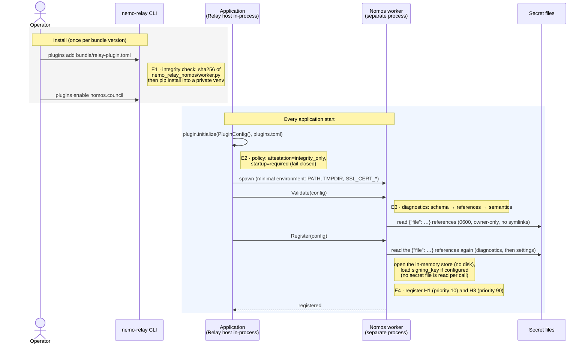
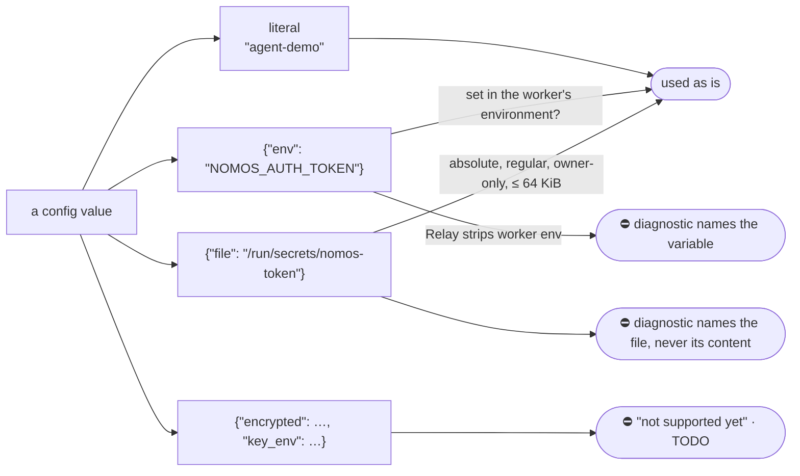

<!--
SPDX-FileCopyrightText: Copyright (c) 2026, NVIDIA CORPORATION & AFFILIATES. All rights reserved.
SPDX-License-Identifier: Apache-2.0
-->

# 1. Deployment and configuration

[← Architecture index](README.md)

The operator deploys three things; the application deploys nothing.

| What | Where |
|---|---|
| the plugin **bundle**: `nemo_relay_nomos`, `pyproject.toml`, `uv.lock`, the manifest `relay-plugin.toml` | registered with the Relay CLI (C8) |
| a `nomos.council` entry in **`plugins.toml`**: Council and Executor, agent identity, guarded tools, trusted keys, optional signing key | read at every start (C3) |
| **secret files**, owner-only; `plugins.toml` only points at them | read at worker start only (validate, then register), never per call (C7) |

## Startup, event by event

### E1 · Install · C8

Relay checks one file's digest, the manifest's `source.artifact`:

{{example manifest.json text lang=toml}}

`plugins add` then pip-installs the bundle into a private venv, resolving dependencies afresh (it ignores
`uv.lock`); the tests install offline from a pinned wheelhouse, [`scripts/wheelhouse.sh`](../../scripts/wheelhouse.sh).

### E2 · Policy

`attestation = "integrity_only"` (bundles are digest-checked, not signed) and `startup = "required"`: if the worker
cannot start, the application does not start. Tools never run ungoverned.

### E3 · Configuration · C3, C7

The `plugins.toml` a test host wrote for one run (secrets are `{"file": …}` references):

{{example plugins_toml.json text lang=toml}}

Every leaf can be written four ways, resolved by `values.resolve` when the settings are built:

{{code nemo_relay_nomos/values.py _from_file}}

| Relay fact | Consequence |
|---|---|
| managed workers keep only `PATH`, `TMPDIR`, `SSL_CERT_*` | `{"env"}` works in-process, not in a managed worker: use `{"file"}` (pinned by the installed-worker tests) |
| Relay (0.10, 0.11) rejects `writeOnly` under `anyOf` | secrets cannot be masked in Relay's editor; file references keep them out of the TOML |

The schema Relay validates against is `settings.SCHEMA` ([`settings.py`](../../nemo_relay_nomos/settings.py));
a pre-commit hook keeps `config.schema.json` identical. Diagnostics stop at the first failing stage and never quote a
value:

| Stage | Example |
|---|---|
| Schema | `guard.include: 'run_shell' is not of type 'array'` |
| References | `connection.auth_token: environment variable NOMOS_AUTH_TOKEN is not set in this process. Managed Relay workers start with a minimal environment …` |
| Semantics | `writ_handler.kind: custom writ handlers are not implemented yet` · `trust.valid_until: trust snapshot has expired` · `connection.mcp_url: http:// to a non-loopback host …` |
| Warnings | `connection.auth_token: a secret is written inline …` · `signing_key: no signing_key: evidence is disabled …` · `trust.council_public_key_source: the Council's key will be taken from connection.mcp_url …` |

### The trust snapshot

By default the plugin never trusts a key because a service sent it. The operator pins:

| Key | Verifies |
|---|---|
| the Council's Ed25519 public key | writs |
| each trusted Executor's public keys (several allow rotation) | execution evidence |
| `policy_version`, `valid_until` | a label and a hard expiry: after it, nothing is trusted and nothing runs |

Provision it out of band: the Executor keys from the Nomos deployment's executor registry, the Council key from
`council_get_public_key`, and a short `valid_until` (the test bed uses 7 days).

**Opt-in:** `council_public_key_source = "council"` replaces the pinned Council key with one the plugin fetches from
`council_get_public_key` on its first guarded call (C4) and keeps for the activation. It needs an `https://` (or
loopback) `mcp_url`, and `validate()` warns: whoever controls that endpoint controls approvals. Executor keys are always
pinned. Details: [`README.md`](../../README.md#operator-configuration).

### E4 · Registration · C6, C3

`register()` validates again, opens an empty SQLite `:memory:` store, loads `signing_key` if configured (never
generates one: no key, no evidence), and registers the hooks. Relay never respawns the worker; if it dies, guarded calls
fail closed until the host initializes again.

| Hook | Relay API | Priority | Why |
|---|---|---|---|
| `inject-intent` | LLM request intercept | 10 | early: edits the request before other request intercepts |
| `authorize-execution` | tool execution intercept | 90 | before Relay's caches (150) and guardrails (100): a cache hit never skips the Council ([DESIGN](../../DESIGN.md#plugin)) |

{{code nemo_relay_nomos/plugin.py NomosPlugin.register}}

Next: [the model request (H1)](02-request-path-h1.md).
