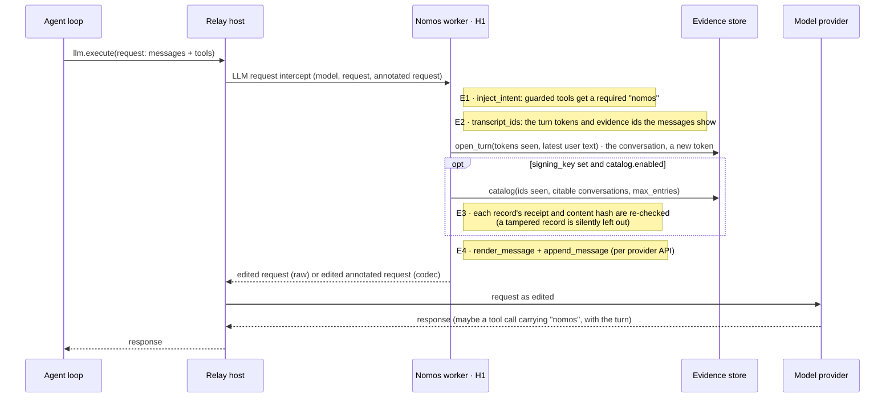
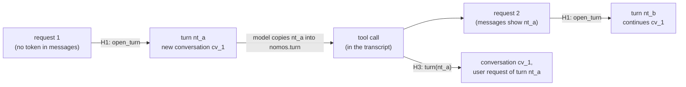

<!--
SPDX-FileCopyrightText: Copyright (c) 2026, NVIDIA CORPORATION & AFFILIATES. All rights reserved.
SPDX-License-Identifier: Apache-2.0
-->

# 2. The model request (H1)

[← Architecture index](README.md) · previous: [Deployment](01-deployment-and-configuration.md)

Each `llm.execute` (C1) passes through **H1** (`NomosPlugin.h1`, over C3) before it reaches the provider (C2). H1
edits only the copy the model receives:

| Edit | What the model gets |
|---|---|
| **Intent** | each guarded tool's schema requires a `nomos` object |
| **Nomos message** | one appended message: this request's **turn token** (copied into `nomos.turn`) and the **catalog** of citable evidence (id, tool, outcome, trust, arguments; never output) |

![What H1 does to every model request, time running down: 1 llm.execute (C1); 2 Relay passes model name and request to H1 (C3); 3 H1 adds the nomos field to guarded tools, the same bytes on every request; 4 H1 opens a turn in the store, a new token (C6): in the conversation the transcript shows, or in a new conversation when it shows none, or several (merged); 5 with a signing key, the catalog: ids these messages show, in conversations this turn may cite (C6); 6 the edited request returns with one Nomos message, the token and the catalog, never output (C3); 7 Relay sends it to the model provider (C2); 8 the model's tool call carries the token in nomos.turn (C2); 9 the reply reaches the application (C1)](../figures/h1.png)

The sections below follow the figure: E1 is step 3, E2 step 4, E3 step 5, E4 step 6. The same order with the
functions that do it:

## E1 · The intent requirement · C1, C3

{{code nemo_relay_nomos/plugin.py NomosPlugin.h1}}

`run_shell` as the agent declares it, then as the model received it (🧪):

{{example agent_tools.json 0}}

{{example model_requests.json 0.tools.0}}

| Property | |
|---|---|
| fixed text | no per-call data in the schema, so the tools block is byte-identical every turn and prompt caches keep working |
| idempotent | a second pass changes nothing |
| guarded tools only | `{"include": ["run_shell"]}` (default) · `["*"]` · `["*"]` with `"exclude": ["read_*"]`; `nomos_*` is never guarded |
| two paths | **codec**: edits Relay's `annotated` request, raw body untouched · **raw**: edits the OpenAI-chat body |
| R13 | fixed in Relay 0.11, which the plugin requires: the codec path now patches back every edited tool (0.10 patched back one; [patch](../upstream/README.md); pinned by `test_relay_codec_carries_two_edited_tools_in_one_request`) |

{{code nemo_relay_nomos/llm_request.py inject_intent}}

## E2 · The turn token and the conversation · C3, C6

One worker serves every conversation in its process, and Relay gives it no caller identity (the tool hook sees
`tool_name`, `args`, `tool_call_id`; the scope id is new per call). So conversations are told apart by their own
transcripts:

{{code nemo_relay_nomos/llm_request.py transcript_ids}}

`open_turn` decides the conversation from the tokens found:

| Live tokens in the messages | Conversation | May cite evidence of |
|---|---|---|
| none (a new conversation, or a new worker) | a new one | itself |
| all from one conversation | that one | that one |
| from several conversations | a new one, starting blocked if any of them is blocked, with the highest denial count | itself and all of them |

{{code nemo_relay_nomos/repository.py EvidenceStore.open_turn}}

A token is a bearer value, like an evidence id. The 🧪 run is one conversation; its first five turns:

{{table store_snapshot.json turns rows=0 cols=token,conversation,user_request,created,expires trim=24}}

**Two conversations on one worker** (🧪, interleaved on purpose: Alice's call is built after Bob's request passed H1;
Bob then cites Alice's evidence id):

![What a conversation may see and cite: two overlapping sets, ids the request's own messages show and records the turn may cite: in both, citable, and listed in the catalog if it is a result, denial or Council error (refusals and unknown outcomes are never listed); only the second, citable but not listed; only the first, not citable. Citable means a record of this conversation or of one merged into it, unless expired or quarantined. Then Alice's and Bob's transcripts from a real run on one worker, each request with a new turn token, each tool result with its evidence id, and Bob's citation of Alice's id refused as evidence_not_found without asking the Council](../figures/conversations.png)

An id of any other conversation, or one with no record, reads `evidence_not_found`, exactly like an unknown id, and the
Council is not asked. The same holds for an evidence id that leaks: on its own it cites nothing from a turn that may
not cite its conversation.

The rules behind it, including what isolation does not promise:

Because only tokens count:

- a transcript trimmed of every live token starts a new conversation;
- forks of one transcript share one conversation;
- a leaked turn token works for whoever holds it, until it expires.

What is kept per conversation: the denial count and cap, the blocked flag, the journal (so replay), and storage quota
shares; the same `tool_call_id` in two conversations is two calls. Only writ claims and tool lists are worker-wide.
A blocked conversation stops only itself.

Each call carries its own user request to the Council; Bob's citation of Alice's id is refused before the Council:

{{example conversations.json council_calls}}

{{example conversations.json bob.tool_calls.1.result}}

{{table conversations.json store.turns cols=token,conversation,user_request,created trim=24}}

The promises, each with its tests: [`DESIGN.md`](../../DESIGN.md#conversations-sharing-one-worker).

## E3 · Which records are offered · C6

Newest first, up to `catalog.max_entries` (20): records whose id **this request's messages show** and whose
conversation **this turn may cite**. Only with a signing key; without one there is no catalog.

| Offered | Not offered | Re-checked |
|---|---|---|
| executor and local results, denials, Council errors | refusals, unknown outcomes, quarantined, expired | content hash and receipt, against the plugin's own key |

{{code nemo_relay_nomos/plugin.py NomosPlugin._catalog}}

The query and its rows: [the evidence store](07-storage-and-recovery.md#reading-the-catalog-and-a-citation).

## E4 · The Nomos message · C2

First request (no evidence yet): the turn line alone.

{{example model_requests.json 0.messages.2}}

Second request, after one executed call:

{{example model_requests.json 1.messages.4}}

Rendered by:

{{code nemo_relay_nomos/llm_request.py render_message}}

Sixth request: the missing-intent refusal is absent; the denial is listed; the Executor's refusal is
`not_executed · certified` (recorded before denials were certified: today the denial lists as `certified` too):

{{example model_requests.json 5.messages.12}}

🌐 live:

{{example live_run.json nomos_message}}

Placement by `annotated.api_specific.api` (always a new item, which codecs accept alongside an edited tool):

| Provider API | Placement |
|---|---|
| OpenAI Chat Completions (or the raw path) | a trailing `{"role": "system"}` message |
| OpenAI Responses | a trailing `{"role": "developer"}` message |
| Anthropic Messages | appended to `instructions`, which becomes the top-level `system` (a `system` role inside `messages` is invalid there) |

On Anthropic this changes the system prompt every turn ([limits](10-limits-and-open-items.md)).

{{code nemo_relay_nomos/llm_request.py append_message}}

## What the model sends back

The (scripted) model's second call, with its turn and a citation:

{{example model_requests.json 2.messages.4}}

Next: [what happens to that call (H3)](03-governed-tool-call-h3.md).
