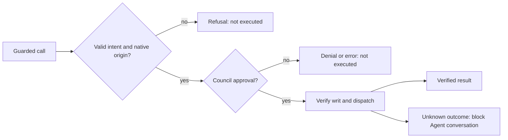

<!--
SPDX-FileCopyrightText: Copyright (c) 2026, NVIDIA CORPORATION & AFFILIATES. All rights reserved.
SPDX-License-Identifier: Apache-2.0
-->

# 4. Every outcome

[← Architecture index](README.md) · previous: [A governed tool call (H3)](03-governed-tool-call-h3.md)

Every ending is an ordinary tool result. With a signing key, most endings are stored as evidence before they are
returned; passthrough, `session_busy`, a replay, the store's own refusals and a failure of the store or plugin itself
store nothing. The outcome marks are: → passthrough, ⊘ refused by the plugin, ✕ the Council denied or
failed, ✓ dispatched and answered, ? may have run (outcome unknown), ↺ replay.

What stops a conversation's guarded calls, and what does not stop the others:

A denial cap or an uncertain execution outcome stops further guarded calls for that Agent's conversation.
Other Agents remain separate. The worker does not retry an action whose outcome is unknown; see
[recovery and retention](07-storage-and-recovery.md#retention) for state lifetime.

Denial and blocked state belongs to the native Agent conversation; see [retention](07-storage-and-recovery.md#retention). Nothing is automatically retried. `nomos_http` and `local` results differ in who vouches for them: the Executor signs a `nomos_http` result and the plugin verifies it (certified). A `local` tool's output comes back through `next_`; with a `signing_key` the plugin stores it as a `local_result` it certified (`plugin_certified`, re-checked against the plugin's key when cited). Nothing verifies the tool's output itself. A denial or Council error is certified the same way; a refusal or unknown outcome is plugin-signed and never citable. Without a `signing_key` no result is stored. A failed `nomos_http` call (`execution_failed`) can also mean the Executor refused to run the writ.

The envelope: `contract_version` (`nomos-plugin/v1`) · `status` · `execution_status` (`not_executed` | `executed` |
`failed` | `unknown`) · `evidence_status` (`locally_verified` | `plugin_signed` | `plugin_certified` | `invalid` | `unavailable`) ·
`evidence_id` when stored. Built by `records.response`.

Every ending, with what it leaves behind. "Stored as" needs a `signing_key`: without one nothing is stored, and the
other columns are unchanged. A call's cited records are untouched until step 15, and an `accepted` record is never downgraded.

| `status` | Mark | `execution_status` | Stored as | Denial count | Its cited records | Blocks the conversation |
|---|---|---|---|---|---|---|
| (not guarded: passthrough) | → | (the tool's own result) | (not stored) | kept | — | no |
| `missing_intent`, `native_context_unavailable` (origin missing, expired or ambiguous), `invalid_arguments` | ⊘ | `not_executed` | 🔏 `plugin_refusal`, in no conversation | kept | untouched | no |
| `session_busy` (another guarded call of the same conversation is in progress) | ⊘ | `not_executed` | (not stored) | kept | untouched | no |
| `invalid_command_arguments`, `missing_tool_call_id`, `missing_tool_subject`, `trust_policy_expired`, `council_key_unavailable` | ⊘ | `not_executed` | 🔏 `plugin_refusal` | kept | untouched | no |
| (replay: same conversation, `tool_call_id` and arguments) | ↺ | as first returned | (nothing new) | kept | untouched | no |
| `tool_call_id_conflict`, `authorization_interrupted`, `storage_quota_exceeded` | ⊘ | `not_executed` | (not stored: the store is what refuses) | kept | untouched | no |
| `session_requires_reconciliation` | ⊘ | `unknown` (an earlier call's outcome is) | (not stored: the store is what refuses) | kept | untouched | it already is |
| `evidence_not_found`, `evidence_expired`, `evidence_quarantined`, `evidence_integrity_failure`, `untrusted_executor`, `citation_size_exceeded` | ⊘ | `not_executed` | 🔏 `plugin_refusal` | kept | untouched | no |
| `denial_cap` | ⊘ | `not_executed` | 🔏 `plugin_refusal` | kept (at the cap) | untouched | no |
| `denied` | ✕ | `not_executed` | 🔏 `council_denial` | + 1 | `submitted_unknown` | no |
| `council_error` | ✕ | `not_executed` | 🔏 `council_error` | kept | `submitted_unknown` | no |
| `writ_binding_mismatch`, `invalid_signature`, `writ_expired`, `writ_replayed`, … | ⊘ | `not_executed` | 🔏 `plugin_refusal` | kept | `submitted_unknown` | no |
| `executed` | ✓ | `executed` | ✅ `executor_result` (`nomos_http`) / 🔏 `local_result` (`local`) | → 0 | `accepted` | no |
| `execution_failed` | ✓ | `failed`, or `not_executed` when the Executor refused to run it | ✅ `executor_result` (`nomos_http`) / 🔏 `local_result` (`local`) | → 0 | `accepted` | no |
| `evidence_invalid` | ? | `unknown` | `executor_result` with status `invalid`: not certified, quarantined, never listed | → 0 | `accepted` | **yes** |
| `execution_unknown` | ? | `unknown` | 🔏 `execution_unknown` (never listed) | → 0 | `accepted` | **yes** |
| `storage_unavailable`, `plugin_error` | ? | `unknown` | (not stored: T3 never runs) | — | — | **yes** if the journal row was left `dispatching` |

Denial count and citations: `denied` adds one; `council_error` and every refusal leave the count alone; any outcome
after a valid writ (`executed`, `execution_failed`, `evidence_invalid`, `execution_unknown`) resets it to 0 and marks
the cited records `accepted`. Once the count reaches `max_denials`, every new guarded call of that conversation is
`denial_cap` before the Council is asked, so the count can no longer be reset: the cap is permanent for that
conversation. The same holds for `session_requires_reconciliation` once a conversation is blocked. Both checks
come after the journal: a call repeating a completed `tool_call_id` with the same arguments still replays its
stored outcome rather than getting `denial_cap` or `session_requires_reconciliation`.

## ⊘ A refusal that teaches: missing intent

`run_shell` without `nomos`; the Council is never asked; the refusal names what to add:

{{code nemo_relay_nomos/llm_request.py teach_nomos}}

The returned `message` describes the required review fields and any validation problems;
`status` is `missing_intent` and `execution_status` is `not_executed`.

## ✕ A denial, with the full Council response

The Council's **entire** response comes back under `council` (bounded, writ removed), with `message` as a readable
summary: reason, guidance, missing permissions, each member's vote and reasoning, the chairman's risk, retryable.

🌐 Live: the permission gate refused `rm -rf /` before any member model (so `council_members` is empty):

{{example live_run.json tool_results.2.result}}

🧪 Offline, with member votes and the chairman:

{{example tool_results.json 2.result}}

Stored as a `council_denial` the plugin certifies (Nomos does not sign denials), listed and citable later as
certified evidence. (Recorded before decisions were certified: today the result says `evidence_status:
"plugin_certified"`, and the annotation has no `asserted_citations`.) The host annotation:

{{example tool_events.json 5.annotation}}

After `max_denials` (3) consecutive denials in a conversation, its next call is `denial_cap` without the Council;
an approval resets the count, an error does not count.

## ✕ A Council error closes the gate

`status: "error"`, an exception, a timeout or a non-object all become `council_error`: nothing runs, and the Council's
error is passed through under `council` (e.g. `council_overloaded … retryable: true`). A certified item the Council
cannot validate comes back this way too ([finding](../findings.md)).

## ✓ "Signed ≠ succeeded": an Executor refusal

The Council approves, the Executor's whitelist refuses, and signs that too: `execution_failed`, `not_executed`,
still ✅ certified. A signature proves who reported the outcome, not success. 🧪 `/bin/df` here (🌐 `/bin/date` live):

{{example tool_results.json 3.result}}

Pinned by `test_executor_refusal_is_signed_but_reported_as_not_run` and, live, `test_live_a_signed_executor_refusal_is_certified_listed_and_citable`.

## ? Quarantine: a result that fails verification

The Executor's stdout was altered after signing: the output is withheld, and `execution_status` is `unknown` (it may have
run).

{{example quarantine.json tampered_result_response}}

Kept for the operator as `invalid`, never listed, never citable; the conversation is blocked:

{{example quarantine.json next_call_response}}

`execution_unknown` (no answer, a dropped connection, cancellation after dispatch) blocks the same way: the pinned
Nomos cannot fetch a result by `writ_id`, and a new writ could run the action twice. See
[storage and recovery](07-storage-and-recovery.md).

## Replay: the same call twice

Same `tool_call_id` and arguments in the same conversation: the stored outcome, nothing contacted again. Different
arguments: `tool_call_id_conflict`.

Next: [evidence and citation](05-evidence-and-citation.md).
