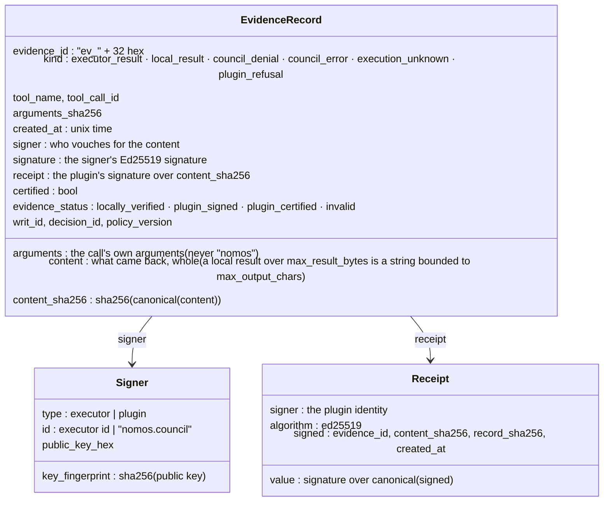
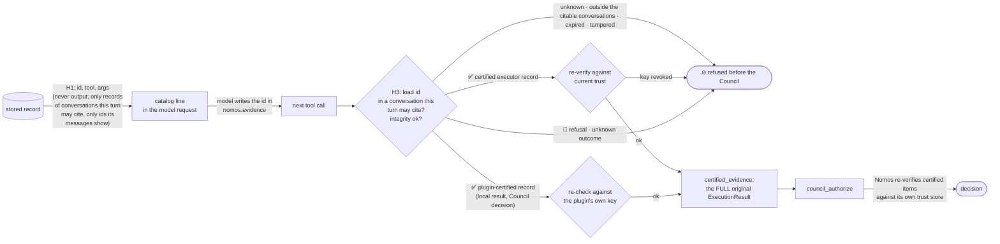
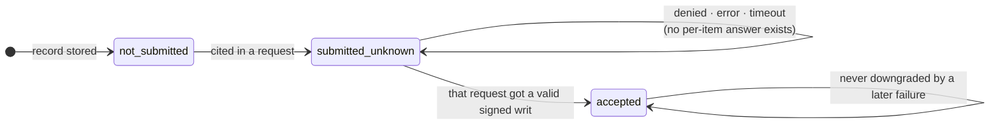

<!--
SPDX-FileCopyrightText: Copyright (c) 2026, NVIDIA CORPORATION & AFFILIATES. All rights reserved.
SPDX-License-Identifier: Apache-2.0
-->

# 5. Evidence and citation

[← Architecture index](README.md) · previous: [Every outcome](04-outcomes.md)

Every outcome of a guarded call becomes a record before the agent sees it: what was called, what came back, who
vouches for it, when. A later call cites it by id, and the plugin sends the record itself, so the model can neither
invent nor alter evidence. (Only with an operator `signing_key`: [no key, no evidence](#no-signing-key-no-evidence).)

![Who signs what, and what the plugin checks it against, one row per signer: the Council signs the writ (one exact call, short-lived), checked against the Council's key, pinned or fetched once if the operator opts in; the Executor signs the ExecutionResult (binding the writ, command and output), checked against the pinned Executor keys on arrival and at every citation; the plugin's signing_key signs the plugin's records and a receipt on every record, Executor records too, and certifies local results and Council decisions, checked against its own key at every catalog read and citation; the model writes the intent (description, justification, …), which nobody checks and which never decides what runs; the Council returns a denial or an error, which Nomos does not sign (when the Council gives no usable reply, the plugin writes the error itself), kept in a record the plugin certifies when there is a signing_key. Hatched middle boxes: nobody signs it. Certified means an ExecutionResult signed by a key the Council trusts: the Executor's, or the plugin's once registered; signed is not succeeded, a verified non-zero exit is still certified](../figures/trust.png)

| Signer | Signs | The plugin checks it against | Sent to the Council as |
|---|---|---|---|
| Council (Ed25519) | the writ: agent, Council, exact command and working directory (or exact tool operation and argument digest), nonce, expiry | the operator-pinned Council key, or the key fetched once per activation if `trust.council_public_key_source = "council"` | (it is the Council's own output) |
| Executor | the `ExecutionResult` `evidence`: the writ, the command, the output digests | the pinned keys in `trust.executors`, on arrival and again at every citation (a revoked key fails the citation) | `certified_evidence`: the whole original, which Nomos re-verifies |
| plugin (`signing_key`) | every record it stores and a receipt on **every** record, Executor records included; and a certified `ExecutionResult` for each `local_result`, `council_denial` and `council_error` | its own key, at every catalog read and citation | `certified_evidence`: the certified copy, which Nomos re-verifies once the key is registered; a `plugin_refusal` or `execution_unknown` is never sent |
| nobody | the model's intent (`description`, `justification`, `target_resource`, `blast_radius`) | — | asserted fields, kept apart from observed ones |
| nobody | a Council denial or error (Nomos does not sign denials) | — | (certified by the plugin, as received) |

What the Council is told on each guarded call, and on whose word:

![What council_authorize tells the Council, and on whose word, sent over C4 only for calls that pass the plugin's own checks. Observed, which the Council judges: agent_id, council_id and auth_token from the operator's configuration (grey); the command, or the local tool call; context, the user request of the call's own turn. Asserted, which the Council weighs: the model's four intent fields; nothing else. Certified, which Nomos re-verifies: certified_evidence, the cited Executor results whole, and, plugin-certified (tagged P), cited local results and Council decisions, and the opt-in tool definitions. The model's intent can explain a call; it can never change what is authorized](../figures/council-request.png)

| Category | Fields | Source | What the Council does with it |
|---|---|---|---|
| observed | `agent_id`, `council_id`, `auth_token` | the operator's configuration | identifies the agent and authorizes the request |
| observed | `command` + `working_directory` (`nomos_http`), or `tool_call` (`local`: tool name, the exact arguments, the operator's subject) | the actual call arguments (minus `nomos`) and configuration | judges exactly this; a writ binds it |
| observed | `context`: the tool name and the user request of **the call's own turn** (at most 800 characters) | H1's turn record, found by `nomos.turn` | judges the call against what the user asked |
| asserted | `description`, `justification`, `target_resource`, `blast_radius` | the model's `nomos` field | weighs it; it cannot change what is authorized |
| — | `evidence`: always `[]` | nothing is sent as asserted | — |
| certified by the plugin | `certified_evidence`, last item (`tool_definitions` on): the tool list the **application** offered in the call's own turn | H1 recorded it from the request and the plugin signed it; the model does not write it | re-verifies it against the plugin key it registered as a trusted executor; `context` names its digest |
| certified | `certified_evidence`: cited Executor results, whole, and the plugin's certified local results and Council decisions | the store, re-verified against the current trust or the plugin's own key | re-verifies each signature itself (the plugin's once its key is registered) |

`council_authorize` goes out only for a guarded call that has passed every one of the plugin's checks (arguments,
intent, turn, `session_busy`, tool policy, trust, T1, citations, denial cap). A call refused before that never
reaches the Council.

The plugin's own `signing_key` decides whether any of this evidence exists:

![What the plugin's signing key switches on: with signing_key, evidence records are kept: signed records, a catalog for the model and nomos.evidence citations, and certified local results and Council decisions, plus the opt-in certified tool list; without one (dashed, off): no records, no catalog and no evidence field, a citation is refused as missing_intent, and tool_definitions is off, with a warning. The same either way: turn tokens and conversations, the journal, replay and quotas, writ checks and nonce claims, and Executor results verified](../figures/signing-key.png)

## Anatomy of a record

**Who is the authority for each field:**

| Field | Meaning | Authority |
|---|---|---|
| `evidence_id` | `ev_` + 32 hex; the id the model cites | plugin |
| `kind` | which of the six endings this records | plugin |
| `tool_name`, `tool_call_id` | which call this answers | Relay (observed) |
| `arguments`, `arguments_sha256` | the call's arguments without `nomos`, and their digest | Relay (observed) |
| `content` | the response, whole: the Executor's `ExecutionResult`, or the plugin's response (a `local` result whose encoding exceeds `limits.max_result_bytes` is kept as a string bounded to `limits.max_output_chars`) | Executor or plugin |
| `content_sha256` | SHA-256 of `canonical(content)` | plugin |
| `signer`, `signature` | who signed `content`, and that signature | Executor or plugin |
| `writ`, `writ_id`, `decision_id` | the decoded writ that authorized it; the Council's decision id | Nomos |
| `certified`, `evidence_status` | `true` / `locally_verified` for a verified Executor result; `true` / `plugin_certified` for a local result or Council decision; `false` / `plugin_signed` for a refusal or unknown outcome | plugin |
| `policy_version` | the trust snapshot it was verified under | operator |
| `created_at` | Unix time the record was sealed | plugin |
| `receipt` | the plugin's signature over `content_sha256`, `evidence_id`, `created_at` and `record_sha256` | plugin |

Stored as canonical JSON in one `records` row beside its SHA-256 ([real rows](07-storage-and-recovery.md#records-one-row-per-response)).

### ✅ A certified record: the Executor vouches

`content` is the Executor's `ExecutionResult` as received; `signature` is the Executor's own, binding the writ, the
command and the output digests and sizes; `certified` because every [E10](03-governed-tool-call-h3.md#e10--strict-verification)
check passed against the pinned key.

{{example evidence_records.json 0.record trim=64}}

### 🔏 A plugin-signed record: the plugin vouches

Denials, refusals, Council errors, unknown outcomes and local results have no Nomos signature: the plugin signs them
with the operator's key (`signature` = `receipt`). Refusals and unknown outcomes stay plugin-signed and are never
cited. Local results and Council decisions also carry the plugin's certified `ExecutionResult` (`certified_result`,
`certified: true`), which is what a citation sends ([DESIGN](../../DESIGN.md#certified-council-decisions)). The denial
from [every outcome](04-outcomes.md), recorded before decisions were certified (today it also carries
`certified_result`):

{{example evidence_records.json 2.record keys=evidence_id,kind,tool_name,arguments,created_at,content_sha256,signer,signature,receipt,certified,evidence_status,decision_id trim=64}}

**A receipt on every record** signs `content_sha256` and `record_sha256` (every other field). `integrity_ok` checks
both against the plugin's **own** key, so a record changed in the store, even with a recomputed row digest, vanishes
from the catalog and is `evidence_integrity_failure` when cited (`test_record_tampered_in_the_store_is_not_listed_or_citable`).

### No signing key, no evidence

The plugin never makes a key up (no one could verify it). Without `signing_key`: no record is stored, the schema has
no `evidence` field, the Nomos message is the turn line only, responses carry no `evidence_id`. Executor results are
still verified, and a failure still withheld. [`DESIGN.md`](../../DESIGN.md#the-plugins-signing-key)

Sealing (at build) and checking (on every catalog read and citation):

{{code nemo_relay_nomos/records.py _seal}}

{{code nemo_relay_nomos/records.py integrity_ok}}

## From the catalog to the Council · C6 → C4

Stages 4–7 of [a record's life](07-storage-and-recovery.md#a-records-life): offered, cited, submitted, settled.

H3 loads each cited id with the turn's citable conversations (another conversation's record reads as
`evidence_not_found`), checks it, and sorts it:

{{code nemo_relay_nomos/plugin.py NomosPlugin._citations}}

{{code nemo_relay_nomos/records.py citation}}

### A ✅ certified citation: the full original goes to the Council

The second call cited the first result; the Council received the stored original, unchanged (never the model's
description, never an excerpt):

{{example council_requests.json 1 keys=command,description,justification,evidence,certified_evidence trim=64}}

### A cited Council decision: certified by the plugin

A cited denial or Council error goes to `certified_evidence` as the `ExecutionResult` the plugin signed when the
answer arrived: `stdout` is `{"type": "nomos.council_decision", …, "status", "guidance", "missing_permissions",
"retryable"}`, only the answer's structured parts. The members' reasoning, which often quotes the agent, never goes
back to the Council as certified. It is sent after the same re-check as a certified local result. Nothing goes as
asserted `evidence`, so a Council with `allow_uncertified_evidence = false` accepts it once the plugin's key is
registered (`test_a_cited_denial_is_certified_and_passes_nomos_validation`). The recorded requests here predate this
change.

## 🌐 The Council reasons over the evidence

The Council checks the model's claim against what actually ran. A matching citation was decided
`{{value live_run.json tool_results.1.result.status}}` (an item Nomos cannot validate is an error, never a decision;
the live contract tests show both rejections). A claim that the evidence shows `ERROR: disk full`, citing an echo that
printed `{{value live_contradiction.json cited_result_stdout}}`:

{{example live_contradiction.json call}}

The Council read the original and refused (live test: denied on the first attempt in 4 of 4 runs):

{{example live_contradiction.json result.council keys=status,error,guidance,council_members trim=600}}

So a citation is marked `accepted` only after a valid signed approval; otherwise it stays `submitted_unknown`.

## Citation status

A record's whole life, from build to expiry, is drawn once in
[the storage page](07-storage-and-recovery.md#a-records-life).

Nomos has no per-item receipt for citations. An approval implies that every certified item was validated,
because the Council (whose key is pinned, or fetched once) rejects the whole request otherwise. A denial says nothing about individual items, so
the plugin does not claim anything it cannot know.

## Retention

Records live for `limits.retention_seconds`, 1 hour by default, and never longer than the worker: the store is
in memory. After expiry the content is erased and an id tombstone is kept, so citing an expired id gives
`evidence_expired` rather than `evidence_not_found`; the tombstone itself goes one retention period later. Ids
are scoped to one conversation in one worker's store. A turn may cite its own conversation and the ones merged into
it (`turn.citable`); an id from any other conversation, another worker, or from before a restart, is
indistinguishable from an unknown one.

Next: [writ handling and executors](06-writ-handling-and-executors.md).
