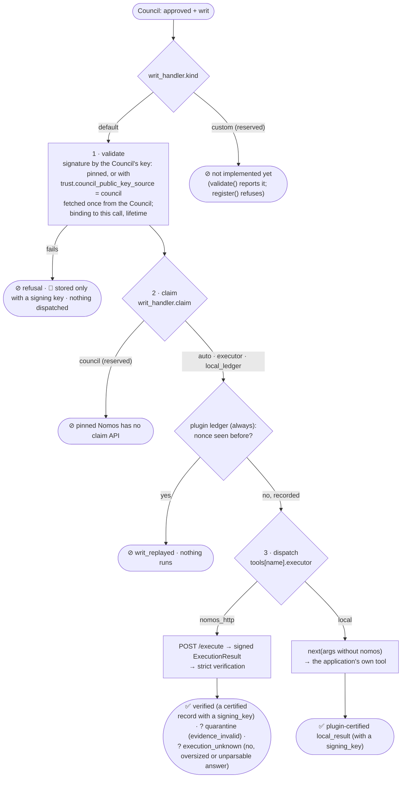

<!--
SPDX-FileCopyrightText: Copyright (c) 2026, NVIDIA CORPORATION & AFFILIATES. All rights reserved.
SPDX-License-Identifier: Apache-2.0
-->

# 6. Writ handling and executors

[← Architecture index](README.md) · previous: [Evidence and citation](05-evidence-and-citation.md)

A **writ** is the Council's signed, single-use permission for one exact operation. A legacy command writ binds a
command, agent, working directory and deadline. A structured tool-call writ binds the tool name, a server-derived
digest of its exact argument object, the host-derived subject, agent and deadline. The **writ handler**
([`writs.py`](../../nemo_relay_nomos/writs.py)) claims it (C6) and dispatches it: to the Executor
(C5) or back through Relay's chain (C3) to the app's function.



## Executors, per tool

| `tools.<name>.executor` | What runs | Evidence |
|---|---|---|
| `nomos_http` | The trusted Executor runs the authorized command; the application's function **never** runs. Needs `command_argument`, the single argument that holds the command. | ✅ certified, signed by the Executor |
| `local` (the default for unlisted guarded tools) | After approval, the plugin calls the next handler in Relay's chain, which is ultimately the application's own tool function, with `nomos` removed. | ✅ `local_result` certified by the plugin's key |

The Council authorizes, and the writ is bound to: the command argument exactly (`nomos_http`), or the structured
tool name, canonical argument digest, canonicalization identifier and subject (`local`). The handler refuses a
command writ for a local tool or a structured writ for `nomos_http`; the two contracts cannot be substituted.

## A `local` tool, end to end (🧪 offline)

`read_file`, guarded with no `tools` entry (`default_executor = "local"`): the Council request and the result:

```json
{
  "tool_call": {
    "schema_version": 1,
    "tool_name": "read_file",
    "arguments": {"path": "notes.txt"},
    "subject": "opaque-host-derived-subject"
  },
  "description": "Read a workspace file",
  "target_resource": "notes.txt",
  "certified_evidence": []
}
```

{{example local_tool.json tool_result trim=64}}

The app's own output, stored (recorded before local results were always certified: today the record also carries
the plugin's `certified_result` and `certified: true`):

{{example local_tool.json evidence_record.record keys=evidence_id,kind,arguments,content,signer,certified,writ_id trim=64}}

The `local` executor:

{{code nemo_relay_nomos/writs.py DefaultWritHandler._local}}

### 🌐 Paired Nomos support required for a `local` tool

The previous plugin rendered a local tool as a fake shell command. The pinned Nomos deployment's OPA policy then
denied that rendering before any member voted:

```text
Not run: the oversight council returned DENIED.
Reason: Denied by OPA policy: Shell commands must invoke executables by absolute path; non-absolute command word(s): read_file
Guidance: Use absolute executable paths for every shell command segment.
```

Pinned by `test_live_guarded_local_tool_gets_a_real_council_decision`. Plugin 0.5 no longer sends that rendering;
it requires the paired Nomos structured-operation change and a new live contract run ([limits](10-limits-and-open-items.md)).

## Claims

Single use, where the writ is consumed:

| Claim | Who | How | Lasts |
|---|---|---|---|
| plugin ledger (always) | the plugin | `INSERT OR IGNORE` into `writ_claims(nonce)` in its in-memory store, before any dispatch | as long as the worker |
| `executor` (nomos_http) | the Nomos Executor, in addition | `SET NX` on the writ's nonce before running; a replay is refused and signed | across restarts (Executor's Redis) |
| `council` | reserved | Nomos `council_consume_writ` exists only on an upstream branch (PA2) | — |

Real ledger rows: [the evidence store](07-storage-and-recovery.md#writ_claims-the-plugins-nonce-ledger).

{{code nemo_relay_nomos/writs.py DefaultWritHandler.handle}}

## The custom handler seam (stubbed)

Configuration reserves the fields a custom handler will need:

```json
{
  "writ_handler": {
    "kind": "custom",
    "entrypoint": "my_package.handlers:ApprovalQueueHandler",
    "options": {"queue": "ops-approvals"},
    "claim": "auto"
  }
}
```

Today `validate()` reports `custom writ handlers are not implemented yet` and `register()` refuses. The interface:

{{code nemo_relay_nomos/writs.py WritCall}}

{{code nemo_relay_nomos/writs.py WritHandler}}

`WritCall.next_` runs the app's tool; `HandlerResult` carries the response, the record (None without a signing
key) and an optional annotation.

Next: [the evidence store and recovery](07-storage-and-recovery.md).
