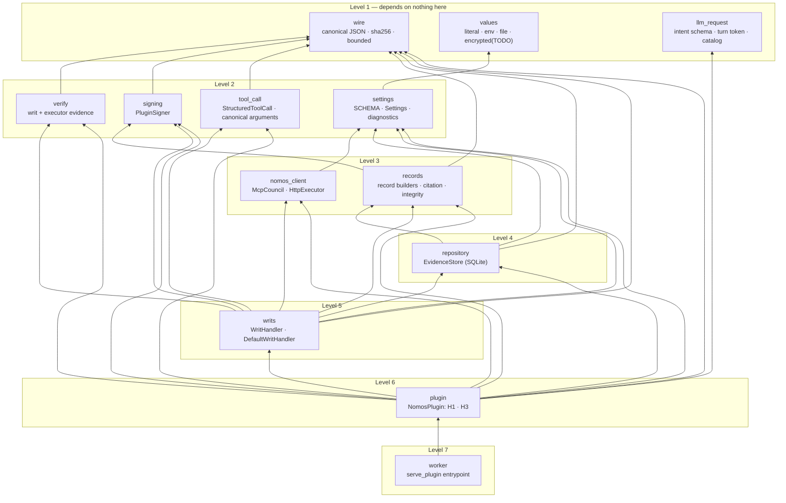

<!--
SPDX-FileCopyrightText: Copyright (c) 2026, NVIDIA CORPORATION & AFFILIATES. All rights reserved.
SPDX-License-Identifier: Apache-2.0
-->

# 8. Components

[← Architecture index](README.md) · previous: [Storage and recovery](07-storage-and-recovery.md)

The package `nemo_relay_nomos` is built as a **levelled physical design**: each module depends only on modules at
a strictly lower level, so the graph has no cycles. Every external surface has exactly one owner. The contract
both the code and the independent spec suite are held to is
[`DESIGN.md`](../../DESIGN.md).

| Module | Owns | Only it touches |
|---|---|---|
| `wire` | canonical bytes (the Nomos contract's), digests | — |
| `values` | resolving `{"env"}`, `{"file"}` references | process environment, operator secret files |
| `llm_request` | the `nomos` schema, `inject_intent`, the turn tokens and evidence ids a transcript shows, the Nomos message and its placement | — |
| `settings` | the configuration schema (source of `config.schema.json`), typed `Settings`, diagnostics | — |
| `verify` | strict checks of writs and executor evidence against pinned trust | — |
| `signing` | the plugin's Ed25519 identity | — |
| `nomos_client` | `council_authorize` over MCP, `POST /execute` over HTTP | **Nomos Council, trusted Executor** |
| `tool_call` | the structured `tool_call` a `local` tool is authorized as: canonical argument bytes and their digest | — |
| `records` | record shapes, the response envelope, citation form, integrity | — |
| `repository` | the in-memory evidence store: conversations, turns, journal, records, claims | **SQLite (`:memory:`)** |
| `writs` | writ handler interface, default handler, claims, executors | — |
| `plugin` | H1 and H3 orchestration | **Relay worker SDK** |
| `worker` | the process entrypoint | **Relay worker SDK** |

## The two hooks

{{code nemo_relay_nomos/plugin.py NomosPlugin.register}}

{{code nemo_relay_nomos/plugin.py NomosPlugin.h1}}

{{code nemo_relay_nomos/plugin.py NomosPlugin.h3}}

The guarded path, from the intent to the call's conversation:

{{code nemo_relay_nomos/plugin.py NomosPlugin._guarded}}

Then, within the conversation, from the journal to the writ handler:

{{code nemo_relay_nomos/plugin.py NomosPlugin._in_conversation}}

Next: [testing](09-testing.md).
