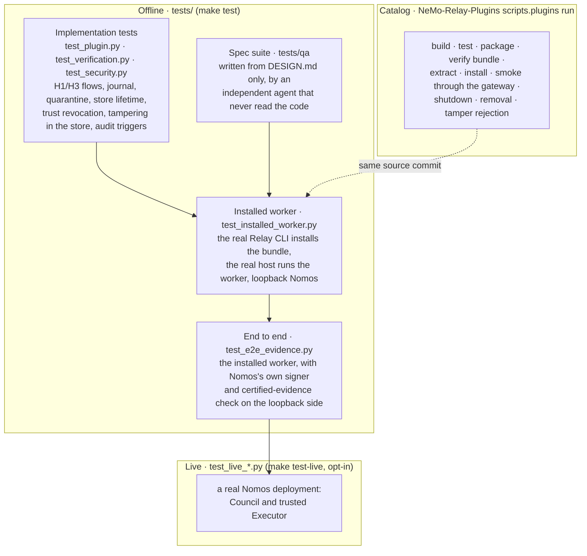

<!--
SPDX-FileCopyrightText: Copyright (c) 2026, NVIDIA CORPORATION & AFFILIATES. All rights reserved.
SPDX-License-Identifier: Apache-2.0
-->

# 9. Testing

[← Architecture index](README.md) · previous: [Components](08-components.md)

| Tier | What is real | What is simulated | Command |
|---|---|---|---|
| Implementation + spec suite | the plugin code, SQLite, Ed25519, JSON Schema | Relay's registration context, Council, Executor (in-process fakes) | `make test` |
| Installed worker | the Relay 0.11 CLI and host, the worker process and its gRPC protocol, pip install of the bundle, `plugins.toml` | Council and Executor (loopback MCP and HTTP, real wire contract, test keys) | `make test` |
| End to end (Nomos contract) | everything in the installed-worker tier, plus Nomos's own code from the enclosing Nomos (`../..`): the Executor verifies writs with `WritOfExecution` and signs with `certify_execution_result`; the Council parses and verifies every certified item with `ExecutionResult` and `ExecutionEvidence.verify()` | the Council's decision rule (approve unless `rm`) and its executor registry (the test key) | `make test` (skipped only when there is no Nomos source at `../..` and no `NOMOS_TEST_NOMOS_SOURCE`) |
| Live | the worker against a real Council and Executor | nothing on the Nomos side | `NOMOS_TEST_LIVE_CONFIG=<config> make test-live` |
| Catalog | the catalog's own build, packaging and smoke harness, at a pinned source commit | provider (fixture) | `uv run python -m scripts.plugins run nomos-plugin` |

An unchanged agent driving the plugin through Relay, the dashboard, and the cluster-level live tests live in the
integration test bed (`nomos_relay_playground`), which installs this package.

| Also | |
|---|---|
| independent spec suite | `tests/qa`, written from `DESIGN.md` by an agent that never read the code; found 5 defects and 12 spec gaps (resolved); changed only to apply spec changes |
| coverage | `make test` measures branch coverage of `nemo_relay_nomos` and fails under the floor in `pyproject.toml` |
| pre-commit | file hygiene, ruff, mypy, codespell, manifest digest = artifact, `config.schema.json` = `settings.SCHEMA`, SPDX and manifest conventions, a current `uv.lock`, rendered docs current, Markdown links resolve, no private keys |

## Certified evidence, end to end

[`test_e2e_evidence.py`](../../tests/test_e2e_evidence.py): every path through the real Relay
host; the loopback Executor signs with Nomos's `certify_execution_result`, and the loopback Council runs Nomos's own
certified-evidence check (a rejected item is an error, as in Nomos):

{{code tests/test_e2e_evidence.py nomos_rejects}}

| Path | What must hold | Test |
|---|---|---|
| Arrival | the result is verified, stored certified, and listed `certified` with its arguments, never its output | `test_an_executor_result_is_certified_on_arrival_and_listed_without_its_output` |
| Citation | the Council receives the Executor's exact result in `certified_evidence` (none of it as asserted text), and Nomos's check accepts it | `test_a_cited_certified_result_reaches_the_council_whole_and_passes_nomos_validation` |
| Several citations | each original, in the order cited, each accepted | `test_two_certified_citations_are_sent_in_order_and_both_validate` |
| Cited denial | the plugin's certified copy reaches the Council in `certified_evidence` beside the Executor's result, nothing goes as asserted, and Nomos's check accepts both once the plugin key is registered | `test_a_cited_denial_is_certified_and_passes_nomos_validation` |
| Cited denial, unregistered key | the Council's error is a closed gate; nothing runs | `test_a_cited_denial_from_an_unregistered_key_closes_the_gate` |
| Signed refusal, failed run | still certified (outcome `not_executed` or `failed`), listed, citable, accepted | `test_a_signed_refusal_or_failed_run_is_certified_and_citable` |
| Tampered output, a key outside the trust snapshot, a result bound to another writ | withheld, never listed, never sent to the Council; its conversation blocks, others carry on | `test_an_unverifiable_result_is_withheld_never_listed_and_blocks_only_its_conversation` |
| Size limit | a citation over `max_citation_bytes` is refused before the Council | `test_a_certified_citation_over_the_size_limit_is_refused_before_the_council` |
| Another conversation | its citation reads as `evidence_not_found`; the Council is not asked | `test_another_conversation_cannot_cite_a_certified_result` |
| Restart | a new worker knows neither the old turn nor the old evidence | `test_a_restarted_worker_holds_no_certified_evidence` |
| Replay | the same call returns its stored result; the Executor is not called again | `test_replaying_a_certified_call_returns_the_stored_result_without_executing_again` |
| Registry mismatch | the plugin pins a key the Council's registry lacks: the Council's error is a closed gate | `test_a_council_that_does_not_trust_the_executor_key_is_a_closed_gate` |
| No signing key | results are still verified before they are returned, never stored, never offered | `test_without_a_signing_key_results_are_verified_but_never_stored_or_offered` |
| Tool definitions | with `tool_definitions` on, the plugin-signed definitions item reaches the Council in `certified_evidence` and Nomos's check accepts it once the key is registered; nothing goes as asserted text; `context` names its digest | `test_tool_definitions_reach_the_council_certified_and_pass_nomos_validation` |
| Tool definitions, unregistered key | the Council's error is a closed gate; nothing runs | `test_tool_definitions_from_an_unregistered_key_close_the_gate` |
| Codecs | the certified catalog and the evidence field reach the model through OpenAI chat, OpenAI Responses and Anthropic Messages | `test_the_certified_catalog_reaches_the_model_through_each_relay_codec` |

**Live**, against a real Council and Executor (opt-in, `NOMOS_TEST_LIVE_CONFIG`):

| Live test | What it shows |
|---|---|
| `tests/test_live_contract.py::test_live_writs_and_results_verify_against_the_operators_trust_snapshot` | the live writ and result pass the plugin's own verifiers against the operator's pinned keys |
| `…::test_live_the_council_serves_the_key_the_operator_pinned` | `council_get_public_key` returns this Council's id and exactly the pinned key, so `council_public_key_source = "council"` trusts the same key |
| `…::test_live_the_executor_runs_a_writ_at_most_once` | a second use of one writ is refused: `Nonce already claimed (replay detected)` |
| `…::test_live_the_council_validates_certified_evidence_it_is_sent` | untouched: decided; altered output or an unregistered key: an error, never a decision. So an accepted citation means the Council validated it |
| `tests/test_live_worker.py::test_live_command_citation_denial_and_restart` | the installed worker against the live services: a command, a citation, a denial, and a restart |
| `…::test_live_without_a_signing_key_results_are_verified_but_never_stored` | no signing key: verified, nothing stored, nothing offered |

**The tests can fail.** Each of these deliberate breaks, reverted afterwards, was caught by the tests named:

- citing certified records as asserted text: the five citation tests;
- skipping the output digest check: the tampered case of the unverifiable-result test;
- citing without the conversation check: the other-conversation test.
