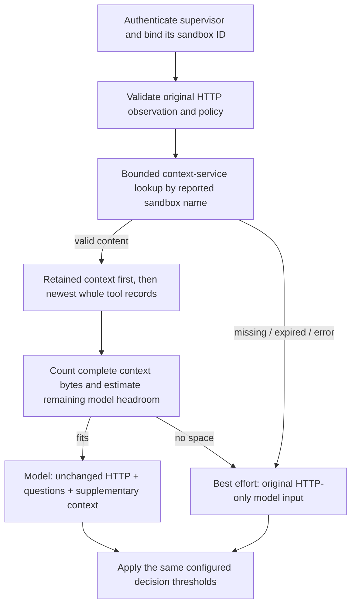

<!-- SPDX-FileCopyrightText: Copyright (c) 2026 NVIDIA CORPORATION & AFFILIATES. All rights reserved. -->
<!-- SPDX-License-Identifier: Apache-2.0 -->

# Add retained conversation and tool context to HTTP review

Context lookup is an optional addition to the existing HTTP assessment. The
[Relay publisher](https://github.com/NVIDIA-dev/nomos-plugins/pull/32) copies its
existing bounded user context and governed tool/Council events to the
[standalone context service](https://github.com/NVIDIA/Nomos/pull/140). This
OpenShell reader retrieves them by the sandbox name reported by a verified
supervisor. It does not replace Council authorization or OpenShell network policy.

The default is **disabled**. Existing HTTP-only lab configurations keep working.
Enabling lookup requires native gRPC TLS and verified OpenShell extension JWTs;
`--allow-insecure-lab` cannot bypass those requirements.



## What goes to the model

The HTTP observation keeps its original `body`, method, destination and other
fields. The model receives an additional nested `state.conversation_context`
object only when usable context fits. For example, the new field can contain:

```json
{
  "retained_context": {
    "latest_user_request": "Publish the fictional community workshop announcement.",
    "user_request_truncated": false
  },
  "recent_tool_records": [{
    "record_id": "event-example",
    "snapshot_id": "snapshot-example",
    "tool_call_id": "provider-call-B",
    "tool_name": "terminal",
    "state": "denied",
    "arguments": {"command": "curl https://example.com"},
    "arguments_incomplete": false,
    "council_review": {
      "status": "denied",
      "decision_id": "intent-example",
      "guidance": ["Remove credentials before uploading."],
      "guidance_truncated": false
    }
  }],
  "returned_tool_records": 3,
  "omitted_returned_records": 2,
  "source_tool_records_truncated": false,
  "context_incomplete": true,
  "publication_completeness": "not_attested",
  "association": "name_based_pilot",
  "content_trust": "agent_reported_workload_mutable",
  "capture_coverage": "managed_relay_calls_only",
  "exact_tool_call_id_for_http_request": null
}
```

This is an illustrative projection, not the entire lookup response. The actual
object also includes the snapshot reference and expiry. IDs do not prove that a
particular tool caused the HTTP request. A reported Council approval is not
permission to bypass the HTTP policy; all captured instructions and guidance
remain untrusted data. Retained context is the existing bounded H1 record, not
full conversation history.

## The budgeting algorithm

1. Build the original HTTP observation and the **exact question JSON used by the
   provider**. Never truncate either to make room for supplementary context.
2. Start a context object with the retained user context, provenance, expiry and
   omission indicators. All of that overhead counts toward the budget.
3. Check the current snapshot's expiry again, then consider returned tool events
   newest first. Each event must have a live parent deadline. The service returns
   `tool_record_expires_at` for individual events, including earlier parents.
   Older events without that metadata are omitted; their expiry is never assumed
   to match the latest snapshot.
4. Add whole records while the complete serialized context stays within
   **32 KiB** and the model-headroom estimate permits it. Stop at the first record
   that will not fit. Do not skip a large completion event to include its older
   pending event, or slice an argument string/JSON object.
5. Report exactly how many **returned** records were omitted. Preserve the
   service's upstream truncation flag separately: it does not reveal how many
   additional records exist. `arguments_incomplete`, legacy unknown values and
   truncated Council guidance contribute to `context_incomplete`.
6. If even the retained-context envelope cannot fit, `best_effort` omits it and
   performs the unchanged HTTP-only assessment. `required` instead reports an
   assessment failure.

`context_incomplete: false` means no omissions were identified in this selected
view. It does not attest that the publisher captured every call: publication
fails open and may lose events. `publication_completeness: not_attested` therefore
always remains present.

### Bytes are not tokens

The 32 KiB context cap is exact. There is no verified tokenizer for the configured
endpoint in this integration. For allocating supplementary context, the reader
uses a deliberately conservative estimate of **one unit per serialized UTF-8
byte**, including JSON and question wrappers, with a default 2,048-unit reserve.
This is not a guarantee that the provider accepts the request.

Defaults reflect [Jev's standard limits](https://docs.typesafe.ai/models#context-length):
32,000 tokens for state plus any one question, and 64,000 for state plus all
questions. Both estimates must fit. Configure different windows for another
model; the reader does not guess from aliases. The flags are:

| Flag | Default |
| --- | --- |
| `--context-model-per-question-tokens` | 32000 |
| `--context-model-per-request-tokens` | 64000 |
| `--context-model-safety-margin-tokens` | 2048 |

This estimate can omit context for a large English request that Jev would
actually accept. It **never rejects or modifies the HTTP-only base** merely
because that estimate is high. The provider remains authoritative.

If an enriched assessment returns an explicit input-size/token-limit error,
`best_effort` permits **one HTTP-only reassessment** within the same overall
evaluation deadline. A valid denial, generic provider error, required-mode
failure or already HTTP-only size rejection never triggers this fallback.

## Configure authenticated lookup

Prepare these files through the deployment's supported secret/certificate
mechanism:

- A **public gateway JWKS**, obtained from the operator over a trusted path. This
  implementation pins it at startup; refresh the file and restart after key
  rotation. It does not discover a key from an incoming JWT.
- The exact gateway ID and registered extension audience.
- The middleware server certificate/private key, valid for the registered host.
- A **reader** context-service token, distinct from the Relay publisher token.
- Optional private CA certificates for each HTTPS connection as required.

Example additions to the otherwise configured service launch (model settings
remain described in [configuration](configuration.md#process-settings)):

```sh
cargo run --locked --bin nomos-request-review -- \
  --bind 0.0.0.0:50051 \
  --model-endpoint https://decision.example.com/v1/systemone \
  --model-id YOUR_MODEL_ID \
  --tls-cert-file /run/certificates/middleware.pem \
  --tls-key-file /run/secrets/middleware-key.pem \
  --extension-jwks-file /run/certificates/gateway-jwks.json \
  --extension-gateway-id YOUR_GATEWAY_ID \
  --extension-audience urn:openshell:extension:middleware:nomos-request-review \
  --context-lookup-mode best_effort \
  --context-service-url https://context.example.com \
  --context-service-token-file /run/secrets/nomos-context-reader/token \
  --context-allowed-workspace default
```

Use the actual workspace value reported by the deployed supervisor. Repeat the
workspace flag for additional explicitly permitted values. The supervisor JWT's
sandbox ID must match the evaluation request; only then is its reported name
used for lookup. Name-based association remains a trusted-client pilot, not
cryptographic proof of conversation ownership or tenant isolation. Use fresh
names across every gateway/workspace sharing the service.

The context lookup request sends `sandbox_name` as the lookup key and
`sandbox_id` as audit metadata. The context service does not use `sandbox_id`
to select context or establish ownership; the middleware has already verified
that ID against the supervisor JWT before making the lookup.

Register the HTTPS listener with OpenShell, for example:

```toml
[[openshell.supervisor.middleware]]
name = "nomos-request-review"
grpc_endpoint = "https://middleware.example.com:50051"
audience = "urn:openshell:extension:middleware:nomos-request-review"
tls_ca_cert_path = "/path/on/openshell-host/middleware-ca.pem"
max_payload_bytes = 262144
timeout = "5s"
```

The gateway must have extension JWT signing configured. OpenShell verifies the
middleware certificate/hostname; `tls_ca_cert_path` is its trust anchor for a
private CA, not the context-service CA. The service verifies `EdDSA`, JWT type
`openshell-ext+jwt`, issuer `openshell-gateway:<id>`, exact audience, signature,
lifetime, caller kind and sandbox binding. Both gateway and supervisor profiles
can perform discovery/configuration, as upstream supervisors also load the
middleware registry. HTTP evaluation requires the supervisor profile. Cached
JWTs may be reused; `jti` is not treated as a one-use nonce. See
[OpenShell's extension contract](https://github.com/NVIDIA/OpenShell/blob/main/docs/extensibility/overview.mdx#authenticating-extensions).

To trust a private context-service CA, add
`--context-ca-cert-file /run/certificates/context-ca.pem`. Peer and hostname
verification remain enabled. For isolated **loopback context HTTP only**, use
`--allow-http-context`; this never relaxes inbound gRPC TLS/JWT requirements.
Context tokens and raw responses are excluded from diagnostics. There are no
redirects, HTTP retries or environment-selected proxies.

## Modes and deadlines

| Mode | Behavior |
| --- | --- |
| `disabled` | Default. No reader initialization, context file reads or lookup. Existing HTTP-only behavior. |
| `audit` | Fetch references/metadata and log the result. Never add conversation content to model input; lookup failures do not stop HTTP review. |
| `best_effort` | Include valid budgeted content; missing, expired, unavailable or over-budget context falls back to HTTP-only review. |
| `required` | Require fresh usable context. Missing context or no budget causes assessment failure; configure OpenShell `on_error: fail_closed`. |

The default lookup deadline is **250 ms**. It must be shorter than the remaining
space between model and evaluation deadlines (defaults 4 s and 4.5 s). Lookup,
budgeting and any HTTP-only reassessment all remain inside the same outer
evaluation deadline; fallback is not a way to extend OpenShell's RPC timeout.
The independent receive cap is 512 KiB before JSON parsing, allowing returned
records to be selected under the smaller 32 KiB model-context cap.

Wrong/missing supervisor authentication and disallowed workspaces are always
rejected. They are not best-effort context failures. Invalid local settings fail
startup. These opt-ins do not change Relay's independent fail-open publication
behavior, original request/body limits, Council decisions or model thresholds.

## Validation

```sh
cargo test --locked
cargo clippy --locked --all-targets -- -D warnings
cargo fmt --check
```

`tests/context_review.rs` exercises real context HTTP plus service authentication
and model-boundary behavior. Unit suites cover strict JWT/JWKS profiles, expiry,
whole-record packing, UTF-8/escaping and exact byte boundaries. The existing lab
and model-quality benchmarks are not rerun by these transport tests.
